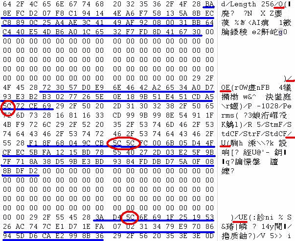

# Adobe Acrobat 9 Pro“用户口令”加密原理分析

> 原文：[`www.pediy.com/kssd/pediy11/125363.html`](https://www.pediy.com/kssd/pediy11/125363.html)

                    
                   Adobe Acrobat 9 Pro“用户口令”加密原理分析   
  
                           天易 love      2010-11-23  
  
    网上能搜到的关于 pdf 文件加密原理的文章很少，即使有也只是 9.0 版本以前的加密分析，由于现在大多数 pdf 口令破解工具对 9.0 以上版本加密的文件束手无策，所以这次仅对 9.0 版本以上的用户口令（文件打开口令）的加密简单讲一下原理，由于分析时间很短，如有错误敬请指正。  
用户口令的概念，当你在 Adobe Acrobat 9 Pro 的“安全”菜单中选择“使用口令加密”，并在”兼容性”下拉列表框中选择“Acrobat 9.0 和更高版本”，然后设置打开文件的口令，此时你设置的就是用户口令，以后如果你忘记了这个口令，你将无法打开该文件。通过以下的加密原理分析，你将会明白为什么只有穷举的办法才能破解，从而对 pdf 文件加密的安全性有一个更深刻的认识。一些有关 pdf 文件格式的内容你可以参考网上相关资料，在此不再赘述。  
     9.0 以上版本加密的算法大致有：sha256、类 aes 算法；涉及 Pdf 文件格式中有关标记有/U、/UE、/O、/OE，这些标记具体叫什么名字我觉得与加密原理关系不大。  
  
    为了表述方便，我定义了一些符号:  
encodeOfFakeAes();decodeOfFakeAes();sha256();key\_expand();keyarrays\_handle();  
1st8BytesOfLastline\_Of\_U;  
2nd8BytesOfLastline\_Of\_U;  
1stTwolinesOf\_U;  
1st8BytesOfLastline\_Of\_O;  
2nd8BytesOfLastline\_Of\_O;  
1stTwolinesOf\_O;  
32BytesOf\_UE;  
32BytesOf\_OE;  
keyOriginal; (32 字节)  
keyarrays;(256 字节)  
decryptkeyarrays;(256 字节)  
globalkeyOriginal; (32 字节)  
decrypGlobaltkeyarrays;(256 字节)  
   这里 each line 表示 16 字节，/U 和/O 都是 3 行、/UE、/OE 都是 2 行，如有多出来几个字节，那是因为其中存在字节$5c 的缘故,解密过程中不起作用。  
 decodeOfFakeAes (32BytesOf\_OE)=decodeOfFakeAes (32BytesOf\_UE) (条件 1)  
 sha256(password+1st8BytesOfLastline\_Of\_U)= 1stTwolinesOf\_U;  (条件 2)  
sha256(passwword+1st8BytesOfLastline\_Of\_O+U)=1stTwolinesOf\_O  (条件 3)  
  
  keyOriginal =sha256(password+2nd8BytesOfLastline\_Of\_U);     
keyarrays=key\_expand(keyOriginal);扩展成$100 字节(256 字节即 16 进制编译器中显示 16 lines，每行 16 字节);  
decryptkeyarrays=keyarrays\_handle(keyarrays);将刚才扩展生成的 keyarrays 再处理一下生成最终 decodeOfFakeAes()函数解密需要的密钥数组 decryptkeyarrays.  
  globalkeyOriginal= decodeOfFakeAes (32BytesOf\_OE)  
或 globalkeyOriginal= decodeOfFakeAes (32BytesOf\_UE)  
这个 globalkeyOriginal 经过 key\_expand()和 keyarrays\_handle();两次函数处理后得到的 decrypGlobaltkeyarrays 是用来解密文件内其他对象时用到的密钥数组，解密其他对象时都是用这个 decrypGlobaltkeyarrays，唯一不同的是每次文件内待解密对象数据的首字节位置之前的 16 个字节，这是作为 decodeOfFakeAes()函数的初始异或值，由于 decodeOfFakeAes()每轮解密得到 16 字节还要与上一轮的密文异或才是最终的明文而首轮异或的对象就是这 16 个字节。  
   
      
   
 举个例子说明一下如上图,从中我们可以提取出:  
/U:  
F1 8F 68 04 9C CB 5C FC 00 6B 05 D4 4F CF EC 5B  
FA 12 15 BD 78 55 40 27 2D 03 E2 5F 9B 7F 71 8A  
38 D5 9B E3 BD 93 84 FD DB D7 5A 0F 08 8B DF D2                                   
/UE:  
3A D4 6E 69 1F 25 19 53 26 AC 74 7C E1 D7 1E FA  
07 02 31 34 79 E9 70 86 94 5D D6 CA E2 99 8B 36  
/O:  
BA 8E FC D2 07 F8 C1 94 14 4E A6 F7 58 13 5A 8B  
EC C8 89 0C 25 A4 AE 3C 41 49 AF 92 08 00 31 BB  
64 C4 40 E5 4D B6 A0 1C 65 32 F7 FD 8D 41 67 30  
/OE:  
72 30 57 D0 E9 6E 46 42 A2 65 34 A0 D7 93 E3 B2  
B3 02 77 26 5E 0E 18 9B 51 E4 51 CD A5 72 CE 69  
注：该文件打开口令 password 是 aaa 即 16 进制 616161  
首先验证 sha256(passwword+1st8BytesOfLastline\_Of\_U)= 1stTwolinesOf\_U;   
显然：Sha256(61616138D59BE3BD9384FD)的值是：  
f18f68049ccb5cfc006b05d44fcfec5bfa1215bd785540272d03e25f9b7f718a  
其次验证：  
sha256(passwword+1st8BytesOfLastline\_Of\_O+U)= 1stTwolinesOf\_O;  
即对 16 进制串：616161+64C440E54DB6A01C+ F1 8F 68 04 9C CB 5C FC 00 6B 05 D4 4F CF EC 5B FA 12 15 BD 78 55 40 27 2D 03 E2 5F 9B 7F 71 8A  
38 D5 9B E3 BD 93 84 FD DB D7 5A 0F 08 8B DF D2 求 sha256  
显然值为：  
ba8efcd207f8c194144ea6f758135a8becc8890c25a4ae3c4149af92080031bb  
最后验证 decodeOfFakeAes (32BytesOf\_OE)=decodeOfFakeAes (32BytesOf\_UE)：  
先用公式 sha256(password+2nd8BytesOfLastline\_Of\_U) 求 keyOriginal  
Sha256(616161+ DB D7 5A 0F 08 8B DF D2)=  
7224c3692572ba7640c517567619d161e6e160621d1aef3b5f8a8259d13ffb3c  
 所以 keyOriginal 就是：  
7224c3692572ba7640c517567619d161e6e160621d1aef3b5f8a8259d13ffb3c  
接着用 key\_expand(keyOriginal)扩展密钥得到 keyarrays；  
  
扩展后变为 256 字节：  
04865620  0E 00 00 00 08 00 00 00 00 00 00 00 00 00 00 00    
04865630  72 24 C3 69 25 72 BA 76 40 C5 17 56 76 19 D1 61 //这 2 行就是 keyOriginal  
04865640  E6 E1 60 62 1D 1A EF 3B 5F 8A 82 59 D1 3F FB 3C    
04865650  06 2B 28 57 23 59 92 21 63 9C 85 77 15 85 54 16    
04865660  BF 76 40 25 A2 6C AF 1E FD E6 2D 47 2C D9 D6 7B     
04865670  31 DD 09 26 12 84 9B 07 71 18 1E 70 64 9D 4A 66    
04865680  FC 28 96 16 5E 44 39 08 A3 A2 14 4F 8F 7B C2 34    
04865690  14 F8 11 55 06 7C 8A 52 77 64 94 22 13 F9 DE 44     
048656A0  81 B1 8B 0D DF F5 B2 05 7C 57 A6 4A F3 2C 64 7E    
048656B0  6D BB E2 58 6B C7 68 0A 1C A3 FC 28 0F 5A 22 6C    
048656C0  F7 0F 18 5D 28 FA AA 58 54 AD 0C 12 A7 81 68 6C     
048656D0  71 FE B2 04 1A 39 DA 0E 06 9A 26 26 09 C0 04 4A     
048656E0  F6 B5 EA 8B DE 4F 40 D3 8A E2 4C C1 2D 63 24 AD    
048656F0  AA C8 27 DC B0 F1 FD D2 B6 6B DB F4 BF AB DF BE    
04865700  FE D7 74 25 20 98 34 F6 AA 7A 78 37 87 19 5C 9A     
04865710  3E 82 9F CB 8E 73 62 19 38 18 B9 ED 87 B3 66 53     
  
     然后用 keyarrays\_handle(keyarrays)求 decryptkeyarrays 这个就是 decodeOfFakeAes()最终解密时用的 key 矩阵了，具体步骤是先利用如下伪代码对除第一、二、最后一行外的所有双字依次进行处理，而后第 2 行与最后一行、第 3 行与倒数第 2 行互换，依次类，这样得到了 key 矩阵就可以进行解密运算了。  
  t1 = 2 \* \*(\_DWORD \*)p & 0xFEFEFEFE ^ ((\*(\_DWORD \*)p & 0x80808080) - ((\*(\_DWORD \*)p & 0x80808080u) >> 7)) & 0x1B1B1B1B;  
      t2 = 2 \* t1 & 0xFEFEFEFE ^ ((t1 & 0x80808080) - ((t1 & 0x80808080) >> 7)) & 0x1B1B1B1B;  
      t3 = 2 \* t2 & 0xFEFEFEFE ^ ((t2 & 0x80808080) - ((t2 & 0x80808080) >> 7)) & 0x1B1B1B1B;  
      t4 = \*(\_DWORD \*)p ^ t3;  
      t5 = rol(t2 ^ t4, 16);  
      t6 = rol(t1 ^ t4, 8);  
      t4 = rol(t4, 8);  
      \*(\_DWORD \*)p = t1 ^ t2 ^ t3 ^ t4 ^ t6 ^ t5;  
最终的密钥矩阵：  
04992EC0  0E 00 00 00 08 00 00 00 00 00 00 00 00 00 00 00     
04992ED0  3E 82 9F CB 8E 73 62 19 38 18 B9 ED 87 B3 66 53     
04992EE0  27 FA 5D F8 9C FF 7C 65 7F 5A 88 32 4F 07 24 34     
04992EF0  51 60 F5 5D 2E 56 BF A9 9B 79 09 19 FC E7 76 18     
04992F00  29 DA 71 A0 BB 05 21 9D E3 A5 F4 57 30 5D AC 06     
04992F10  BF 49 0E C1 7F 36 4A F4 B5 2F B6 B0 67 9E 7F 01    
04992F20  AF 50 21 63 92 DF 50 3D 58 A0 D5 CA D3 F8 58 51    
04992F30  F1 89 A6 B2 C0 7F 44 35 CA 19 FC 44 D2 B1 C9 B1     
04992F40  B8 72 C5 B9 3D 8F 71 5E CA 7F 85 F7 8B 58 8D 9B     
04992F50  5C 2C 12 CA 31 F6 E2 87 0A 66 B8 71 18 A8 35 F5     
04992F60  3E 75 FC E3 85 FD B4 E7 F7 F0 F4 A9 41 27 08 6C     
04992F70  93 2E 36 48 6D DA F0 4D 3B 90 5A F6 12 CE 8D 84     
04992F80  5C F6 E0 E6 BB 88 48 04 72 0D 40 4E B6 D7 FC C5     
04992F90  10 32 9A EA FE F4 C6 05 56 4A AA BB 29 5E D7 72     
04992FA0  EB EF 67 66 E7 7E A8 E2 C9 85 08 4A C4 DA BC 8B     
04992FB0  72 24 C3 69 25 72 BA 76 40 C5 17 56 76 19 D1 61  
利用此 key，对 32BytesOf\_OE 进行解密得到 globalkeyOriginal；  
decodeOfFakeAes (32BytesOf\_OE)的返回值 globalkeyOriginal 是：  
 DA 2D 99 D0 57 8F 19 73 06 44 AB 1B DA 19 55 F3     
47 94 11 0F 6E D2 FE D4 2F 8A 44 26 67 AA A3 55    
同样 decodeOfFakeAes (32BytesOf\_UE)的结果也是：  
DA 2D 99 D0 57 8F 19 73 06 44 AB 1B DA 19 55 F3     
47 94 11 0F 6E D2 FE D4 2F 8A 44 26 67 AA A3 55  
条件 1 最终成立，这个解密的结果 globalkeyOriginal 通过类似上面的方法扩展成 256 字节后就可以用来解密其他加密对象了。  
这个所谓的 aes 虽然是 256 位密钥，但是解密的分组却是 128bit，而且是优化过的，扩展后所谓的 Nb 也不符合规定，所有函数实现代码都在 ccme\_base.dll 内。  
转帖请注明原创于看雪论坛，谢谢！