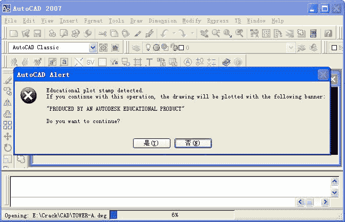
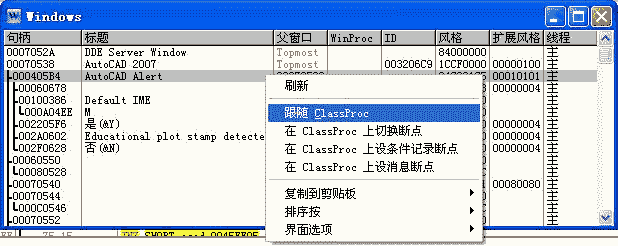
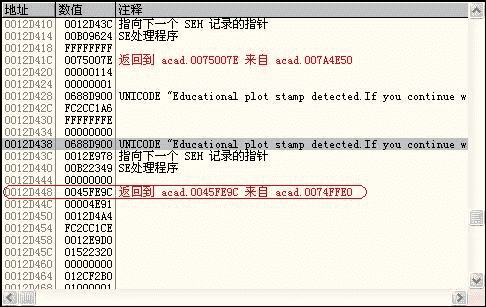
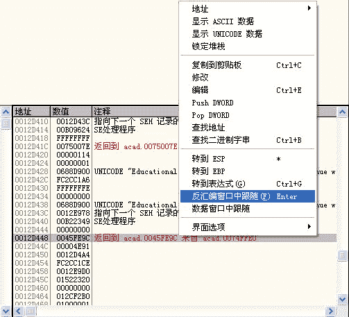
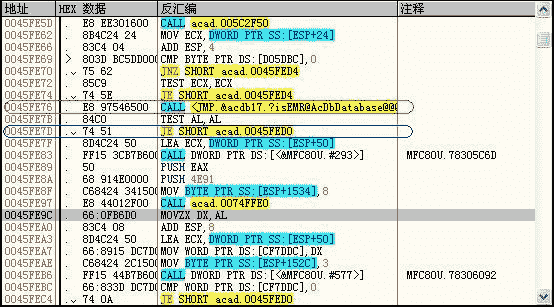

# AutoCAD 教育版打印戳记破解日记

> 原文：[`www.pediy.com/kssd/pediy11/112890.html`](https://www.pediy.com/kssd/pediy11/112890.html)

  
　　经常用 AutoCAD 的朋友可能遇到过“AutoCAD 教育版打印戳记”的问题，虽然不会有大的影响，频繁出现的警告窗口和出图时加上的戳记，还是让人有些烦。网上有很多有关“去除 AutoCAD 教育版打印戳记”的网页，其原理基本上都是通过转换为 DXF 格式，再转换为 DWG 文件而实现的。  
　　通过跟踪 AutoCAD 的运行，找到直接破解的方法。破解的过程如下（以 WinXP、AutoCAD2007 英文版为例）：  
　　1、打开一个带有“教育版打印戳记”的 DWG 文件，AutoCAD 会出现教育版的警告窗口（如图一所示）。此时，不要先作出任何选择。  
  
　　2、打开 Ollydbg，“附加”到 AutoCAD，然后“查看\\窗口”中打到“AutoCAD Alert”，在右键菜单中选择“跟随 ClassProc”（如图二所示）。  
  
　　3、在“堆栈”窗口中，从底部往上查找到第一个“Educational plot stamp detected...”（即警告窗口中的内容，如图三所示），并由此找到调用显示警告窗口的函数（此处需返回的地址即为调用函数的下一行）。  
  
　　4、在“反汇编窗口中跟随”此函数（如图四所示），可看到反汇编结果（如图五所示）。  
  
  
  
　　　0045FE76  |.  E8 97546500   CALL <JMP.&acdb17.?isEMR@AcDbDatabase@@QBE\_NXZ>  
　　　0045FE7B  |.  84C0          TEST AL,AL  
　　　0045FE7D  |.  74 51         JE SHORT acad.0045FED0  
　　　0045FE7F  |.  8D4C24 50     LEA ECX,DWORD PTR SS:\[ESP+50\]  
　　　0045FE83  |.  FF15 3CB7B600 CALL DWORD PTR DS:\[<&MFC80U.#293>\]                 ;  MFC80U.78305C6D  
　　　0045FE89  |.  50            PUSH EAX  
　　　0045FE8A  |.  68 914E0000   PUSH 4E91  
　　　0045FE8F  |.  C68424 341500>MOV BYTE PTR SS:\[ESP+1534\],8  
　　　0045FE97  |.  E8 44012F00   CALL acad.0074FFE0  
　　　0045FE9C  |.  66:0FB6D0     MOVZX DX,AL  
　　5、由 0045FE9C 向前查看，在 0045FE7D 处找到第一个条件跳转指令，测试指令前刚好有一个 CALL 指令。于是，大胆推测 acdb17.?isEMR@AcDbDatabase@@QBE\_NXZ（简记为 isEMR）就是判断 DWG 文件中是否含有“教育版打印戳记”的函数。  
　　6、先分析一下这段代码，由 TEST 和 JE 指令可知，函数 isEMR 的返回值存放在 AL 中，AL＝0 则跳转，不显示警告窗口（即无打印戳记）；AL≠0 则显示警告窗口（即有打印戳记）。  
　　7、“跟随”进入函数 isEMR，代码如下：  
　　　64567730 >  8B41 04         MOV EAX,DWORD PTR DS:\[ECX+4\]  
　　　64567733    33C9            XOR ECX,ECX  
　　　64567735    3988 DC070000   CMP DWORD PTR DS:\[EAX+7DC\],ECX  
　　　6456773B    0F95C1          SETNE CL  
　　　6456773E    8AC1            MOV AL,CL  
　　　64567740    C3              RETN  
　　8、由 CMP 指令可知，\[EAX+7DC\]的值是否为 0，代表了文件中是否有打印戳记。为了验证上面的猜想，下面将进行一些测试。  
　　9、由于 AutoCAD 已运行至显示警告窗口，需要在 Ollydbg 中重新载入 AutoCAD。为了对比，先在 Ollydbg 中直接运行，注意其结果；然后再重新载入 AutoCAD，在“可执行模块\\acdb17.dll”中定位至地址 6456773E 处，将“MOV AL,CL”改为“MOV AL,1”后运行。比较两次运行的结果：第一次运行时，AutoCAD 新建一个未命名的 DWG 文件，没有弹出教育版的警告窗口；第二次运行时，多了教育版的警告窗口（如图一所示）。由此可见，上面的猜测得到了部分的验证。  
　　10、为什么是部分验证呢？因为刚才的测试，只是通过修改函数 isEMR，将全部 DWG 文件（无论有还是没有打印戳记）都认为是有打印戳记的。而我们的目标确刚好相反，那么将“MOV AL,CL”改为“MOV AL,0”后再试一试呢？结果程序在打开文件的过程中就发生异常了，什么原因？由于我也是菜鸟，不知道！望有高手指点！有兴趣的朋友可以来共同探讨这个问题！