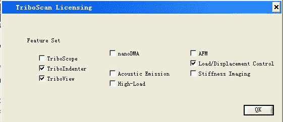

# Hysitron 控制程序的功能限制解除分析

> 原文：[`www.pediy.com/kssd/pediy11/105454.html`](https://www.pediy.com/kssd/pediy11/105454.html)

\[文标题 \] Hysitron 控制程序的功能限制解除分析  
\[作者 \] HailDuz  
\[ 作者邮箱 \] hailduz@hotmail.com  
\[解工具 \] Ollydbg 1.1 汉化版，RegMon  
\[解平台 \] WinXp  
\[ 软件名称 \] Hysitron Triboscan   
\[ 原版下载 \] 仪器配备。  
\[ 保护方式 \] 注册表存储注册信息，算法加密。  
\[ 软件简介 \] 美国 Hysitron 公司纳米压痕类仪器控制软件，有软件加密，限制功能使用。  
\[解声明 \] 由于单位经费原因，对本软件模块使用功能限制修改。本文纯技术交流，转载请保持完整。  
  
  
前言：本软件使用了美国国家仪器的硬件（AD 卡等），采用 Labview 进行编程。程序没有加壳，运行后发现有如图所示的 9 项功能：  
   
图中 Load/Displacement Control 功能一项就需要 2 万美金（有点贵）。  
运行一下，发现有对工作目录下的 LicenseChk.exe 调用，并进行了注册表的读写。  
读写内容在:HKEY\_LOCAL\_MACHINE\\SOFTWARE\\Hysitron\\License  
  
分析 LicenseChk.exe，OD 载入，单步运行到此，信息提示满充分（May I see yure License fur yure Minkey...），下面函数为计算注册信息模块。  
/////////////////////////////////////////////////////////////////////////////////////////////////  
00401000  /$  81EC E4020000 SUB ESP,2E4  
00401006  |.  68 D4724100   PUSH LicenseC.004172D4                              ;  ASCII "May I see yure License fur yure Minkey..."  
0040100B  |.  E8 E5180000   CALL LicenseC.004028F5  
00401010  |.  83C4 04       ADD ESP,4  
00401013  |.  E8 480B0000   CALL LicenseC.00401B60                             //验证部分，后续分析  
00401018  |.  85C0          TEST EAX,EAX  
0040101A  |.  75 27         JNZ SHORT LicenseC.00401043                        //验证码有效，返回值为 1，后续解开对应软件限制  
0040101C  |.  68 98724100   PUSH LicenseC.00417298                              ;  ASCII "Cannot unlock Hysitron Software: license data base altered"  
00401021  |.  E8 CF180000   CALL LicenseC.004028F5  
00401026  |.  83C4 04       ADD ESP,4  
00401029  |.  6A 00         PUSH 0                                              ; /Arg3 = 00000000  
0040102B  |.  6A 00         PUSH 0                                              ; |Arg2 = 00000000  
0040102D  |.  68 98724100   PUSH LicenseC.00417298                              ; |Arg1 = 00417298 ASCII "Cannot unlock Hysitron Software: license data base altered"  
00401032  |.  E8 E0090100   CALL LicenseC.00411A17                              ; \\LicenseC.00411A17  
00401037  |.  B8 F8FFFFFF   MOV EAX,-8  
0040103C  |.  81C4 E4020000 ADD ESP,2E4  
00401042  |.  C3            RETN  
00401043  |>  8D4424 64     LEA EAX,DWORD PTR SS:\[ESP+64\]  
00401047  |.  50            PUSH EAX  
00401048  |.  E8 B30A0000   CALL LicenseC.00401B00  
0040104D  |.  8D4C24 28     LEA ECX,DWORD PTR SS:\[ESP+28\]  
00401051  |.  6A 40         PUSH 40  
00401053  |.  51            PUSH ECX  
00401054  |.  E8 67030000   CALL LicenseC.004013C0  
00401059  |.  8D9424 700100>LEA EDX,DWORD PTR SS:\[ESP+170\]  
00401060  |.  8D4424 30     LEA EAX,DWORD PTR SS:\[ESP+30\]  
00401064  |.  52            PUSH EDX  
00401065  |.  8D4C24 74     LEA ECX,DWORD PTR SS:\[ESP+74\]  
00401069  |.  50            PUSH EAX  
0040106A  |.  51            PUSH ECX  
0040106B  |.  E8 E00C0000   CALL LicenseC.00401D50                             //计算对应的功能解码。后续分析  
00401070  |.  83C4 18       ADD ESP,18  
00401073  |.  85C0          TEST EAX,EAX  
00401075  |.  75 27         JNZ SHORT LicenseC.0040109E                        //返回值应为 1，否则失败。  
00401077  |.  68 4C724100   PUSH LicenseC.0041724C                              ;  ASCII "Cannot unlock Hysitron Software: machine config changed or license altered"  
0040107C  |.  E8 74180000   CALL LicenseC.004028F5  
00401081  |.  83C4 04       ADD ESP,4  
00401084  |.  6A 00         PUSH 0                                              ; /Arg3 = 00000000  
00401086  |.  6A 00         PUSH 0                                              ; |Arg2 = 00000000  
00401088  |.  68 F0714100   PUSH LicenseC.004171F0                              ; |Arg1 = 004171F0 ASCII "Cannot unlock Hysitron Software: decoding failed..machine config changed or license altered"  
0040108D  |.  E8 85090100   CALL LicenseC.00411A17                              ; \\LicenseC.00411A17  
00401092  |.  B8 F7FFFFFF   MOV EAX,-9  
00401097  |.  81C4 E4020000 ADD ESP,2E4  
0040109D  |.  C3            RETN  
0040109E  |>  8D5424 18     LEA EDX,DWORD PTR SS:\[ESP+18\]  
004010A2  |.  8D4424 20     LEA EAX,DWORD PTR SS:\[ESP+20\]  
004010A6  |.  52            PUSH EDX  
004010A7  |.  8D4C24 20     LEA ECX,DWORD PTR SS:\[ESP+20\]  
004010AB  |.  50            PUSH EAX  
004010AC  |.  8D5424 0C     LEA EDX,DWORD PTR SS:\[ESP+C\]  
004010B0  |.  51            PUSH ECX  
004010B1  |.  8D4424 14     LEA EAX,DWORD PTR SS:\[ESP+14\]  
004010B5  |.  52            PUSH EDX  
004010B6  |.  8D4C24 1C     LEA ECX,DWORD PTR SS:\[ESP+1C\]  
004010BA  |.  50            PUSH EAX  
004010BB  |.  8D5424 28     LEA EDX,DWORD PTR SS:\[ESP+28\]  
004010BF  |.  51            PUSH ECX  
004010C0  |.  8D4424 18     LEA EAX,DWORD PTR SS:\[ESP+18\]  
004010C4  |.  52            PUSH EDX  
004010C5  |.  8D4C24 2C     LEA ECX,DWORD PTR SS:\[ESP+2C\]  
004010C9  |.  50            PUSH EAX  
004010CA  |.  51            PUSH ECX  
004010CB  |.  8D9424 880100>LEA EDX,DWORD PTR SS:\[ESP+188\]  
004010D2  |.  6A 40         PUSH 40  
004010D4  |.  52            PUSH EDX  
004010D5  |.  E8 360F0000   CALL LicenseC.00402010                              //此处计算注册日期是否过期，功能解码串第一位不为 0 即可.  
004010DA  |.  83C4 2C       ADD ESP,2C  
004010DD  |.  85C0          TEST EAX,EAX  
004010DF  |.  75 27         JNZ SHORT LicenseC.00401108                           
004010E1  |.  68 C0714100   PUSH LicenseC.004171C0                              ;  ASCII "Cannot unlock Hysitron Software: Decoding bad"  
004010E6  |.  E8 0A180000   CALL LicenseC.004028F5  
004010EB  |.  83C4 04       ADD ESP,4  
004010EE  |.  6A 00         PUSH 0                                              ; /Arg3 = 00000000  
004010F0  |.  6A 00         PUSH 0                                              ; |Arg2 = 00000000  
004010F2  |.  68 C0714100   PUSH LicenseC.004171C0                              ; |Arg1 = 004171C0 ASCII "Cannot unlock Hysitron Software: Decoding bad"  
004010F7  |.  E8 1B090100   CALL LicenseC.00411A17                              ; \\LicenseC.00411A17  
004010FC  |.  B8 F6FFFFFF   MOV EAX,-0A  
00401101  |.  81C4 E4020000 ADD ESP,2E4  
00401107  |.  C3            RETN  
00401108  |>  8B4424 10     MOV EAX,DWORD PTR SS:\[ESP+10\]  
0040110C  |.  85C0          TEST EAX,EAX  
0040110E  |.  75 69         JNZ SHORT LicenseC.00401179  
00401110  |.  8B4424 04     MOV EAX,DWORD PTR SS:\[ESP+4\]  
00401114  |.  8B4C24 08     MOV ECX,DWORD PTR SS:\[ESP+8\]  
00401118  |.  8B5424 0C     MOV EDX,DWORD PTR SS:\[ESP+C\]  
0040111C  |.  50            PUSH EAX  
0040111D  |.  51            PUSH ECX  
0040111E  |.  52            PUSH EDX  
0040111F  |.  E8 DC0F0000   CALL LicenseC.00402100  
00401124  |.  83C4 0C       ADD ESP,0C  
00401127  |.  85C0          TEST EAX,EAX  
00401129  |.  7F 27         JG SHORT LicenseC.00401152  
0040112B  |.  68 88714100   PUSH LicenseC.00417188                              ;  ASCII "Cannot unlock Hysitron Software: license has expired"  
00401130  |.  E8 C0170000   CALL LicenseC.004028F5  
00401135  |.  83C4 04       ADD ESP,4  
00401138  |.  6A 00         PUSH 0                                              ; /Arg3 = 00000000  
0040113A  |.  6A 00         PUSH 0                                              ; |Arg2 = 00000000  
0040113C  |.  68 88714100   PUSH LicenseC.00417188                              ; |Arg1 = 00417188 ASCII "Cannot unlock Hysitron Software: license has expired"  
00401141  |.  E8 D1080100   CALL LicenseC.00411A17                              ; \\LicenseC.00411A17  
00401146  |.  B8 F5FFFFFF   MOV EAX,-0B  
0040114B  |.  81C4 E4020000 ADD ESP,2E4  
00401151  |.  C3            RETN  
00401152  |>  50            PUSH EAX  
00401153  |.  8D8424 E80000>LEA EAX,DWORD PTR SS:\[ESP+E8\]  
0040115A  |.  68 48714100   PUSH LicenseC.00417148                              ;  ASCII "You have %d days left in your evaluation of Hysitron Software"  
0040115F  |.  50            PUSH EAX  
00401160  |.  E8 3E170000   CALL LicenseC.004028A3  
00401165  |.  83C4 0C       ADD ESP,0C  
00401168  |.  8D8C24 E40000>LEA ECX,DWORD PTR SS:\[ESP+E4\]  
0040116F  |.  6A 00         PUSH 0                                              ; /Arg3 = 00000000  
00401171  |.  6A 00         PUSH 0                                              ; |Arg2 = 00000000  
00401173  |.  51            PUSH ECX                                            ; |Arg1  
00401174  |.  E8 9E080100   CALL LicenseC.00411A17                              ; \\LicenseC.00411A17  
00401179  |>  837C24 14 01  CMP DWORD PTR SS:\[ESP+14\],1  
0040117E  |.  75 09         JNZ SHORT LicenseC.00401189  
00401180  |.  33C0          XOR EAX,EAX  
00401182  |.  81C4 E4020000 ADD ESP,2E4  
00401188  |.  C3            RETN  
00401189  |>  8B5424 00     MOV EDX,DWORD PTR SS:\[ESP\]  
0040118D  |.  57            PUSH EDI  
0040118E  |.  52            PUSH EDX  
0040118F  |.  8D8424 EC0100>LEA EAX,DWORD PTR SS:\[ESP+1EC\]  
00401196  |.  68 44714100   PUSH LicenseC.00417144                              ;  ASCII "%d"  
0040119B  |.  50            PUSH EAX  
0040119C  |.  E8 02170000   CALL LicenseC.004028A3  
004011A1  |.  8DBC24 F40100>LEA EDI,DWORD PTR SS:\[ESP+1F4\]  
004011A8  |.  83C9 FF       OR ECX,FFFFFFFF  
004011AB  |.  33C0          XOR EAX,EAX  
004011AD  |.  F2:AE         REPNE SCAS BYTE PTR ES:\[EDI\]  
004011AF  |.  F7D1          NOT ECX  
004011B1  |.  49            DEC ECX  
004011B2  |.  51            PUSH ECX  
004011B3  |.  8D8C24 F80100>LEA ECX,DWORD PTR SS:\[ESP+1F8\]  
004011BA  |.  51            PUSH ECX  
004011BB  |.  68 38714100   PUSH LicenseC.00417138                              ;  ASCII "Temporary"  
004011C0  |.  68 1C714100   PUSH LicenseC.0041711C                              ;  ASCII "Software\\Hysitron\\License"  
004011C5  |.  68 02000080   PUSH 80000002  
004011CA  |.  E8 41080000   CALL LicenseC.00401A10                              //将功能解码后十六进制 3 位写入注册表 Temorary 处（该码在 00401DF2 前已经得到）  
004011CF  |.  8B4424 24     MOV EAX,DWORD PTR SS:\[ESP+24\]  
004011D3  |.  83C4 20       ADD ESP,20  
004011D6  |.  85C0          TEST EAX,EAX  
004011D8  |.  5F            POP EDI  
004011D9  |.  7F 0E         JG SHORT LicenseC.004011E9  
004011DB  |.  6A 00         PUSH 0                                              ; /Arg3 = 00000000  
004011DD  |.  6A 00         PUSH 0                                              ; |Arg2 = 00000000  
004011DF  |.  68 B0704100   PUSH LicenseC.004170B0                              ; |Arg1 = 004170B0 ASCII "Problem with featureSetFlags..we are signalling expiry or demo mode when we should be allowing program run"  
004011E4  |.  E8 2E080100   CALL LicenseC.00411A17                              ; \\LicenseC.00411A17  
004011E9  |>  8B4424 00     MOV EAX,DWORD PTR SS:\[ESP\]  
004011ED  |.  81C4 E4020000 ADD ESP,2E4  
004011F3  \\.  C3            RETN  
/////////////////////////////////////////////////////////////////////////////////////////////////  
  
此处为程序 00401013 处 00401B60 调用部分的验证模块  
/////////////////////////////////////////////////////////////////////////////////////////////////  
00401B60  /$  81EC 04020000 SUB ESP,204  
00401B66  |.  B9 06000000   MOV ECX,6  
00401B6B  |.  33C0          XOR EAX,EAX  
00401B6D  |.  56            PUSH ESI  
00401B6E  |.  57            PUSH EDI  
00401B6F  |.  BE 1C714100   MOV ESI,LicenseC.0041711C                ;  ASCII "Software\\Hysitron\\License"  
00401B74  |.  8DBC24 0C0100>LEA EDI,DWORD PTR SS:\[ESP+10C\]  
00401B7B  |.  F3:A5         REP MOVS DWORD PTR ES:\[EDI\],DWORD PTR DS>  
00401B7D  |.  66:A5         MOVS WORD PTR ES:\[EDI\],WORD PTR DS:\[ESI\]  
00401B7F  |.  B9 39000000   MOV ECX,39  
00401B84  |.  8DBC24 260100>LEA EDI,DWORD PTR SS:\[ESP+126\]  
00401B8B  |.  F3:AB         REP STOS DWORD PTR ES:\[EDI\]  
00401B8D  |.  66:AB         STOS WORD PTR ES:\[EDI\]  
00401B8F  |.  8D8424 CC0000>LEA EAX,DWORD PTR SS:\[ESP+CC\]  
00401B96  |.  6A 40         PUSH 40  
00401B98  |.  50            PUSH EAX  
00401B99  |.  8D8C24 140100>LEA ECX,DWORD PTR SS:\[ESP+114\]  
00401BA0  |.  68 5C754100   PUSH LicenseC.0041755C                   ;  ASCII "Checksum"  
00401BA5  |.  51            PUSH ECX  
00401BA6  |.  68 02000080   PUSH 80000002  
00401BAB  |.  E8 E0FEFFFF   CALL LicenseC.00401A90                   //取 Checksum 的键值  
00401BB0  |.  83C4 14       ADD ESP,14  
00401BB3  |.  85C0          TEST EAX,EAX  
00401BB5  |.  75 18         JNZ SHORT LicenseC.00401BCF  
00401BB7  |.  68 C4754100   PUSH LicenseC.004175C4                   ;  ASCII "bad ObfusicatedKeyStr"  
00401BBC  |.  E8 340D0000   CALL LicenseC.004028F5  
00401BC1  |.  83C4 04       ADD ESP,4  
00401BC4  |.  33C0          XOR EAX,EAX  
00401BC6  |.  5F            POP EDI  
00401BC7  |.  5E            POP ESI  
00401BC8  |.  81C4 04020000 ADD ESP,204  
00401BCE  |.  C3            RETN  
00401BCF  |>  8D9424 8C0000>LEA EDX,DWORD PTR SS:\[ESP+8C\]  
00401BD6  |.  6A 40         PUSH 40  
00401BD8  |.  52            PUSH EDX  
00401BD9  |.  8D8424 140100>LEA EAX,DWORD PTR SS:\[ESP+114\]  
00401BE0  |.  68 BC754100   PUSH LicenseC.004175BC                   ;  ASCII "License"  
00401BE5  |.  50            PUSH EAX  
00401BE6  |.  68 02000080   PUSH 80000002  
00401BEB  |.  E8 A0FEFFFF   CALL LicenseC.00401A90  
00401BF0  |.  83C4 14       ADD ESP,14  
00401BF3  |.  85C0          TEST EAX,EAX  
00401BF5  |.  75 18         JNZ SHORT LicenseC.00401C0F  
00401BF7  |.  68 AC754100   PUSH LicenseC.004175AC                   ;  ASCII "bad checksumStr"  
00401BFC  |.  E8 F40C0000   CALL LicenseC.004028F5  
00401C01  |.  83C4 04       ADD ESP,4  
00401C04  |.  33C0          XOR EAX,EAX  
00401C06  |.  5F            POP EDI  
00401C07  |.  5E            POP ESI  
00401C08  |.  81C4 04020000 ADD ESP,204  
00401C0E  |.  C3            RETN  
00401C0F  |>  8D4C24 0C     LEA ECX,DWORD PTR SS:\[ESP+C\]  
00401C13  |.  6A 40         PUSH 40  
00401C15  |.  51            PUSH ECX  
00401C16  |.  8D9424 140100>LEA EDX,DWORD PTR SS:\[ESP+114\]  
00401C1D  |.  68 A4754100   PUSH LicenseC.004175A4                   ;  ASCII "Data"  
00401C22  |.  52            PUSH EDX  
00401C23  |.  68 02000080   PUSH 80000002  
00401C28  |.  E8 63FEFFFF   CALL LicenseC.00401A90                    //取 Data 的键值  
00401C2D  |.  83C4 14       ADD ESP,14  
00401C30  |.  85C0          TEST EAX,EAX  
00401C32  |.  75 18         JNZ SHORT LicenseC.00401C4C  
00401C34  |.  68 98754100   PUSH LicenseC.00417598                   ;  ASCII "bad DataStr"  
00401C39  |.  E8 B70C0000   CALL LicenseC.004028F5  
00401C3E  |.  83C4 04       ADD ESP,4  
00401C41  |.  33C0          XOR EAX,EAX  
00401C43  |.  5F            POP EDI  
00401C44  |.  5E            POP ESI  
00401C45  |.  81C4 04020000 ADD ESP,204  
00401C4B  |.  C3            RETN  
00401C4C  |>  8D8424 CC0000>LEA EAX,DWORD PTR SS:\[ESP+CC\]  
00401C53  |.  53            PUSH EBX  
00401C54  |.  50            PUSH EAX  
00401C55  |.  E8 B6000000   CALL LicenseC.00401D10                    //added by duz 计算 Checksum 变码  
00401C5A  |.  8D4C24 10     LEA ECX,DWORD PTR SS:\[ESP+10\]  
00401C5E  |.  8D9424 940000>LEA EDX,DWORD PTR SS:\[ESP+94\]  
00401C65  |.  51            PUSH ECX  
00401C66  |.  68 44714100   PUSH LicenseC.00417144                   ;  ASCII "%d"  
00401C6B  |.  52            PUSH EDX  
00401C6C  |.  8BF0          MOV ESI,EAX  
00401C6E  |.  E8 350F0000   CALL LicenseC.00402BA8                  //得到 License 码的十六进制数  
00401C73  |.  8B4424 1C     MOV EAX,DWORD PTR SS:\[ESP+1C\]  
00401C77  |.  8D4C24 60     LEA ECX,DWORD PTR SS:\[ESP+60\]  
00401C7B  |.  33C6          XOR EAX,ESI                             //Checksum 变码和 License 码异或得到与 Data 码进行验算的最终验证码  
00401C7D  |.  50            PUSH EAX  
00401C7E  |.  68 44714100   PUSH LicenseC.00417144                   ;  ASCII "%d"  
00401C83  |.  51            PUSH ECX  
00401C84  |.  E8 1A0C0000   CALL LicenseC.004028A3  
00401C89  |.  83C4 1C       ADD ESP,1C  
00401C8C  |.  8D7424 10     LEA ESI,DWORD PTR SS:\[ESP+10\]  
00401C90  |.  8D4424 50     LEA EAX,DWORD PTR SS:\[ESP+50\]  
00401C94  |>  8A10          /MOV DL,BYTE PTR DS:\[EAX\]                //此处开始逐位验证 Checksum 最终验证码和 Data 键值是否吻合，否则注册失败。  
00401C96  |.  8A1E          |MOV BL,BYTE PTR DS:\[ESI\]  
00401C98  |.  8ACA          |MOV CL,DL  
00401C9A  |.  3AD3          |CMP DL,BL  
00401C9C  |.  75 1E         |JNZ SHORT LicenseC.00401CBC  
00401C9E  |.  84C9          |TEST CL,CL  
00401CA0  |.  74 16         |JE SHORT LicenseC.00401CB8  
00401CA2  |.  8A50 01       |MOV DL,BYTE PTR DS:\[EAX+1\]  
00401CA5  |.  8A5E 01       |MOV BL,BYTE PTR DS:\[ESI+1\]  
00401CA8  |.  8ACA          |MOV CL,DL  
00401CAA  |.  3AD3          |CMP DL,BL  
00401CAC  |.  75 0E         |JNZ SHORT LicenseC.00401CBC  
00401CAE  |.  83C0 02       |ADD EAX,2  
00401CB1  |.  83C6 02       |ADD ESI,2  
00401CB4  |.  84C9          |TEST CL,CL  
00401CB6  |.^ 75 DC         \\JNZ SHORT LicenseC.00401C94  
00401CB8  |>  33C0          XOR EAX,EAX  
00401CBA  |.  EB 05         JMP SHORT LicenseC.00401CC1              //运行到此处时验证成功，  
00401CBC  |>  1BC0          SBB EAX,EAX  
00401CBE  |.  83D8 FF       SBB EAX,-1  
00401CC1  |>  85C0          TEST EAX,EAX  
00401CC3  |.  5B            POP EBX  
00401CC4  |.  75 0E         JNZ SHORT LicenseC.00401CD4  
00401CC6  |.  5F            POP EDI  
00401CC7  |.  B8 01000000   MOV EAX,1                          
00401CCC  |.  5E            POP ESI  
00401CCD  |.  81C4 04020000 ADD ESP,204  
00401CD3  |.  C3            RETN  
00401CD4  |>  8D8424 8C0000>LEA EAX,DWORD PTR SS:\[ESP+8C\]  
00401CDB  |.  50            PUSH EAX  
00401CDC  |.  68 88754100   PUSH LicenseC.00417588                   ;  ASCII "ChecksumStr %s"  
00401CE1  |.  E8 0F0C0000   CALL LicenseC.004028F5  
00401CE6  |.  8D4C24 14     LEA ECX,DWORD PTR SS:\[ESP+14\]  
00401CEA  |.  8D5424 54     LEA EDX,DWORD PTR SS:\[ESP+54\]  
00401CEE  |.  51            PUSH ECX  
00401CEF  |.  52            PUSH EDX  
00401CF0  |.  68 68754100   PUSH LicenseC.00417568                   ;  ASCII "bad compare between: %s and  %s"  
00401CF5  |.  E8 FB0B0000   CALL LicenseC.004028F5  
00401CFA  |.  83C4 14       ADD ESP,14  
00401CFD  |.  33C0          XOR EAX,EAX  
00401CFF  |.  5F            POP EDI  
00401D00  |.  5E            POP ESI  
00401D01  |.  81C4 04020000 ADD ESP,204  
00401D07  \\.  C3            RETN  
/////////////////////////////////////////////////////////////////////////////////////////////////  
  
以下为计算 Checksum 变吗模块  
/////////////////////////////////////////////////////////////////////////////////////////////////  
00401D10  /$  53            PUSH EBX  
00401D11  |.  8B5C24 08     MOV EBX,DWORD PTR SS:\[ESP+8\]  
00401D15  |.  56            PUSH ESI  
00401D16  |.  57            PUSH EDI  
00401D17  |.  8BFB          MOV EDI,EBX  
00401D19  |.  83C9 FF       OR ECX,FFFFFFFF  
00401D1C  |.  33C0          XOR EAX,EAX  
00401D1E  |.  BA 01000000   MOV EDX,1  
00401D23  |.  F2:AE         REPNE SCAS BYTE PTR ES:\[EDI\]  
00401D25  |.  0FBE03        MOVSX EAX,BYTE PTR DS:\[EBX\]  
00401D28  |.  F7D1          NOT ECX  
00401D2A  |.  49            DEC ECX  
00401D2B  |.  8BF2          MOV ESI,EDX  
00401D2D  |.  3BCA          CMP ECX,EDX  
00401D2F  |.  7E 16         JLE SHORT LicenseC.00401D47  
00401D31  |>  0FBE3C1E      /MOVSX EDI,BYTE PTR DS:\[ESI+EBX\]    //\[EBX\]中为 Checksum 码如"123456",初始时 Edi 为 0x30 字符'1'  
00401D35  |.  0FAFFA        |IMUL EDI,EDX                       //初始时 Edx 为 0x32，字符'2'，执行后 Edi = Edi\*Edx  
00401D38  |.  03C7          |ADD EAX,EDI                        //Edi 和 EDX 相乘与 Eax 内数相加，Eax 初始时为 0.  
00401D3A  |.  8D3C52        |LEA EDI,DWORD PTR DS:\[EDX+EDX\*2\]   //Edi = Edx+Edx\*2  
00401D3D  |.  8D14BA        |LEA EDX,DWORD PTR DS:\[EDX+EDI\*4\]   //Edx = Edx+Edi\*4  
00401D40  |.  D1E2          |SHL EDX,1                          //Edx=Edx/2  
00401D42  |.  46            |INC ESI                              
00401D43  |.  3BF1          |CMP ESI,ECX                        //判断是否所有字符参加了计算以结束。  
00401D45  |.^ 7C EA         \\JL SHORT LicenseC.00401D31  
00401D47  |>  5F            POP EDI  
00401D48  |.  5E            POP ESI  
00401D49  |.  5B            POP EBX  
00401D4A  \\.  C3            RETN  
/////////////////////////////////////////////////////////////////////////////////////////////////  
  
此处为程序 0040106B 处 00401D50 调用计算对应的功能解码模块。  
/////////////////////////////////////////////////////////////////////////////////////////////////  
00401D50  /$  83EC 44       SUB ESP,44  
00401D53  |.  8B5424 48     MOV EDX,DWORD PTR SS:\[ESP+48\]  
00401D57  |.  53            PUSH EBX  
00401D58  |.  55            PUSH EBP  
00401D59  |.  56            PUSH ESI  
00401D5A  |.  57            PUSH EDI  
00401D5B  |.  8BFA          MOV EDI,EDX  
00401D5D  |.  83C9 FF       OR ECX,FFFFFFFF  
00401D60  |.  33C0          XOR EAX,EAX  
00401D62  |.  F2:AE         REPNE SCAS BYTE PTR ES:\[EDI\]  
00401D64  |.  8B5C24 5C     MOV EBX,DWORD PTR SS:\[ESP+5C\]  
00401D68  |.  F7D1          NOT ECX  
00401D6A  |.  49            DEC ECX  
00401D6B  |.  8BFB          MOV EDI,EBX  
00401D6D  |.  8BE9          MOV EBP,ECX  
00401D6F  |.  83C9 FF       OR ECX,FFFFFFFF  
00401D72  |.  F2:AE         REPNE SCAS BYTE PTR ES:\[EDI\]  
00401D74  |.  F7D1          NOT ECX  
00401D76  |.  49            DEC ECX  
00401D77  |.  83FD 40       CMP EBP,40  
00401D7A  |.  894C24 10     MOV DWORD PTR SS:\[ESP+10\],ECX  
00401D7E  |.  0F8F 41010000 JG LicenseC.00401EC5  
00401D84  |.  8BFA          MOV EDI,EDX  
00401D86  |.  83C9 FF       OR ECX,FFFFFFFF  
00401D89  |.  F2:AE         REPNE SCAS BYTE PTR ES:\[EDI\]  
00401D8B  |.  8D7424 14     LEA ESI,DWORD PTR SS:\[ESP+14\]  
00401D8F  |.  F7D1          NOT ECX  
00401D91  |.  2BF9          SUB EDI,ECX  
00401D93  |.  8BD6          MOV EDX,ESI  
00401D95  |.  8BC1          MOV EAX,ECX  
00401D97  |.  8BF7          MOV ESI,EDI  
00401D99  |.  8BFA          MOV EDI,EDX  
00401D9B  |.  C1E9 02       SHR ECX,2  
00401D9E  |.  F3:A5         REP MOVS DWORD PTR ES:\[EDI\],DWORD PTR DS>  
00401DA0  |.  8BC8          MOV ECX,EAX  
00401DA2  |.  83E1 03       AND ECX,3  
00401DA5  |.  F3:A4         REP MOVS BYTE PTR ES:\[EDI\],BYTE PTR DS:\[>  
00401DA7  |.  8D7D FC       LEA EDI,DWORD PTR SS:\[EBP-4\]  
00401DAA  |.  33F6          XOR ESI,ESI  
00401DAC  |.  85FF          TEST EDI,EDI  
00401DAE  |.  7E 42         JLE SHORT LicenseC.00401DF2  
00401DB0  |>  8A4C34 14     /MOV CL,BYTE PTR SS:\[ESP+ESI+14\]     //依次取 Checksum 码到倒数第 4 位前为止  
00401DB4  |.  0FBEC1        |MOVSX EAX,CL  
00401DB7  |.  83E8 30       |SUB EAX,30                          //下面判断是否是字符'0'到'9'如果是用'9'减得到数字，并对应存储。  
00401DBA  |.  78 0F         |JS SHORT LicenseC.00401DCB          //例如此位为'1'，对应结果为：0x39-（0x31-0x30）=0x38 '8'  
00401DBC  |.  83F8 09       |CMP EAX,9  
00401DBF  |.  7F 0A         |JG SHORT LicenseC.00401DCB  
00401DC1  |.  B1 39         |MOV CL,39  
00401DC3  |.  2AC8          |SUB CL,AL  
00401DC5  |.  884C34 14     |MOV BYTE PTR SS:\[ESP+ESI+14\],CL  
00401DC9  |.  EB 22         |JMP SHORT LicenseC.00401DED  
00401DCB  |>  8BC6          |MOV EAX,ESI                          //如果上面 Checksum 不是数字，  
00401DCD  |.  99            |CDQ  
00401DCE  |.  F77C24 10     |IDIV DWORD PTR SS:\[ESP+10\]  
00401DD2  |.  2A0C1A        |SUB CL,BYTE PTR DS:\[EDX+EBX\]         //以下为 CheckSum 对应位-0x30 再减去  EBX 内为字串"NCUD748E01"对应的 ASCII 码值  
00401DD5  |.  8AC1          |MOV AL,CL                            //如 Checksum 第二位为'a',则计算结果为：0x61-0x30-0x43=0xEE  
00401DD7  |.  04 1F         |ADD AL,1F  
00401DD9  |.  3C 30         |CMP AL,30                            //判断是否在 0 和 9 之间，否则注册失败。  
00401DDB  |.  884434 14     |MOV BYTE PTR SS:\[ESP+ESI+14\],AL  
00401DDF  |.  0F8C E0000000 |JL LicenseC.00401EC5  
00401DE5  |.  3C 39         |CMP AL,39  
00401DE7  |.  0F8F D8000000 |JG LicenseC.00401EC5  
00401DED  |>  46            |INC ESI  
00401DEE  |.  3BF7          |CMP ESI,EDI  
00401DF0  |.^ 7C BE         \\JL SHORT LicenseC.00401DB0  
00401DF2  |>  8D55 FC       LEA EDX,DWORD PTR SS:\[EBP-4\]          //至此计算完校验解码（用于功能解锁），并用该码进行查表计算求 Checksum 最后四位。  
00401DF5  |.  8D4424 14     LEA EAX,DWORD PTR SS:\[ESP+14\]  
00401DF9  |.  52            PUSH EDX  
00401DFA  |.  50            PUSH EAX  
00401DFB  |.  6A FF         PUSH -1  
00401DFD  |.  C64434 20 00  MOV BYTE PTR SS:\[ESP+ESI+20\],0  
00401E02  |.  E8 C9000000   CALL LicenseC.00401ED0                   //查数据表计算后 Checksum 的四位字符的计算码 在 EXA 中  
00401E07  |.  8BF0          MOV ESI,EAX                              //例如 EAX=0x2DC519CA  
00401E09  |.  25 FF000000   AND EAX,0FF                              //取最低 8 位，有 0xCA  
00401E0E  |.  99            CDQ  
00401E0F  |.  B9 1A000000   MOV ECX,1A  
00401E14  |.  83C4 0C       ADD ESP,0C  
00401E17  |.  F7F9          IDIV ECX                                //除以 0x1a，余数加 0x41，如等于'O'则给值'P'  
00401E19  |.  8BCA          MOV ECX,EDX  
00401E1B  |.  80C1 41       ADD CL,41  
00401E1E  |.  80F9 4F       CMP CL,4F  
00401E21  |.  75 02         JNZ SHORT LicenseC.00401E25  
00401E23  |.  B1 50         MOV CL,50  
00401E25  |>  8BC6          MOV EAX,ESI  
00401E27  |.  BF 1A000000   MOV EDI,1A  
00401E2C  |.  C1F8 08       SAR EAX,8                                //计算下一个字符，方法雷同。  
00401E2F  |.  25 FF000000   AND EAX,0FF  
00401E34  |.  99            CDQ  
00401E35  |.  F7FF          IDIV EDI  
00401E37  |.  80C2 41       ADD DL,41  
00401E3A  |.  80FA 4F       CMP DL,4F  
00401E3D  |.  885424 5C     MOV BYTE PTR SS:\[ESP+5C\],DL  
00401E41  |.  75 05         JNZ SHORT LicenseC.00401E48  
00401E43  |.  C64424 5C 50  MOV BYTE PTR SS:\[ESP+5C\],50  
00401E48  |>  8BC6          MOV EAX,ESI  
00401E4A  |.  BF 1A000000   MOV EDI,1A  
00401E4F  |.  C1F8 10       SAR EAX,10                                //第三个字符计算。  
00401E52  |.  25 FF000000   AND EAX,0FF  
00401E57  |.  99            CDQ  
00401E58  |.  F7FF          IDIV EDI  
00401E5A  |.  8BDA          MOV EBX,EDX  
00401E5C  |.  80C3 41       ADD BL,41  
00401E5F  |.  80FB 4F       CMP BL,4F  
00401E62  |.  75 02         JNZ SHORT LicenseC.00401E66  
00401E64  |.  B3 50         MOV BL,50  
00401E66  |>  8BC6          MOV EAX,ESI  
00401E68  |.  BE 1A000000   MOV ESI,1A  
00401E6D  |.  C1F8 18       SAR EAX,18                                //第四个字符计算  
00401E70  |.  25 FF000000   AND EAX,0FF  
00401E75  |.  99            CDQ  
00401E76  |.  F7FE          IDIV ESI  
00401E78  |.  80C2 41       ADD DL,41  
00401E7B  |.  80FA 4F       CMP DL,4F  
00401E7E  |.  75 02         JNZ SHORT LicenseC.00401E82  
00401E80  |.  B2 50         MOV DL,50  
00401E82  |>  8B7424 58     MOV ESI,DWORD PTR SS:\[ESP+58\]  
00401E86  |.  384C2E FC     CMP BYTE PTR DS:\[ESI+EBP-4\],CL           //此处进行计算与 Checksum 字符串后四位比较，相同则注册成功。  
00401E8A  |.  75 39         JNZ SHORT LicenseC.00401EC5  
00401E8C  |.  8A4424 5C     MOV AL,BYTE PTR SS:\[ESP+5C\]  
00401E90  |.  8A4C2E FD     MOV CL,BYTE PTR DS:\[ESI+EBP-3\]  
00401E94  |.  3AC8          CMP CL,AL  
00401E96  |.  75 2D         JNZ SHORT LicenseC.00401EC5  
00401E98  |.  385C2E FE     CMP BYTE PTR DS:\[ESI+EBP-2\],BL  
00401E9C  |.  75 27         JNZ SHORT LicenseC.00401EC5  
00401E9E  |.  38542E FF     CMP BYTE PTR DS:\[ESI+EBP-1\],DL  
00401EA2  |.  75 21         JNZ SHORT LicenseC.00401EC5  
00401EA4  |.  8B5424 60     MOV EDX,DWORD PTR SS:\[ESP+60\]  
00401EA8  |.  45            INC EBP  
00401EA9  |.  8D4C24 14     LEA ECX,DWORD PTR SS:\[ESP+14\]  
00401EAD  |.  55            PUSH EBP  
00401EAE  |.  51            PUSH ECX  
00401EAF  |.  52            PUSH EDX  
00401EB0  |.  E8 BB0B0000   CALL LicenseC.00402A70  
00401EB5  |.  83C4 0C       ADD ESP,0C  
00401EB8  |.  B8 01000000   MOV EAX,1  
00401EBD  |.  5F            POP EDI  
00401EBE  |.  5E            POP ESI  
00401EBF  |.  5D            POP EBP  
00401EC0  |.  5B            POP EBX  
00401EC1  |.  83C4 44       ADD ESP,44  
00401EC4  |.  C3            RETN  
00401EC5  |>  5F            POP EDI  
00401EC6  |.  5E            POP ESI  
00401EC7  |.  5D            POP EBP  
00401EC8  |.  33C0          XOR EAX,EAX  
00401ECA  |.  5B            POP EBX  
00401ECB  |.  83C4 44       ADD ESP,44  
00401ECE  \\.  C3            RETN  
/////////////////////////////////////////////////////////////////////////////////////////////////  
  
  
在 00401E02 处调用 00401ED0//查数据表计算后 Checksum 的四位字符的计算码  
/////////////////////////////////////////////////////////////////////////////////////////////////  
00401ED0  /$  8B4C24 08     MOV ECX,DWORD PTR SS:\[ESP+8\]  
00401ED4  |.  85C9          TEST ECX,ECX  
00401ED6  |.  75 03         JNZ SHORT LicenseC.00401EDB  
00401ED8  |.  33C0          XOR EAX,EAX  
00401EDA  |.  C3            RETN  
00401EDB  |>  8B4424 04     MOV EAX,DWORD PTR SS:\[ESP+4\]  
00401EDF  |.  53            PUSH EBX  
00401EE0  |.  56            PUSH ESI  
00401EE1  |.  8B7424 14     MOV ESI,DWORD PTR SS:\[ESP+14\]  
00401EE5  |.  83FE 08       CMP ESI,8                             
00401EE8  |.  F7D0          NOT EAX  
00401EEA  |.  0F82 EE000000 JB LicenseC.00401FDE                //Checknum 字符个数除去后四位后仍大于等于 8  
00401EF0  |.  57            PUSH EDI  
00401EF1  |.  8BFE          MOV EDI,ESI  
00401EF3  |.  C1EF 03       SHR EDI,3  
00401EF6  |>  8BD0          /MOV EDX,EAX                        //此处循环次数为 Checksum 字符后四位前面个数大于 8 位的整倍数，如前面有 17 个字符则次循环 2 次  
00401EF8  |.  33DB          |XOR EBX,EBX                        //但实际据前面分析如果大于 10 后，根据字符串 NCUD748E01 的长度，不应有非数字，否则注册结果不确定。  
00401EFA  |.  8A19          |MOV BL,BYTE PTR DS:\[ECX\]  
00401EFC  |.  81E2 FF000000 |AND EDX,0FF  
00401F02  |.  33D3          |XOR EDX,EBX  
00401F04  |.  8BD8          |MOV EBX,EAX  
00401F06  |.  C1EB 08       |SHR EBX,8  
00401F09  |.  8B0495 403341>|MOV EAX,DWORD PTR DS:\[EDX\*4+413340\]   //此处查 413340 地址处开始的表单参与计算，  
00401F10  |.  83EE 08       |SUB ESI,8                             //计算过程不复杂，这里不说了。  
00401F13  |.  33C3          |XOR EAX,EBX  
00401F15  |.  41            |INC ECX  
00401F16  |.  8BD0          |MOV EDX,EAX  
00401F18  |.  33DB          |XOR EBX,EBX  
00401F1A  |.  8A19          |MOV BL,BYTE PTR DS:\[ECX\]  
00401F1C  |.  81E2 FF000000 |AND EDX,0FF  
00401F22  |.  33D3          |XOR EDX,EBX  
00401F24  |.  33DB          |XOR EBX,EBX  
00401F26  |.  8A59 01       |MOV BL,BYTE PTR DS:\[ECX+1\]  
00401F29  |.  8B1495 403341>|MOV EDX,DWORD PTR DS:\[EDX\*4+413340\]  
00401F30  |.  C1E8 08       |SHR EAX,8  
00401F33  |.  33D0          |XOR EDX,EAX  
00401F35  |.  41            |INC ECX  
00401F36  |.  8BC2          |MOV EAX,EDX  
00401F38  |.  25 FF000000   |AND EAX,0FF  
00401F3D  |.  33C3          |XOR EAX,EBX  
00401F3F  |.  33DB          |XOR EBX,EBX  
00401F41  |.  8A59 01       |MOV BL,BYTE PTR DS:\[ECX+1\]  
00401F44  |.  8B0485 403341>|MOV EAX,DWORD PTR DS:\[EAX\*4+413340\]  
00401F4B  |.  C1EA 08       |SHR EDX,8  
00401F4E  |.  33C2          |XOR EAX,EDX  
00401F50  |.  41            |INC ECX  
00401F51  |.  8BD0          |MOV EDX,EAX  
00401F53  |.  81E2 FF000000 |AND EDX,0FF  
00401F59  |.  33D3          |XOR EDX,EBX  
00401F5B  |.  33DB          |XOR EBX,EBX  
00401F5D  |.  8A59 01       |MOV BL,BYTE PTR DS:\[ECX+1\]  
00401F60  |.  8B1495 403341>|MOV EDX,DWORD PTR DS:\[EDX\*4+413340\]  
00401F67  |.  C1E8 08       |SHR EAX,8  
00401F6A  |.  33D0          |XOR EDX,EAX  
00401F6C  |.  41            |INC ECX  
00401F6D  |.  8BC2          |MOV EAX,EDX  
00401F6F  |.  25 FF000000   |AND EAX,0FF  
00401F74  |.  33C3          |XOR EAX,EBX  
00401F76  |.  33DB          |XOR EBX,EBX  
00401F78  |.  8A59 01       |MOV BL,BYTE PTR DS:\[ECX+1\]  
00401F7B  |.  8B0485 403341>|MOV EAX,DWORD PTR DS:\[EAX\*4+413340\]  
00401F82  |.  C1EA 08       |SHR EDX,8  
00401F85  |.  33C2          |XOR EAX,EDX  
00401F87  |.  41            |INC ECX  
00401F88  |.  8BD0          |MOV EDX,EAX  
00401F8A  |.  81E2 FF000000 |AND EDX,0FF  
00401F90  |.  33D3          |XOR EDX,EBX  
00401F92  |.  33DB          |XOR EBX,EBX  
00401F94  |.  8A59 01       |MOV BL,BYTE PTR DS:\[ECX+1\]  
00401F97  |.  8B1495 403341>|MOV EDX,DWORD PTR DS:\[EDX\*4+413340\]  
00401F9E  |.  C1E8 08       |SHR EAX,8  
00401FA1  |.  33D0          |XOR EDX,EAX  
00401FA3  |.  41            |INC ECX  
00401FA4  |.  8BC2          |MOV EAX,EDX  
00401FA6  |.  25 FF000000   |AND EAX,0FF  
00401FAB  |.  33C3          |XOR EAX,EBX  
00401FAD  |.  33DB          |XOR EBX,EBX  
00401FAF  |.  8A59 01       |MOV BL,BYTE PTR DS:\[ECX+1\]  
00401FB2  |.  8B0485 403341>|MOV EAX,DWORD PTR DS:\[EAX\*4+413340\]  
00401FB9  |.  C1EA 08       |SHR EDX,8  
00401FBC  |.  33C2          |XOR EAX,EDX  
00401FBE  |.  41            |INC ECX  
00401FBF  |.  8BD0          |MOV EDX,EAX  
00401FC1  |.  81E2 FF000000 |AND EDX,0FF  
00401FC7  |.  33D3          |XOR EDX,EBX  
00401FC9  |.  C1E8 08       |SHR EAX,8  
00401FCC  |.  8B1495 403341>|MOV EDX,DWORD PTR DS:\[EDX\*4+413340\]  
00401FD3  |.  33C2          |XOR EAX,EDX  
00401FD5  |.  41            |INC ECX  
00401FD6  |.  4F            |DEC EDI  
00401FD7  |.^ 0F85 19FFFFFF \\JNZ LicenseC.00401EF6  
00401FDD  |.  5F            POP EDI  
00401FDE  |>  85F6          TEST ESI,ESI  
00401FE0  |.  74 1E         JE SHORT LicenseC.00402000  
00401FE2  |>  8BD0          /MOV EDX,EAX                               //这里进行注册字符个数整除八后的余数，同样查表计算  
00401FE4  |.  33DB          |XOR EBX,EBX                               //计算后返回一个计算结果用于计算 Checksum 字符串后四位。  
00401FE6  |.  8A19          |MOV BL,BYTE PTR DS:\[ECX\]  
00401FE8  |.  81E2 FF000000 |AND EDX,0FF  
00401FEE  |.  33D3          |XOR EDX,EBX  
00401FF0  |.  C1E8 08       |SHR EAX,8  
00401FF3  |.  8B1495 403341>|MOV EDX,DWORD PTR DS:\[EDX\*4+413340\]  
00401FFA  |.  33C2          |XOR EAX,EDX  
00401FFC  |.  41            |INC ECX  
00401FFD  |.  4E            |DEC ESI  
00401FFE  |.^ 75 E2         \\JNZ SHORT LicenseC.00401FE2  
00402000  |>  5E            POP ESI  
00402001  |.  5B            POP EBX  
00402002  |.  F7D0          NOT EAX  
00402004  \\.  C3            RETN  
/////////////////////////////////////////////////////////////////////////////////////////////////  
  
//此处为 413340 起始的部分数据表  
00413340  00 00 00 00 96 30 07 77 2C 61 0E EE BA 51 09 99  ....?w,a 詈 Q.  
00413350  19 C4 6D 07 8F F4 6A 70 35 A5 63 E9 A3 95 64 9E  jp5 椋  
00413360  32 88 DB 0E A4 B8 DC 79 1E E9 D5 E0 88 D9 D2 97  2じ檎僖  
00413370  2B 4C B6 09 BD 7C B1 7E 07 2D B8 E7 91 1D BF 90  +L?-哥?  
00413380  64 10 B7 1D F2 20 B0 6A 48 71 B9 F3 DE 41 BE 84  d??Hq 贵  
00413390  7D D4 DA 1A EB E4 DD 6D 51 B5 D4 F4 C7 85 D3 83  }在脘 Q 翟羟  
004133A0  56 98 6C 13 C0 A8 6B 64 7A F9 62 FD EC C9 65 8A  V 括 kdz  
004133B0  4F 5C 01 14 D9 6C 06 63 63 3D 0F FA F5 0D 08 8D  O\\cc=.  
004133C0  C8 20 6E 3B 5E 10 69 4C E4 41 60 D5 72 71 67 A2  ?n;^iL\`qg  
。。。。。。。。。。。。。。。。。。。。。。。。。。。。。。。。。。。。。  
  
  
  
调试控制软件，考虑限制功能的设置部分，发现有 JMP.&cvirte.SetCtrlVal 调用。跟踪调试来到软件功能设置部分，  
得到 TriboScope、TriboView 等 9 项设置部分。  
/////////////////////////////////////////////////////////////////////////////////////////////////  
004D2D86  /.  55            PUSH EBP  
004D2D87  |.  89E5          MOV EBP,ESP  
004D2D89  |.  83EC 08       SUB ESP,8  
004D2D8C  |.  56            PUSH ESI  
004D2D8D  |.  8B45 10       MOV EAX,DWORD PTR SS:\[EBP+10\]  
004D2D90  |.  B9 04000000   MOV ECX,4  
004D2D95  |.  39C8          CMP EAX,ECX  
004D2D97  |.  0F84 05000000 JE TriboSca.004D2DA2  
004D2D9D  |.  E9 3C020000   JMP TriboSca.004D2FDE  
004D2DA2  |>  E8 D9271200   CALL TriboSca.005F5580  
004D2DA7  |.  B9 00000000   MOV ECX,0  
004D2DAC  |.  39C8          CMP EAX,ECX  
004D2DAE  |.  0F84 21000000 JE TriboSca.004D2DD5  
004D2DB4  |.  E8 D4271200   CALL TriboSca.005F558D  
004D2DB9  |.  50            PUSH EAX  
004D2DBA  |.  68 E2FFFFFF   PUSH -1E  
004D2DBF  |.  68 38FFFFFF   PUSH -0C8  
004D2DC4  |.  8B45 08       MOV EAX,DWORD PTR SS:\[EBP+8\]  
004D2DC7  |.  50            PUSH EAX  
004D2DC8  |.  E8 25361600   CALL TriboSca.006363F2  
004D2DCD  |.  83C4 10       ADD ESP,10  
004D2DD0  |.  E9 09020000   JMP TriboSca.004D2FDE  
004D2DD5  |>  8D05 CC35F209 LEA EAX,DWORD PTR DS:\[9F235CC\]  
004D2DDB  |.  68 19000000   PUSH 19  
004D2DE0  |.  50            PUSH EAX  
004D2DE1  |.  68 00000000   PUSH 0  
004D2DE6  |.  E8 ADF4FFFF   CALL TriboSca.004D2298  
004D2DEB  |.  83C4 0C       ADD ESP,0C  
004D2DEE  |.  8D4D FC       LEA ECX,DWORD PTR SS:\[EBP-4\]  
004D2DF1  |.  8901          MOV DWORD PTR DS:\[ECX\],EAX  
004D2DF3  |.  8B45 FC       MOV EAX,DWORD PTR SS:\[EBP-4\]  
004D2DF6  |.  50            PUSH EAX  
004D2DF7  |.  E8 4A0FF3FF   CALL <JMP.&cvirte.InstallPopup>  
004D2DFC  |.  E8 552B1200   CALL TriboSca.005F5956                     //TriboScope  
004D2E01  |.  B9 00000000   MOV ECX,0  
004D2E06  |.  39C8          CMP EAX,ECX  
004D2E08  |.  0F84 3B000000 JE TriboSca.004D2E49                       //返回值为 1 时，设置有效  
004D2E0E  |.  68 01000000   PUSH 1  
004D2E13  |.  68 0B000000   PUSH 0B  
004D2E18  |.  8B45 FC       MOV EAX,DWORD PTR SS:\[EBP-4\]  
004D2E1B  |.  50            PUSH EAX  
004D2E1C  |.  E8 0D00F3FF   CALL <JMP.&cvirte.SetCtrlVal>  
004D2E21  |.  83C4 0C       ADD ESP,0C  
004D2E24  |.  8D4D F8       LEA ECX,DWORD PTR SS:\[EBP-8\]  
004D2E27  |.  8901          MOV DWORD PTR DS:\[ECX\],EAX  
004D2E29  |.  68 01000000   PUSH 1  
004D2E2E  |.  68 12020000   PUSH 212  
004D2E33  |.  68 07000000   PUSH 7  
004D2E38  |.  8B45 FC       MOV EAX,DWORD PTR SS:\[EBP-4\]  
004D2E3B  |.  50            PUSH EAX  
004D2E3C  |.  E8 7307F3FF   CALL <JMP.&cvirte.SetCtrlAttribute>  
004D2E41  |.  83C4 10       ADD ESP,10  
004D2E44  |.  8D4D F8       LEA ECX,DWORD PTR SS:\[EBP-8\]  
004D2E47  |.  8901          MOV DWORD PTR DS:\[ECX\],EAX  
004D2E49  |>  E8 182C1200   CALL TriboSca.005F5A66                     //TriboView，以下设置见总结描述  
004D2E4E  |.  B9 00000000   MOV ECX,0  
004D2E53  |.  39C8          CMP EAX,ECX  
004D2E55  |.  0F84 1B000000 JE TriboSca.004D2E76                       //返回值为 1 时，设置有效  
004D2E5B  |.  68 01000000   PUSH 1  
004D2E60  |.  68 09000000   PUSH 9  
004D2E65  |.  8B45 FC       MOV EAX,DWORD PTR SS:\[EBP-4\]  
004D2E68  |.  50            PUSH EAX  
004D2E69  |.  E8 C0FFF2FF   CALL <JMP.&cvirte.SetCtrlVal>  
004D2E6E  |.  83C4 0C       ADD ESP,0C  
004D2E71  |.  8D4D F8       LEA ECX,DWORD PTR SS:\[EBP-8\]  
004D2E74  |.  8901          MOV DWORD PTR DS:\[ECX\],EAX  
004D2E76  |>  E8 632B1200   CALL TriboSca.005F59DE  
004D2E7B  |.  B9 00000000   MOV ECX,0  
004D2E80  |.  39C8          CMP EAX,ECX  
004D2E82  |.  0F84 1B000000 JE TriboSca.004D2EA3  
004D2E88  |.  68 01000000   PUSH 1  
004D2E8D  |.  68 0A000000   PUSH 0A  
004D2E92  |.  8B45 FC       MOV EAX,DWORD PTR SS:\[EBP-4\]  
004D2E95  |.  50            PUSH EAX  
004D2E96  |.  E8 93FFF2FF   CALL <JMP.&cvirte.SetCtrlVal>  
004D2E9B  |.  83C4 0C       ADD ESP,0C  
004D2E9E  |.  8D4D F8       LEA ECX,DWORD PTR SS:\[EBP-8\]  
004D2EA1  |.  8901          MOV DWORD PTR DS:\[ECX\],EAX  
004D2EA3  |>  E8 4A2A1200   CALL TriboSca.005F58F2  
004D2EA8  |.  B9 00000000   MOV ECX,0  
004D2EAD  |.  39C8          CMP EAX,ECX  
004D2EAF  |.  0F84 1B000000 JE TriboSca.004D2ED0  
004D2EB5  |.  68 01000000   PUSH 1  
004D2EBA  |.  68 06000000   PUSH 6  
004D2EBF  |.  8B45 FC       MOV EAX,DWORD PTR SS:\[EBP-4\]  
004D2EC2  |.  50            PUSH EAX  
004D2EC3  |.  E8 66FFF2FF   CALL <JMP.&cvirte.SetCtrlVal>  
004D2EC8  |.  83C4 0C       ADD ESP,0C  
004D2ECB  |.  8D4D F8       LEA ECX,DWORD PTR SS:\[EBP-8\]  
004D2ECE  |.  8901          MOV DWORD PTR DS:\[ECX\],EAX  
004D2ED0  |>  E8 F52B1200   CALL TriboSca.005F5ACA  
004D2ED5  |.  B9 00000000   MOV ECX,0  
004D2EDA  |.  39C8          CMP EAX,ECX  
004D2EDC  |.  0F84 1B000000 JE TriboSca.004D2EFD  
004D2EE2  |.  68 01000000   PUSH 1  
004D2EE7  |.  68 08000000   PUSH 8  
004D2EEC  |.  8B45 FC       MOV EAX,DWORD PTR SS:\[EBP-4\]  
004D2EEF  |.  50            PUSH EAX  
004D2EF0  |.  E8 39FFF2FF   CALL <JMP.&cvirte.SetCtrlVal>  
004D2EF5  |.  83C4 0C       ADD ESP,0C  
004D2EF8  |.  8D4D F8       LEA ECX,DWORD PTR SS:\[EBP-8\]  
004D2EFB  |.  8901          MOV DWORD PTR DS:\[ECX\],EAX  
004D2EFD  |>  E8 902C1200   CALL TriboSca.005F5B92  
004D2F02  |.  B9 00000000   MOV ECX,0  
004D2F07  |.  39C8          CMP EAX,ECX  
004D2F09  |.  0F84 1B000000 JE TriboSca.004D2F2A  
004D2F0F  |.  68 01000000   PUSH 1  
004D2F14  |.  68 04000000   PUSH 4  
004D2F19  |.  8B45 FC       MOV EAX,DWORD PTR SS:\[EBP-4\]  
004D2F1C  |.  50            PUSH EAX  
004D2F1D  |.  E8 0CFFF2FF   CALL <JMP.&cvirte.SetCtrlVal>  
004D2F22  |.  83C4 0C       ADD ESP,0C  
004D2F25  |.  8D4D F8       LEA ECX,DWORD PTR SS:\[EBP-8\]  
004D2F28  |.  8901          MOV DWORD PTR DS:\[ECX\],EAX  
004D2F2A  |>  E8 DB281200   CALL TriboSca.005F580A  
004D2F2F  |.  B9 00000000   MOV ECX,0  
004D2F34  |.  39C8          CMP EAX,ECX  
004D2F36  |.  0F84 1B000000 JE TriboSca.004D2F57  
004D2F3C  |.  68 01000000   PUSH 1  
004D2F41  |.  68 05000000   PUSH 5  
004D2F46  |.  8B45 FC       MOV EAX,DWORD PTR SS:\[EBP-4\]  
004D2F49  |.  50            PUSH EAX  
004D2F4A  |.  E8 DFFEF2FF   CALL <JMP.&cvirte.SetCtrlVal>  
004D2F4F  |.  83C4 0C       ADD ESP,0C  
004D2F52  |.  8D4D F8       LEA ECX,DWORD PTR SS:\[EBP-8\]  
004D2F55  |.  8901          MOV DWORD PTR DS:\[ECX\],EAX  
004D2F57  |>  E8 AA271200   CALL TriboSca.005F5706  
004D2F5C  |.  B9 00000000   MOV ECX,0  
004D2F61  |.  39C8          CMP EAX,ECX  
004D2F63  |.  0F84 1B000000 JE TriboSca.004D2F84  
004D2F69  |.  68 01000000   PUSH 1  
004D2F6E  |.  68 03000000   PUSH 3  
004D2F73  |.  8B45 FC       MOV EAX,DWORD PTR SS:\[EBP-4\]  
004D2F76  |.  50            PUSH EAX  
004D2F77  |.  E8 B2FEF2FF   CALL <JMP.&cvirte.SetCtrlVal>  
004D2F7C  |.  83C4 0C       ADD ESP,0C  
004D2F7F  |.  8D4D F8       LEA ECX,DWORD PTR SS:\[EBP-8\]  
004D2F82  |.  8901          MOV DWORD PTR DS:\[ECX\],EAX  
004D2F84  |>  E8 E8261200   CALL TriboSca.005F5671  
004D2F89  |.  B9 00000000   MOV ECX,0  
004D2F8E  |.  39C8          CMP EAX,ECX  
004D2F90  |.  0F84 1B000000 JE TriboSca.004D2FB1  
004D2F96  |.  68 01000000   PUSH 1  
004D2F9B  |.  68 02000000   PUSH 2  
004D2FA0  |.  8B45 FC       MOV EAX,DWORD PTR SS:\[EBP-4\]  
004D2FA3  |.  50            PUSH EAX  
004D2FA4  |.  E8 85FEF2FF   CALL <JMP.&cvirte.SetCtrlVal>  
004D2FA9  |.  83C4 0C       ADD ESP,0C  
004D2FAC  |.  8D4D F8       LEA ECX,DWORD PTR SS:\[EBP-8\]  
004D2FAF  |.  8901          MOV DWORD PTR DS:\[ECX\],EAX  
004D2FB1  |>  E8 F0271200   CALL TriboSca.005F57A6  
004D2FB6  |.  B9 00000000   MOV ECX,0  
004D2FBB  |.  39C8          CMP EAX,ECX  
004D2FBD  |.  0F84 1B000000 JE TriboSca.004D2FDE  
004D2FC3  |.  68 01000000   PUSH 1  
004D2FC8  |.  68 07000000   PUSH 7  
004D2FCD  |.  8B45 FC       MOV EAX,DWORD PTR SS:\[EBP-4\]  
004D2FD0  |.  50            PUSH EAX  
004D2FD1  |.  E8 58FEF2FF   CALL <JMP.&cvirte.SetCtrlVal>  
004D2FD6  |.  83C4 0C       ADD ESP,0C  
004D2FD9  |.  8D4D F8       LEA ECX,DWORD PTR SS:\[EBP-8\]  
004D2FDC  |.  8901          MOV DWORD PTR DS:\[ECX\],EAX  
004D2FDE  |>  B8 00000000   MOV EAX,0  
004D2FE3  |.  5E            POP ESI  
004D2FE4  |.  C9            LEAVE  
004D2FE5  \\.  C3            RETN  
/////////////////////////////////////////////////////////////////////////////////////////////////  
  
  
  
下面是应用程序对应的功能设置部分，仅给出 TriboScope（005F5956）判断部分。  
//////////////////////////////////////////////////////////////////////////////////////////////  
005F5956   $  55            PUSH EBP                              //Added by duz TriboScope        And 2 || and 4 Not 0 OK        ;0x2 And 0x4  
005F5957   .  89E5          MOV EBP,ESP  
005F5959   .  56            PUSH ESI  
005F595A   .  E9 2E000000   JMP TriboSca.005F598D  
005F595F   .  8B05 D05AA90A MOV EAX,DWORD PTR DS:\[AA95AD0\]  
005F5965   .  B9 00200000   MOV ECX,2000  
005F596A   .  21C8          AND EAX,ECX  
005F596C   .  B9 00000000   MOV ECX,0  
005F5971   .  39C8          CMP EAX,ECX  
005F5973   .  0F84 0A000000 JE TriboSca.005F5983  
005F5979   .  B8 01000000   MOV EAX,1  
005F597E   .  E9 57000000   JMP TriboSca.005F59DA  
005F5983   >  B8 00000000   MOV EAX,0  
005F5988   .  E9 4D000000   JMP TriboSca.005F59DA  
005F598D   >  8B05 D05AA90A MOV EAX,DWORD PTR DS:\[AA95AD0\]      //判断验证码中包括 0x2  
005F5993   .  B9 02000000   MOV ECX,2  
005F5998   .  21C8          AND EAX,ECX  
005F599A   .  B9 00000000   MOV ECX,0  
005F599F   .  39C8          CMP EAX,ECX  
005F59A1   .  0F84 2E000000 JE TriboSca.005F59D5  
005F59A7   .  8B05 D05AA90A MOV EAX,DWORD PTR DS:\[AA95AD0\]      //判断验证码中包括 0x4  
005F59AD   .  B9 04000000   MOV ECX,4  
005F59B2   .  21C8          AND EAX,ECX  
005F59B4   .  B9 00000000   MOV ECX,0  
005F59B9   .  39C8          CMP EAX,ECX  
005F59BB   .  0F84 0A000000 JE TriboSca.005F59CB  
005F59C1   .  B8 01000000   MOV EAX,1  
005F59C6   .  E9 0F000000   JMP TriboSca.005F59DA               //功能有效跳转出。  
005F59CB   >  B8 00000000   MOV EAX,0  
005F59D0   .  E9 05000000   JMP TriboSca.005F59DA  
005F59D5   >  B8 00000000   MOV EAX,0                            
005F59DA   >  5E            POP ESI  
005F59DB   .  C9            LEAVE  
005F59DC   .  C3            RETN  
/////////////////////////////////////////////////////////////////////////////////////////////  
总结得到如下表对应的关系。  
005F5956    TriboScope        And 2 || and 4 Not 0 OK        ;0x2 And 0x4  
005f5a66    TriboView         And 8  Not 0     OK            ;0x8  
005f59de    TriboIndenter     And 2 Not 2 || and 4 Not 0 OK  ;0x4 and not 0x2  
005f58f2    Automated triboScope    And 20 not 0 Ok          ;0x20  
005f5aca    NanoDMA                 And 10 not 0 Ok          ;0x10  
005f5b92    Afm                      And 100 not 0 Ok        ;0x100                      
005f580a    High-load               And 80 not 0 Ok          ;0x80   
005f5706    Load/Displacement Control  And 200 not 0 Ok      ;0x200  
005f5671    Stiffness Imaging          And 400 not 0 Ok      ;0x400  
005F57A6    Automated TriboScope       And 40 not 0 Ok       ;0x40  
第一列为相应功能的判断调用，第二列为对应的功能，第三列为判断条件，第四列为验证解码的掩码。  
举例说明，如果需要 Triboscope 和 Triboview 功能，则验证解码为：0x2|0x4|0x8=0xE。如果需要 Automated triboScope 和 Afm 功能，  
则验证码为：0x20|0x100=0x120。  
  
总结一下，本软件为软件计算加密，注册信息存储于注册表内：  
\[HKEY\_LOCAL\_MACHINE\\SOFTWARE\\Hysitron\\License\]  
"Checksum"="717653UZPT"  
"License"="1234"  
"DATA"="-2101450602"  
"Temporary"=524  
  
使用中，License 字串用于数字，其它为 0。Data 字串用于数字。  
Checksum 字串后四位要与其前面字符、"NCUD748E01"与数据表共同计算结果相符才行。  
Data 中数字需要和 Checksum 除后四位和 License 共同计算而得结果相符。  
Temporary 中是功能解码的十六进制后 3 位，由程序自动生成。  
因此根据解锁任务确定功能解码的后 3 位，如 0x4，可以通过穷举计算，根据相互关系计算所有注册信息。  
这里给一组码打开功能 TriboIndenter（是该仪器用户都有），注册信息如下：  
"Checksum"="049995BNPD"  
"License"="1234"  
"DATA"="-1486709256"  
  
  
HailDuz  
2010.1.18 日夜