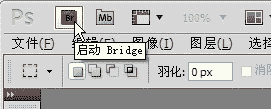
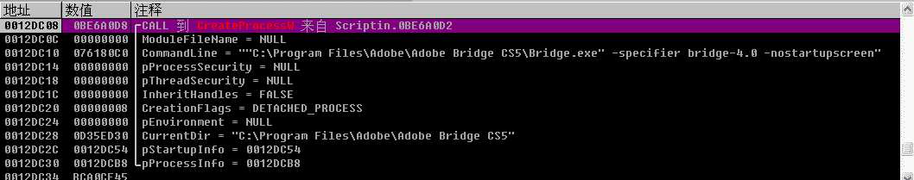
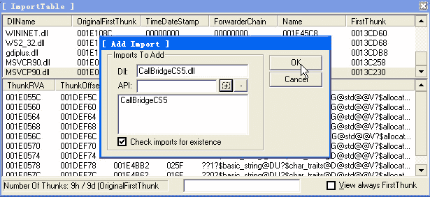
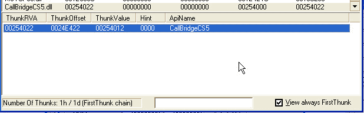
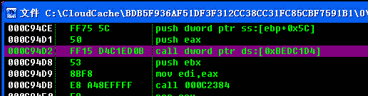
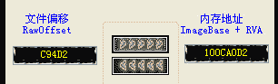
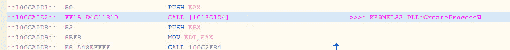
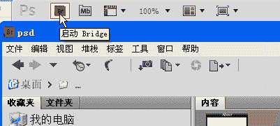
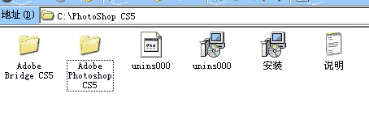

# 让绿色版的 PhotoShop CS5 支持 Bridge CS5 组件

> 原文：[`www.pediy.com/kssd/pediy12/127560.html`](https://www.pediy.com/kssd/pediy12/127560.html)

作者：cntrump  
   网上有很多绿色版的 PhotoShop CS5 ，但是都没有带上 Bridge CS5 组件，原因之一就是 Bridge CS5 组件不能移动位置，否则就无法调用。  
   为了能解决这个问题，我决定尝试一下。  
   Bridge CS5 是 PhotoShop CS5 的一个附加组件，是可独立运行的应用程序，那么在 PS 中要调用它的话，肯定是要创建进程。理所应当就应该下断 bp CreateProcessW/A 了因为系统只知道这样来创建一个进程，下面是实际操作过程：  
   启动 PS 后用 OD 附加，下断 CreateProcessW 后点击界面上的 “启动 Bridge 按钮”，在 OD 中被断下：  
  
  
    此时的堆栈如下：  
  
  
    因为我使用的是绿色版的 PS ，并没有 Bridge CS5 组件，所以可以肯定的是程序使用了固定的路径来调用 Bridge CS5，所以就造成了 Bridge CS5 的目录不能移动。从堆栈中可以看到需要修正的参数有两个，一是命令行中 Bridge 主程序的路径，二是 Brdge 的所在目录路径（这个路径作用是 CreateProcess 的当前目录参数值）。  
   首先想到的方法是使用 API Hook 。这样的话所有调用到 CreateProcess 的地方都会被拦截，修改参数就很简单了。  
   从上面继续简单地跟踪还可以知道 PS 调用 Bridge 的函数都是一个，参数也是不变的。  
   如果 Hook 所有的 CreateProcess 那么效率肯定会受到影响，所以我想了一个折中的方案，自己写一个函数来接替 PS 调用 Bridge 的 CreateProcess 函数，在自定义的函数里面判断参数是否是我们需要修改的值，如果是则修改参数后再调用 CreateProcess。  
   这样的话，只需要写一个 Dll ，导出一个自定义函数，名为 CallBridgeCS5。用它来接替调用 Bridge 处的 CreateProcess 函数，这样流程就转到了我们的 Dll 了，想干什么都可以了。  
    VC6 新建一个 Dll 工程，添加导出函数 CallBridgeCS5 ，并且参数和返回值必须和 CreateProcess 一样：  

代码:

```
\_\_declspec(dllexport) BOOL WINAPI CallBridgeCS5(IN LPCWSTR lpApplicationName,
              IN LPWSTR lpCommandLine,
              IN LPSECURITY\_ATTRIBUTES lpProcessAttributes,
              IN LPSECURITY\_ATTRIBUTES lpThreadAttributes,
              IN BOOL bInheritHandles,
              IN DWORD dwCreationFlags,
              IN LPVOID lpEnvironment,
              IN LPCWSTR lpCurrentDirectory,
              IN LPSTARTUPINFOW lpStartupInfo,
              OUT LPPROCESS\_INFORMATION lpProcessInformation)
{
  if (lstrcmpW(OLD\_CMDLINE, lpCommandLine))  // 先判断是否要要修改的命令行
  {
    return CreateProcessW(lpApplicationName, 
          lpCommandLine, 
          lpProcessAttributes, 
          lpThreadAttributes,
          bInheritHandles, 
          dwCreationFlags,
          lpEnvironment, 
          lpCurrentDirectory, 
          lpStartupInfo, 
          lpProcessInformation);
  }
// 注册表中有 Bridge CS5 的安装路径，直接读取利用就可以了。
  HKEY hKey;
  LONG ret = RegOpenKeyExW(HKEY\_LOCAL\_MACHINE, L"SOFTWARE\\\\Adobe\\\\Adobe Bridge\\\\CS5\\\\Installer\\\\", 0, KEY\_READ, &hKey);
  DWORD cbData=MAX\_BUFFER, dwType = REG\_SZ;
  LPWSTR lpBuffer = NULL, lpBuffer2 = NULL;

  if (ERROR\_SUCCESS == ret)
  {

    ret = RegQueryValueExW(hKey, L"InstallPath", NULL, &dwType, (LPBYTE)lpBuffer, &cbData);

    if (ERROR\_SUCCESS == ret)
    {
      cbData += 40\*2;
      lpBuffer = (LPWSTR)VirtualAlloc(NULL, cbData, MEM\_COMMIT, PAGE\_READWRITE);
      lpBuffer2 = (LPWSTR)VirtualAlloc(NULL, cbData, MEM\_COMMIT, PAGE\_READWRITE);  

      if ((NULL != lpBuffer) && (NULL != lpBuffer2))
      {
        ZeroMemory(lpBuffer, cbData);
        ZeroMemory(lpBuffer2, cbData);

        ret = RegQueryValueExW(hKey, L"InstallPath", NULL, &dwType, (LPBYTE)lpBuffer, &cbData);
                                                               // 去除路径末尾的斜框
        if (lpBuffer\[lstrlenW(lpBuffer)-1\] == WCHAR('\\\\'))
          lpBuffer\[lstrlenW(lpBuffer)-1\] = WCHAR('\\0');

        lstrcatW(lpBuffer, L"\\\\Bridge.exe");
        
        wsprintfW(lpBuffer2, L"\\"%s\\" %s", lpBuffer, L"-specifier bridge-4.0 -nostartupscreen");
                                                               //经过上面的格式化后再把 lpBuffer 作为当前目录使用
        lpBuffer\[lstrlenW(lpBuffer)-11\] = WCHAR('\\0');

        ret = CreateProcessW(lpApplicationName, 
            lpBuffer2, 
            lpProcessAttributes,
            lpThreadAttributes, 
            bInheritHandles, 
            dwCreationFlags,        
            lpEnvironment, 
            lpBuffer, 
            lpStartupInfo, 
            lpProcessInformation);
                                                                // GetLastError 作用是在调试时使用
        GetLastError();

      }

      VirtualFree(lpBuffer, NULL, MEM\_RELEASE);
      VirtualFree(lpBuffer2, NULL, MEM\_RELEASE);
    }

    RegCloseKey(hKey);
  }

  return ret;

}

```

别忘了再在 .def 定义文件中添加导出函数的定义：  
代码:

```
LIBRARY CallBridgeCS5
EXPORTS
  CallBridgeCS5

```

     在 OD 的窗口中还可以知道，调用 Bridge CS5 命令的文件是 Plug-ins\\Extensions\\ScriptingSupport.8li 而不是 PS 主程序（OD 的标题栏告诉我的）。  
   所以使用 Lordpe 对它的导入表添加 CallBridgeCS5 函数，这样就可以在程序中直接使用了：  
  
  
记下 ThunkRVA ，就是函数地址：  
  
再在 OD 中找到调用 Bridge 的 ScriptingSupport.8li  中的偏移地址：  
  
  
  
用 OC 转换为内存地址：  
  
  
  
用 C32ASM 的反汇编模式打开 ScriptingSupport.8li 转到计算出来的内存地址（EIP）：  
  
  
再转到对应的 Hex 模式：  
  
  
修改为：  
  
  
  
CallBridgeCS5.dll 必须和 PS 主程序在同一目录下，否则会提示找不到文件。  
保存好了以后运行 PS 看看效果（先从其他地方复制一份 Brdge CS5 过来，再在注册表中添加好路径）：  
  
  
  
可以正常使用 Bridge CS5 了，不需要使用固定路径了。  
现在 Bridge CS5 的路径由注册表中的 HKEY\_LOCAL\_MACHINE\\SOFTWARE\\Adobe\\Adobe Bridge\\CS5\\Installer 键下的 InstallPath 值所指定，这样就灵活多了。  
附件中包含我写的 CallBridgeCS5.dll （包含在补丁中）程序及用于 ScriptingSupport.8li 的补丁程序，用于 PS 12.0.3 版本。  
  
解决这个问题后就可以打造完整的绿色版 Photoshop CS5 了  
下面是我做成绿色版后的目录截图：  
  
带 Bridge 的绿色版 Photoshop，暂时只有我有了

上传的附件
|  || 让.bridge.cs5.组件可移植-patch.7z  
 |