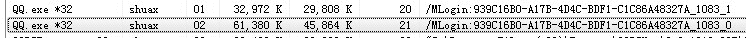

# QQ2011 多账号登录分析

> 原文：[`www.pediy.com/kssd/pediy12/141457.html`](https://www.pediy.com/kssd/pediy12/141457.html)

从 QQ2011 Beta3 开始 QQ 提供了多账户登录功能，但是很遗憾，一次最多登录 3 个 QQ 而已。  
于是想办法能不能突破呢？  
  
  
依然记得 QQ2008 那个时候的命令行登录，所以先看一下命令行吧  
  
额，我的两个 QQ 密码可不是一样的，我不相信后面这一串是密码哈希。  
……  
论坛不好排版，放 word 里面了。

上传的附件
|  || QQ2011 多账号登录分析.doc  
 |