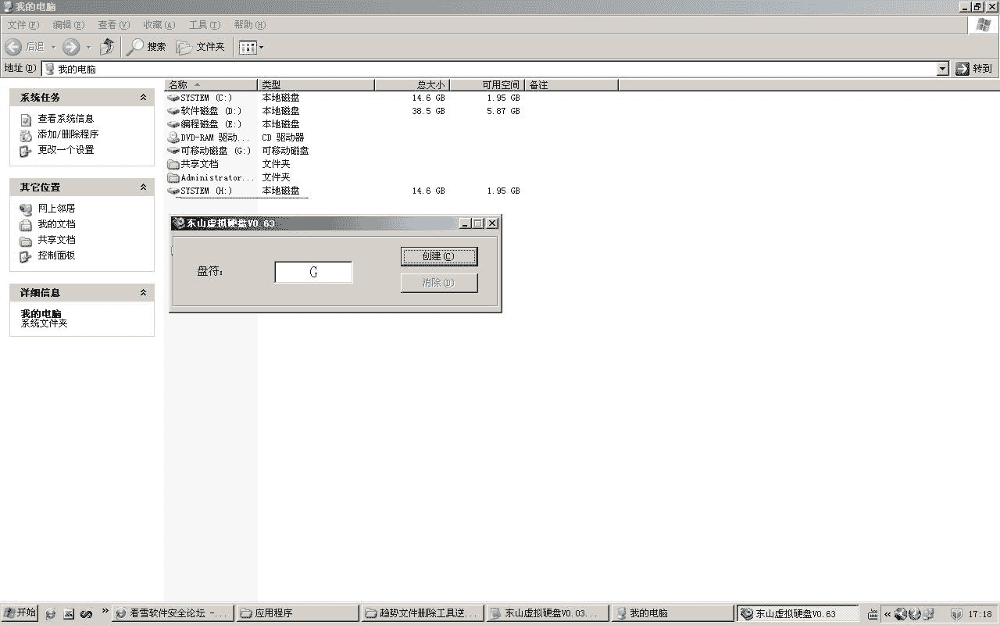

# 东山虚拟硬盘的原理--一次吐血分析

> 原文：[`www.pediy.com/kssd/pediy12/135837.html`](https://www.pediy.com/kssd/pediy12/135837.html)

今天在华军网站上闲逛，发现一款叫做《东山虚拟硬盘 0.645.5 一键通》这个软件可以实现一个虚拟分区，安装后使用 peid 查壳发现是 vb 写的，效果图如下：  
  
使用 ollydbg 稍微跟踪那一下，发现其实现原理极其简单，  
创建一个虚拟分区：  
cmd:subst X: C:\\$Cdrom$  (X 指新建的分区盘符)  
卸载一个虚拟分区：  
cmd:sub X: /D  
  
这就是所谓的虚拟分区的实现，批处理实现，连个函数都没用到，这个函数 DefineDosDevice 作者会不会，这就是虚拟分区，我真是要吐了，看看真正的虚拟分区，都是用驱动按照 FileDisk 的方法实现，华军软件也是搞笑，什么软件都往上面放，这是软件吗？简直是一脱大便，这里请原谅我用粗话，实在是受不了那，你自己是白痴不要紧，但是你以为其他人跟你是一样的！