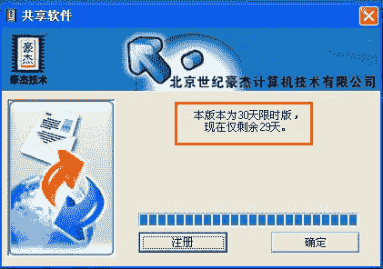
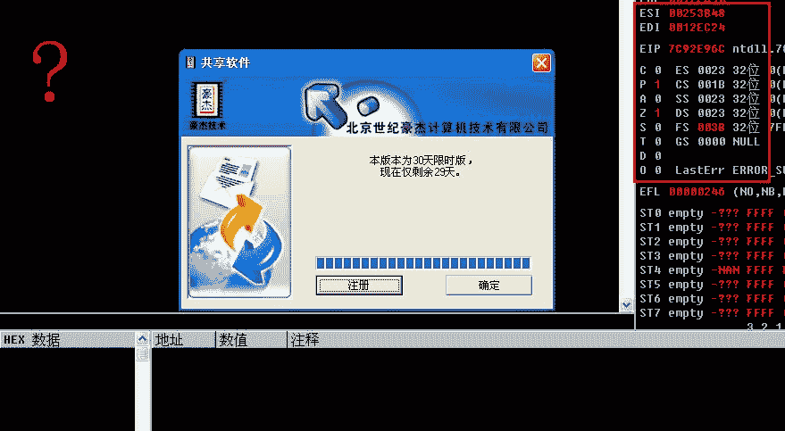
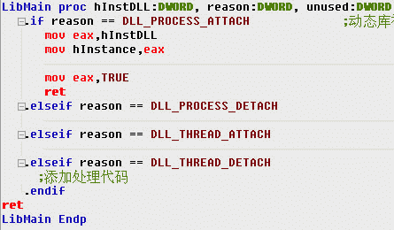
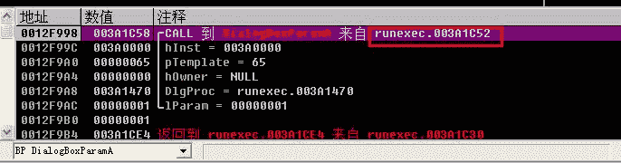
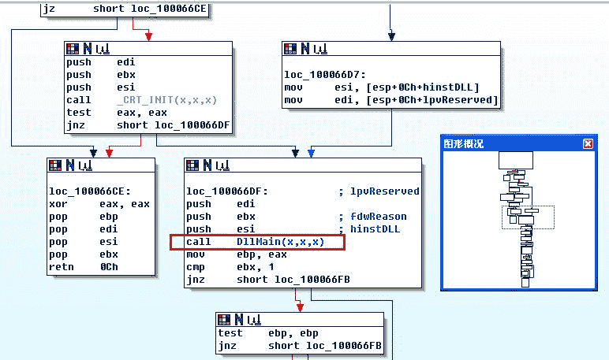
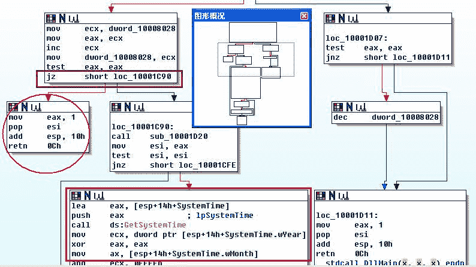

# 豪杰超级 DVD 播放器Ⅲ破解之菜鸟了解 PE 文件

> 原文：[`www.pediy.com/kssd/pediy11/124741.html`](https://www.pediy.com/kssd/pediy11/124741.html)

**豪杰超级 DVD 播放器Ⅲ破解之菜鸟了解 PE 文件**  
【文章作者】：YangCoCol  
【作者 QQ】：1174968967（解密小生）  
  
    豪杰超级 DVD 播放器Ⅲ已经是个很老的播放器了，而且网上破解版的多的是，此次破解的目的并不是为了破解而破解，只是为了学习和分享，通过分析软件注册保护机制总结几种破解对策，可以说这篇破文是个纯菜鸟级的破文，大鸟请飞过！！希望对初入破解之门的朋友们有一点点的帮助，本破文将以图文并貌的方式来讲解破解的过程，废话少说！开始吧，Let’s Go~~~~~  
    首先，我们安装《豪杰超级 DVD 播放器Ⅲ》软件，安装好后用 PEid 查壳，没有加壳，Microsoft Visual C++ 4.x 写的（看来真的是挺老啊！！！），运行程序，此时提示还有 29 天试用期，如下图所示：  
      
    通过跟踪分析，点击“注册”按钮会运行软件根目录中的 程序，是一个单独的注册程序，在这里我不准备对注册算法进行分析，写过注 册机的朋友一定知道在算法里转来转去是一件多么痛苦的事情，所以决定爆破之……。  
    运行 OD，设置“调试选项”中事件暂停在“主模块入口点”，装载程序，此时出现如下图的现象：  
    我们暂且不解释现象出现的原因，先简单说说 PE 文件的加载过程：PE 加载器首先将文件映射到内存，再根据导入表中 name 字段找到 DLL 文件名字，并将所需的模块一一加载，加载结束后创建主线程并从主模块入口处开始执行程序。在加载期间 PE 装载器会完成“导入函数地址写入”、“代码重定位“等等操作，这里就不再一一叙述，网上也有很多关于 PE 文件结构的教程，不熟悉的朋友可以下载学习。  
    在上面的调试过程中，我们是把事件暂停设置在“主模块入口点”处的，但是在还没有中断在程序入口处就弹出对话框提示了，在这里我做了一个猜测，这个对话框是由某个 DLL 弹出。  
    说到这里，我们再来看看 DLL 模块的入口函数，为了方便分析我用 MASM 写个 DLL 源码做实例，如下图所示：  
    以上为 DLL 的入口函数，在某进程加载它时会向它传递参数 reason 等于 DLL\_PROCESS\_ATTCH，并且它的加载成功与否决定返回值，上面的返回值为 TRUE，永远为真，如果先前猜测是对的话，那么一定有一个 DLL，并且在入口处有弹出对话框操作，接着推理下去，那它一定有判断是否已经成功注册的语句，其实我们分析到这爆破的突破口也就找到了。    
    有了以上的分析，下面我们开始找到究竟是哪个 DLL 模块弹出的对话框，再次运行 OD,这回我们把 事件暂停设置在“系统断点”处，再次加载待破解程序，下 DialogBoxParamA 访问断点，F9 运行，程序断下，如下图所示：  
    从上图可以得到如下信息，1.弹出对话框的是 runexec.dll 模块；2.窗口事件处理函数在 0x3A1470 地址开始处，其实，我们知道是 runexec.dll 模块弹出的对话框就 OK 了。  
    剩下的工作就是分析那个 DLL 文件了，可以在目标 DLL 的代码段设置硬件执行断点跟踪分析。我通过用 DiE 分析主程序发现，在主程序的导入表中并没有对 runexec.dll 模块的引用说明，用 OD 调试时发现它的加载是被另一个 DLL hook 了主程序 IAT 中某个函数地址而加载的，具体 hook 的 API 我并没有深入分析，如果只是出于破解目的，就没有什么必要了，若是学习的话就要一查到底了~~~~(又开始废话了…嘿嘿！)。  
    其实，我们到这里破解已经不是我们的目的了，目的是方法的总结、思路的拓展、理论的学习，更何况这个也没有什么破解难度。  
    下面我准被用 IDA 来分析那个 DLL 文件，IDA 是个公认的静态反汇编的专业工具，现在好多招聘逆向的工程师都要求会 OD 和 IDA 工具，在这里我就当是练习练习使用 IDA 吧~~  
用默认设置加载目标 DLL，定位到入口函数处，其实对于 IDA 来说定位是很简单的，入口函数反汇编部分代码如下图所示：  
    通过分析，上图中 call DllMail(x,x,x)应是个关键的 call,我们跟进去看看，DllMail(x,x,x)函数反汇编部分代码如下图所示：  
    ;先来看看红色框中的代码，这是在获取当前系统日期，能执行到这一定是已经判断了软件没有被注册，那判断的语句在哪？？嘿嘿~~在紫色方框中“jz”判断，而在粉色圆圈中的代码是返回语句，并且 eax 寄存器中值为 1，根据前面的知识，这一定是模块加载成功返回语句，O(∩\_∩)O 哈哈~~我想现在你一定想到好多方法搞定它了吧！！  
    我又对这个 DLL 文件做了详细的分析，确定它没有导出函数被主程序调用，它是个独立的模块，哎()！话说到这份了~~~你一定明白了吧！！！  
**偶的搞它方法：**  
1.nop 掉“jz”的关键判断语句。  
2.自己写个直接返回成功的 DLL 文件，并覆盖掉原 DLL。  
2.在主程序中把存在 hook 的 DLL 文件的导入信息抹掉。  
**结束语：**夯实基础，总结经验，温故而知新。