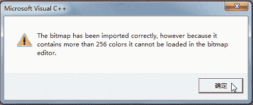
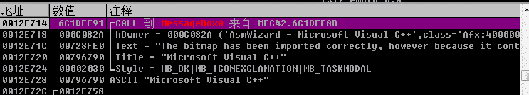
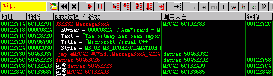
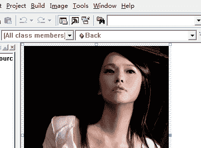

# 解除 VC6 不能打开真彩色位图的限制

> 原文：[`www.pediy.com/kssd/pediy12/127539.html`](https://www.pediy.com/kssd/pediy12/127539.html)

解除 VC6 不能打开真彩色位图的限制  
作者：cntrump  
      官方的 VC6 只能打开最大 256 色的位图，有时候项目里用了真彩色的位图，想要在 IDE 里直接查看就不行了，必须要在外部查看，比较麻烦。  
    为了以后查看真彩色位图能节省时间，所以我就想尝试下看 VC6 是不能还是不想显示真彩色位图。  
    直接从限制入手。如果位图超过 256 色，那么会得到一个提示：  
  
   
    这是系统的 MessageBox ，我的判断依据是“确定”按钮，因为我用的英文版本，而提示信息中的按钮却是中文的，那么可以肯定的这个框是操作系统本身的资源，而不是 Dialog 之类的自定义资源。那么嫌疑最大的就是 MessageBoxA 了（因为 VC6 是 98 年的产品，它还可以运行在 Windows 98 上，所以只能是 ASCII 编译的）。  
    OD 加载 VC6 主程序（或者附加也可以，加载大型软件比较慢时就用附加）。下断 bp MessageBoxA ，在 IDE 里打开一个真彩色位图。被断下：  
  
    正是我们想要的信息，Atl+K 看调用堆栈，主要是看这个消息框来源。  
  
   
    根据以上内容可以知道，5046BCE6 的作用只是弹出消息框，看来是个封装函数。而调用它的地方是在 5045EFE3 ，处理位图的地方肯定也在这里。  
    跟进后发现对位图处理判断的流程起始地方是在  5045EB71 ，如果打开的位图超过 256 色就会跳走弹出消息框，不超过就按正常流程进行。那么只要对比下程序打开真彩色和 256 色以下位图的流程，让真彩色位图走正常流程，如果能正常显示真彩色位图就说明 VC6 是支持真彩色位图的，如果显示不正常则说明 VC6 不支持。  
  
操作如下：  
1. 用 IDE 本身的功能新建一个位图资源，程序就断在了 5045EB71，用 F8 步过每一个 CALL ，标记下所经过的跳转指令。  
2. 再在 IDE 里打开一个真彩色位图，同样步过每一个 CALL ，注意看在真彩色位图下所经过的跳转指令和第一步中的有什么不同，如果不同则强制修改为 nop 或 jmp 让其流程和第一步的一样。  
  
    经过对比发现，打开真彩色位图和小于 256 色的位图流程区别在于：  

代码:

```
 5045EEBE   /0F8E 27010000   jle devres.5045EFEB        

```

  
    小于 256 位图的话会执行这句跳转，而真彩色位图则不会执行跳转。把 jle 强制修改 jmp 让其走正常流程。  
修改后发现真彩色位图可以在 IDE 中正常显示，再对位图进行常规的编辑/保存操作，完全正常，这说明 VC6 是完全可以支持真彩色位图的。  
最后把修改的文件保存出来，收工了。  
    为了以后方便，我做了个补丁，只要 Patch 一下就可以了。  
在 VC6 中打开真彩色位图：  
  
  
VC6 出生的年代， Windows 98 , 2000 本身还不能支持真彩色。所以 VC6 不支持真彩色是正常的。

上传的附件
|  || 解除.vc6.不能打开真彩色位图限制-patch.7z  
 |