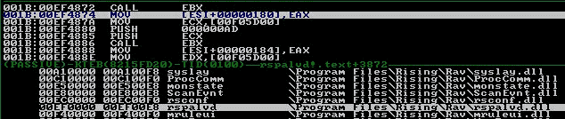
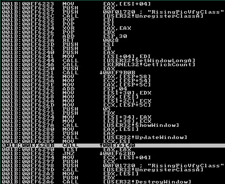
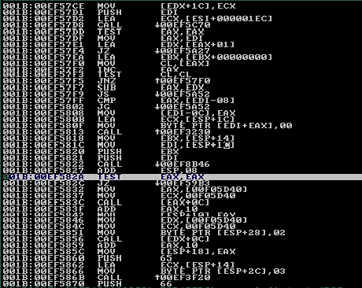

# Pediy“瑞星”实现快速禁用

> 原文：[`www.pediy.com/kssd/pediy11/105815.html`](https://www.pediy.com/kssd/pediy11/105815.html)

Pediy“瑞星”实现快速禁用  
     每次禁用都要输入验证码，不甚其烦。有没有快速禁用的方法呢？琢磨了一天，终于实现。  
     方便起见，我还是用 softice。在虚拟机中装上瑞星，Ctrl+D 进入 softice，bpx LoadBitmapA 下断后 Ctrl+D 返回桌面，右键右下脚瑞星托盘图标，选“禁用所有监控”，即被断下。再按 F12，返回上一层函数，此时 softice 显示进入 RsTray 的地址空间。当前地址为 001B:00ef4874，看看在哪个模块里，用 mod 命令见下图,  
     
    
  
    原来在 rav 文件夹下的 dll 文件中。显然这个就是我们的 key dll 了。 再次进入 softice，先 bd 0 即禁用 0 号断点，，而后下断 bpx SetFocus 并按下 Ctrl+D 被立即断下。  
PUSH ECX                                 ; /Arg10  
MOV ECX,DWORD PTR SS:\[ESP+24\]             
SUB EDX,ECX                                
PUSH EDX                                 ; |Arg9  
MOV EDX,DWORD PTR DS:\[ESI+18C\]           
PUSH EDX                                 ; |Arg8  
MOV EDX,DWORD PTR DS:\[ESI+188\]           
PUSH EDX                                 ; |Arg7  
MOV EDX,DWORD PTR DS:\[ESI+184\]         
PUSH EDX                                 ; |Arg6  
MOV EDX,DWORD PTR DS:\[ESI+180\]           
PUSH EDX                                 ; |Arg5  
MOV EDX,DWORD PTR DS:\[10015CB0\]         
PUSH EDX                                 ; |Arg4 => 00000000  
MOV EDX,DWORD PTR DS:\[EDI\]               
PUSH EDX                                 ; |Arg3  
PUSH EAX                                 ; |Arg2  
PUSH ECX                                 ; |Arg1  
LEA ECX,DWORD PTR DS:\[ESI+1EC\]          
CALL  00ef6170                    //关键 call 跟进  
MOV EAX,DWORD PTR DS:\[EDI\]  
PUSH 477                                  ; /ControlID = 477 (1143.)  
PUSH EAX                                 ; |hWnd  //确认验证码的对话框窗口句柄  
CALL DWORD PTR DS:\[<&USER32.GetDlgItem>\] ; \\GetDlgItem //显示 4 位验证码的小图片窗口  
MOV ESI,EAX  
JE SHORT 00ef49CE  
PUSH 0  
PUSH 4  
PUSH 0C5  
PUSH ESI  
CALL EBX  
PUSH -1  
PUSH 0  
PUSH 0B1  
PUSH ESI  
CALL EBX  
PUSH 0  
PUSH 0  
PUSH 0B7  
PUSH ESI  
CALL EBX  
PUSH ESI                                   ; /hWnd  
CALL DWORD PTR DS:\[<&USER32.SetFocus>\]   ; \\SetFocus    //断在这里  
      输入 bd 1，暂时去除 SetFocus 断点的影响，Ctrl+D 返回桌面，此时已经弹出了确认验证码的对话框，当前闪烁的输入焦点当然就是 SetFocus 的功劳了。显然已经生成了验证码，那么我们就要退回去看，不远处在 001B:00ef498a 处有个 CALL  00ef6170  且 push 了很多参数，那就 F8 单步跟进瞧瞧。进入后单步几下来到如下图所示高亮的 call 处，  
  
     
  
   再跟进来到下面：  
PUSH ESI  
MOV ESI,ECX  
MOV EAX,DWORD PTR DS:\[ESI\]  
PUSH EAX                                   ; /hWnd  
CALL DWORD PTR DS:\[<&USER32.IsWindow>\]   ; \\IsWindow  
TEST EAX,EAX  
NZ SHORT 00ef6152  
POP ESI  
RETN  
MOV ECX,ESI  
CALL 00ef6080   //生成验证码的重要 call 继续跟进来到下面  
MOV ECX,ESI  
CALL 00ef5CB0  
MOV EAX,1  
POP ESI  
RETN  
  
00ef6080：  
…………  
XOR EBX,EBX  
LEA EDI,DWORD PTR DS:\[ESI+1C\]  
TEST BL,1  
MOV ECX,ESI  
JE SHORT 00ef60A4  
CALL 00ef5DB0        // 算法 call1  
JMP SHORT 00ef60A9  
CALL 00ef5E00         //算法 call2  
MOV ECX,ESI  
MOV BYTE PTR DS:\[ESI+EBX+8\],AL  //保存本次循环生成的一位验证码  
…………………….  
INC EBX  
ADD EDI,4  
CMP EBX,4        // 循环生成四位验证码  
JL SHORT 00ef6096  
  
算法 call1  
00ef5DB0  /$  51            PUSH ECX  
00ef5DB1  |.  56            PUSH ESI  
00ef5DB2  |>  E8 613D0000   /CALL   00ef9B18  
00ef5DB7  |.  894424 04     |MOV DWORD PTR SS:\[ESP+4\],EAX  
00ef5DBB  |.  33F6          |XOR ESI,ESI  
00ef5DBD  |.  8D49 00       |LEA ECX,DWORD PTR DS:\[ECX\]  
00ef5DC0  |>  8A4434 04     |/MOV AL,BYTE PTR SS:\[ESP+ESI+4\]  
00ef5DC4  |.  3C 41         ||CMP AL,41  
00ef5DC6  |.  7C 04         ||JL SHORT 00ef5DCC  
00ef5DC8  |.  3C 5A         ||CMP AL,5A  
00ef5DCA  |.  7E 08         ||JLE SHORT 00ef5DD4  
00ef5DCC  |>  3C 61         ||CMP AL,61  
00ef5DCE  |.  7C 19         ||JL SHORT 00ef5DE9  
00ef5DD0  |.  3C 7A         ||CMP AL,7A  
00ef5DD2  |.  7F 15         ||JG SHORT 00ef5DE9  
00ef5DD4  |>  0FBEC0        ||MOVSX EAX,AL  
00ef5DD7  |.  50            ||PUSH EAX  
00ef5DD8  |.  68 34170110   ||PUSH 10011734     ;  ASCII "SOIlo"  
00ef5DDD  |.  E8 DE340000   ||CALL 00ef92C0  
00ef5DE2  |.  83C4 08       ||ADD ESP,8  
00ef5DE5  |.  85C0          ||TEST EAX,EAX  
00ef5DE7  |.  74 08         ||JE SHORT 00ef5DF1  
00ef5DE9  |>  46            ||INC ESI  
00ef5DEA  |.  83FE 04       ||CMP ESI,4  
00ef5DED  |.^ 72 D1         |\\JB SHORT 00ef5DC0  
00ef5DEF  |.^ EB C1         \\JMP SHORT 00ef5DB2  
00ef5DF1  |>  8A4434 04     MOV AL,BYTE PTR SS:\[ESP+ESI+4\]  
00ef5DF5  |.  5E            POP ESI  
00ef5DF6  |.  59            POP ECX  
00ef5DF7  \\.  C3            RETN  
  
/算法 call2  
00ef5E00  /$  51            PUSH ECX  
00ef5E01  |.  56            PUSH ESI  
00ef5E02  |>  E8 113D0000   /CALL  00ef9B18  
00ef5E07  |.  894424 04      |MOV DWORD PTR SS:\[ESP+4\],EAX  
00ef5E0B  |.  33F6          |XOR ESI,ESI  
00ef5E0D  |.  8D49 00       |LEA ECX,DWORD PTR DS:\[ECX\]  
00ef5E10  |>  8A4434 04     |/MOV AL,BYTE PTR SS:\[ESP+ESI+4\]  
00ef5E14  |.  3C 30         ||CMP AL,30  
00ef5E16  |.  7C 19         ||JL SHORT  00ef5E31  
00ef5E18  |.  3C 39         ||CMP AL,39  
00ef5E1A  |.  7F 15         ||JG SHORT  00ef5E31  
00ef5E1C  |.  0FBEC0       ||MOVSX EAX,AL  
00ef5E1F  |.  50            ||PUSH EAX  
00ef5E20  |.  68 3C170110   ||PUSH  1001173C  ;  ASCII "015"  
00ef5E25  |.  E8 96340000   ||CALL  00ef92C0  
00ef5E2A  |.  83C4 08       ||ADD ESP,8  
00ef5E2D  |.  85C0          ||TEST EAX,EAX  
00ef5E2F  |.  74 08         ||JE SHORT  00ef5E39  
00ef5E31  |>  46            ||INC ESI  
00ef5E32  |.  83FE 04       ||CMP ESI,4  
00ef5E35  |.^ 72 D9         |\\JB SHORT  00ef5E10  
00ef5E37  |.^ EB C9         \\JMP SHORT  00ef5E02  
00ef5E39  |>  8A4434 04     MOV AL,BYTE PTR SS:\[ESP+ESI+4\]  
00ef5E3D  |.  5E            POP ESI  
00ef5E3E  |.  59            POP ECX  
00ef5E3F  \\.  C3            RETN  
    有兴趣的可以看看这些算法，不是很难。我的目的是要尽快找到爆破点，时间宝贵啊。注意到刚才有一句：MOV BYTE PTR DS:\[ESI+EBX+8\],AL  //保存本次循环生成的一位验证码  
那我就在验证码的保存地址上下内存读取断点，输入命令：Bpm 1b:f2401c r  
Ctrl+d 返回到桌面后随即被断下，这次读取是绘制验证码，继续 Ctrl+d 这次返回到桌面，随便输入 4 位验证码，确定后立即被断下，接着单步几下就到爆破点了。如下图  
  
      
  
      输入 a 1b:00ef582a 回车后再输入 xor eax,eax 回车即完成修改。爆破后直接跳到以下代码处。  
00ef59B3   MOV EAX,DWORD PTR DS:\[ESI+164\]  
00ef59B9   PUSH 1                                     ; /Result = 1  
00ef59BB   PUSH EAX                                 ; |hWnd  
00ef59BC   MOV DWORD PTR DS:\[ESI+22C\],1            //这里置位禁用标志  
00ef59C6   CALL DWORD PTR DS:\[<&USER32.EndDialog>\]  ; \\EndDialog  
 现在 bd \* ，然后 Ctrl+d 返回到桌面，试了一下不再需要输入验证码了，再执行几个驱动工具，瑞星也不报毒了，达到快速禁用的目的。接下来就是收尾工作，用 od 载入 rspalvd.dll，修改后保存，再拷回原来的瑞星目录。这里有个小技巧，你可以把瑞星的几个监控进程结束掉，并以最快的速度覆盖原文件，这里可以打个时间差，否则你是改不了的。最后呼吁，请支持国产软件！  
  
                       Happy birthday 天易!  
        
                                                                                 By 天易 love 2010-1-23