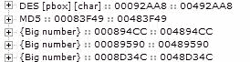

# 关于某软件自校验技术分析总结

> 原文：[`www.pediy.com/kssd/pediy10/86919.html`](https://www.pediy.com/kssd/pediy10/86919.html)

第一次分析程序保护技术，花了不少的时间，分析的也不是很透彻，拿出来请大家发现分析过程中的问题。整理的时间仓促，可能有疏漏，大家还是挑重点的看。  
  
谢谢和我一起进行分析工作的 vcpestudy，在分析困顿之时，他提出一些很好的想法。  
  
破除软件保护机制基本可分为三个步骤：定位保护代码、分析保护机制和破除保护机制。三个过程同等重要，但是对于不同的软件的保护机制不同，三个步骤分析难度也各不相同。  
  
  
在除去程序外壳后，经常会出现文件自校验的错误。下面结合一个外挂程序，分析软件是如何进行自校验保护，也为以后的分析工作提供思路。  
  
如何去除文件的自校验是这篇文章的目的。  
  
外挂程序采用了 UPX 加壳，脱壳不难，无论是使用现有的脱壳工具或者手动都可以轻易的去除壳。运行后出现自校验错误提示，表明程序存在自校验。  
  
一、  定位保护代码  
1.  逆着 MessageBoxA 提示而上  
一般的思路是通过追溯 MessageBoxA 弹出的堆栈，一直回溯到导致错误发生的代码位置，当然这样的工作量大，而且有些软件并没有提示的校验出错。  
  
查看堆栈的信息  
0012FD44   0045D473  /CALL 到 MessageBoxA 来自 V2.0045D46E  
0012FD48   001D0146  |hOwner = 001D0146   
0012FD4C   00FD542C  |Text = "重新下载"  
0012FD50   00FD50AC  |Title = "提示"  
0012FD54   00000040  \\Style = MB\_OK|MB\_ICONASTERISK|MB\_APPLMODAL  
0012FD58   0012FDD0  指向下一个 SEH 记录的指针  
0012FD5C   0045D4DD  SE 处理程序  
……  
0012FD78   00000000  
0012FD7C   0012FDC0  
0012FD80   004027DF  返回到 004027DF 来自 0040237C  
0012FD84   0012FDB0  
0012FD88   00404576  返回到.00404576 来自 004027D4  
0012FD8C   00000038  
0012FD90   00000000  
0012FD94   00488509  返回到.00488509 来自 00404550  
0012FD98   00488511    
  
一般堆栈都会很深，写这些保护代码的人并非“善良”之辈，不要希望在上层函数就可以发现有用的代码。一般可以结合 IDA 分析出调用函数表，在几个可能的地方预先设下断点，减少工作量。  
2.  查找代码中的校验函数  
程序保护所使用的校验算法一般会使用成熟的算法，如 MD5、SHA、RCR32 等，当然除了一些通过比较软件大小是否改变、修改时间的校验方法。  
可喜的是这些代码的特征可以被 PEID 插件 KryptoAnalyze 的分析得到，在锁定特征代码出现的位置加以分析，就可以基本确定校验代码。  
得到如下的结果，  
   
DES 算法是用来加密的，这里是用作校验，是无需考虑的。查看出现 MD5 的代码的位置  
UPX1:00483F2B                 push    eax  
UPX1:00483F2C                 push    7  
UPX1:00483F2E                 push    0D76AA478h  
UPX1:00483F33                 mov     eax, ebx  
UPX1:00483F35                 mov     ecx, \[edi\]  
UPX1:00483F37                 mov     edx, \[esi\]  
UPX1:00483F39                 call    sub\_0\_483D8C  
UPX1:00483F3E                 mov     eax, \[edi\]  
UPX1:00483F40                 push    eax  
UPX1:00483F41                 mov     eax, \[esp+5Ch+var\_3C\]  
UPX1:00483F45                 push    eax  
UPX1:00483F46                 push    0Ch  
UPX1:00483F48                 push    0E8C7B756h  
UPX1:00483F4D                 mov     eax, ebp  
UPX1:00483F4F                 mov     ecx, \[esi\]  
UPX1:00483F51                 mov     edx, \[ebx\]  
UPX1:00483F53                 call    sub\_0\_483D8C  
看到 MD5 的轮运算常量，那么这个函数体就可能是 MD5 的 Md5TransForm()，为了证实在函数外层不远处出现 MD5Init()  
UPX1:00484600 MD5Init         proc near               ; CODE XREF: MD5+25 p  
UPX1:00484600                                         ; GetFileMD5+25 p  
UPX1:00484600                 mov     dword ptr \[eax\], 67452301h  
UPX1:00484606                 mov     dword ptr \[eax+4\], 0EFCDAB89h  
UPX1:0048460D                 mov     dword ptr \[eax+8\], 98BADCFEh  
UPX1:00484614                 mov     dword ptr \[eax+0Ch\], 10325476h  
UPX1:0048461B                 xor     edx, edx  
UPX1:0048461D                 mov     \[eax+10h\], edx  
UPX1:00484620                 xor     edx, edx  
UPX1:00484622                 mov     \[eax+14h\], edx  
UPX1:00484625                 add     eax, 18h  
UPX1:00484628                 mov     edx, 40h  
UPX1:0048462D                 call    sub\_0\_4074A8  
UPX1:00484632                 retn  
UPX1:00484632 MD5Init         endp  
那么究竟是拿什么内容来做校验呢，在 MD5 开始的位置即可寻找到答案，参见如下的代码：  
UPX1:004847C1                 call    MD5Init  
UPX1:004847C6                 push    0               ; hTemplateFile  
UPX1:004847C8                 push    8000080h        ; dwFlagsAndAttributes  
UPX1:004847CD                 push    3               ; dwCreationDisposition  
UPX1:004847CF                 push    0               ; lpSecurityAttributes  
UPX1:004847D1                 push    3               ; dwShareMode  
UPX1:004847D3                 push    80000000h       ; dwDesiredAccess  
UPX1:004847D8                 mov     eax, \[ebp+var\_4\]  
UPX1:004847DB                 call    sub\_0\_4049DC  
UPX1:004847E0                 push    eax             ; lpFileName  
UPX1:004847E1                 call    CreateFileA\_0  
……  
UPX1:0048485D                 call    GetFileSize\_0  
UPX1:00484862                 mov     ecx, eax  
UPX1:00484864                 lea     eax, \[ebp+var\_6C\]  
UPX1:00484867                 mov     edx, \[ebp+lpBaseAddress\]  
UPX1:0048486A                 call    Md5Updata  
这是代码的一部分，当然程序可能会对几个文件进行校验，也可能分几次对程序校验，但是按照这个思路，寻找整个校验代码应该是可以的。  
  
二、  分析保护机制  
软件保护往往会采用几种保护措施，比如定时退出、出错提示等。在确定了保护代码位置后，分析软件是如何进行自我保护。  
第一部分：  
UPX1:0048D702                 mov     eax, \[ebp+var\_20\]  
UPX1:0048D705                 lea     edx, \[ebp+var\_1C\]  
UPX1:0048D708                 call    GetFileMD5Value  
UPX1:0048D70D                 mov     eax, \[ebp+var\_1C\]  
UPX1:0048D710                 mov     edx, ds:off\_0\_492F90  
UPX1:0048D716                 call     loc\_0\_404928  
；校验文件的 MD5 值  
UPX1:0048D71B                 jz      short loc\_0\_48D768  
UPX1:0048D71D                 push    40h  
UPX1:0048D71F                 lea     edx, \[ebp+var\_24\]  
UPX1:0048D722             mov     eax, offset aB0b2c8abcce1cabe\_0"  
UPX1:0048D727                 call    sub\_0\_48843C  
UPX1:0048D72C                 mov     eax, \[ebp+var\_24\]  
UPX1:0048D72F                 call    sub\_0\_4049DC  
UPX1:0048D734                 push    eax  
UPX1:0048D735                 lea     edx, \[ebp+var\_28\]  
UPX1:0048D738                 mov     eax, ds:off\_0\_492F94  
UPX1:0048D73D                 call    sub\_0\_48843C  
UPX1:0048D742                 mov     eax, \[ebp+var\_28\]  
UPX1:0048D745                 call    sub\_0\_4049DC  
UPX1:0048D74A                 mov     edx, eax  
UPX1:0048D74C                 mov     eax, ds:off\_0\_4932B8  
UPX1:0048D751                 mov     eax, \[eax\]  
UPX1:0048D753                 pop     ecx  
UPX1:0048D754                 call    Error\_MessageBox  
UPX1:0048D6BE                 lea     eax, \[ebp+var\_18\]  
UPX1:0048D6C1                 mov     ecx, offset dword\_0\_48D88C  
UPX1:0048D6C6                 mov     edx, ds:dword\_0\_494DE8  
经过跟踪，第一处保护机制如下：  
将第一次 md5 值->ByteToHexChars()->md5->ByteToHexChars()->分组转换->结果。进行结果校验，是否与原来的值相同。  
第二部分：  
UPX1:0048D7CA                 lea     edx, \[ebp+var\_2C\]  
UPX1:0048D7CD                 mov     eax, 17D92h  
UPX1:0048D7D2                 call    sub\_0\_489DC4  
UPX1:0048D7D7                 mov     eax, \[ebp+var\_2C\]  
UPX1:0048D7DA                 mov     edx, offset dword\_0\_48D930  
UPX1:0048D7DF                 call    loc\_0\_404928 ；strcmp  
；对文件的壳代码进行校验  
UPX1:0048D7E4                 jz      short loc\_0\_48D7F3  
UPX1:0048D7E6                 mov     dl, 1  
UPX1:0048D7E8                 mov     eax, \[ebx+34Ch\]  
UPX1:0048D7EE                 call    sub\_0\_436104  
第二处的保护机制：  
校验文件壳代码，如果有修改，则通过设置一个时间信号产生一个 WM\_QUIT 信号结束程序。校验壳的手段比较有意思，不敢恭维。  
下面具体分析程序是如何产生的 WM\_QUIT 信号，以及程序是如何处理的  
loc\_0\_404928 函数是内联的 strcmp 函数。函数结束后，通过 ZF 标志位来判断比较结果。  
使用 SetTimer 设置程序退出信号。见如下的代码  
sub\_0\_436104 函数很有意思，  
UPX0:00436104                 cmp     dl, \[eax+40h\]  
UPX0:00436107                 jz      short locret\_0\_436111  
UPX0:00436109                 mov     \[eax+40h\], dl  
UPX0:0043610C                 call    sub\_0\_436078  
sub\_0\_436078 函数如下所示：  
……  
UPX0:004360A1                 cmp     byte ptr \[ebx+40h\], 0  
UPX0:004360A5                 jz      short loc\_0\_4360E1  
UPX0:004360A7                 cmp     word ptr \[ebx+3Ah\], 0  
UPX0:004360AC                 jz      short loc\_0\_4360E1  
UPX0:004360AE                 push    0               ; lpTimerFunc  
UPX0:004360B0                 push    esi             ; uElapse  
UPX0:004360B1                 push    1               ; nIDEvent  
UPX0:004360B3                 mov     eax, \[ebx+34h\]  
UPX0:004360B6                 push    eax             ; hWnd  
UPX0:004360B7                 call    SetTimer  
……  
看到 SetTimer 函数就知道应该知道程序用它来做什么，最容易想到的是函数通过设置一个定时器，每隔一段时间处理某种功能。  
本程序中使用利用这个函数，做了两种不同的校验方法：  
一种是通过设置 WM\_TIMER，定时的对配置文件中信息进行校验，如果校验失败，通过 PostQuitMessage()，退出程序。  
另一种就是上面代码分析的，如果校验结果不成功，通过 SetTimer 发送一个 WM\_TIMER 消息，程序将在定时器消失后退出。  
根据上面的思路，确定消息响应函数  
0045CFDF    E8 20A3FAFF     call    <jmp.&USER32.PeekMessageA>  
0045CFE4    85C0            test    eax, eax  
0045CFE6    74 75           je      short 0045D05D  
0045CFE8    B3 01           mov     bl, 1  
0045CFEA >  837F 04 12      cmp     dword ptr \[edi+4\], 12  
0045CFEE    74 66           je      short 0045D056  
……  
0045D049    E8 06A4FAFF     call    <jmp.&USER32.TranslateMessage>  
0045D04E    57              push    edi  
0045D04F    E8 F89FFAFF     call    <jmp.&USER32.DispatchMessageA>  
0045CFEA 处 EDI 指向的结构是 MSG 结构体  
typedef struct tagMSG {   
HWND hwnd;   
UINT message;   
WPARAM wParam;   
LPARAM lParam;   
DWORD time;   
POINT pt; }   
MSG;  
\[edi+4\]表示的是 message，那么 0x12 消息对应的是 WM\_QUIT，通过分析，代码中并没有对 WM\_TIMER(0x113)做处理，统一交由系统 DispatchMessageA 处理。  
这里需要做的工作就是定位不同消息对应的响应函数。  
77D1872A    8088 B40F0000 0>or      byte ptr \[eax+FB4\], 1  
77D18731    FF55 08         call    dword ptr \[ebp+8\]      
在内存区域发现  
01110D24  E8 DB F2 FF FF 04 60 43 00 F4 44 FD 00 E8 CE F2  枸? \`C.?栉  
01110D34  FF FF 04 60 43 00 80 EA FC 00 E8 C1 F2 FF FF 04   \`C.挈.枇?   
对应的是处理函数  
01110D24    E8 DBF2FFFF     call    01110004  
01110D29    04 60           add     al, 60  
01110D2B    43              inc     ebx  
01110D2C    00F4            add     ah, dh  
01110D2E    44              inc     esp  
定位到需要的 WM\_TIMER 消息响应函数在  
01110D31    E8 CEF2FFFF     call    01110004  
01110D36    04 60           add     al, 60  
01110D38    43              inc     ebx  
01110D39    0080 EAFC00E8   add     byte ptr \[eax+E800FCEA\], al  
  
01110004    59              pop     ecx                              ; 01110D36  
01110005  - E9 123D31FF     jmp     dump4-9-.00423D1C  
  
00423D1C    55              push    ebp  
00423D1D    8BEC            mov     ebp, esp  
00423D1F    31C0            xor     eax, eax  
00423D21    50              push    eax  
00423D22    FF75 14         push    dword ptr \[ebp+14\]  
00423D25    FF75 10         push    dword ptr \[ebp+10\]  
00423D28    FF75 0C         push    dword ptr \[ebp+C\]  
00423D2B    89E2            mov     edx, esp  
00423D2D    8B41 04         mov     eax, dword ptr \[ecx+4\]  
00423D30    FF11          call    dword ptr \[ecx\]            ; dump4-9-.00436004  
此时 ecx 指向的相对跳转代码后的是个字节  
01110D21  00 00 00 E8 DB F2 FF FF 04 60 43 00 F4 44 FD 00  ...枸? \`C.?  
01110D31  E8 CE F2 FF FF 04 60 43 00 80 EA FC 00 E8 C1 F2  栉? \`C.挈.枇  
01110D41  FF FF 04 60 43 00 38 EA FC 00 E8 B4 F2 FF FF 04   \`C.8 挈.璐?   
01110D51  60 43 00 90 58 FD 00 E8 A7 F2 FF FF 04 60 43 00  \`C.?瑙? \`C.  
01110D61  70 6F FD 00                                      po?  
   
0012FE38  /0012FE64  
0012FE3C  |77D18734  返回到 USER32.77D18734  
0012FE40  |000C01AE  
0012FE44  |0000C0D4  
0012FE48  |00000000  
0012FE4C  |00000000  
0012FE50  |01110D31  
0012FE54  |DCBAABCD  
0012FE58  |00000000  
0012FE5C  |0012FEA0  
0012FE60  |01110D31  
  
这样，对于每一个 TPUtilWindow 发出的每一个消息都可以对于到一个函数中，这样建立一个已知的消息响应函数表。每一个消息都可以准确的定位到自己的响应函数。  
继续分析对 WM\_TIMER 处理，下面的代码现实了对 TPUtilWindow 发出的每一个消息进行分发处理。  
00436004    55              push    ebp  
00436005    8BEC            mov     ebp, esp  
00436007    51              push    ecx  
00436008    53              push    ebx  
00436009    56              push    esi  
0043600A    57              push    edi  
0043600B    8BDA            mov     ebx, edx  
0043600D    8945 FC         mov     dword ptr \[ebp-4\], eax  
00436010    8B33            mov     esi, dword ptr \[ebx\]  
00436012 >  81FE 13010000   cmp     esi, 113  
00436018    75 3F           jnz     short 00436059  
；如果发送的是 WM\_TIMER 消息，就去执行 004039BC，否则跳转  
……  
0043602F    E8 88D9FCFF     call    004039BC  
……  
0043603C    EB 33           jmp     short 00436071  
0043603E  ^ E9 5DDCFCFF     jmp     00403CA0  
……  
00436057    EB 18           jmp     short 00436071  
00436059    8B43 08         mov     eax, dword ptr \[ebx+8\]  
……  
00436069    E8 AE0FFDFF     call    <jmp.&USER32.DefWindowProcA>  
0043606E    8943 0C         mov     dword ptr \[ebx+C\], eax  
00436071    5F              pop     edi  
00436072    5E              pop     esi  
00436073    5B              pop     ebx  
00436074    59              pop     ecx  
00436075    5D              pop     ebp  
00436076    C3              retn  
通过上面的分析，可以知道程序通过 WM\_TIMER 消息设置循环校验，也使用 WM\_TIMER 消息发送 WM\_QUIT 消息。并通过上面的代码分发给不同的处理函数。  
  
总结软件的保护：  
MD5 对目录下文件校验  
校验配置文件  
未知？  
三、  破除保护机制  
第一、 破除文件 MD5 校验  
因为校验的值在文件中可以找到，通过重新计算得数值，重写到文件中，到比如下面所示  
UPX1:00492F8C off\_0\_492F8C    dd offset MD5\_File\_A    ;   
"......."  
UPX1:00492F90 off\_0\_492F90    dd offset MD5\_File\_B      
"......"  
修改关键跳转，即是在校验不对的时候也跳往正常的程序流程，不过这样做可能导致意想不到的错误。在自己修正这个程序的自校验时，由于爆破的位置不对，带来了许多问题。  
第二、 破除 SetTimer 消息  
1）破除壳代码的校验，不会产生退出的信号  
2）设置退出的时间，可能程序运行几天才可以退出，呵呵。。。  
3）其它  
  
  
参考文章  
《加密解密 二版》 第五章 软件保护技术及其弱点 时间限制   
标准 SHA1 算法识别技巧 cocoruder https://www.xfocus.net/bbs/index.php?act=SE&f=2&t=58652&p=274110