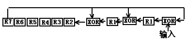

# 循环冗余检验 CRC

> 原文：[`www.pediy.com/kssd/pediy11/126361.html`](https://www.pediy.com/kssd/pediy11/126361.html)

在学 TCP/IP 中，关于 Ethernet 帧结构中的最后一部分**帧校验字段 FCS**（4B），在编程通信程序时，我们需对数据链路层通信 Ethernet 帧进行校验，即对帧校验字段 FCS 进行校验。FCS 采用 32 位 CRC 校验。校验的范围包括目的地址、源地址字段、类型字段、数据字段。在接受段进行校验，如果发现错误，帧将被丢弃。  
**下面是关于 CRC 的循序渐进的知识：**  
    循环冗余码校验（CRC=cyclic redundancy check），是一个信息字段和校验字段的长度可以任意选定的差错校验码。  
    **原理：**任意一个由二进制位串组成的代码都可以和一个系数仅为‘0’和‘1’取值的多项式一一对应。例如：代码 1010111 对应的多项式为 x6+x4+x2+x+1，而多项式为 x5+x3+x2+x+1 对应的代码 101111。发过来看：x8+ x2+x1+1= 1\*x8+0\*x7+ 0\*x6+0\*x5+0\*x4+1\*x2+1\*x1+1\*1，所得到的代码是 100000111。  
    **CRC 码集选择的原则：**若设码字长度为 N，信息字段为 K 位，校验字段为 R 位(N=K+R)，则对于 CRC 码集中的任一码字，存在且仅存在一个 R 次多项式 g(x)，使得 V(x)=A(x)g(x)=xRm(x)+r(x);其中: m(x)为 K 次信息多项式， r(x)为 R-1 次校验多项式，g(x)称为生成多项式：g(x)=g0+g1x1+ g2x2+...+g(R-1)x(R-1)+gRxR。发送方通过指定的 g(x)产生 CRC 码字，接收方则通过该 g(x)来验证收到的 CRC 码字。  
    **CRC 校验码软件生成方法：**借助于多项式除法，其余数为校验字段。例如：信息字段代码为: 1011001；对应 m(x)=x6+x4+x3+1 。假设生成多项式为：g(x)=x4+x3+1；则对应 g(x)的代码为: 11001 。x4m(x)=x10+x8+x7+x4 对应的代码记为：10110010000；x4m(x)/ g(x)即采用多项式除法（如何运算见下段）: 得余数为: 1010 (即校验字段为：1010）。发送方：发出的传输字段为: 1 0 1 1 0 0 1 1010（信息字段 校验字段）。接收方：使用相同的生成码进行校验:接收到的字段/生成码（二进制除法）如果能够除尽，则正确。  
给出余数（1010）的计算步骤：除法没有数学上的含义，而是采用计算机的模二除法，即，除数和被除数做异或运算。进行异或运算时除数和被除数最高位对齐，按位异或。  
　　1011001 0000  
　　-11001  
　　--------------------------  
　　=01111010000  
　　1111010000  
　　-11001  
　　-------------------------  
　　=0011110000  
　　11110000  
　　-11001  
　　--------------------------  
　　=00111000  
　　111000  
　　- 11001  
　　-------------------  
　　= 001010  
**以下是 8 位 CRC 校验为例：**  
      关于 CRC 校验实现的方法有很多，简单起见，采用 8 位 CRC 校验，其生成多项式为 G（x）= x8+ x2+x1+1。例：一个实现 CRC-8 的硬件电路：由 8 个移位寄存器和 3 个异或单元组成。  
  
      计算过程如下：  
    （1）开始编码解码前所有寄存器清 0。  
    （2）输入位作为最左边异或或操作的输入之一，8 个寄存器上的移位操作同时进行，均为左移一位。  
    （3）每次移位时寄存器 R7 的输出作为所有 3 个异或操作的输入之一，寄存器 R0 的输出作为中间异或操作的输入之一，寄存器 R1 的输出作为最左边异或操作的输入之一。  
    （4）各个异或操作的结果作为它左边那个寄存器的输入位。  
    （5）重复以上操作，每输入一位就做一次移位操作，直到输入了所有要计算的数据为止。这时，这个寄存器组中的数据就是 CRC-8 的结果。  
    以 1010 为例，将 1010 后补 8 个 0 所得的比特序列（即 101000000000）当做输入值，8 个移位寄存器组中的值为 00110110。该结果与 101000000000 除以 100000111（G（x）= x8+ x2+x1+1）所得的余数相同。  
    对上面计算过程分析可以得到，当寄存器 R7 的移出位为 1 时，寄存器组才和 00000111 进行 XOR 运算；移出位为 0 时，不做运算。每次寄存器中的数据左移后就需要从输入数据中读入一位新的数据，如果读入的新数据为 1，则需要把寄存器 R0 置为 1，然后再判断寄存器是否需要与 00000111 进行 XOR 运算。  
    思路：  
    //register8 是一个 8 位的寄存器，把 register8 中的值置为 0，在原始数据后添加 8 个 0（因为校验字段为 8 位，得到的是 x8 m(x)）  
    

代码:

```
While(数据未处理完)
{
  if(register8 首位是 1)
  {
    register8 中的数据左移 1 位;
    if(从输入中读入的新数据为 1)
    {
      将 register8 的最低位置 1;
    }
    register8= register8 XOR 00000111
  }
  else
  {
    register8 中的数据左移 1 位;
    if(从输入中读入的新数据为 1)
    {
      将 register8 的最低位置 1;
    }
  }
}

```

把上面思路实现如下：  
代码:

```
void checkCRC(int &chCurrByte, int chNextByte)
{
  // CRC 循环：每次调用进行 8 次循环，处理一个字节的数据。
  for (int nMask = 0x80; nMask > 0; nMask >>= 1)
  {
    if ((chCurrByte & 0x80) != 0)    // 首位为 1：移位，并进行异或运算    
    {  
      chCurrByte <<= 1;        // 移一位
      if ( (chNextByte & nMask) != 0)  // 补一位
      {
        chCurrByte |= 1;
      }
      chCurrByte ^= 7;        // 首位已经移出，仅对低 8 位进行异或运算，7 的二进制为 0000,0111
    }
    else                // 首位为 0，只移位，不进行异或运算
    {    
      chCurrByte <<= 1;        // 移一位
      if ( (chNextByte & nMask) != 0)  // 补一位
      {
        chCurrByte |= 1;
      }
    }
  }
}

```

**CRC-32 校验：**  
      前面介绍的串行方法，对于任意长度的生成多项式 G（x）都是适用。如果发送的数据块很长的话，这种方法就不太合适，效率太低。为了提高效率，可以一次处理 8,16 或 32 位。  
    Ethernet 一般是对一帧数据进行 CRC 校验，而字节是帧的基本单位，所以最常用的 CRC 校验算法是按字节查表的快速算法：本字节后的 CRC 码，等于上一节 CRC 右移 8 位和本字节之和再与上一字节余式 CRC 码的低 8 位左移 8 位相加所求的 CRC 码。如果把 8 位二进制序列数的 CRC（共 256 个）全部计算出来放在一个表中，编码时只要从表中查找对应的值进行处理即可。  
   下面给出网上搜到的参数表生成程序：  
代码:

```
#include <stdio.h>
    unsigned long int crc32\_table\[256\];
    unsigned long int ulPolynomial = 0x04c11db7;
    unsigned long int Reflect(unsigned long int ref, char ch)
    { unsigned long int value(0);
          // 交换 bit0 和 bit7，bit1 和 bit6，类推
          for(int i = 1; i < (ch + 1); i++)
          {  if(ref & 1)
                        value |= 1 << (ch - i);
               ref >>= 1; }
          return value;
    }
    init\_crc32\_table()
    { unsigned long int crc,temp;
          // 256 个值
          for(int i = 0; i <= 0xFF; i++)
          {   temp=Reflect(i, 8);
                 crc32\_table\[i\]= temp<< 24;
                 for (int j = 0; j < 8; j++){
               unsigned long int t1,t2;
             unsigned long int flag=crc32\_table\[i\]&0x80000000;
                  t1=(crc32\_table\[i\] << 1);
                  if(flag==0)
                    t2=0;
                  else
                    t2=ulPolynomial;
                  crc32\_table\[i\] =t1^t2 ;  }
                 crc=crc32\_table\[i\];
                 crc32\_table\[i\] = Reflect(crc32\_table\[i\], 32);
          }
    }

```

运用查表法来完成 CRC-32 校验码的程序：  
代码:

```
unsigned   long     crc\_32\_tab\[256\]=
{0x00000000,   0x77073096,   0xee0e612c,   0x990951ba,   0x076dc419,   0x706af48f,   0xe963a535
,   0x9e6495a3,0x0edb8832,…,   0x5a05df1b,   0x2d02ef8d   
  };//事先计算出的参数表，共有 256 项，未全部列出。   
    
  unsigned   long   GenerateCRC32(char   xdata   \*   DataBuf,unsigned   long len)   
  {   
      unsigned   long   oldcrc32;   
      unsigned   long   crc32;   
      unsigned   long   oldcrc;   
      unsigned     int   charcnt;   
      char   c,t;   
      oldcrc32   =   0x00000000;   //初值为 0   
      charcnt=0;   
      while(len--)
     {   
           t= (oldcrc32   >>   24)&0xFF;       //要移出的字节的值   
       oldcrc=crc\_32\_tab\[t\];                   //根据移出的字节的值查表   
       c=DataBuf\[charcnt\];                     //新移进来的字节值   
       oldcrc32=   (oldcrc32   <<   8)   |   c;   //将新移进来的字节值添在寄存器末字节中   
       oldcrc32=oldcrc32^oldcrc;           //将寄存器与查出的值进行 xor 运算   
       charcnt++;   
     }   
     crc32=oldcrc32;   
     return   crc32;   
  }   

```