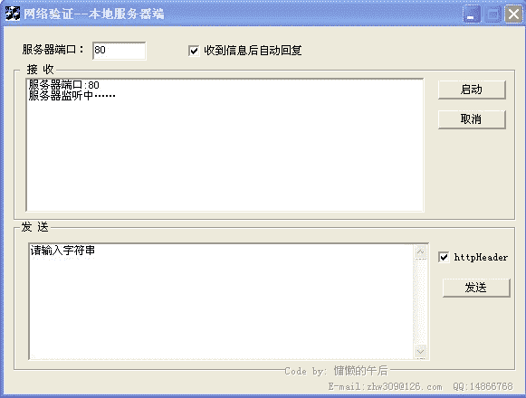

# 一种软件网络验证方式的实现 + 网络验证转本地验证的一种实现（附 VC 源码）

> 原文：[`www.pediy.com/kssd/pediy11/113849.html`](https://www.pediy.com/kssd/pediy11/113849.html)

  写在前面：这两个源文件并没有什么最新技术，只是这几天我在跟踪几个软件发现都是用这种网络验证方式实现的，感觉这种验证方式还是比较常用的一种，因此就写了出来，是对我自己的一种总结，也给有需要的人看看吧。  欢迎拍砖，欢迎看到更好的方式，如果能抛砖引玉那就更让人欣慰了！  
  
  
      目前很多软件都是通过网络验证来实现的，一种比较流行的方式便是把服务器端（如验证网页）放在服务器上，软件为客户端，当软件注册或启动时通过网络与服务器端进行数据交换，重新实现验证的目的。  
      个人觉得网络验证将是一种趋势，做得好的网络验证方式将是对软件的一种极大保护，如把软件的关键数据或关键代码放在服务器端，当认证通过后再发回到软件，且在传输过程中都用比较成熟的大型算法加密，从而达到一种防破解的目的。举个简单的例子，软件 SMC 加传输数据的 RSA 加密便是一个强度还可以的保护，再比如说，你做一个论坛推广的软件，客户端用户在注册的时候把 论坛的用户名和密码 发送给服务端，服务端通过后对论坛进行注册（这个就是我所谓的关键代码放在服务端），然后再返回注册信息（如所注册的论坛网址和用户名，密码），因此即使用户通过包模拟也是没有用的，你替别人宣传吗？ ：）  
  
      网络验证方式的实现程序只是一个示例，显示其最简单的实现方式，程序很好的可移植性和很大的发挥空间。  
      服务端为一个验证网页 Conn.asp，getinfo.asp，data.mdb，只需把它放至空间上，其中访问 getinfo.asp 的格式为：getinfo.asp?username = XXXXXXX & password = XXXXXXX,(XXXXXX 表示需要提交确认的用户名和密码)。  
      软件的实现方式为经典的 wininet 编程，其流程（类似 closehandle 之类的就不列出来了）基本上为：  
    1,hInternet = OpenInternet ()  
      2,hConnection = OpenConnection (hInternet, szUrl, szUsrName, szUsrPwd) ;  
      3,hRequest = OpenRequest (hConnection, HttpTool::szPost, szUrl, dwFlags, szReferer) ;  
      4,AddRequestHeader (hRequest) ;  
      5,SendRequest (hRequest, dwTotalByte.Value ()) ;  
      6,EndRequest (hRequest)  
  
      通过反汇编分析发现其实 SendRequest 后内存中即已发现返回包的值，接下去便为对接受到的包的读取部分,分别为其头部和内容部分的读取，再根据实际返回值判断用户名或密码是否正确。  
    以上即是对网络验证的最简单的实现，详细内容见源代码（目前源代码中 wininet 部分为 Ryeol 的封装类，佩服他的完美封装。另：用户需要根据服务端的实际网址修改对应代码，如更改为：m\_strSvrURL=(\_T("http://127.0.0.1/softreg/getinfo.asp"));  
）。  
  
\-------------------------------------------------------------------------------------------------------  
  
网络验证转本地验证的一种实现方式：  
抓取包的分析过程我就不说了，这里面牵扯到太多东西了，我的源程序只是一个很简单的本地服务器，当有验证信息过来时根据需要发相应的包回去（socket），从而达到欺骗软件得到验证的结果。  
  
  
  
  
    BIN 文件.rar 是上面生成的两个程序，一个是网络验证程序（我已经把验证的 IP 改为 127.0.0.1，现实中也可通过该 host 方式实现），另一个即是本地服务器端，只要在发送的内容中填写 123456789 即可对软件进行欺骗验证。

上传的附件
|  || 软件网络验证.rar  
 |
|  || NetLocal(转本地认证源文件).rar  
 |
|  || Bin 文件.rar  
 |