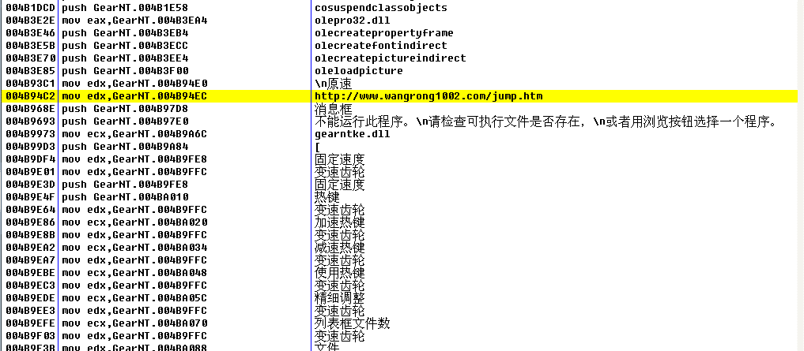
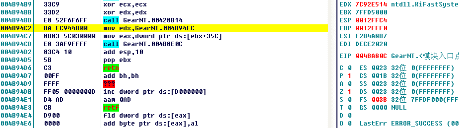

# 自己修改的变速齿轮 0.46 版本

> 原文：[`www.pediy.com/kssd/pediy12/135432.html`](https://www.pediy.com/kssd/pediy12/135432.html)

使用过变速齿轮的朋友,一定知道这款加速工具的优点.  
  
 今天朋友说变速齿轮新版有弹出广告的陋习,于是就动手操作了一下,非常简单,和大家分享一下.  
  
 方法:用 OD 打开后直接查找 unicode,然后输入 www 查找,可以找到如下位置:  
  
  
  
  
  
一看就是一个实时更新的跳转网页地址,然后双击来到这里:  
  
  
  
  
  
  
很简单的修改:直接改成 mov edx,0 .改成 nop 也行,但是运行后会有弹窗,比较恶心.  
  
亲测,加速效果依旧完美!

上传的附件
|  || 变速齿轮 0.46.rar  
 |