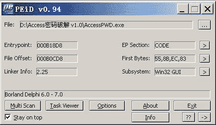
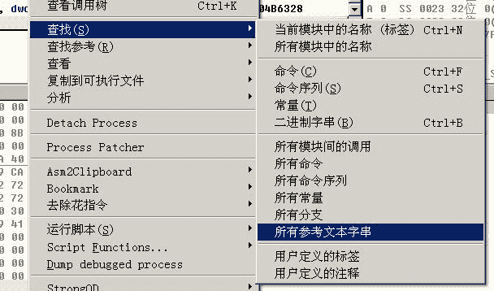
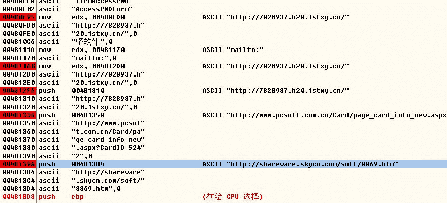
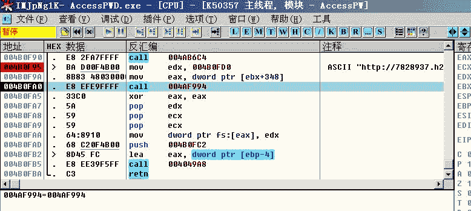
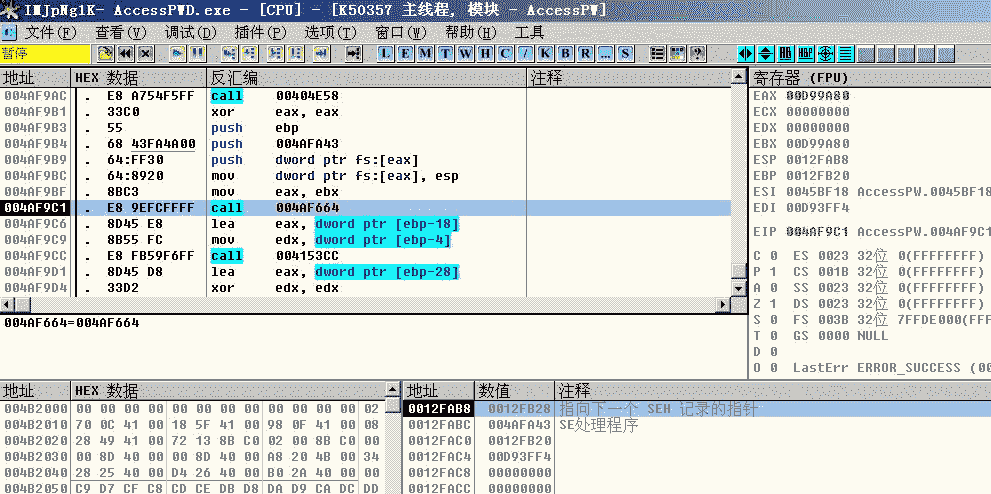
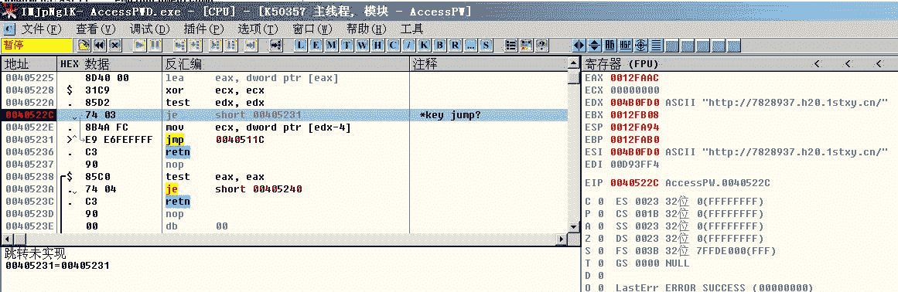

# 轻轻松松去除 ACCESS 密码破解 1.0 的内置网络链接

> 原文：[`www.pediy.com/kssd/pediy11/116384.html`](https://www.pediy.com/kssd/pediy11/116384.html)

【文章标题】: 轻轻松松去除 ACCESS 密码破解 1.0 的内置网络链接  
【文章作者】: appleibm  
【作者邮箱】: ibming@126.com  
【软件名称】: ACCESS 密码破解 1.0  
【软件大小】: 1M 左右  
【下载地址】: http://www.onlinedown.net/soft/37067.htm  
【加壳方式】: 无  
【保护方式】: 内置链接检查  
【编写语言】: Delphi  
【使用工具】: OD,winhex,PEid  
【软件介绍】: 号称能破解任何 Access 密码!  
【作者声明】: 只是感兴趣，没有其他目的。失误之处敬请诸位大侠赐教!  
\--------------------------------------------------------------------------------  
【详细过程】  
  今天整理硬盘，突然发现了一个不明的 Access 数据库文件，而且体积还不小，超过 4M，想看看里面究竟是什么，一打开，我擦，居然有密码。  
  百度 Access 密码破解软件，找到了本文的主角。  
    
  看网页介绍是纯绿色软件，下下来一看，还要安装，言而无信，心中不爽。setup 之，软件居然自己打开内置网页，虽说作者可以做广告，但是这样就不能号称“绿色软件”了，对吧？  
  嘛叫绿色软件？纯天然无公害的才是，一心一意为人民服务的才是，脱离低级趣味纯洁无私的才是！  
  算了，不看广告，看疗效吧！打开数据库文件，发现密码根本不能破译或者说根本不能破解加密的 Access 密码，只有未加密的简单密码才可以破解。  
  这种把三聚氰胺当蛋白质的软件让我一下子火大了！你说纯绿色软件，咱认了；你说无任何限制，咱认了；你自己“带三个婊”还要树牌坊，咱忍了。可是千不该万不该，作者不该吹牛说大话，号称能破解各种版本的 Access 密码啊！更令人发指的事情还在后面！我嫌网页连接麻烦，fish yes 动用 winhex 搜索“http”字串，然后全部 00 00 了（注意不是字符'0'，而是十六进制 00），再打开程序后突然发现按钮全是灰色的了，连退出的按钮都是灰色的！！！！！  
  面对着这个牛皮大大，功用小小，限制多多的“纯绿色”软件，我的小宇宙终于爆发了！  
  原程序查壳，无壳！  
    
  OD 载入，查看所有字串，所有的“http://xxxxxxxxx”字串下断，  
    
     
  F9 运行，被断了下来，F8 到了一个 CALL，F7 跟进，  
     
     
再往下跟了两步，又发现一个 CALL，跟进，不久就到了 0040522C 这个地方，看到寄存器的字串，怀疑可能开始关键跳了，先模拟汇编了一把，将 je 改成 jne，果然是关键跳。  
    
记下地址和十六进制码 74 03。用 winhex 打开原程序，先把字串"http:xxxxxxxxxxx”统统清零，然后来到文件偏移 0000462C 处（这个偏移如何计算的不用说了），将 74 改成 75，保存后退出。再次运行，哇，整个世界干净了！  
    
    
\--------------------------------------------------------------------------------  
【经验总结】  
  1、查找字串，下断  
  2、跟踪比较，找到关键跳  
  3、修改判断，完成爆破  
  4、很简单，当做闲暇时的一种放松练习吧！  
  5、虽然整篇文字用了戏谑的口吻，不过希望原作者不要介意，毕竟这也是他的劳动成果！  
    
\--------------------------------------------------------------------------------  
【版权声明】: 本文原创于看雪技术论坛, 转载请注明作者并保持文章的完整, 谢谢!  
  
                                                       2010 年 07 月 07 日 15:08:11