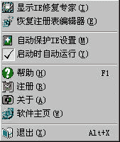

# 按钮变为灰色

> 原文：[`www.pediy.com/kssd/pediy05/pediy50207.htm`](https://www.pediy.com/kssd/pediy05/pediy50207.htm)

如何将按钮变为灰色（应网友要求修改稿）   
  
作者：囚童   
工具：TRW2000   
　　　ULTRAEDIT   
  
1、运行 TRW2000，将其最小化。   
  
2、运行应用程序，调出要修改的按钮所在窗口。   
　　如图：   
　　  
　　此例中要改注册按钮为灰色，注意：注册两字后面的(R)。   
  
3、按 CTRL+N 调出 TRW2000。   
  
4、下 PMODULE 指令，返回 WINDOWS 窗口。   
  
5、点要修改的按钮，被 TRW2000 拦截，光标停留在应用程序域。   
  
6、在光标所在行上面的那个 CALL 上下断。   
  
7、重新运行应用程序，再次调出要修改的按钮所在窗口，被所下断点拦截。   
  
8、清中断并下指令：   
　　S DS:400000 L100000 28 26 52 29 （回车）   
　　或   
　　S DS:400000 L100000 '(&R)' （回车）   
　　   
　　其中：40000 是应用程序的基地址，100000 是程序装入内存的总长度（可根据实际情况灵   
　　活掌握），搜索码 28 26 52 29 是(&R)的 ASCII 码。之所以用(&R)，而不用“注册”搜索，   
　　是因为(R)较容易观察到，不用翻译中文机器码。   
  
　　回车后 TRW2000 返回下面的信息：   
  
　　409BA5 IN XXXXXX！.RSRC+EBA5   
  
　　说明 TRW2000 找到该按钮菜单的相关信息在.RSRC 段的+EBA5，   
　　此时数据窗口也显示 409BA5 开始的数据。   
  
9、按 ALT+↑，使数据的内存映象从 409B95 开始显示   
  
　　490B80 65 6C 70 43 6C 69 63 6B-00 00 09 54 4D 65 6E 75 elpClick...TMenu   
　　490B90 49 74 65 6D 02 52 31 07-43 61 70 74 69 6F 6E 06 Item.R1.Caption.   
　　490BA0 08 D7 A2 B2 E1 28 26 52-29 0A 49 6D 61 67 65 49 .注册(&R).ImageI   
　　490BB0 6E 64 65 78 02 02 07 4F-6E 43 6C 69 63 6B 07 0B ndex...OnClick..   
　　490BC0 62 74 6E 52 65 67 43 6C-69 63 6B 00 00 09 54 4D btnRegClick...TM   
  
　　可以看出，将 07 OnClick 07 0B btnRegClick 改为 07 Enabled 08，并补足其余的空间，   
　　即可使注册按钮变为灰色，且被禁止激活。   
  
10、用以下数据制作 LOADER，或用 ULTRAEDIT 作如下修改：   
　　   
　　409BA9：   
　　0A 49 6D 61 67 65 49 6E 64 65 78 02 02 07 4F 6E 43 6C 69 63 6B 07 0B 62 74 6E 52 65 67 43 6C 69 63 6B   
　　20 20 20 20 20 20 20 20 20 20 20 20 0A 49 6D 61 67 65 49 6E 64 65 78 02 02 07,45 6E 61 62 6C 65 64 08   
  
　　其中：12 个空格是因为 OnClick 07 0B btnRegClick 去掉后，Enabled 08 比它少 12 个字   
　　符，因此用空格补足。空格只能补在可显示的字符串后面，其他参数项的位置向后顺延。   
  
11、用以下数据制作 LOADER，或用 ULTRAEDIT 作如下修改：   
　　   
　　409BA0：   
　　08   
　　14   
  
　　串长度增加 0Ch。   
  
12、存盘,重新运行应用程序，注册按钮变为灰色，且被禁止激活。   
  
　　改后内存映象：   
　　490B80 65 6C 70 43 6C 69 63 6B-00 00 09 54 4D 65 6E 75 elpClick...TMenu   
　　490B90 49 74 65 6D 02 52 31 07-43 61 70 74 69 6F 6E 06 Item.R1.Caption.   
　　490BA0 14 D7 A2 B2 E1 28 26 52-29 20 20 20 20 20 20 20 .注册(&R)        
　　490BB0 20 20 20 20 20 0A 49 6D-61 67 65 49 6E 64 65 78      .ImageIndex   
　　490BC0 02 02 07 45 6E 61 62 6C-65 64 08 00 00 09 54 4D ...Enabled....TM   
  
改前后图象对比：   
　　   
  
  
说明：   
  
①、该按钮菜单项的资源可以用下面的方式来表达：   
  
　　object R1: TMenuItem            ;菜单项   
　　　Caption = '注册(&R)'          ;可显示的字符串   
　　　ImageIndex = 2                ;图标   
　　　OnClick = btnRegClick        ;键响应   
　　end   
　　   
　　它在内存中有一个固定的长度，   
　　其中 ImageIndex、OnClick 等参数所占用的内存空间是可用空间。   
  
　　修改后：   
  
　　object R1: TMenuItem   
　　　Caption = '注册(&R)            '   
　　　ImageIndex = 2   
　　　Enabled = False   
　　end   
  
②、修改内存后，原有空间内的所有内容都必须是合法的资源表达，否则 WINDOWS 会认为资源   
　　找不到而报错。无法表达的空间可以填写合法而无意义的参数或用空格来填充。空格只能   
　　补在可显示的字符串后面。   
  
③、内存中字串前面的一字节十六进制数，指示字串的长度，若字串长度被修改，该数值也应   
　　做相应的修改。   
  
④、上面的示例若改为使用 ImageIndex 参数所占用的内存空间，修改的字节数会大大减少，   
　　适合制作 LOADER，但图标将消失。 

1.对于 delphi、vb、c+builder 等，“菜单”控件的属性控制默认直接定义在表单中，编译为 exe 程序后也基本以原表单形式储存，所以可以通过修改表单来激活或灭活菜单   
  这也是囚童上文所写的方法   
  
  
2.vc，c 编译的程序好像不存在类似表单，（因为其以 MS API 函数直接编写并控制），所以需要用 api 函数来对付，如 enablemenu 等   
  此外，对于 delphi、vb、c+builder 等，若其也通过函数来控制“菜单”控件的某些属性，则也同于此例  4dd466d0e1e0cc123afbe504da2462ca