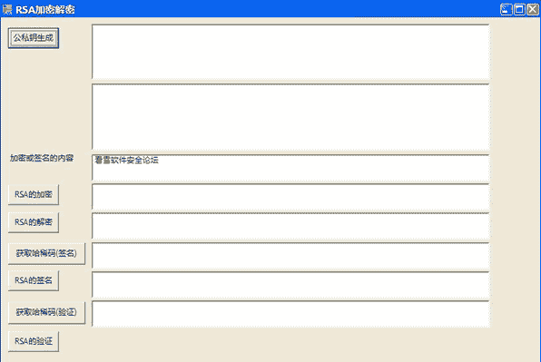

# .NET 中 RAS 加解密和签名与验证的 c#实现代码讲解，及实现程序提供，源码自己 Reflector。

> 原文：[`www.pediy.com/kssd/pediy10/77341.html`](https://www.pediy.com/kssd/pediy10/77341.html)

第一次发表原创，申请加精。提供实现程序，自己可以 Reflector。代码没有加密等。  
  
  
RSA 加密算法是一种非对称加密算法。在公钥加密标准和电子商业中 RSA 被广泛使用。RSA 是 1977 年由罗纳德李维斯特（Ron Rivest）、阿迪萨莫尔（Adi Shamir）和伦纳德阿德曼（Leonard Adleman）一起提出的。当时他们三人都在麻省理工学院工作。RSA 就是他们三人姓氏开头字母拼在一起组成的。  
  
     公钥和私钥的产生  
假设 Alice 想要通过一个不可靠的媒体接收 Bob 的一条私人讯息。她可以用以下的方式来产生一个公钥和一个密钥：  
1.随意选择两个大的质数 p 和 q，p 不等于 q，计算 N=pq。   
2.根据欧拉函数,不大于 N 且与 N 互质的整数个数为(p-1)(q-1)   
3.选择一个整数 e 与(p-1)(q-1)互质,并且 e 小于(p-1)(q-1)   
4.用以下这个公式计算 d：d× e ≡ 1 (mod (p-1)(q-1))   
5.将 p 和 q 的记录销毁。   
e 是公钥，d 是私钥。d 是秘密的，而 N 是公众都知道的。Alice 将她的公钥传给 Bob，而将她的私钥藏起来。  
  
     加密消息  
     假设 Bob 想给 Alice 送一个消息 m，他知道 Alice 产生的 N 和 e。他使用起先与 Alice 约好的格式将 m 转换为一个小于 N 的整数 n，比如他可以将每一个字转换为这个字的 Unicode 码，然后将这些数字连在一起组成一个数字。假如他的信息非常长的话，他可以将这个信息分为几段，然后将每一段转换为 n。可以将 n 加密为 c，计算 c 并不复杂。Bob 算出 c 后就可以将它传递给 Alice。  
  
      解密消息  
      Alice 得到 Bob 的消息 c 后就可以利用她的密钥 d 来解码。可以公式来将 c 转换为 n，得到 n 后，她可以将原来的信息 m 重新复原。  
   
      签名消息  
      RSA 也可以用来为一个消息署名。假如甲想给乙传递一个署名的消息的话，那么她可以为她的消息计算一个散列值，然后用她的密钥加密这个散列值并将这个“署名”加在消息的后面。这个消息只有用她的公钥才能被解密。乙获得这个消息后可以用甲的公钥解密这个散列值，然后将这个数据与他自己为这个消息计算的散列值相比较。假如两者相符的话，那么他就可以知道发信人持有甲的密钥，以及这个消息在传播路径上没有被篡改过。  
安全  
      假设偷听者乙获得了甲的公钥 N 和 e 以及丙的加密消息 c，但她无法直接获得甲的密钥 d。要获得 d，最简单的方法是从 c 算出 n，然后将 N 分解为 p 和 q，这样她可以计算(p-1)(q-1)并从而由 e 推算出 d。至今为止还没有人找到一个多项式时间的计算方法来分解一个大的整数的因子，但至今为止也还没有人能够证明这种算法不存在（见因式分解）。  
      至今为止也没有人能够证明对 N 进行分解因式是唯一的从 c 导出 n 的方法，但今天还没有找到比它更简单的方法。（至少没有公开的方法。）  
      因此今天一般认为只要 N 足够大，那么黑客就没有办法了。  
  
      .Net 的推出，我们能够利用.Net Framework 中的类提供的加密服务来保证数据安全。目前应用较为广泛的加密方法是使用 RSA 算法进行加密。在.Net Framework 中与 RSA 加密算法相关的类主要有两个：RSA 类和 RSACryptoServiceProvider 类。按照 MSDN 的说法 RSA 类是“表示 RSA 算法的所有实现均从中继承的基类”，而 RSACryptoServiceProvider 类是“使用加密服务提供程序 (CSP) 提供的 RSA 算法的实现执行不对称加密和解密”。另外，“表示 RSA 算法的标准参数”的 RSAParameters 结构也是很重要的，它保存了 RSA 算法的参数。  
  
      这里具体讲述一下在 C#中如何使用框架提供的 RSA 算法来对我们的信息加密、签名、验证签名、解密的这个几个步骤的实现过程  
  
      产生私钥和公钥  

代码:

```
System.Security.Cryptography.RSACryptoServiceProvider myrsa = new RSACryptoServiceProvider();
//得到私钥主要保存了 RSAParameters 中的 8 各参数
privateKey = myrsa.ToXmlString(true); 
//得到公钥保存了 RSAParameters 中 2 个参数
publicKey = myrsa.ToXmlString(false); 

```

RAS 实现加密代码:

```
System.Security.Cryptography.RSACryptoServiceProvider myrsa = new RSACryptoServiceProvider();
//得到公钥
myrsa.FromXmlString(publicKey);
//把你要加密的内容转换成 byte\[\]
PlainTextBArray = (new UnicodeEncoding()).GetBytes(“这里是你要加密的内容”);
//使用.NET 中的 Encrypt 方法加密
CypherTextBArray = myrsa.Encrypt(PlainTextBArray, false);
//最后吧加密后的 byte\[\]转换成 Base64String，这里就是加密后的内容了
Result = Convert.ToBase64String(CypherTextBArray);

```

RAS 实现解密代码:

```
System.Security.Cryptography.RSACryptoServiceProvider myrsa = new RSACryptoServiceProvider();
//得到私钥
myrsa.FromXmlString(xmlPrivateKey);
//把原来加密后的 String 转换成 byte\[\]
PlainTextBArray = Convert.FromBase64String(“刚才加密后的 string”);
//使用.NET 中的 Decrypt 方法解密
DypherTextBArray = myrsa.Decrypt(PlainTextBArray, false);
//转换解密后的 byte\[\]，这就得到了我们原来的加密前的内容了
Result = (new UnicodeEncoding()).GetString(DypherTextBArray);

```

    获取 MD5 的 Hash 描述表  
代码:

```
System.Security.Cryptography.HashAlgorithm MD5 = System.Security.Cryptography.HashAlgorithm.Create("MD5");
Buffer = System.Text.Encoding.GetEncoding("GB2312").GetBytes(m\_strSource);
HashData = MD5.ComputeHash(Buffer);

```

RSA 签名代码:

```
System.Security.Cryptography.RSACryptoServiceProvider MYRSA = new System.Security.Cryptography.RSACryptoServiceProvider();
//得到私钥
MYRSA.FromXmlString(KeyPrivate);
//使用.NET 中提供的 RSA 签名，生成刚才我们的 MYRSA 私钥的签名对象 RSAFormatter
System.Security.Cryptography.RSAPKCS1SignatureFormatter RSAFormatter = new System.Security.Cryptography.RSAPKCS1SignatureFormatter(MYRSA);
//设置签名的算法为 MD5
RSAFormatter.SetHashAlgorithm("MD5");
//执行签名 EncryptedSignatureData 就是签名后的数据
EncryptedSignatureData = RSAFormatter.CreateSignature(“MD5 的 Hash 描述表”);

```

RSA 签名验证代码:

```
System.Security.Cryptography.RSACryptoServiceProvider MYRSA = new System.Security.Cryptography.RSACryptoServiceProvider();
//得到公钥
MYRSA.FromXmlString(strKeyPublic);
//使用.NET 中提供的 RSA 签名，生成刚才我们的 MYRSA 公钥的验证签名对象 RSADeformatter
System.Security.Cryptography.RSAPKCS1SignatureDeformatter RSADeformatter = new System.Security.Cryptography.RSAPKCS1SignatureDeformatter(MYRSA);
//指定解密的时候 HASH 算法为 MD5
RSADeformatter.SetHashAlgorithm("MD5");
//验证签名，
RSADeformatter.VerifySignature(“MD5 的 Hash 描述表”, “这里是需要验证的签名数据”)

```



上传的附件
|  || RSA.rar  
 |