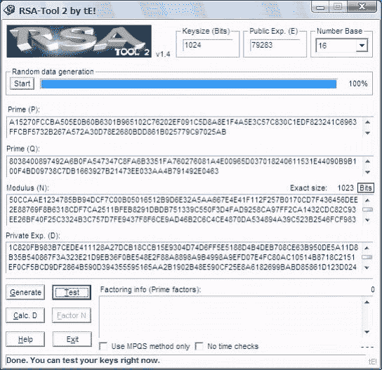
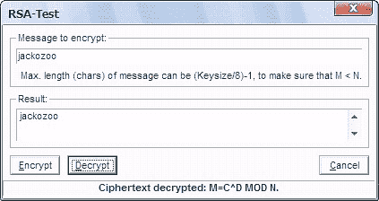

# 使用 RSA1024 算法防止软件被 Keygen

> 原文：[`www.pediy.com/kssd/pediy10/92380.html`](https://www.pediy.com/kssd/pediy10/92380.html)

学习新的知识是一件很令人高兴和满足的事情，但是能和别人分享学习的经验，更令人快乐。  
由于我是一个菜鸟，所以有很多说不清楚的地方，还希望高手指正，毕竟，讨论才是学习永恒的主题。  
  
相信大家看了密码学版块的相关文章, 已经了解了 RSA 算法. 所以对于算法部分我就不再多介绍了.  
这节里我们主要看一下将 RSA 算法用于软件的注册机制, 保证软件在不被修改的情况下无法被解密者 Keygen.  
  
对于 RSA 的秘匙长度, 我们选择 RSA1024. 即 p, q 都为 512 位. 关于为什么 p, q 的位数相同要安全些, 这些原因我不做解释, 不明白的朋友请阅读密码学板块的相关文章或一些其他的书籍 .  
  
P.S : 由于本文主要讲解的是关于软件注册方面的算法知识. 所以我们不考虑对软件进行 patch, 然后再谈注册的情况. 所以讲解的前提是不对软件数据文件进行修改.  
  
**约定**: 我们约定在软件注册过程中使用机器码和注册码的方式注册. 即在下文中, 所谈的所有软件的注册都是以机器码和注册码作为输入(忽略掉对于注册算法来说完全多余的用户名) . 我们将机器码记作 M, 注册码记作 R.  
  
**一款软件如何注册?**各种不同类型的软件各有各的注册方式, 我们从注册机的角度来看, 一般来说, 有一下几种:  
  
**1) 解密者和软件作者都无法写出注册机的软件:**  
  
   当然, 这种软件貌似存在的比较少, 不过按我个人的观点, 这种机制也不是完全不会出现到市场上, 某些情况下, 因为解密者无法写出注册机将会很大地打击解密者的心气, 部分高傲点的解密者甚至直接把软件扔到一边算了, 因为这类解密者不屑于 patch. 那么如果有人要买软件的话, 软件作者该怎么办了?   
  
这里我们要分情况讨论了:  
  
**i: 验证 M = HASH(R) 类. **  
(这里的数学算式都是最本质化的, 软件作者肯定会以其作为蓝本进行同等变化的, 下同)  
这类注册当然是无法写出注册机的, 原因很简单, HASH 算法的不可逆性. 对于一个不可逆算法, 不管你是人还是神, 你都是不可能写出注册机的, 因为要写出注册机的前提就是要求算法可逆. 那么在这种无注册机的情况下 , 软件作者就可以根据客户的机器码来生成一个相应的注册 exe, 也即 patch 式的注册小程序. 而且可以保证不同机器码的 patch 程序也不同. 呵呵~ 虽然做法很可笑, 但是你不能否认这不是一种打击 Cracker 积极性的好方法.  
  
   **ii: 网络验证类**  
    bool   bIsRegisted =   
SELECT COUNT(\*) FROM  tb\_Register WHERE M = @M AND R = @R  
    上面一句 SQL 查询语句很生动地描述了这类注册机制的通式, 很这种验证方式通过网络连接到软件作者的服务器, 然后进行查询, 若查询不到数据即证明解密者输入的注册码是错误的. 一旦查询到数据, 即为注册成功, 然后软件会将注册成功信息保存到文件,注册表等等位置, 然后下次软件启动的时候也不在连接网络了. 这种情况下, 软件作者严格意义上来说, 也是不能使用真正意义的注册机的. 软件作者能做的是, 当客户购买软件时, 将客户的(机器码, 常量注册码)对添加到数据库中(如\[BC03ED9F, “Miczosoft.MSZ”\]), 或者使用 F 函数写个辅助的假注册机生成, 然后将(M, F(M))对添加到数据库中. 然后将 F(M)发给客户告诉他这个即是注册码.  
  
**2) 解密者和软件作者都可以写出注册机的软件**  
  
这类软件目前在市场上占据这很大部分, 毫无疑问, 只要解密者可以写出注册机, 那软件作者也当然可以写出注册机了. 所以, 这里导致解密者可以写出注册机的最关键地方就是算法的可逆或类可逆.   
  
**i.**  可逆.比如注册算法 F(M,R) = f(M)  g(R) = 0 为验证算法. 这时只要 g 为可逆算法即可直接 Keygen 之. 因为若 g 可逆, 则 R = g^-1(f(M)) .  
  
**ii.**  类可逆. 这种一般是指注册算法在数学意义上并不是可逆的, 但是解密者可以利用计算机通过很短的时间内穷举数据进行求解注册码. 某些情况下, 注册码还不是唯一的!  
  
**3)解密者无法写出注册机但软件作者可以写出注册机的软件**  
  
这一类就是我们今天要讲到的重点了 ---- RSA. 严格来说, 在今天这个时代应该说是 RSA1024 .  
采用 RSA1024 的注册机制为什么可以防止解密者写出注册机而软件作者却可以大摇大摆的写出注册机并使用了?  
关键原因还是在于一个数学问题 .  关于 RSA 原理部分, 以及 RSA 弱秘匙攻击, 素性检测等部分知识请读者阅读前面的章节, 在此仅作简要说明, 不作过多介绍.  
  
选取两个别人不知道的大素数 p, q.  
公共模 n = p\*q  
欧拉值 t = (p-1)(q-1)  
选取公匙(加密匙) e , 满足 \*\*\*(e, t) = 1. 常用为 3, 65537 等.  
根据扩展欧几里德算法求得:  
私匙 d = e^-1 mod t .   
加解密算法:  
加密: 密文 c = m^e mod n  
解密: 明文 m = c^d mod n  
  
  
**软件注册机制设计:**  
  
传统的对称加密算法(比如软件作者自己发明的算法, 或 DES, AES 等), 他们的加密秘匙和解密秘匙都是可以很轻松的互相推导的, 这也导致了这样一个现象: 你软件作者能写注册机我解密者照样可以写 .  
  
但是 RSA 则不同, 它的公匙别人都可以知道, 但是私匙则只有软件作者知道.    
  
也即现在有这样一个事实: 对解密者来说, 他通过逆向工程可以知道公共模 n, 公匙 e(严格来说, e 和 d 是相对的, 谁都可以做公匙的, 这里我们就按一般大众的约定俗成将 e 成为公匙), 除此之外, 他是永远都不会知道私匙 d 的(假设 1024 足够安全, 不会被解密者因子分解).; 然而, 我们的软件作者却比解密者多知道一样东西, 那就是私匙. 根据这样一个事实, 我们不难设计一个满足标题的算法.  
  
**我们看如下的注册设计:**  
  
首先从我们的注册机角度考虑, 我们的注册机的输入是机器码, 输出是注册码, 而我们知道注册机的功能就是更具机器码得到注册码, 所以我们使用 注册码=D(h(机器码)||机器码,?d)这一公式得到特定客户的注册码. 式中的 d 因为只有软件作者知道, 所以当然是私匙了 . OK, 注册机我们确定了, 接下来就顺藤摸瓜, 很轻松地退出软件注册界面应该这么验证:  
验证 机器码 = E(注册码, e) ? 是否成立? 若此式成立, 则显然注册码与我们的注册机算出来的是一样的, 则注册成功; 否则便与我们注册机算出来的注册码不一样, 也即注册失败.  
  
现在思路很清晰了, 我们现在从软件作者的角度编写程序 .  
  
(因为我们使用 RSA1024 算法, 会涉及到大数运算, 所以大家在编写自己的软件注册机制时, 要使用大数库, 读者朋友们可以根据自己喜欢的语言选择不同的大数库, 这里我使用的是 miracl 大数库)  
  
miracl 的用法:  
  

代码:

```
miracl\* mip=mirsys(600,16); 
big p,q, e, n, m, c, c2 ; // big 直接作为关键字使用.
mip->IOBASE=16; //16 为 16 进制的意思.
n = mirvar(0) ; // 初始化为零.

bytes\_to\_big(strlen(szName),szname,c); // 用于将字节串转换为 big 大数. 
//一般用于对可见字符操作, 如用户名
//等, 我们这里应为是机器码就不需要.

我们这里是机器码, 就使用这个函数.
cinstr(c,szM); //把 szM 字符串当做 16 进制串转换为 big 大数.
cinstr(m,szR); //注册码作为 big 大数.
powmod(m,e,n,c2);

if(c == c2)
{
  注册成功.
}
else
  注册失败.

```

其中的 p, q , e, n 我们可以通过自己的随即算法得到, 但是要避免产生弱秘匙, 而且要保证随机性. 这其中为了效率, 我们还要使用素性检测来生成随即大素数. 这些工作有兴趣的朋友可以自己去完成, 这里我们就直接使用 tE!写的 RSAtool 来完成我们秘匙生成工作.  
RSATool 是国外一款非常优秀的软件, 界面图如图所示:  
  
  
  
比如我们再生成一个随机的秘匙对:  
  
代码:

```
e = 0x196BB
p=  DDF219AB7005813F5EAFE4AA496DF5B27926EB3B1E178D9B01017BEA7A35392DC5D9984A2F8877F4848B1CE501ADC70DA0562A1027B06D4934E98E1830A81C13;
q=
F9FE9F66EA6F33BB8D003AD81A28655BF36B50E5134B9966F7F9C2D05EAC037FA628F21EFCA594AAAD955EF0E5D38B1033547054F4834FDA38748608CB44B6E3;
n=
D8BD3B5FCFB5E958985FF03800BEB17F41CB11BA6D5C1F26B88699E6904EAE25BF2D876CB02F37606BA4223F5D5821397CC45C084096E664F0B0DB223419B77F5185A1D4045BD6105C77DDA97A171E8BD8299281B34F4B1127578D023A0A22A3840500EEDA46F4B7FDD35FD5CCC78739F2B42598125CE6F747AF3F8D2F1266D9;
d=
58AFF4329BAC7313F5776926EB442C496B03037FF783BC404DC20FAF671AEE61D8187A023C197C950180FFAFF103E905420EEF108FF8B551F8CAA2B90C2CE0005DA06A64CEA8EF3494232A864C79E266BECE2DAC206ABB32D1A1D35DA6A122AB8BFB5F657890F43860D31ACD2148577ED437CE905FE0BE32B40E730F9E6C36DB;

```

在我们使用 RSATool 生成完了秘匙对之后, 我们还必须测试一下, 看加密与解密能否吻合, 这其实是为了检测素性检测是否成功. 如图所示:  
  
  
  
  
**注册机编写:**  
  
注册机的编写就更简单了, 如下所示:  
代码:

```
  char szM\[MAXINPUTLEN\]={0}; //机器码
  char szR\[1024\]={0};         //待显示的注册码

  miracl\* mip=mirsys(600,16);
  big big\_N,big\_D,big\_M,big\_C;

  GetDlgItemText(NULL,IDC\_EDIT\_M,szM, sizeof(szM));
  mip->IOBASE=16;
  big\_N=mirvar(0);
  big\_D=mirvar(0);
  big\_M=mirvar(0);
  big\_C=mirvar(0);

cinstr(big\_M,szM); //机器码变为 big 大数
  cinstr(big\_N,"D8BD3B5FCFB5E958985FF03800BEB17F41CB11BA6D5C1F26B88699E6904EAE25BF2D876CB02F37606BA4223F5D5821397CC45C084096E664F0B0DB223419B77F5185A1D4045BD6105C77DDA97A171E8BD8299281B34F4B1127578D023A0A22A3840500EEDA46F4B7FDD35FD5CCC78739F2B42598125CE6F747AF3F8D2F1266D9");
  cinstr(big\_D," 58AFF4329BAC7313F5776926EB442C496B03037FF783BC404DC20FAF671AEE61D8187A023C197C950180FFAFF103E905420EEF108FF8B551F8CAA2B90C2CE0005DA06A64CEA8EF3494232A864C79E266BECE2DAC206ABB32D1A1D35DA6A122AB8BFB5F657890F43860D31ACD2148577ED437CE905FE0BE32B40E730F9E6C36DB ");

  powmod(big\_M,big\_D,big\_N,big\_C);
  cotstr(big\_C,szR);  //将 big 大数转换成 16 进制的字符串.

  SetDlgItemText(hWnd, IDC\_EDIT\_,szR);       
  mirkill(big\_C);  //释放内存.
  mirkill(big\_D);
  mirkill(big\_M);
  mirkill(big\_N);
  mirexit();       //退出大数库.

```

至此, 就基本上将 RSA1024 应用与软件的注册机制中, 当然, 这只是很简陋的一个使用 RSA 算法的示例, 各位读者朋友可以自行扩展发挥, 各位朋友们可以配个其他的算法完全能在更深层次上更加有效的保护软件的注册机制.  
  
以上给出了使用 RSA 应用于软件注册中的整个思路.   
附件中为一个使用 RSA 算法的 CrackMe. 为了使大家可以写出 keygen, 其 RSA 秘匙被我设置为不超过 100bit.  
同时给出了这个 CM 以及其对应 Keygen 的源码.   
  
PS.代码可能很乱,  不过为了让更多的人了解原理, 小菜就献丑贴代码了.  
  

上传的附件
|  || [CM&KG\_bin.rar](http://bbs.pediy.com/attachment.php?attachmentid=27907&d=1246072464)  
 |
|  || CM&KG\_src.rar  
 |