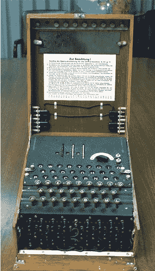
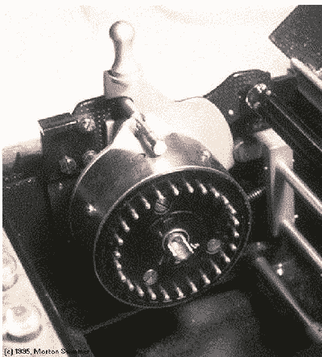
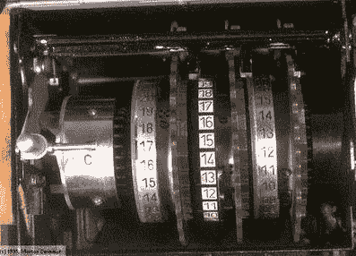
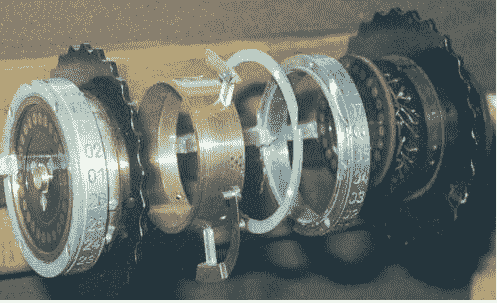
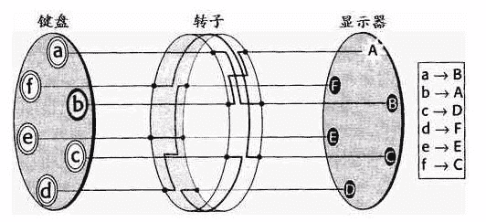
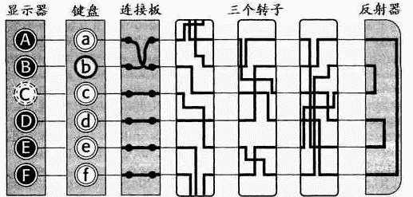
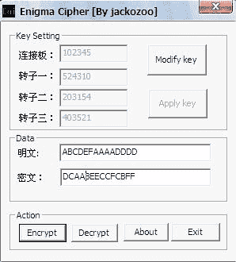

# 密码学入门系列(六) 之 Enigma 密码机(古典)

> 原文：[`www.pediy.com/kssd/pediy10/90402.html`](https://www.pediy.com/kssd/pediy10/90402.html)

【文章标题】: 密码学入门系列(六) 之 Enigma 密码机(古典)  
【文章作者】: jackozoo  
【作者邮箱】: jackozoo@163.com  
【作者声明】: 只是感兴趣，没有其他目的。失误之处敬请诸位大侠赐教!  
\--------------------------------------------------------------------------------  
【详细过程】  
**系列声明**:见一.  
  
**讲解目录**:  
  
1)Enigma 简介.  
2)Enigma 构造.  
3)Enigma 能够实际使用的原理.  
4)纠正一些网友关于 Enigma 所写的文章的部分理解错误.  
5)附带源码说明.  
  
  
**(一)Enigma 密码机简介**:  
Enigma 密码机属于轮转机的一种, 它采用的也是多表替换的思想, 而且是一个长周期的多表替换密码机. 在此系列(六)中直接拿 Enigma 出来讲是因为 Enigma 比较具有代表性(当然也是最有名气的, Enigma 出自二战时期的德国军方). 其他的一些轮转机有美国的 Sigaba, 日本的 Red 和 Purple 等, 都是二战时期的产物.Enigma 密码机说白了就是几个机械零件组合而成的. 对于轮转机而言, 它有一个键盘和一系列的转轮, 键盘用来输入明文字符串, 每个转轮是字母的任意组合, 有 26 个接线端, 用来完成一种简单的替换, 同时每个转轮的输出端连接到其下一个相邻转轮的输入端. 当输入一个明文字符时, 相应的信号从第一个轮转的输入端进入, 依次经过各个相邻的转轮,当每经过一个转轮的时候, 该转轮会转动一个位置, 当该转轮装动了一个周期之后, 其下一个转轮会转动一个位置, 这样一直到达最后一个转轮, 然后反射回来, 即可得到密文.  
  
**(二)Enigma 的构造:**  
  
Enigma 看起来就像是一个盒子一样, 大家不要觉得这个东西看起来很复杂一样, 虽然其构造复杂,但原理还是可以理清的, 不要被它的外表所吓到. 其主要的三个部件为: 键盘, 转子, 显示器 . 当然, 在后面我还会提到反射器. 由于在这里我们是从密码学的角度来看待问题的. 所以还请大家不要在键盘怎么发送信号, 转子怎么传送信号以及显示器怎么显示这些问题上钻牛角尖. 简单来说, 所有的一切都是映射而已. 只不过 Enigma 密码机的映射比较特殊.  
\[重要:\] 为了在文章中能更清晰的展示 Enigma 的结构, 我在此以 6 个字符的键盘转子显示器作为演示道具.(附带源码也是使用的 Z6 字母表, 仅仅 ABCDEF6 个字母, 这个是有原因的, 后面会讲到).  
  
先来几张图片让大家看看 Enigma 长什么样:(这几个图片不知源头来自哪儿, 因此无法注明作者信息) 

  
  

  
  
  
我们再来看下, 如何通过转动转子来达到每次替换的字母都是不一样的:  
  
  
**(三)Enigma 能够实际使用的原理**  
  
大家想, 如果只使用一个转子的话, 那么 Enigma 密码机就成了以前讲过的凯撒密码了, 就没什么价值可言了. 但聪明的德国人是通过一系列的手段使得 Enigma 在德国军方中使用这么久的.  
一下分别列出:  
  
1): 使用多个转子.(一般为 3 个, 德军后期使用的转子甚至达到了 4 个)  
2): 使用"加密一个字母后, 转动前一个字母一个位置, 满周期后, 带动下一个转子转动一个位置"的体制.  
3): 转子可自由拆卸换上新转子.  
4): 使用反射器机制, 使得加解密为统一过程.  
5): 使用了连线板, 在隐藏了字频的同时无数倍的增加了穷举破解的难度.  
6): 其他.  
  
来张图看的清楚些(这张图比前面的那张要多了些东西, 请注意看):  
  
  
(!!: 我在附带源码中, 就是使用的这幅图中的状态作为初始状态的, 另外转子,连接板和反射器的布线也是按照这个来的.)  
  
**具体讲解:**  
  
**1**. 使用 3 个转子, 使得加密周期由 26 变为了 26\*26\*26.  
  
**2**. 使用转动的传递性机制, 可以确保明文的加密方式为多表替换.  
  
**3**. 转子可自由拆卸, 这里的作用曾被很多人误解 . 包括很多人的博客中很热的关于 Enigma 的文章 (我的那些图片就是从别人一些文章中截图过来的, 另外, 由于原作者也不知道是谁, 故无法注明图片信息).   
   一些人认为 3 个转子可以自由拆卸代表转子的排列方式变丰富了, 使用排列组合的知识知我们有了 3\*2\*1 中排列方式. 所以也增大了复杂性. 实际上, 我认为并非如此. 我认为对于一个含 26 个字母的转子而言, 转子本身的种类就有了很多种, 它们主要是布线方式:  
   比如我使用 6 字母的转子为例:   
   0    5  
   1    2  
   2    4  
   3    3  
   4    1  
   5    0  
  
  可以看到上面就是一种转子, 其他的接线方式还有更多种. 我们运用排列组合的知识, 可以很轻易的写出转子总数为:A26²⁶/26 种.  
  所以我想当初设计 Enigma 密码机的人之所以要让转子可以随意拆卸的目的肯定不是增加一个 6, 而是为了使用各种不同的转子.  
    
  谈到这, 我就得说下 Enigma 的秘匙了, Enigma 的秘匙有很多因素, 为以下: 3 个转子的起始位置, 3 个转子的布线种类, 连接板的布线类型.  
  
4.反射机制其实就是为了解密能够更容易的进行, 反射板被放在最后一和转子之后, 反射板也是布线的. 比如如下:  
  反射器:  0-5 1-2 3-4, 代表的就是 0 5 互射, 1 2 互射, 3 4 互射. 这样当每一个信号到达反射板时, 信号会沿路回去的, 注意: 信号被反射回去到显示器上的时侯, 其过程中转子是不会转的, 因为信号在来的时候转子已经转过了.  
  \[思考\] 这种方式会造成一个什么问题?  
  聪明的你肯定已经想到了, 对. 那就是任意一个字母加密后都不会是它本身. 其原因就在与刚才的反射板了, 没有信号再被反射后是沿原路返回的, 所以加密后的字母不会和原字母相同的.  
  
5.连线板是个什么东西? 很多文章都把它说的很神, 不过它的确也起了很大的作用. 你只要把它当成是一个不会转的转子就 OK .   
  从某种角度来看, 连接板可以看成是单个字母替换, 不过由于有了后面的 3 个转子的工作, 密文不会暴露字频信息的.  
  我发现某些文章在计算可能出现情况的问题上也有问题, 比如, 连接板布线的方式有多少种? 这根转子的布线方式是一样的多~~ .  
  
  
  
**(四) 纠正一些关于 Enigma 的文献的部分理解错误.**  
     说明: 1. 关于转子可以拆卸的用途的误解.见上.  
             2. 关于连接板布线的方式的个数.(上面有讲解).  
  
  
**(五) 附带源码说明.**  
  
因为我查了一些文献, 但是始终找不到 Enigma 的全面的转子及连接板的布线格局 . 所以如果使用 26 个字母做字母表的话, 其转子的布线格局这个我不得而知. 所以为了谨慎起见, 我在源码中使用的是 Z6 字母表(即 A-F).  (PS. 貌似 ebay 上面在拍卖德军二战时期的 Enigma 密码机, 传言而已~) . 因此我使用了 6 字母的字母表, 他们分别是 ABCDEF 6 个字母.  
所以,在软件的使用中, 明文请输入 A-F 这 6 个字母组成的字节序列. 当然, 我建议大家看看源码, 那样会对 Enigma 有很全面的认识.  
  
转子的布线与帖子中截图的转子的布线相同.  
  
转子的初始状态使用 0,1,2,3,4,5 的序列表示.  
  
如默认的转子 1 的初始转台为:524310  
  
其意思即为: 0 1 2 3 4 5 进, 对应 5 2 4 3 1 0 出.  
  
Enigma 模逆软件 运行截图:  
  
  
  
  
    
\--------------------------------------------------------------------------------  
【版权声明】: 本文原创于看雪技术论坛, 转载请注明作者并保持文章的完整, 谢谢!  
  
                                                       2009 年 06 月 01 日 AM 11:03:19 

上传的附件
|  || Enigma\_src\_sp1.rar  
 |
|  || Enigma\_bin\_sp1.rar  
 |