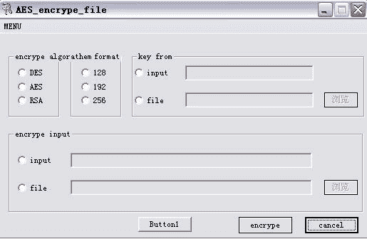
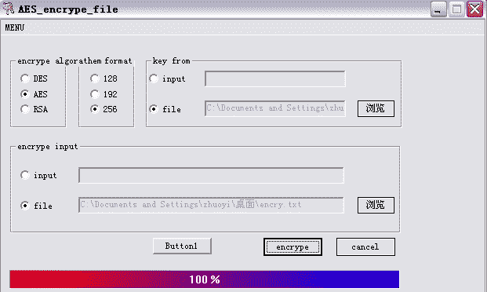

# 简单文件加密工具 VC6

> 原文：[`www.pediy.com/kssd/pediy12/132914.html`](https://www.pediy.com/kssd/pediy12/132914.html)

好久没有来看雪了，2010 年我转向 B/S 架构程序开发，学习了半年多的 ORACLE，以及简单了解了一下 JAVA 企业应用开发，学习了一些技术框架，Spring,Struts2 等。  
进入社会，我靠的是 C/C++谋求工作，对于 C/C++我一直铭记于心，我喜欢 VC6，VS2008，喜欢研究计算机底层技术，包括学习内核，驱动的编写及调试，这些技术很有意义。其实，WINDOWS 的底层技术的研究（也许您以后会玩 Linux），对于 Linux 的底层技术的学习研究也是很有帮助的，毕竟内核中都是 C 语言占主要地位。好了，少说废话，最近用我喜欢的 VC6，当然我更喜欢 VS2008，写了一个简单的文件加密工具。之所以简陋，是因为控件没有美化，所以看起来一般，不过文件加密效果还可以。分享给你  
  
  
  

上传的附件
|  || AESencrypefile.rar  
 |