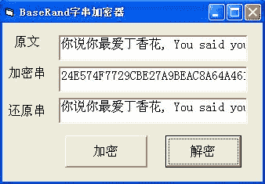

# 用 VB6.0 做出的字串加密 dll（带源码）！！

> 原文：[`www.pediy.com/kssd/pediy10/64972.html`](https://www.pediy.com/kssd/pediy10/64972.html)

code.dll 的说明：  
  这是一个由 VB 做成的 dll 文件，它支持对字串进行 Base64 和随机数加解密两种方式。  
如果要进行中英文混合加解密，可以先用 Base64 函数加解密，再用随机数解密。  
  注意，加密和解密是逆向的，如加密过程为 Rand\_Encode(Base64\_Encode(str))  
则解密过程为 Base64\_Decode(Rand\_Decode(pas))  
   
 函数原型为:  
      Public Function Rand\_Encode(ByVal x As String) As String '随机数加密，支持英文半角  
      Rand\_Decode(ByVal x As String) As String  '随机数解密，支持英文半角  
      Public Function Base64\_Decode(ByVal strSource As String) As String 'Base64 解密，支持中英文全半角  
      Public Function Base64\_Encode(ByVal strSource As String) As String 'Base64 加密，支持中英文全半角 

上传的附件
|  || codeDll.rar  
 |
|    ||   
 |