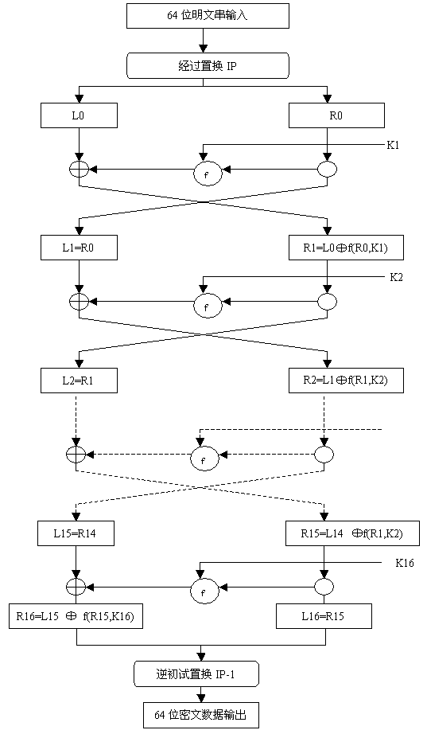
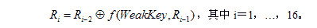
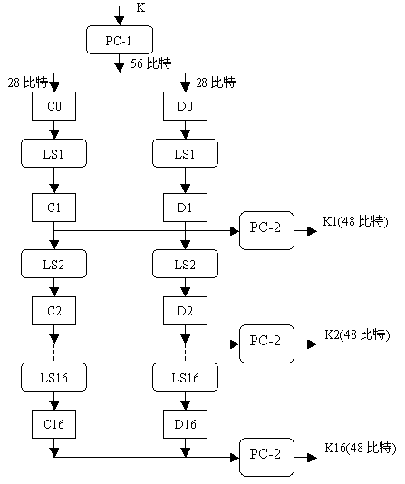

# DES(Weakkey,X)=X 的分析

> 原文：[`www.pediy.com/kssd/pediy07/pediy7-752.htm`](https://www.pediy.com/kssd/pediy07/pediy7-752.htm)

DES (Weak Key,X)=X  
 作者：winndy【FCG】【DFCG】【PYG】  
Email：cnwinndy@hotmail.com  
完稿时间：2005.12.16  
如果有疑问，欢迎大家讨论。  
  
这是密码学开卷考试的一道题目：  
在 DES 中，若 K 是弱密钥，证明存在明文 X，使 DES（K，X）＝X。  
也就是明文经 DES 加密后还是明文自身。  
  
一、首先应了解什么是 DES 弱密钥。  
    
       先从 DES 的解密说起：  
       DES 的解密过程，DES 的解密过程和 DES 的加密过程完全类似，只不过将 16 圈的子密钥序列 K1，K2……K16 的顺序倒过来。即第一圈用第 16 个子密钥 K16，第二圈用 K15，其余类推。  
       如果 K16＝K1，K15＝K2，…，K9＝K8，则加密所用的子密钥与解密所用的子密钥相同，对一个明文 X 加密两次，得到的还是明文 X。  
       更强的，若 K1＝K2＝…＝K16，则加密过程与解密过程完全一样。  
       弱密钥的定义也就是这样定义：**若 k 使得加密函数与解密函数一致，则称 k 为弱密钥。**  
      DES 至少有 4 个弱密钥，让我们先来看看子密钥的产生过程：  
        
图片来自：风雨无阻，《公路坐标计算系统  1.0》。  
http://www.pediy.com/bbshtml/BBS5/pediy50649.htm  
要了解更详细的 DES 的流程，可参考上面的文章，这里只简要介绍一下。  
  
   
  
64Bits 的密钥 K 经 PC-1 之后，变为 56Bits，然后分为高 28Bits 和低 28Bits，分别进行移位。  
LSi 是循环左移。PC-2 是从 56Bits 中选出 48Bits 输出。若 C0 和 D0 为全 0 或全 1，则经过移位后显然不变，于是 16 个子密钥都相同。C0 和 D0 是独立进行移位的，组合一下，就有 4 个弱密钥了。因此至少有 4 个弱密钥。  
(1)K1＝…＝K16＝0x000000000000  
(2)K1＝…＝K16＝0xFFFFFFFFFFFF  
(3)K1＝…＝K16＝0x000000FFFFFF  
(4)K1＝…＝K16＝0xFFFFFF000000  
  
还可以注意到，第一组和第二组是互补的，第三组和第四组也是互补的。  
事实上，对于任意密钥 k，我们还有以下关系成立：（DES 的互补性）  
若 y＝Des（k，X），则 yBar＝DES（kBar，XBar）。（后缀 Bar 表示取补）  
  
二、分析（逆推法）  
      
刚拿到这个题目，不知怎么着手。首先想到的是从置换盒 SBox 着手，  
                     DES 的加密流程图  
   
  
因为，如果存在明文 X 使得 f 函数的输出为 0，那么由于 0 Xor 0＝0，0 Xor 1＝1，那么若 L0＝R0，则 L1＝R2，…。最终必有 R16＝L0，L16＝R0。  
事实上，当我把 SBox 盒为 0 的情况都列举出来以后，根据每一种排列情况，看其是否满足 E 扩展后的格式，不幸的是，不存在任何 X 使得 f 函数的输出为 0。  
  
   回过头，再仔细观察 DES 的加密流程图，不能忽略这样一个 Xor 的基本性质：  
      A Xor B＝C，则 A＝B xor C。  
同时注意到 L[(*i*\-1)]\=R[*i*]，其中*i*＝1，…，16。  
为了简化讨论，可以写出这样的序列：  
L0，R0，R1，R2，…，R7，R8，…，R16。  
不妨记 L0＝R[\-1]，则有：  
     
下面就利用逆向分析法，来求应满足的关系式：  
   
既然 L0R0 加密后为 R16R15，那么我们令 R16＝L0，R15＝R0，然后来求 R14 看看。  
R16＝R14 Xor f（weakkey，R15），于是 R14＝R16 Xor f（weakkey，R15），  
＝L0 Xor f（weakkey，R0）＝R1，继续推下去，…  
R13＝R2，…，R8＝R7，…。即 R[*i*] =R[*15-i*] ;，i＝-1，0，…7。  
事实上，只要 R8＝R7，就可以推出其他的等式。很容易就可以证明。  
上面，得到了 R8＝R7 是 DES（weakkey，X）＝X 的必要条件。  
反过来，给定 R8＝R7，是否就有 DES（weakkey，X）＝X 成立呢？  
答案是肯定的，很容易推出来。  
  
于是，我们可以令 L0＝R0，经过 8 圈 DES 加密过程，再经过 IP-1，就可以得到满足要求的明文 X。  
我编了一个简单的程序进行了校验，结果完全是正确的。  
故满足这样的要求的明文共有 4×（2³²）个。  
事实上，利用 DES 的互补性质，只需生成 2×（2³²）个明文，就可以通过取反，得到另外 2×（2³²）个明文。  
  
三、小结  
    思路很简单，逆推就可以了，在做注册机，分析算法后，要经常逆推，得到注册流程。虽然这么简单，但我还没发现周围的同学有独立思考出来的，甚至我给了提示，也有人想不出来。我们应该反思一下我们的教育制度了，而且是研究生教育……..

 4dd466d0e1e0cc123afbe504da2462ca