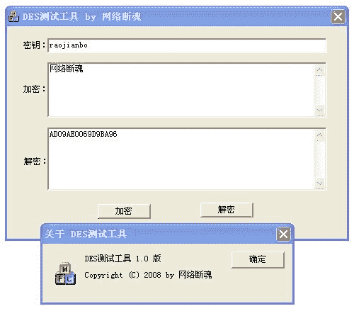

# DES 测试工具(含源码)

> 原文：[`www.pediy.com/kssd/pediy10/58001.html`](https://www.pediy.com/kssd/pediy10/58001.html)

前些时间调试软件,碰到好几个都是 DES 算法的,想做注册机,苦于没有 DES 算法源码,网上找的许多源码不是这错误就是那错误,自己又没还没能力写出来,于是挑选了尹学渊大侠的 DES 源码来修改,顺便弄了个简单的 DES 测试工具,主要目的还是放个 DES 源码出来,对于工具还是推荐 PYG 的密码学综合工具,功能比较强大!  
主要修改了原版代码中的几个点:1、加密解密时左右交换错误,2、待加密字符填充改成填充 0，3、密钥不足 7 位时数组越界问题，4、另一处的数组越界，  
  
  
希望对大家有用，欢迎大家测试指正！ 

上传的附件
|  || DES 测试工具.rar  
 |
|   
 ||  |