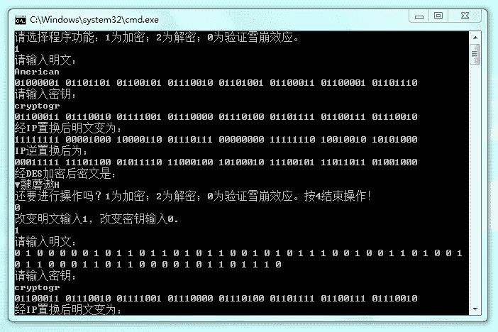

# DES 算法加密解密及雪崩效应验证

> 原文：[`www.pediy.com/kssd/pediy11/110383.html`](https://www.pediy.com/kssd/pediy11/110383.html)

我是信息安全专业的本科生。这是做密码学实验时的程序，功能包括加密、解密及对雪崩效应的验证，运行在 Visual Studio 2008 环境下  
希望得到邀请码，更好的交流和学习  
源程序在附件中  

上传的附件
|  || DES 源码.doc  
 |