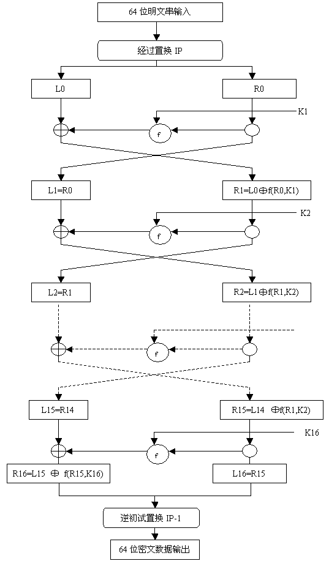
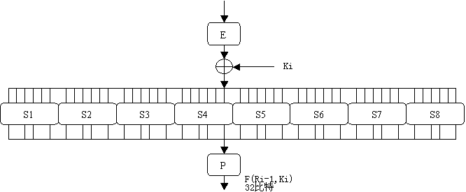
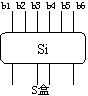
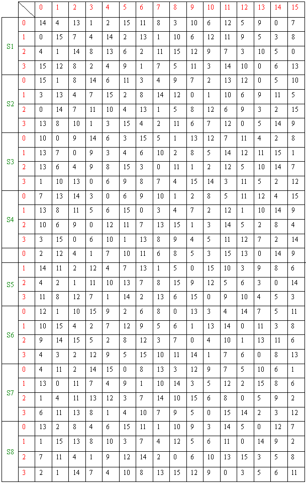
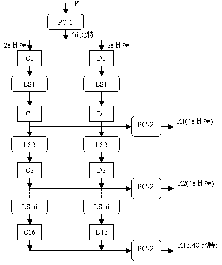
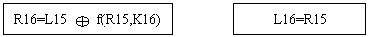
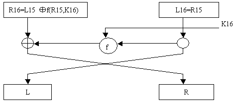

# 公路坐标计算系统 1.0

> 原文：[`www.pediy.com/kssd/pediy05/pediy50649.htm`](https://www.pediy.com/kssd/pediy05/pediy50649.htm)

【软件名称】：公路坐标计算系统  
【整理日期】：2003.4.24  
【最新版本】：1.0　Build 418  
【文件大小】：179KB  
【软件授权】：共享软件  
【使用平台】：Win9x/Me/NT/2000/XP  
【下载地址】：http://www.onlinedown.net/measure.htm  
【软件简介】：包括直线，圆曲线坐标，缓和曲线中桩计算，任意长度的边桩的坐标计算，任一点或任一桩号的坐标计算（包括边桩），并有测边交会，单三角形，前方交会，后方交会，侧方交会，坐标正反算,计算器等工具。并新增任意角度的边桩计算。  
  
　　

【作    者】：风雨无阻  
【声    明】：纯技术交流，无任何商业目的  
【破解工具】：fi2.5, Ollydbg1.09 中文版，AspackDie 1.41 汉化版，TRW2000 娃娃汉化版，win98 系统

  
【破解过程】  
第一步：用 fi 探测一下，是 Aspack2.11 的壳，使用 AspackDie 1.41 汉化版脱壳成功。  
第二步：填写注册信息，启动 TRW2000 娃娃汉化版，下万能断点 bpx hmemcpy  回到程序点击注册，程序被 TRW 拦截，pmodule 回到程序领空发现在 00417801 处，关闭 TRW 使用 Ollydbg1.09 中文版载入程序，在 00417801 处下断点：分析如下

00417801  |. E8 941D0000    CALL <JMP.&MFC42.#3097>  
                            --->读入假码 "87654321"

00417806  |. 8B4D F0        MOV ECX,DWORD PTR SS:\[EBP\-10\]  
00417809  |. 8B41 F8        MOV EAX,DWORD PTR DS:\[ECX\-8\]  
0041780C  |. 83F8 08        CMP EAX,8  
0041780F  |. 75 19          JNZ SHORT UNPACKED.0041782A  
                            --->比较位数是否是 8 位，如果不是则跳转  
                     
00417811  |. 8D55 F0        LEA EDX,DWORD PTR SS:\[EBP\-10\]  
00417814  |. 8BCF           MOV ECX,EDI  
00417816  |. 52             PUSH EDX  
                            --->此时 EDX 所指向的内存单元保存的是假码的地址

00417817  |. 68 1E040000    PUSH 41E  
0041781C  |. E8 791D0000    CALL <JMP.&MFC42.#3097>  
                            --->读入假码 abcdefgh

00417821  |. 8B45 F0        MOV EAX,DWORD PTR SS:\[EBP\-10\]  
00417824  |. 8378 F8 08     CMP DWORD PTR DS:\[EAX\-8\],8  
00417828  |. 74 1F          JE SHORT UNPACKED.00417849  
                            --->比较位数是否是 8 位，如果是则跳转

0041782A  |> 8D4D E8        LEA ECX,DWORD PTR SS:\[EBP\-18\]  
0041782D  |. C645 FC 01     MOV BYTE PTR SS:\[EBP\-4\],1  
00417831  |. E8 7E1B0000    CALL <JMP.&MFC42.#800>  
00417836  |. 8D4D E4        LEA ECX,DWORD PTR SS:\[EBP\-1C\]  
00417839  |. 885D FC        MOV BYTE PTR SS:\[EBP\-4\],BL  
0041783C  |. E8 731B0000    CALL <JMP.&MFC42.#800>  
00417841  |. 8975 FC        MOV DWORD PTR SS:\[EBP\-4\],ESI  
00417844  |. E9 3E060000    JMP UNPACKED.00417E87

00417849  |> 8D4D F0        LEA ECX,DWORD PTR SS:\[EBP\-10\]  
0041784C  |. 51             PUSH ECX  
0041784D  |. 68 1C040000    PUSH 41C  
00417852  |. 8BCF           MOV ECX,EDI  
00417854  |. E8 411D0000    CALL <JMP.&MFC42.#3097>  
                            --->读入机器码共 8 位我的是"40019524"

00417859  |. 8B75 F0        MOV ESI,DWORD PTR SS:\[EBP\-10\]  
0041785C  |. 8D55 D4        LEA EDX,DWORD PTR SS:\[EBP\-2C\]  
0041785F  |. 2BF2           SUB ESI,EDX  
00417861  |. 8D45 D4        LEA EAX,DWORD PTR SS:\[EBP\-2C\]  
00417864  |. BA 08000000    MOV EDX,8  
                            --->EDX ＝ 8

00417869  |> 8A0C06         /MOV CL,BYTE PTR DS:\[ESI+EAX\]  
                            --->依次将机器码 40019524 送入 CL

0041786C  |. 8808           |MOV BYTE PTR DS:\[EAX\],CL  
                            --->将 CL 内容送入 DS:\[EAX\]保存

0041786E  |. 40             |INC EAX  
                            --->EAX ＝ EAX + 1

0041786F  |. 4A             |DEC EDX  
                            --->EDX ＝ EDX - 1

00417870  |.⁷⁵ F7          \\JNZ SHORT UNPACKED.00417869  
                            --->总共循环 8 次

00417872  |. 8D85 30FFFFFF  LEA EAX,DWORD PTR SS:\[EBP\-D0\]  
                            --->此时 EAX ＝ 0069EF94   
                                而 69EF94 内容是一字符串“WL750415”

00417878  |. 8D4D D4        LEA ECX,DWORD PTR SS:\[EBP\-2C\]  
                            --->机器码地址送入 ECX

0041787B  |. 50             PUSH EAX  
0041787C  |. 51             PUSH ECX  
                            --->将机器码和“WL750415”入栈

0041787D  |. 885D DC        MOV BYTE PTR SS:\[EBP\-24\],BL  
00417880  |. E8 BBFCFFFF    CALL UNPACKED.00417540  
                            --->跳转到下面继续执行  
－－－－－－－－－－－－－－－－－－－－－－－－－－－－－－－－－－－－－－－  
00417540  /$ 8B4424 04      MOV EAX,DWORD PTR SS:\[ESP+4\]  
                            --->EAX 指向机器码

00417544  |. 56             PUSH ESI  
00417545  |. 8B7424 0C      MOV ESI,DWORD PTR SS:\[ESP+C\]  
00417549  |. 8A08           MOV CL,BYTE PTR DS:\[EAX\]  
                            --->将机器码的第一位 4 送入 CL ＝ 34H  
0041754B  |. D0E1           SHL CL,1  
                            --->CL 左移一位也就是 CL ＝ CL \* 2 = 68H  
        
0041754D  |. 880E           MOV BYTE PTR DS:\[ESI\],CL  
                            --->将计算结果保存

0041754F  |. 8A10           MOV DL,BYTE PTR DS:\[EAX\]  
                            --->将机器码的第一位 4 送入 DL = 34H

00417551  |. 8A48 01        MOV CL,BYTE PTR DS:\[EAX+1\]  
                            --->将机器码的第二位 0 送入 CL = 30H

00417554  |. C0EA 06        SHR DL,6  
                            --->DL 右移 6 位，DL = 00H

00417557  |. 80E2 02        AND DL,2  
                            --->与 2 进行"与"运算后 DL = 00H

0041755A  |. C0E1 02        SHL CL,2  
                            --->CL 左移两位 CL = CL \* 4 = C0H

0041755D  |. 0AD1           OR DL,CL  
                            --->或运算 DL = C0H

0041755F  |. 8856 01        MOV BYTE PTR DS:\[ESI+1\],DL  
                            --->将计算结果保存

00417562  |. 8A50 01        MOV DL,BYTE PTR DS:\[EAX+1\]  
                            --->送入机器码的第二位 0  
00417565  |. 8A48 02        MOV CL,BYTE PTR DS:\[EAX+2\]  
                            --->送入机器码的第三位 0  
00417568  |. C0EA 05        SHR DL,5  
0041756B  |. 80E2 06        AND DL,6  
0041756E  |. C0E1 03        SHL CL,3  
00417571  |. 0AD1           OR DL,CL  
00417573  |. 8856 02        MOV BYTE PTR DS:\[ESI+2\],DL  
                            --->将计算结果保存

00417576  |. 8A50 02        MOV DL,BYTE PTR DS:\[EAX+2\]  
00417579  |. 8A48 03        MOV CL,BYTE PTR DS:\[EAX+3\]  
                            --->送入机器码的第 3，4 位"0，1"进行计算  
0041757C  |. C0EA 04        SHR DL,4  
0041757F  |. 80E2 0E        AND DL,0E  
00417582  |. C0E1 04        SHL CL,4  
00417585  |. 0AD1           OR DL,CL  
00417587  |. 8856 03        MOV BYTE PTR DS:\[ESI+3\],DL  
0041758A  |. 8A50 03        MOV DL,BYTE PTR DS:\[EAX+3\]  
0041758D  |. 8A48 04        MOV CL,BYTE PTR DS:\[EAX+4\]  
                            --->送入机器码的第 4，5 位"1，9"进行计算  
00417590  |. C0EA 03        SHR DL,3  
00417593  |. 80E2 1E        AND DL,1E  
00417596  |. C0E1 05        SHL CL,5  
00417599  |. 0AD1           OR DL,CL  
0041759B  |. 8856 04        MOV BYTE PTR DS:\[ESI+4\],DL  
0041759E  |. 8A50 04        MOV DL,BYTE PTR DS:\[EAX+4\]  
004175A1  |. 8A48 05        MOV CL,BYTE PTR DS:\[EAX+5\]  
                            --->送入机器码的第 5，6 位"9，5"进行计算  
004175A4  |. C0EA 02        SHR DL,2  
004175A7  |. 80E2 3E        AND DL,3E  
004175AA  |. C0E1 06        SHL CL,6  
004175AD  |. 0AD1           OR DL,CL  
004175AF  |. 8856 05        MOV BYTE PTR DS:\[ESI+5\],DL  
004175B2  |. 8A50 05        MOV DL,BYTE PTR DS:\[EAX+5\]  
004175B5  |. 8A48 06        MOV CL,BYTE PTR DS:\[EAX+6\]  
                            --->送入机器码的第 6，7 位"5，2"进行计算  
004175B8  |. D0EA           SHR DL,1  
004175BA  |. 80E2 7E        AND DL,7E  
004175BD  |. C0E1 07        SHL CL,7  
004175C0  |. 0AD1           OR DL,CL  
004175C2  |. 8856 06        MOV BYTE PTR DS:\[ESI+6\],DL  
004175C5  |. 8A50 06        MOV DL,BYTE PTR DS:\[EAX+6\]  
                            --->送入机器码的第 7，8 位"2，4"进行计算  
004175C8  |. 80E2 FE        AND DL,0FE  
004175CB  |. 8856 07        MOV BYTE PTR DS:\[ESI+7\],DL  
004175CE  |. 5E             POP ESI  
004175CF  \\. C3             RETN  
                            --->此处返回继续  
                            --->最后的计算结果  
                               DS:\[ESI\] =  68 C0 80 12 26 4E 1A 32

－－－－－－－－－－－－－－－－－－－－－－－－－－－－－－－－－－－－－－－－

00417885  |. 8D95 30FFFFFF  LEA EDX,DWORD PTR SS:\[EBP\-D0\]  
0041788B  |. 8D85 30FEFFFF  LEA EAX,DWORD PTR SS:\[EBP\-1D0\]  
                            --->此时 EAX 指向 0069EE94  B6 EE 69 00 AA 7E 00 00   
00417891  |. 52             PUSH EDX  
                            --->将刚刚计算的结果地址入栈

00417892  |. 50             PUSH EAX  
00417893  |. E8 C8FBFFFF    CALL UNPACKED.00417460  
                            --->???????这个地方我跟进过，不过没有搞懂，好像是  
                                DES 加密算法,总共加密了四次  
                                还请各位密界高手指点??????????  
  
00417898  |. 8D4D D4        LEA ECX,DWORD PTR SS:\[EBP\-2C\]  
0041789B  |. 6A 01          PUSH 1  
0041789D  |. 8D95 30FEFFFF  LEA EDX,DWORD PTR SS:\[EBP\-1D0\]  
004178A3  |. 51             PUSH ECX  
                            --->机器码入栈  
004178A4  |. 52             PUSH EDX  
                            --->将 00417893 处的计算结果入栈

004178A5  |. E8 F6FBFFFF    CALL UNPACKED.004174A0  
                            --->此 CALL 对机器码进行了变换得到以下结果  
                                由于过于复杂，就不列出来了。    
                    
004178AA  |. 8B45 D7        MOV EAX,DWORD PTR SS:\[EBP\-29\]  
                            --->EAX ＝ BB3373CB

004178AD  |. 8B4D D6        MOV ECX,DWORD PTR SS:\[EBP\-2A\]  
                            --->ECX ＝ 3373CB30

004178B0  |. 8B55 D5        MOV EDX,DWORD PTR SS:\[EBP\-2B\]  
                            --->EDX ＝ 73CB3010

004178B3  |. 25 FF000000    AND EAX,0FF  
004178B8  |. 83F0 04        XOR EAX,4  
004178BB  |. 81E1 FF000000  AND ECX,0FF  
                            --->ECX ＝ 00000030

004178C1  |. 50             PUSH EAX  
                            --->EAX ＝ 000000CF 注册码前半部分最后两位是"CF"

004178C2  |. 8B45 D4        MOV EAX,DWORD PTR SS:\[EBP\-2C\]  
                            --->EAX ＝ CB301038

004178C5  |. 81E2 FF000000  AND EDX,0FF  
004178CB  |. 83F1 0A        XOR ECX,0A  
004178CE  |. 25 FF000000    AND EAX,0FF  
004178D3  |. 83F2 08        XOR EDX,8  
004178D6  |. 51             PUSH ECX  
                            --->ECX ＝ 0000003A 注册码前半部分 5,6 两位是"3A"

004178D7  |. 83F0 06        XOR EAX,6  
004178DA  |. 52             PUSH EDX  
                            --->ECX ＝ 00000018 注册码前半部分 3,4 两位是"18"

004178DB  |. 50             PUSH EAX  
                            --->ECX ＝ 0000003E 注册码前半部分 1,2 两位是"3E"  
                                至此注册码的前半部分已经完成"3E183ACF"

004178DC  |. 8D4D E4        LEA ECX,DWORD PTR SS:\[EBP\-1C\]  
004178DF  |. 68 28104200    PUSH UNPACKED.00421028                   ;  ASCII "%02X%02X%02X%02X"  
004178E4  |. 51             PUSH ECX  
004178E5  |. E8 741C0000    CALL <JMP.&MFC42.#2818>  
                            --->将前面计算的两位两位的注册码组合

004178EA  |. 83C4 34        ADD ESP,34  
004178ED  |. 8D55 E8        LEA EDX,DWORD PTR SS:\[EBP\-18\]  
004178F0  |. 8BCF           MOV ECX,EDI  
004178F2  |. 52             PUSH EDX  
004178F3  |. 68 1E040000    PUSH 41E  
004178F8  |. E8 9D1C0000    CALL <JMP.&MFC42.#3097>  
004178FD  |. 8D4D E8        LEA ECX,DWORD PTR SS:\[EBP\-18\]  
00417900  |. E8 8F1C0000    CALL <JMP.&MFC42.#4204>  
                            --->将假码的小写字母转换为大写字母

00417905  |. 8B45 E4        MOV EAX,DWORD PTR SS:\[EBP\-1C\]  
                            --->EAX ＝ 真码，在这设断点，就可得到真码前半部分，也可作成内存注册机

00417908  |. 8B4D E8        MOV ECX,DWORD PTR SS:\[EBP\-18\]  
                            --->ECX ＝ 假码

0041790B  |. 8B35 38B44100  MOV ESI,DWORD PTR DS:\[<&MSVCRT.\_mbscmp>\] ;  MSVCRT.\_mbscmp  
00417911  |. 50             PUSH EAX                                 ; /s2  
00417912  |. 51             PUSH ECX                                 ; |s1  
00417913  |. FFD6           CALL ESI                                 ; \\\_mbscmp  
00417915  |. 83C4 08        ADD ESP,8  
00417918  |. 85C0           TEST EAX,EAX  
0041791A  |. 0F85 49050000  JNZ UNPACKED.00417E69  
                            --->测试跳转，可以在此爆破，注意后面还有一处。

00417920  |. 8B55 DB        MOV EDX,DWORD PTR SS:\[EBP\-25\]  
00417923  |. 8B45 DA        MOV EAX,DWORD PTR SS:\[EBP\-26\]  
00417926  |. 8B4D D9        MOV ECX,DWORD PTR SS:\[EBP\-27\]  
00417929  |. 81E2 FF000000  AND EDX,0FF  
0041792F  |. 83F2 06        XOR EDX,6  
00417932  |. 25 FF000000    AND EAX,0FF  
00417937  |. 52             PUSH EDX  
                            --->EDX ＝ 0000007E 注册码前后部分 7，8 两位是 7E

00417938  |. 8B55 D8        MOV EDX,DWORD PTR SS:\[EBP\-28\]  
0041793B  |. 81E1 FF000000  AND ECX,0FF  
00417941  |. 83F0 03        XOR EAX,3  
00417944  |. 81E2 FF000000  AND EDX,0FF  
0041794A  |. 83F1 0B        XOR ECX,0B  
0041794D  |. 50             PUSH EAX  
                            --->EAX ＝ 000000B8 注册码前后部分 5，6 两位是 B8

0041794E  |. 83F2 0C        XOR EDX,0C  
00417951  |. 51             PUSH ECX  
                            --->ECX ＝ 00000038 注册码前后部分 3，4 两位是 38

00417952  |. 52             PUSH EDX  
                            --->EDX ＝ 0000007F 注册码前后部分 1，2 两位是 7F

00417953  |. 8D45 E4        LEA EAX,DWORD PTR SS:\[EBP\-1C\]  
00417956  |. 68 28104200    PUSH UNPACKED.00421028                   ;  ASCII "%02X%02X%02X%02X"  
0041795B  |. 50             PUSH EAX  
0041795C  |. E8 FD1B0000    CALL <JMP.&MFC42.#2818>  
                            --->将前面计算的两位两位的注册码组合

00417961  |. 83C4 18        ADD ESP,18  
00417964  |. 8D4D E8        LEA ECX,DWORD PTR SS:\[EBP\-18\]  
00417967  |. 51             PUSH ECX  
00417968  |. 68 1F040000    PUSH 41F  
0041796D  |. 8BCF           MOV ECX,EDI  
0041796F  |. E8 261C0000    CALL <JMP.&MFC42.#3097>  
00417974  |. 8D4D E8        LEA ECX,DWORD PTR SS:\[EBP\-18\]  
00417977  |. E8 181C0000    CALL <JMP.&MFC42.#4204>  
                            --->将假码的小写字母转换为大写字母

0041797C  |. 8B55 E4        MOV EDX,DWORD PTR SS:\[EBP\-1C\]  
                            --->真码的后半部分

0041797F  |. 8B45 E8        MOV EAX,DWORD PTR SS:\[EBP\-18\]  
00417982  |. 52             PUSH EDX  
00417983  |. 50             PUSH EAX  
00417984  |. FFD6           CALL ESI  
00417986  |. 83C4 08        ADD ESP,8  
00417989  |. 85C0           TEST EAX,EAX  
0041798B  |. 0F85 D8040000  JNZ UNPACKED.00417E69  
                            --->测试跳转，可以在此爆破。

【总    结】注册成功后会在 C 盘建立一名为 measure.dll 的文件，将其删除就会又成为未注册版。此次并未能完全透彻的分析处他的加密算法，因为软件作者使用了 DES 加密，我的功力还不够，只能尽我的能力，把我所知道的写出来与大家一起分享，研究。有谁能真正分析出完整的加密算法的话，希望能加以补充，大家一起进步！！！ 

【在上一篇《\[原创\]解密算法－－－公路坐标计算系统 》 中未对其 DES 加密算法进行详细分析，经过两天对 DES 加密算法的了解，对程序又进行了跟踪，很相与大家一起分享，所以再次发贴进行补充，错误之处，请即时指出。   
首先介绍一下有关 DES 的知识（资料来自互联网）   
一．加密   
DES 算法处理的数据对象是一组 64 比特的明文串。设该明文串为 m=m1m2…m64 (mi=0 或 1)。明文串经过 64 比特的密钥 K 来加密，最后生成长度为 64 比特的密文 E。其加密过程图示如下：

  
DES 算法加密过程   
对 DES 算法加密过程图示的说明如下：待加密的 64 比特明文串 m，经过 IP 置换后，得到的比特串的下标列表如下：   
IP   
58 50 42 34 26 18 10 2   
60 52 44 36 28 20 12 4   
62 54 46 38 30 22 14 6   
64 56 48 40 32 24 16 8   
57 49 41 33 25 17 9 1   
59 51 43 35 27 19 11 3   
61 53 45 37 29 21 13 5   
63 55 47 39 31 23 15 7   
  
该比特串被分为 32 位的 L0 和 32 位的 R0 两部分。R0 子密钥 K1(子密钥的生成将在后面讲)经过变换 f(R0,K1)（f 变换将在下面讲）输出 32 位的比特串 f1,f1 与 L0 做不进位的二进制加法运算。运算规则为：   
  
f1 与 L0 做不进位的二进制加法运算后的结果赋给 R1，R0 则原封不动的赋给 L1。L1 与 R0 又做与以上完全相同的运算，生成 L2，R2…… 一共经过 16 次运算。最后生成 R16 和 L16。其中 R16 为 L15 与 f(R15,K16)做不进位二进制加法运算的结果，L16 是 R15 的直接赋值。   
  
R16 与 L16 合并成 64 位的比特串。值得注意的是 R16 一定要排在 L16 前面。R16 与 L16 合并后成的比特串，经过置换 IP-1 后所得比特串的下标列表如下：   
IP-1   
40 8 48 16 56 24 64 32   
39 7 47 15 55 23 63 31   
38 6 46 14 54 22 62 30   
37 5 45 13 53 21 61 29   
36 4 44 12 52 20 60 28   
35 3 43 11 51 19 59 27   
34 2 42 10 50 18 58 26   
33 1 41 9 49 17 57 25   
  
经过置换 IP-1 后生成的比特串就是密文 e   
下面再讲一下变换 f(Ri-1,Ki)。   
它的功能是将 32 比特的输入再转化为 32 比特的输出。其过程如图所示：   
  
对 f 变换说明如下：输入 Ri-1(32 比特)经过变换 E 后，膨胀为 48 比特。膨胀后的比特串的下标列表如下：   
E:   
32 1 2 3 4 5   
4 5 6 7 8 9   
8 9 10 11 12 13   
12 13 14 15 16 17   
16 17 18 19 20 21   
20 21 22 23 24 25   
24 25 26 27 28 29   
28 29 30 31 32 31   
  
膨胀后的比特串分为 8 组，每组 6 比特。各组经过各自的 S 盒后，又变为 4 比特(具体过程见后)，合并后又成为 32 比特。该 32 比特经过 P 变换后，其下标列表如下：   
P:   
16 7 20 21   
29 12 28 17   
1 15 23 26   
5 18 31 10   
2 8 24 14   
32 27 3 9   
19 13 30 6   
22 11 4 25   
  
经过 P 变换后输出的比特串才是 32 比特的 f (Ri-1,Ki)。   
下面再讲一下 S 盒的变换过程。任取一 S 盒。见图：   
  
在其输入 b1,b2,b3,b4,b5,b6 中，计算出 x=b1\*2+b6, y=b5+b4\*2+b3\*4+b2\*8，再从 Si 表中查出 x 行，y 列的值 Sxy。将 Sxy 化为二进制，即得 Si 盒的输出。（S 表如图所示）   

至此，DES 算法加密原理讲完了。   
二．子密钥的生成   
64 比特的密钥生成 16 个 48 比特的子密钥。其生成过程见图：   
  
子密钥生成过程具体解释如下：   
64 比特的密钥 K，经过 PC-1 后，生成 56 比特的串。其下标如表所示：   
PC-1   
57 49 41 33 25 17 9   
1 58 50 42 34 26 18   
10 2 59 51 43 35 27   
19 11 3 60 52 44 36   
63 55 47 39 31 23 15   
7 62 54 46 38 30 22   
14 6 61 53 45 37 29   
21 13 5 28 20 12 4   
  
该比特串分为长度相等的比特串 C0 和 D0。然后 C0 和 D0 分别循环左移 1 位，得到 C1 和 D1。C1 和 D1 合并起来生成 C1D1。C1D1 经过 PC-2 变换后即生成 48 比特的 K1。K1 的下标列表为：   
PC-2   
14 17 11 24 1 5   
3 28 15 6 21 10   
23 19 12 4 26 8   
16 7 27 20 13 2   
41 52 31 37 47 55   
30 40 51 45 33 48   
44 49 39 56 34 53   
46 42 50 36 29 32   
  
C1、D1 分别循环左移 LS2 位，再合并，经过 PC-2，生成子密钥 K2……依次类推直至生成子密钥 K16。   
注意：Lsi (I =1,2,….16)的数值是不同的。具体见下表：   
  
迭代顺序 1 2 3 4 5 6 7 8 9 10 11 12 13 14 15 16   
左移位数 1 1 2 2 2 2 2 2 1 2 2 2 2 2 2 1   
  
三．解密   
DES 的解密过程和 DES 的加密过程完全类似，只不过将 16 圈的子密钥序列 K1，K2……K16 的顺序倒过来。即第一圈用第 16 个子密钥 K16，第二圈用 K15，其余类推。   
第一圈：加密后的结果L=R15, R=L15⊕f(R15,K16)⊕f(R15,K16)=L15   
同理 R15=L14⊕f(R14,K15), L15=R14。   
同理类推：   
得 L=R0, R=L0。   
四．示例   
例如：已知明文 m=learning, 密钥 k=computer。   
明文 m 的 ASCII 二进制表示：   
  
m= 01101100 01100101 01100001 01110010   
01101110 01101001 01101110 01100111   
  
密钥 k 的 ASCII 二进制表示：   
  
k=01100011 01101111 01101101 01110000   
01110101 01110100 01100101 01110010   
  
明文 m 经过 IP 置换后，得：   
  
11111111 00001000 11010011 10100110 00000000 11111111 01110001 11011000   
  
等分为左右两段：   
  
L0=11111111 00001000 11010011 10100110 R0=00000000 11111111 01110001 11011000   
  
经过 16 次迭代后，所得结果为：   
  
L1=00000000 11111111 01110001 11011000 R1=00110101 00110001 00111011 10100101   
L2=00110101 00110001 00111011 10100101 R2=00010111 11100010 10111010 10000111   
L3=00010111 11100010 10111010 10000111 R3=00111110 10110001 00001011 10000100   
L4=00111110101100010000101110000100 R4=11110111110101111111101000111110   
L5=11110111110101111111101000111110 R5=10010110011001110100111111100101   
L6=10010110011001110100111111100101 R6=11001011001010000101110110100111   
L7=11001011001010000101110110100111 R7=01100011110011101000111011011001   
L8=01100011110011101000111011011001 R8=01001011110100001111001000000100   
L9=01001011110100001111001000000100 R9=00011101001101111010111011100001   
L10=00011101001101111010111011100001 R10=11101110111110111111010100000101   
L11=11101110111110111111010100000101 R11=01101101111011011110010111111000   
L12=01101101111011011110010111111000 R12=11111101110011100111000110110111   
L13=11111101110011100111000110110111 R13=11100111111001011010101000000100   
L14=11100111111001011010101000000100 R14=00011110010010011011100001100001   
L15=00011110010010011011100001100001 R15=01010000111001001101110110100011   
L16=01010000111001001101110110100011 R16=01111101101010000100110001100001   
  
其中，f 函数的结果为：   
  
f1=11001010001110011110100000000011 f2=00010111000111011100101101011111   
f3=00001011100000000011000000100001 f4=11100000001101010100000010111001   
f5=10101000110101100100010001100001 f6=00111100111111111010011110011001   
f7=11110101101010011100000100111100 f8=10000000111110001010111110100011   
f9=01111110111110010010000000111000 f10=10100101001010110000011100000001   
f11=01110000110110100100101100011001 f12=00010011001101011000010010110010   
f13=10001010000010000100111111111100 f14=11100011100001111100100111010110   
f15=10110111000000010111011110100111 f16=01100011111000011111010000000000   
  
16 个子密钥为：   
  
K1=11110000101111101110111011010000 K2=11100000101111101111011010010101   
K3=11110100111111100111011000101000 K4=11100110111101110111001000011010   
K5=11101110110101110111011100100110 K6=11101111110100110101101110001011   
K7=00101111110100111111101111100110 K8=10111111010110011101101101010000   
K9=00011111010110111101101101000100 K10=00111111011110011101110100001001   
K11=00011111011011011100110101101000 K12=01011011011011011011110100001010   
K13=11011101101011011010110110001111 K14=11010011101011101010111110000000   
K15=11111001101111101010011011010011 K16=11110001101111100010111000000001   
  
S 盒中，16 次运算时，每次的 8 个结果为：   
第一次：5，11，4，1，0，3，13，9；   
第二次：7，13，15，8，12，12，13，1；   
第三次：8，0，0，4，8，1，9，12；   
第四次：0，7，4，1，7，6，12，4；   
第五次：8，1，0，11，5，0，14，14；   
第六次：14，12，13，2，7，15，14，10；   
第七次：12，15，15，1，9，14，0，4；   
第八次：15，8，8，3，2，3，14，5；   
第九次：8，14，5，2，1，15，5，12；   
第十次：2，8，13，1，9，2，10，2；   
第十一次：10，15，8，2，1，12，12，3；   
第十二次：5，4，4，0，14，10，7，4；   
第十三次：2，13，10，9，2，4，3，13；   
第十四次：13，7，14，9，15，0，1，3；   
第十五次：3，1，15，5，11，9，11，4；   
第十六次：12，3，4，6，9，3，3，0；   
  
子密钥生成过程中，生成的数值为：   
  
C0=0000000011111111111111111011 D0=1000001101110110000001101000   
C1=0000000111111111111111110110 D1=0000011011101100000011010001   
C2=0000001111111111111111101100 D2=0000110111011000000110100010   
C3=0000111111111111111110110000 D3=0011011101100000011010001000   
C4=0011111111111111111011000000 D4=1101110110000001101000100000   
C5=1111111111111111101100000000 D5=0111011000000110100010000011   
C6=1111111111111110110000000011 D6=1101100000011010001000001101   
C7=1111111111111011000000001111 D7=0110000001101000100000110111   
C8=1111111111101100000000111111 D8=1000000110100010000011011101   
C9=1111111111011000000001111111 D9=0000001101000100000110111011   
C10=1111111101100000000111111111 D10=0000110100010000011011101100   
C11=1111110110000000011111111111 D11=0011010001000001101110110000   
C12=1111011000000001111111111111 D12=1101000100000110111011000000   
C13=1101100000000111111111111111 D13=0100010000011011101100000011   
C14=0110000000011111111111111111 D14=0001000001101110110000001101   
C15=1000000001111111111111111101 D15=0100000110111011000000110100   
C16=0000000011111111111111111011 D16=1000001101110110000001101000   
  
解密过程与加密过程相反，所得的数据的顺序恰好相反。在此就不赘述。   
  
  
有关《\[原创\]解密算法－－－公路坐标计算系统 》一文的 DES 算法补充   
00417885  |. 8D95 30FFFFFF  LEA EDX,DWORD PTR SS:\[EBP\-D0\]   
0041788B  |. 8D85 30FEFFFF  LEA EAX,DWORD PTR SS:\[EBP\-1D0\]   
00417891  |. 52             PUSH EDX   
00417892  |. 50             PUSH EAX   
00417893  |. E8 C8FBFFFF    CALL UNPACKED.00417460   
                            --->计算子密钥，下面有详细分析   
00417898  |. 8D4D D4        LEA ECX,DWORD PTR SS:\[EBP\-2C\]   
0041789B  |. 6A 01          PUSH 1   
0041789D  |. 8D95 30FEFFFF  LEA EDX,DWORD PTR SS:\[EBP\-1D0\]   
004178A3  |. 51             PUSH ECX   
004178A4  |. 52             PUSH EDX   
004178A5  |. E8 F6FBFFFF    CALL UNPACKED.004174A0   
                            --->根据密钥进行 DES 加密，下面有详细分析   
004178AA  |. 8B45 D7        MOV EAX,DWORD PTR SS:\[EBP\-29\]   
004178AD  |. 8B4D D6        MOV ECX,DWORD PTR SS:\[EBP\-2A\]   
004178B0  |. 8B55 D5        MOV EDX,DWORD PTR SS:\[EBP\-2B\]   
－－－－－－－－－－－－－－－－－－－－－－－－－－－－－－－－－－－－－－－－－－－－－－   
  
00417460  /$ 56             PUSH ESI   
00417461  |. 8B7424 0C      MOV ESI,DWORD PTR SS:\[ESP+C\]   
00417465  |. 57             PUSH EDI   
00417466  |. 6A 00          PUSH 0   
00417468  |. 56             PUSH ESI   
00417469  |. E8 02FBFFFF    CALL UNPACKED.00416F70   
                            --->此 CALL 计算子密钥，下面有详细分析   
0041746E  |. 8B7C24 14      MOV EDI,DWORD PTR SS:\[ESP+14\]   
00417472  |. 57             PUSH EDI   
00417473  |. E8 F8FCFFFF    CALL UNPACKED.00417170   
00417478  |. 6A 01          PUSH 1   
0041747A  |. 56             PUSH ESI   
0041747B  |. E8 F0FAFFFF    CALL UNPACKED.00416F70   
00417480  |. 81C7 80000000  ADD EDI,80   
00417486  |. 57             PUSH EDI   
00417487  |. E8 E4FCFFFF    CALL UNPACKED.00417170   
0041748C  |. 83C4 18        ADD ESP,18   
0041748F  |. 5F             POP EDI   
00417490  |. 5E             POP ESI   
00417491  \\. C3             RETN   
  
－－－－－－－－－－－－－－－－－－－－－－－－－－－－－－－－－－－－－－－－－－－－－－   
004174A0  /$ 83EC 08        SUB ESP,8   
004174A3  |. 56             PUSH ESI   
004174A4  |. 8B7424 14      MOV ESI,DWORD PTR SS:\[ESP+14\]   
004174A8  |. 57             PUSH EDI   
004174A9  |. 8B7C24 1C      MOV EDI,DWORD PTR SS:\[ESP+1C\]   
004174AD  |. 85FF           TEST EDI,EDI   
004174AF  |. 7E 30          JLE SHORT UNPACKED.004174E1   
004174B1  |. 53             PUSH EBX   
004174B2  |. 8B5C24 18      MOV EBX,DWORD PTR SS:\[ESP+18\]   
004174B6  |> 8D4424 0C      /LEA EAX,DWORD PTR SS:\[ESP+C\]   
004174BA  |. 50             |PUSH EAX   
004174BB  |. 56             |PUSH ESI   
004174BC  |. E8 EFFCFFFF    |CALL UNPACKED.004171B0   
         |                 |--->此 CALL 对机器码进行了位置变换 40019524-->10044295,就不详细分析了   
         |                 |   
004174C1  |. 8D4C24 14      |LEA ECX,DWORD PTR SS:\[ESP+14\]   
004174C5  |. 53             |PUSH EBX   
004174C6  |. 51             |PUSH ECX   
004174C7  |. E8 A4FDFFFF    |CALL UNPACKED.00417270   
         |                 |--->此 CALL 对进行了初始 IP 位置置换，并进行 16 次迭代最后计算出 R16 和 L16 在下面详细分析   
         |                 |   
004174CC  |. 8D5424 1C      |LEA EDX,DWORD PTR SS:\[ESP+1C\]   
004174D0  |. 56             |PUSH ESI   
004174D1  |. 52             |PUSH EDX   
004174D2  |. E8 49FDFFFF    |CALL UNPACKED.00417220   
         |                 |--->此 CALL 对上一步计算结果进行 IP－1 置换，生成 64 位密文输出   
         |                 |   
004174D7  |. 83C4 18        |ADD ESP,18   
004174DA  |. 83C6 08        |ADD ESI,8   
004174DD  |. 4F             |DEC EDI   
004174DE  |.⁷⁵ D6          \\JNZ SHORT UNPACKED.004174B6   
004174E0  |. 5B             POP EBX   
004174E1  |> 5F             POP EDI   
004174E2  |. 5E             POP ESI   
004174E3  |. 83C4 08        ADD ESP,8   
004174E6  \\. C3             RETN   
  
－－－－－－－－－－－－－－－－－－－－－－－－－－－－－－－－－－－－－－－－－－－－－－－－－－－－－－－－－－－－   
00416F70  /$ 81EC F4000000  SUB ESP,0F4   
00416F76  |. 33C9           XOR ECX,ECX   
00416F78  |. 53             PUSH EBX   
00416F79  |. 55             PUSH EBP   
00416F7A  |. 56             PUSH ESI   
00416F7B  |. 8BB424 0401000>MOV ESI,DWORD PTR SS:\[ESP+104\]   
00416F82  |. 57             PUSH EDI   
          |                 －－－－－－－－－－－－－－－－－－－－－   
          |                 下面的循环对 64 位的初始密钥进行上面所介绍的 DES 子密钥生成的 PC－1 变换生成 56 位的串，保存在 SS:\[ESP+ECX+4C\]   
00416F83  |> 33C0           /XOR EAX,EAX   
00416F85  |. 8A81 3C074200  |MOV AL,BYTE PTR DS:\[ECX+42073C\]   
00416F8B  |. 8BD0           |MOV EDX,EAX   
00416F8D  |. 83E0 07        |AND EAX,7   
00416F90  |. C1FA 03        |SAR EDX,3   
00416F93  |. 8A1C45 CC06420>|MOV BL,BYTE PTR DS:\[EAX\*2+4206CC\]   
00416F9A  |. 8A1432         |MOV DL,BYTE PTR DS:\[EDX+ESI\]   
00416F9D  |. 84D3           |TEST BL,DL   
00416F9F  |. 0F95C0         |SETNE AL   
00416FA2  |. 88440C 4C      |MOV BYTE PTR SS:\[ESP+ECX+4C\],AL   
00416FA6  |. 41             |INC ECX   
00416FA7  |. 83F9 38        |CMP ECX,38－－－－－－>十进制 = 56       
00416FAA  |.⁷C D7          \\JL SHORT UNPACKED.00416F83   
          |                 －－－－－－－－－－－－－－－－－－－－－   
00416FAC  |. 33DB           XOR EBX,EBX   
00416FAE  |. C74424 10 1E00>MOV DWORD PTR SS:\[ESP+10\],1E   
          |                 －－－－－－－－－－－－－－－－－－－－－   
          |                 下面的循环进行 16 个 48 位子密钥计算     
00416FB6  |> 66:83BC24 0C01>/CMP WORD PTR SS:\[ESP+10C\],1   
00416FBF  |. 8B4424 10      |MOV EAX,DWORD PTR SS:\[ESP+10\]   
00416FC3  |. 74 03          |JE SHORT UNPACKED.00416FC8   
00416FC5  |. 8D041B         |LEA EAX,DWORD PTR DS:\[EBX+EBX\]   
00416FC8  |> 8DBC84 8800000>|LEA EDI,DWORD PTR SS:\[ESP+EAX\*4+88\]   
00416FCF  |. 8DAC84 8400000>|LEA EBP,DWORD PTR SS:\[ESP+EAX\*4+84\]   
00416FD6  |. 33C0           |XOR EAX,EAX   
00416FD8  |. 33C9           |XOR ECX,ECX   
00416FDA  |. 8A8B 74074200  |MOV CL,BYTE PTR DS:\[EBX+420774\]   
00416FE0  |. C707 00000000  |MOV DWORD PTR DS:\[EDI\],0   
00416FE6  |. C745 00 000000>|MOV DWORD PTR SS:\[EBP\],0   
00416FED  |. 8BF1           |MOV ESI,ECX   
          |                 |-------------------------------------------   
                            |  下面这个循环共 28 次，对上面生成的 56 位串的前 28 位就是前文的 C0 进行循环移位，移位位数表前文已经列出，将结果保存在 SS:\[ESP+EAX+14\]   
00416FEF  |> 83F9 1C        |/CMP ECX,1C   
00416FF2  |. 7D 06          ||JGE SHORT UNPACKED.00416FFA   
00416FF4  |. 8A540C 4C      ||MOV DL,BYTE PTR SS:\[ESP+ECX+4C\]   
00416FF8  |. EB 04          ||JMP SHORT UNPACKED.00416FFE   
00416FFA  |> 8A540C 30      ||MOV DL,BYTE PTR SS:\[ESP+ECX+30\]   
00416FFE  |> 885404 14      ||MOV BYTE PTR SS:\[ESP+EAX+14\],DL   
00417002  |. 40             ||INC EAX   
00417003  |. 41             ||INC ECX   
00417004  |. 83F8 1C        ||CMP EAX,1C   
00417007  |.⁷C E6          |\\JL SHORT UNPACKED.00416FEF   
          |                 |-------------------------------------------   
00417009  |. B8 1C000000    |MOV EAX,1C   
0041700E  |. 8D4E 1C        |LEA ECX,DWORD PTR DS:\[ESI+1C\]   
          |                 |-------------------------------------------   
                            |  下面这个循环共 28 次，对上面生成的 56 位串的后 28 位就是前文的 D0 进行循环移位，移位位数表前文已经列出，将保存在 SS:\[ESP+EAX+14\]   
00417011  |> 83F9 38        |/CMP ECX,38   
00417014  |. 7D 06          ||JGE SHORT UNPACKED.0041701C   
00417016  |. 8A540C 4C      ||MOV DL,BYTE PTR SS:\[ESP+ECX+4C\]   
0041701A  |. EB 04          ||JMP SHORT UNPACKED.00417020   
0041701C  |> 8A540C 30      ||MOV DL,BYTE PTR SS:\[ESP+ECX+30\]   
00417020  |> 885404 14      ||MOV BYTE PTR SS:\[ESP+EAX+14\],DL   
00417024  |. 40             ||INC EAX   
00417025  |. 41             ||INC ECX   
00417026  |. 83F8 38        ||CMP EAX,38   
00417029  |.⁷C E6          |\\JL SHORT UNPACKED.00417011   
          |                 |-------------------------------------------   
0041702B  |. 33C9           |XOR ECX,ECX   
0041702D  |. B8 DC064200    |MOV EAX,UNPACKED.004206DC   
          |                 |-------------------------------------------   
                            | 下面这个循环进行 PC－2 移位变换生成子密钥，保存在 SS:\[EBP\]，我的第一个子密钥是   
                              94DC2062C323   
00417032  |> 33D2           |/XOR EDX,EDX   
00417034  |. 8A91 84074200  ||MOV DL,BYTE PTR DS:\[ECX+420784\]   
0041703A  |. 807C14 14 00   ||CMP BYTE PTR SS:\[ESP+EDX+14\],0   
0041703F  |. 74 0A          ||JE SHORT UNPACKED.0041704B   
00417041  |. 8B10           ||MOV EDX,DWORD PTR DS:\[EAX\]   
00417043  |. 8B75 00        ||MOV ESI,DWORD PTR SS:\[EBP\]   
00417046  |. 0BF2           ||OR ESI,EDX   
00417048  |. 8975 00        ||MOV DWORD PTR SS:\[EBP\],ESI   
0041704B  |> 33D2           ||XOR EDX,EDX   
0041704D  |. 8A91 9C074200  ||MOV DL,BYTE PTR DS:\[ECX+42079C\]   
00417053  |. 807C14 14 00   ||CMP BYTE PTR SS:\[ESP+EDX+14\],0   
00417058  |. 74 08          ||JE SHORT UNPACKED.00417062   
0041705A  |. 8B10           ||MOV EDX,DWORD PTR DS:\[EAX\]   
0041705C  |. 8B37           ||MOV ESI,DWORD PTR DS:\[EDI\]   
0041705E  |. 0BF2           ||OR ESI,EDX   
00417060  |. 8937           ||MOV DWORD PTR DS:\[EDI\],ESI   
00417062  |> 83C0 04        ||ADD EAX,4   
00417065  |. 41             ||INC ECX   
00417066  |. 3D 3C074200    ||CMP EAX,UNPACKED.0042073C   
0041706B  |.⁷C C5          |\\JL SHORT UNPACKED.00417032   
          |                 |-------------------------------------------   
0041706D  |. 8B07           |MOV EAX,DWORD PTR DS:\[EDI\]   
0041706F  |. 8B4D 00        |MOV ECX,DWORD PTR SS:\[EBP\]   
00417072  |. 50             |PUSH EAX                                ; /<%06x>   
00417073  |. 51             |PUSH ECX                                ; |<%06x>   
00417074  |. 53             |PUSH EBX                                ; |<%d>   
00417075  |. 68 B40F4200    |PUSH UNPACKED.00420FB4                  ; |format = "DES key%d:   %06x   %06x   
"   
0041707A  |. FF15 50B44100  |CALL DWORD PTR DS:\[<&MSVCRT.printf>\]    ; \\printf   
00417080  |. 8B4424 20      |MOV EAX,DWORD PTR SS:\[ESP+20\]   
00417084  |. 83C4 10        |ADD ESP,10   
00417087  |. 83E8 02        |SUB EAX,2   
0041708A  |. 43             |INC EBX   
0041708B  |. 83F8 FE        |CMP EAX,-2   
0041708E  |. 894424 10      |MOV DWORD PTR SS:\[ESP+10\],EAX   
00417092  |.⁰F8F 1EFFFFFF  \\JG UNPACKED.00416FB6   
          |                 |循环 16 次后就会生成 16 个 48 位的子密钥   
          |                 |-------------------------------------------   
00417098  |. 8D9424 8400000>LEA EDX,DWORD PTR SS:\[ESP+84\]   
0041709F  |. 52             PUSH EDX   
004170A0  |. E8 1B000000    CALL UNPACKED.004170C0   
004170A5  |. 83C4 04        ADD ESP,4   
004170A8  |. 5F             POP EDI   
004170A9  |. 5E             POP ESI   
004170AA  |. 5D             POP EBP   
004170AB  |. 5B             POP EBX   
004170AC  |. 81C4 F4000000  ADD ESP,0F4   
004170B2  \\. C3             RETN   
－－－－－－－－－－－－－－－－－－－－－－－－－－－－－－－－－－－－－－－－－－－－－－－－－－－－－－－－－－－－－   
00417270  /$ 53             PUSH EBX   
00417271  |. 8B5C24 08      MOV EBX,DWORD PTR SS:\[ESP+8\]   
00417275  |. 55             PUSH EBP   
00417276  |. 56             PUSH ESI   
00417277  |. 8B03           MOV EAX,DWORD PTR DS:\[EBX\]   
00417279  |. 8B4B 04        MOV ECX,DWORD PTR DS:\[EBX+4\]   
0041727C  |. 8BD0           MOV EDX,EAX   
0041727E  |. 8BF1           MOV ESI,ECX   
00417280  |. C1EA 04        SHR EDX,4   
00417283  |. 81E2 0F0F0F0F  AND EDX,0F0F0F0F   
00417289  |. 81E6 0F0F0F0F  AND ESI,0F0F0F0F   
0041728F  |. 33D6           XOR EDX,ESI   
00417291  |. 57             PUSH EDI   
00417292  |. 33CA           XOR ECX,EDX   
00417294  |. C1E2 04        SHL EDX,4   
00417297  |. 33C2           XOR EAX,EDX   
00417299  |. 8BF1           MOV ESI,ECX   
0041729B  |. 8BD0           MOV EDX,EAX   
0041729D  |. 81E6 FFFF0000  AND ESI,0FFFF   
004172A3  |. C1EA 10        SHR EDX,10   
004172A6  |. 33D6           XOR EDX,ESI   
004172A8  |. 33CA           XOR ECX,EDX   
004172AA  |. C1E2 10        SHL EDX,10   
004172AD  |. 33C2           XOR EAX,EDX   
004172AF  |. 8BD1           MOV EDX,ECX   
004172B1  |. C1EA 02        SHR EDX,2   
004172B4  |. 8BF0           MOV ESI,EAX   
004172B6  |. 81E2 33333333  AND EDX,33333333   
004172BC  |. 81E6 33333333  AND ESI,33333333   
004172C2  |. 33D6           XOR EDX,ESI   
004172C4  |. 33C2           XOR EAX,EDX   
004172C6  |. C1E2 02        SHL EDX,2   
004172C9  |. 33CA           XOR ECX,EDX   
004172CB  |. 8BF0           MOV ESI,EAX   
004172CD  |. 8BD1           MOV EDX,ECX   
004172CF  |. 81E6 FF00FF00  AND ESI,0FF00FF   
004172D5  |. C1EA 08        SHR EDX,8   
004172D8  |. 81E2 FF00FF00  AND EDX,0FF00FF   
004172DE  |. 33D6           XOR EDX,ESI   
004172E0  |. 33C2           XOR EAX,EDX   
004172E2  |. C1E2 08        SHL EDX,8   
004172E5  |. 33CA           XOR ECX,EDX   
004172E7  |. 8BF1           MOV ESI,ECX   
004172E9  |. 03C9           ADD ECX,ECX   
004172EB  |. C1EE 1F        SHR ESI,1F   
004172EE  |. 0BF1           OR ESI,ECX   
004172F0  |. 8BCE           MOV ECX,ESI   
004172F2  |. 33C8           XOR ECX,EAX   
004172F4  |. 81E1 AAAAAAAA  AND ECX,AAAAAAAA   
004172FA  |. 33C1           XOR EAX,ECX   
004172FC  |. 33F1           XOR ESI,ECX   
004172FE  |. 8BF8           MOV EDI,EAX   
00417300  |. 56             PUSH ESI                              ; /<%08x>   
00417301  |. C1EF 1F        SHR EDI,1F                            ; |   
00417304  |. 8D1400         LEA EDX,DWORD PTR DS:\[EAX+EAX\]        ; |   
00417307  |. 0BFA           OR EDI,EDX                            ; |   
00417309  |. 57             PUSH EDI                              ; |<%08x>   
0041730A  |. 68 D00F4200    PUSH UNPACKED.00420FD0                ; |format = "IP trans: %08x %08x   
"   
0041730F  |. FF15 50B44100  CALL DWORD PTR DS:\[<&MSVCRT.printf>\]  ; \\printf   
          |                 |--->上面对初始明文进行了 IP 位置变换，下面就会与 16 个密钥进行异或运算   
          |                 |   
00417315  |. 8B4C24 24      MOV ECX,DWORD PTR SS:\[ESP+24\]   
00417319  |. 83C4 0C        ADD ESP,0C   
0041731C  |. C74424 14 0800>MOV DWORD PTR SS:\[ESP+14\],8   
00417324  |> 8B41 04        MOV EAX,DWORD PTR DS:\[ECX+4\]   
00417327  |. 83C1 04        ADD ECX,4   
0041732A  |. 33C6           XOR EAX,ESI   
0041732C  |. 83C1 08        ADD ECX,8   
0041732F  |. 8BD0           MOV EDX,EAX   
00417331  |. 8BE8           MOV EBP,EAX   
00417333  |. C1EA 18        SHR EDX,18   
00417336  |. 83E2 3F        AND EDX,3F   
00417339  |. 83C1 04        ADD ECX,4   
0041733C  |. C1ED 10        SHR EBP,10   
0041733F  |. 8B1495 B408420>MOV EDX,DWORD PTR DS:\[EDX\*4+4208B4\]   
00417346  |. 83E5 3F        AND EBP,3F   
00417349  |. 0B14AD B40A420>OR EDX,DWORD PTR DS:\[EBP\*4+420AB4\]   
00417350  |. 8BE8           MOV EBP,EAX   
00417352  |. C1ED 08        SHR EBP,8   
00417355  |. 83E5 3F        AND EBP,3F   
00417358  |. 83E0 3F        AND EAX,3F   
0041735B  |. 0B14AD B40C420>OR EDX,DWORD PTR DS:\[EBP\*4+420CB4\]   
00417362  |. 8B2C85 B40E420>MOV EBP,DWORD PTR DS:\[EAX\*4+420EB4\]   
00417369  |. 8B41 FC        MOV EAX,DWORD PTR DS:\[ECX\-4\]   
0041736C  |. 0BD5           OR EDX,EBP   
0041736E  |. 33FA           XOR EDI,EDX   
00417370  |. 33C7           XOR EAX,EDI   
00417372  |. 8BD0           MOV EDX,EAX   
00417374  |. 8BE8           MOV EBP,EAX   
00417376  |. C1EA 18        SHR EDX,18   
00417379  |. 83E2 3F        AND EDX,3F   
0041737C  |. C1ED 10        SHR EBP,10   
0041737F  |. 8B1495 B408420>MOV EDX,DWORD PTR DS:\[EDX\*4+4208B4\]   
00417386  |. 83E5 3F        AND EBP,3F   
00417389  |. 0B14AD B40A420>OR EDX,DWORD PTR DS:\[EBP\*4+420AB4\]   
00417390  |. 8BE8           MOV EBP,EAX   
00417392  |. C1ED 08        SHR EBP,8   
00417395  |. 83E5 3F        AND EBP,3F   
00417398  |. 83E0 3F        AND EAX,3F   
0041739B  |. 0B14AD B40C420>OR EDX,DWORD PTR DS:\[EBP\*4+420CB4\]   
004173A2  |. 8B2C85 B40E420>MOV EBP,DWORD PTR DS:\[EAX\*4+420EB4\]   
004173A9  |. 8B4424 14      MOV EAX,DWORD PTR SS:\[ESP+14\]   
004173AD  |. 0BD5           OR EDX,EBP   
004173AF  |. 33F2           XOR ESI,EDX   
004173B1  |. 48             DEC EAX   
004173B2  |. 894424 14      MOV DWORD PTR SS:\[ESP+14\],EAX   
004173B6  |.⁰F85 68FFFFFF  JNZ UNPACKED.00417324                 
004173BC  |. 8BC6           MOV EAX,ESI   
004173BE  |. C1E0 1F        SHL EAX,1F   
004173C1  |. D1EE           SHR ESI,1   
004173C3  |. 0BC6           OR EAX,ESI   
004173C5  |. 8BC8           MOV ECX,EAX   
004173C7  |. 33CF           XOR ECX,EDI   
004173C9  |. 81E1 AAAAAAAA  AND ECX,AAAAAAAA   
004173CF  |. 33F9           XOR EDI,ECX   
004173D1  |. 33C1           XOR EAX,ECX   
004173D3  |. 8BCF           MOV ECX,EDI   
004173D5  |. 8BF0           MOV ESI,EAX   
004173D7  |. C1E1 1F        SHL ECX,1F   
004173DA  |. D1EF           SHR EDI,1   
004173DC  |. 0BCF           OR ECX,EDI   
004173DE  |. 81E6 FF00FF00  AND ESI,0FF00FF   
004173E4  |. 8BD1           MOV EDX,ECX   
004173E6  |. 5F             POP EDI   
004173E7  |. C1EA 08        SHR EDX,8   
004173EA  |. 81E2 FF00FF00  AND EDX,0FF00FF   
004173F0  |. 33D6           XOR EDX,ESI   
004173F2  |. 33C2           XOR EAX,EDX   
004173F4  |. C1E2 08        SHL EDX,8   
004173F7  |. 33CA           XOR ECX,EDX   
004173F9  |. 8BF0           MOV ESI,EAX   
004173FB  |. 8BD1           MOV EDX,ECX   
004173FD  |. 81E6 33333333  AND ESI,33333333   
00417403  |. C1EA 02        SHR EDX,2   
00417406  |. 81E2 33333333  AND EDX,33333333   
0041740C  |. 33D6           XOR EDX,ESI   
0041740E  |. 33C2           XOR EAX,EDX   
00417410  |. C1E2 02        SHL EDX,2   
00417413  |. 33CA           XOR ECX,EDX   
00417415  |. 8BD0           MOV EDX,EAX   
00417417  |. 8BF1           MOV ESI,ECX   
00417419  |. C1EA 10        SHR EDX,10   
0041741C  |. 81E6 FFFF0000  AND ESI,0FFFF   
00417422  |. 33D6           XOR EDX,ESI   
00417424  |. 33CA           XOR ECX,EDX   
00417426  |. C1E2 10        SHL EDX,10   
00417429  |. 33C2           XOR EAX,EDX   
0041742B  |. 8BF1           MOV ESI,ECX   
0041742D  |. 8BD0           MOV EDX,EAX   
0041742F  |. 81E6 0F0F0F0F  AND ESI,0F0F0F0F   
00417435  |. C1EA 04        SHR EDX,4   
00417438  |. 81E2 0F0F0F0F  AND EDX,0F0F0F0F   
0041743E  |. 33D6           XOR EDX,ESI   
00417440  |. 8BF2           MOV ESI,EDX   
00417442  |. 33D1           XOR EDX,ECX   
00417444  |. C1E6 04        SHL ESI,4   
00417447  |. 33F0           XOR ESI,EAX   
00417449  |. 8933           MOV DWORD PTR DS:\[EBX\],ESI   
0041744B  |. 5E             POP ESI   
0041744C  |. 8953 04        MOV DWORD PTR DS:\[EBX+4\],EDX   
0041744F  |. 5D             POP EBP   
00417450  |. 5B             POP EBX   
00417451  \\. C3             RETN   
          |                 |--->上面已经完成与 16 个密钥进行的异或运算，以及 S 盒的运算，（可能分析有误）返回   
－－－－－－－－－－－－－－－－－－－－－－－－－－－－－－－－－－－－－－－－－－－－－－   
  
  
总结，经过这次跟踪我觉得断定一个软件是否使用 DES 加密就要看是否有 16 个子密钥的计算过程，这一点最容易看出来。只要有上面关于子密钥算法的汇编形式就应该可以断定使用的是 DES 加密。以上仅是一点个人心得，不一定完全正确。  

 4dd466d0e1e0cc123afbe504da2462ca