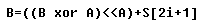

# 冷雨飘心的 CrkMe2

> 原文：[`www.pediy.com/kssd/pediy04/kanxue049.htm`](https://www.pediy.com/kssd/pediy04/kanxue049.htm)

首先声明:我写 crackme 的目的不是想难倒任何人,也不是用于任何水平测试,只是想把自己一点幼稚的想法通过他与同好者分享.   
  
  
  
        我的 crkMe2 以及 RC5 算法\[自战解说\]   
                --嘿嘿,看大家这么轻松就破了,我自己也来凑热闹   
作者:冷雨飘心   
完成时间:9-23/2001   
  
        前言   
;======================================================================   
crack 和保护就象矛和盾,只有研究保护才能更有效的 crack,isn't it?   
最近没有时间破解那些大东西,只好研究一下保护,这过程中感觉到欠缺的知识太多   
看来得学习一阵子了...   
  
这个 crackme 只是演示一下密码学的应用,如果不知道这个可逆的话,穷举攻击是很困难的   
本来还是想加一点 anti-trw or SICE 的代码和花指令,还有内存校验防止爆破的东东,可   
自己时间有限,这个东东用一下午来写,调试又用了 2 个小时,(我用的是纯汇编),结果还有 BUG!~\_~   
最可惜的是我花费一多半时间搞的 DDraw 画面还和一些设置冲突无法运行.   
  
当然为了不浪费大家的时间也没有必要把所有的保护全放进来,所以把所有条件都给出了,   
计算注册码仅仅是求逆的过程,重点在于考察对于简单算法的了解,实际应用不可能如此简单!   
呵呵不废话了,还是进入正文:   
  
;=======================================================================   
RC5 是由 Rivest(RSA 的发明者之一,还设计了许多加密算法,崇拜~\_~)设计的一种序列密码算法,只   
用了几种最简单的的运算(XOR,ADD,sub 和 LOOP)但是统计特性很好,在加密多轮后(15 轮以上)可以有   
效抗击穷举攻击.这里讨论 64 位分组,为什么?呵呵,便于计算机实现,我的 crkme2 就是个 64 位分组最简   
单的情形.   
原理:   
将 64 位分为两个各 32 位分组 A,B,准备加密 X 轮,需密钥相关 32 位字数目 2X+2 个设为 S\[0\],S\[1\]...   
加密:   
A+=S\[0\]   
B+=S\[1\]   
for (i=1 to i=X)   
A=((A xor B)<<B)+S\[2i\]   
  
output:-->A 和 B   
  
  
解密:   
for (i=X to i=1)   
B=((b-S\[2i+1\])>>A) Xor A   
A=((A-S\[2i\])>>B) xor B   
B-=S\[1\]   
A-=S\[0\]   
  
呵呵,谁说密码学全部难啊,这个够简单罢,呵呵,好就用他来保护我的 crkme2:   
  
RC5struct    STRUC   
turn    dd 8   
cont    dd 0   
S0        dd " CCG"  ;密钥全部给出了实际上完全可以隐藏密钥只发给注册用户   
S1        dd "&BCG"    ;再计算这个密钥分组,注册码里可以有一部分是这个密钥   
S2        dd "Good"    ;然后根据一定的规则初始化密钥相关分组   
S3        dd "hehe"    ;这个是大家娱乐的,就这样吧   
S4        dd "hehe"    ;另外还可以存放关键部分数据,用他加密特征字,然后   
S5        dd "hehe"    ;适当时用密钥解密,如果结果与特征字不同不同就证明遭到   
S6        dd "hehe"    ;暴力修改或者损坏,失败   
S7        dd "CRYP"   
S8        dd "CRYP"   
S9        dd "CRYP"   
S10        dd "CRYP"   
S11        dd "love"   
S12        dd "love"   
S13        dd "love"   
S14        dd "love"   
S15        dd "myth"   
S16        dd "myth"   
S17        dd "myth"   
        dd 4  dup(0)   
  
RC5struct    ENDS   
我的 crackme2 的关键就是由用户名计算得到一个 32 位字,另外一个 B 也给出了,(实际上可以只发给注   
册用户),作为明文.而将注册码部分作为密文,然后解密则应必定与明文相同(这里可以对密钥相关的 S0..   
是否被修改做出反映,可以 CRC 的,呵呵这次就不加了),这里得到的结果与用户名计算的特征字比较   
不同就失败,呵呵.   
如何计算注册码?写这个 crackme 主要是想测试一下有没有人试图穷举攻击,如果是,呵呵,很不幸,上当了!   
实际上所有资料都已经给出,直接逆运算不就好了,呵呵,简单吧!!!对明文加密得到的密文就是注册码,没有   
任何难度!   
当然实际软件保护不可能这么容易,他可以隐藏一个密文(只发给注册用户)或者密钥部分的生成作些手脚,使你不容易分析,也可以导致得不到正确的注册码便无法作注册机,还可以用来作 CRC 保护...(类似 winhex?),   
当然对于这种保护来说,写注册机和追注册码一样"简单".   
  
附加密和解密函数(我自己写的,呵呵丑陋不要骂我):   
加密:   
RC5MainCall\_Encrypt    PROC      
            add eax,rc5key.S0      ;in eax & edx   
            add edx,rc5key.S1   
            lea esi,rc5key.S2   
            mov edi,rc5key.cont           
        @gRc5encrypt:   
            inc edi   
               
            mov ecx,edx   
            xor eax,edx   
            and ecx,1fh    ;to get the shift result   
            rol eax,cl   
            add eax,\[esi\]   
            add esi,4   
            mov ecx,eax   
            xor edx,eax   
            and ecx,1fh   
            rol edx,cl   
            add edx,\[esi\]   
            add esi,4   
            cmp edi,rc5key.turn   
            jb  @gRc5encrypt   
            mov RC5\_r3,eax   
            mov RC5\_r4,edx   
            mov rc5key.cont,0   
            ret   
RC5MainCall\_Encrypt    ENDP   
  
解密:   
  
RC5MainCall\_Decrypt    PROC    ;key data to be decrypt is in eax,edx   
            lea esi,rc5key.S17   
            mov edi,rc5key.cont           
        @gRc5decrypt:   
            inc edi           
            mov ecx,eax   
            sub edx,\[esi\]   
            sub esi,4   
            and ecx,1fh    ;to get the  shift result   
            ror edx,cl   
            xor edx,eax   
            mov ecx,edx   
            sub eax,\[esi\]   
            sub esi,4   
            and ecx,1fh   
            ror eax,cl   
            xor eax,edx   
            cmp edi,rc5key.turn   
            jb  @gRc5decrypt   
            sub edx,rc5key.S1   
            sub eax,rc5key.S0   
            mov RC5\_r5,eax   
            mov RC5\_r6,edx   
            ret   
RC5MainCall\_Decrypt    ENDP 

\[作者：S.M\]   
  
冷雨飘心大哥 crackme 的注册机都出来了，我来简单分析一下。   
给没能破出来的朋友提醒一下：   
  
\* Referenced  to: user32.sengMessageA,ord:0210h   
\*\*\*\*\*\*\*\*    call        00401d04   
\*\*\*\*\*\*\*\*    or          eax,eax   
\*\*\*\*\*\*\*\*    je          00401389   
....   
....        mov        al,10  \\   
....        add        al,1D  /al==2D   
....   
\*\*\*\*\*\*\*\*    repnz      scasb  -- 搜是否有‘-’   
\*\*\*\*\*\*\*\*    jne        0040129c -- 没有跳，所以注册码中要有‘-’。   
\*\*\*\*\*\*\*\*    mov        eax,dword ptr \[004031BB\]   
\*\*\*\*\*\*\*\*    xor        eax,4743435F --eax 中为注册码倒置的前四位和   
                                      GCC\_“比较”，填\_CCG-123456789   
\*\*\*\*\*\*\*\*    jne        004012A4                        
\*\*\*\*\*\*\*\*    lea        esi, dword  ptr  \[004031BB\]   
\*\*\*\*\*\*\*\*    add        esi, 00000005  --除去注册码前 5 位移入 esi   
\*\*\*\*\*\*\*\*    call        call 0040172F  --F8 进入   
\*\*\*\*\*\*\*\*    xor        eax,FFFFFFF   
\*\*\*\*\*\*\*\*    je          004012A4   
  
来到：   
0040172F    push        esi   
....   
....   
\*\*\*\*\*\*\*\*    mov        ecx,00000007  --循环 7 次   
....   
....   
\*\*\*\*\*\*\*\*    cmp        al,30      \\   
\*\*\*\*\*\*\*\*    jb          0040174c    |   
\*\*\*\*\*\*\*\*    cmp        al,46      |是否在 0-F，否则死   
\*\*\*\*\*\*\*\*    ja          0040174c  /   
\*\*\*\*\*\*\*\*    cmp        al,40      \\        
\*\*\*\*\*\*\*\*    ja          00401750  /A-F 跳   
\*\*\*\*\*\*\*\*    cmp        al,3A      \\   
\*\*\*\*\*\*\*\*    jb          00401750  /0-9 跳   
  
\* Referenced  by  a (U)nconditional  or  (C)onditional  Jump at    
Address:   
00401750    cmp        al,41    \\   
\*\*\*\*\*\*\*\*    jb          00401756  /0-9 跳   
\*\*\*\*\*\*\*\*    sub        al,07   
    
\* Referenced  by  a (U)nconditional  or  (C)onditional  Jump at    
Address:   
  
00401756    sub        al,30   
\*\*\*\*\*\*\*\*    and        al,0F   
\*\*\*\*\*\*\*\*    and        bl,al   
\*\*\*\*\*\*\*\*    shl        ebx,04   
\*\*\*\*\*\*\*\*    loop        0040173B  --将注册码 6-12 位移入 ebx   
....   
\*\*\*\*\*\*\*\*    cmp        al,31      \\比较第 13 位   
\*\*\*\*\*\*\*\*    jb          00401772    |   
\*\*\*\*\*\*\*\*    cmp        al,46      |   
\*\*\*\*\*\*\*\*    ja          00401772    |是否在 1-F，否则死   
\*\*\*\*\*\*\*\*    cmp        al,40      |        
\*\*\*\*\*\*\*\*    ja          00401776    |A-F 跳   
\*\*\*\*\*\*\*\*    cmp        al,3A      |   
\*\*\*\*\*\*\*\*    jb          00401776  / 0-9 跳   
  
\* Referenced  by  a (U)nconditional  or  (C)onditional  Jump at    
Address:   
  
00401776    cmp        al,41    --0-9 跳   
\*\*\*\*\*\*\*\*    jb          0040177C   
0040177A    sub        al,07   
  
\* Referenced  by  a (U)nconditional  or  (C)onditional  Jump at    
Address:   
  
0040177C    sub        al,07   
\*\*\*\*\*\*\*\*    and        al,0F   
\*\*\*\*\*\*\*\*    and        bl,al   
\*\*\*\*\*\*\*\*    mov        eax,ebx   
\*\*\*\*\*\*\*\*    jmp        0040178B  --跳过 00401786   
  
  
\* Referenced  by  a (U)nconditional  or  (C)onditional  Jump at    
Address:   
00401786    mov        eax,FFFFFFFF   
  
跳出 call，接下来来到：   
\*\*\*\*\*\*\*\*    lea        esi, dword  ptr  \[004031BB\]   
\*\*\*\*\*\*\*\*    add        esi, 0000000E  --除去注册码前 14 位移入 esi   
\*\*\*\*\*\*\*\*    call        call 0040172F  --跟前面的 call 一样。   
                                      重填注册码\_CCG-123456789ABCDEF12   
\*\*\*\*\*\*\*\*    xor        eax,FFFFFFF   
\*\*\*\*\*\*\*\*    je          004012A4   
  ....   
\*\*\*\*\*\*\*\*    mov        eax,dword ptr \[004030E3\]  --12345678   
\*\*\*\*\*\*\*\*    mov        edx,dword ptr \[004030E7\]  --ABCDEF12   
\*\*\*\*\*\*\*\*    call        00401636  --关键的 call。   
                                  由于本人太懒，不想循环的算，   
                                  所以还是写个算法比较干脆，   
                                  幸好伪大哥写了，大家参考一下吧。   
  
\*\*\*\*\*\*\*\*    mov        eax,dword ptr \[004030EB\]  --算出的前四位   
\*\*\*\*\*\*\*\*    mov        eax,dword ptr \[004030EF\]  --后几位   
\*\*\*\*\*\*\*\*    xor        eax,dword ptr \[004030DB\]  --注册名算出的注册   
                                                    码前四位‘比较’   
                                                                      
\*\*\*\*\*\*\*\*    jne        004012A4   
\*\*\*\*\*\*\*\*    xor        eax,dword ptr \[004030DF\]   
\*\*\*\*\*\*\*\*    jne        004012A4  后几位比较   
\*\*\*\*\*\*\*\*    jmp        004012BD  --不要以为成功了^\_\_^   
  
\* Referenced  by  a (U)nconditional  or  (C)onditional  Jump at    
Address:   
  ....   
\*\*\*\*\*\*\*\*    mov        al, byte ptr \[esi+04\]   
\*\*\*\*\*\*\*\*    sub        al,0D   
\*\*\*\*\*\*\*\*    cmp        al,20  --第五位是否为‘-’   
\*\*\*\*\*\*\*\*    jne        004012A4   
\*\*\*\*\*\*\*\*    mov        al, byte ptr \[esi+0D\]   
\*\*\*\*\*\*\*\*    cmp        al,2D  --第 14 位是否为‘-’   
\*\*\*\*\*\*\*\*    jne        004012A4   
\*\*\*\*\*\*\*\*    jmp        004012AC  success!!   
  
接下来可以欣赏美丽的画面了。(真的好看!!)   
整理一下注册码的格式为：\_CCG-XXXXXXXX-XXXXXXXX 

#include "stdio.h"   
#define ROTATE(a,n)  (((a)<<(n))|(((a)&0xffffffff)>>(32-(n))))   
main()   
{unsigned long eax=0,edx=0x656d7568;   
unsigned long temp1=0,temp2,n;   
char tb\[\]="dooGehehehehehehehehPYRCPYRCPYRCPYRCevolevolevolevolhtymhtymhtym";   
int i,d;   
unsigned char string\[81\];   
printf("\*\*\*\*\*\*Crkme 0.02\*\*\*\*\*\*\*\*\\nThis keygen is made by Pretender\\nPlease input your user name:  ");   
gets(string);   
d=strlen(string);   
string\[32\]=0;   
if(d<=32)   
for(i=d;i<32;i++)   
{n=string\[i-1\];   
  string\[i\]=n/i+n\*i;   
  }   
n=0;   
if(d<=32)   
{for(i=0;i<d;i++)   
n+=string\[i\];   
n&=0xff;   
eax=n<<24;}   
  
  
  eax+=0x200000;   
  for(i=1;string\[i\]!=0;i++)   
  {n=string\[i\];   
  n\*=i;   
  temp1+=n;}   
  temp1^=-1;   
  temp1&=0xffff;   
  eax+=temp1;   
eax+=0x20434347;edx+=0x26424347;   
for(i=0;i<8;i++)   
{temp1=tb\[i\*8\]+tb\[i\*8+1\]\*256+tb\[i\*8+2\]\*65536+tb\[i\*8+3\]\*256\*65536;   
  temp2=tb\[i\*8+4\]+tb\[i\*8+5\]\*256+tb\[i\*8+6\]\*65536+tb\[i\*8+7\]\*256\*65536;   
  eax^=edx;   
  n=edx&0x1f;   
  eax=ROTATE(eax,n);   
  eax+=temp1;   
  edx^=eax;   
  n=eax&0x1f;   
  edx=ROTATE(edx,n);   
  edx+=temp2;   
}   
printf("Your Register code is  : \_CCG-");   
printf("%lX-%lX\\n",eax,edx);   
printf(" \*\*\*\*\*\*\*\*\*\*\*\*\*\*\*\*\*\*\*\*\*\*\*\*\*\*\*\*\*      ---    ---    ---\\n \*Welcome to WWW.CRACKNOW.COM\*      /      /      / --\\n \*\*\*\*\*\*\*\*\*\*\*\*\*\*\*\*\*\*\*\*\*\*\*\*\*\*\*\*\*      ---    ---    --/\\n");   
}   
也许是作者不小心在 401762 处有一个 BUG   
应将 401762 CMP AL，31 改为 CMP AL，30 否则将有 6.25%的用户名没有注册码（如 CRACKNOW）~~~~另外还有就是 CRACKME 中有些计算没有意义~~~（算用户名的时候的）   
整体而言这个 CRACKME 还是比较不错的！  4dd466d0e1e0cc123afbe504da2462ca