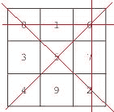
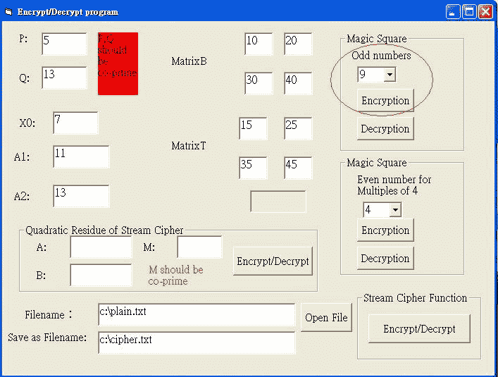
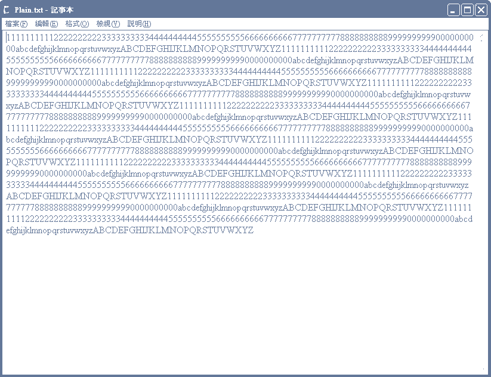
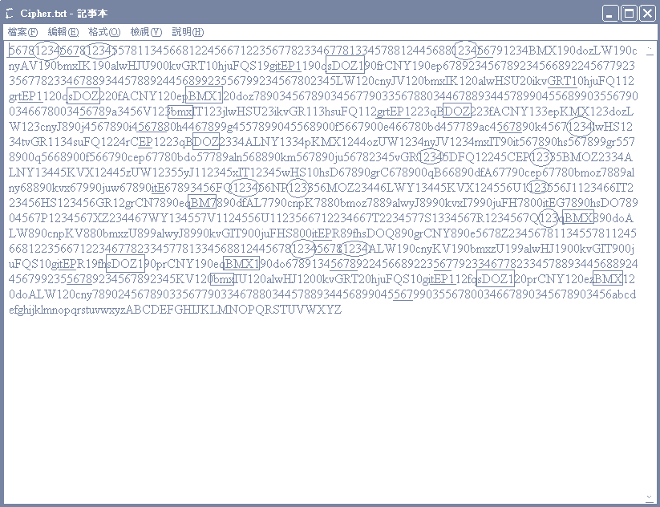
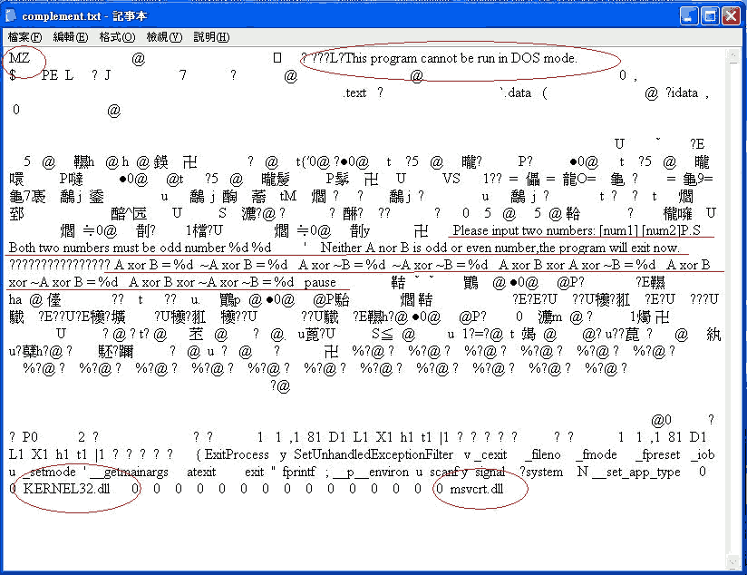
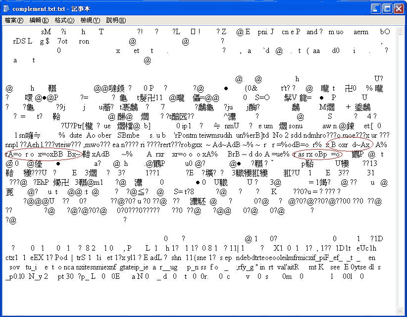

# 流密嵌魔方於存之研究-- Magic Square 篇

> 原文：[`www.pediy.com/kssd/pediy10/89421.html`](https://www.pediy.com/kssd/pediy10/89421.html)

※  这次我不会再误会大家的意思了。  
  
些附件是根[【原创】流密嵌魔方於存之研究](http://bbs.pediy.com/showthread.php?t=88968)所出的西。  
  
这是一个 3 by 3 的魔方阵 (magic square)，也就是说，它的行 (row) 跟列 (column) 及斜线的交叉 (cross) 总和(sum)都一样，这样的一个矩阵(matrix)，就叫称做魔方阵。  
大学本科是 Computer Science related fields 的人，可能都有接触过。  
这个问题，最早是个数学问题，最后变成 beginning programmer 的 exercise 我也不知道。  
现在我要介绍我把 magic square 当做 encryption / decryption 的方法。  
我先选择 magic square 中的 9 ，然后按下 encryption，  
  
  
接着会把 plain.txt 加密，  
  
变成 cipher.txt  
  
这个 plain.txt 是我延用上次的 file，这次用 magic square 来加密，大家会看到加密之后的结果，很特别。  
我有把一些特征(characteristics) mark 起来，你们自己找一找，看看是不是可以从 cipher.txt 反推回 plain.txt 的那种关系出来。  
  
接着我再把 complement.txt 加密，这一看就是知道是一个 hex file，跟 plain.txt 完全不一样。  
  
加密后会变成 complement.txt.txt  
  
我也一样把常出现的 characteristic mark 起来，看看可不可以找出彼此的 relationship。  
现在，您们知道我用 9 来加密的，你们自己可以做一遍，如果做出来的结果跟我的不一样，那就是有问题。  
  
或者，您可以把加密的 file 解密，如果解回来的，跟我的不一样，那也是有问题的。  
  
plain.txt 1,672  bytes  
cipher.txt 1,672 bytes  
complement.txt 4,096 byes  
complement.txt.txt 4,096 bytes  
  
Ps.  
其实，那套软件，提供三种不同的加密法，到目前为止，我已经介绍两种，下次有机会再介绍另一种。等介绍完，我再谈它的应用，它可以应用在  
Satellite communication, Telecommunication, FAX 及 汽车的安全防盗锁，很多方面。  
若再有机会，我再介绍它应用在 quantum crypto 的 properties。

上传的附件
|  || Plain.txt  
 |
|  || Cipher.txt  
 |
|  || complement.txt  
 |
|  || complement.txt.txt  
 |