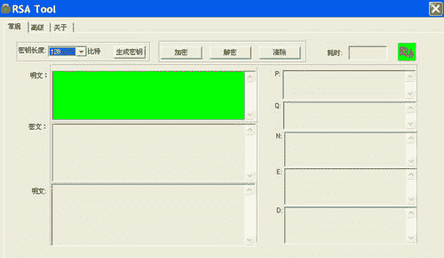
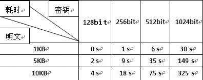
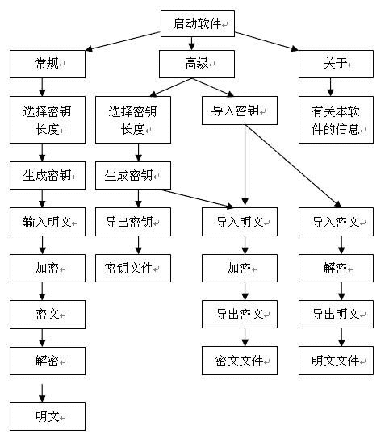

# 【作品提交】RSA 加密解密的实现

> 原文：[`www.pediy.com/kssd/pediy10/67412.html`](https://www.pediy.com/kssd/pediy10/67412.html)

这学期刚学密码学，RSA 算法相对简单，于是写了这个小软件.开发环境:VC++6.0。    
    RSA 的安全性依赖于大数分解。据猜测，从一个密钥和密文推断出明文的难度等同于分解两个大素数的积。  
    数据加密算法 RSA 的关键在于大素数的生成,本软件采取数组形式解决大素数的存储和运算问题,可生成超过 1024 位的十进制数的大素数,以应用于数据加密。  
    RSA 的缺点主要有：产生密钥很麻烦，受到素数产生技术的限制，因而难以做到一次一密。分组长度太大，为保证安全性，n 至少也要 600 bits 以上，使运算代价很高，尤其是速度较慢，较对称密码算法慢几个数量级；且随着大数分解技术的发展，这个长度还在增加，不利于数据格式的标准化。  
密钥生成步骤：  
1，选两个保密的大素数 p,q  
2，计算 n=p\*q,计算欧拉函数值(p-1)\*(q-1)  
3，选一个整数 e,且 e 小于欧拉函数值并且大于 1，同时满足 e 与欧拉函数值互质  
4，再选一个整数 d,满足 d 是 e 在模欧拉函数值下的乘法逆元，因 e 与欧拉函数值  
互质，由模运算可知它的乘法逆员一定存在。  
5，以 PK={e,n}为公钥，SK={d,p,q}为私钥。  
加密：  
先将明文比特数分组，使分组对应的 10 进制数小于 n，然后对每个分组作加密运算  
c=(m^e)mod(n),c 就是密文  
解密：  
对密文分组进行 m=(c^d)mod(n)  
以上计算涉及到信息安全数学基础和现代密码学的知识，请参考《现代密码学（第二版）》和《信息安全数学基础》  
均为清华大学出版社出版。  
  
RSA 是一个较为完善的公钥密码算法，不仅能够用于加密，还能用于签名，是被广泛  
研究的公钥密码算法，从提出到现在 20 多年，经历了各种攻击的考验，被普遍认为是目前最  
优秀的公钥密码算法之一。随着人类计算能力的不断提高，原来被认为是不肯能分解的大数已被  
成功分解。1994 年贝尔实验室用 1600 台计算机耗时 8 个月（用时 4600 年）成功分解 RSA-129，就是 n 为 129 位 10 进制数。  
在当前一般商业领域，用的是 RSA-155（约 512 比特）是安全的。估计在未来一段比较长的时期，密钥长度介于 1024 至  
2048 比特之间的 RSA 是安全的。  
软件界面:  
  
    对于明文是字母、数字、符号、汉字的各种组合都能正确加密解密  
测试数据：  
加密密钥:  
{E, N} = { 4058909522923781627, 153870764068524986667864920209111888657}  
  
解密密钥：  
{D, N} = { 14781867977920790397315320392274696923,  
     153870764068524986667864920209111888657}  
明文：放假过来玩儿！<>:L"\*)(&fafg5435  
密文：     
  
60723915094460019985764292058618742154703013068749621244689639385694447422914889064196589028269619112  
  
0965431827171  
解密后：放假过来玩儿！<>:L"\*)(&fafg5435  
  
下图是软件执行性能的测试结果  
  
  
下图是软件流程图:  

上传的附件
|  || RSA Tool.rar  
 |