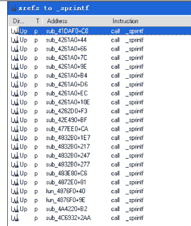

# EditPlus V2.20 Build 284 注册算法分析

> 原文：[`www.pediy.com/kssd/pediy07/pediy7-440.htm`](https://www.pediy.com/kssd/pediy07/pediy7-440.htm)

【软件名称】Editplus 2.20 Build 284   
【原创作者】forever\[RCT\]  
【目标语言】VC  
【保护方式】注册码  
【保护级别】难  
【使用工具】PEiD,ollydgb,ida  
【目标简介】 EditPlus 是 Internet 时代的 32 位文本编辑程序，HTML 编辑及程序员的 Windows 平台编辑器。它可以充分的替换记事本，它也提供网页作家及程序设计师许多强悍的功能。对于 HTML、CSS、PHP、ASP、Perl、C/C++、Java、JavaScript 及 VBScript 的语法突显。当然，它也可以在自定义语法文件后扩充其他的程序语言。嵌合网页浏览器作 HTML 页的预览，及 FTP 命令做本地文件上传到 FTP 服务器。其他功能还包含 HTML 工具栏、用户工具、列号、标尺、URL 突显。自动完成、剪贴文本、行列选择、强大的搜索与替换、多重撤消/重做、拼写检测、自定义键盘快捷键、以及更多。  
【下载地址】http://www1.skycn.com/soft/3640.html  
【正文】  
       这个软件的算法并不难，难的是如果把分散在各处的验证找全。我看了一下前面的分析，对比这个版本变化不大。在看雪精华 4 里有篇夜月的分析应该算是比较全的了。夜月所提到的那个核心算法其实就是 C 函数 sprintf。我这篇分析大体也是这个思路。所以找到的仍然是对前 10 位注册码的验证。那么还有必要写这篇分析吗？我是这样想的：既然程序是用 C 语言来编写的，当然也能把算法用 C 语言还原回去。因此下面的分析是用 C 语言描述的。  
       这篇分析可能没找到全部的验证，如果你在使用中有什么新的发现，请告诉我。我不胜感激！  
         
   在 ida 里跟踪 sprintf 函数：  
     
   

  
好了。数数，共有 22 处引用 sprintf 这个函数的。这 22 处不是每一处都是判断注册码的。在分别查看过后整理如下：  
地址         判断注册码第几位  
41DAF0        7  
42E490        10  
477EE0        8  
483E80        11  
4872E0        5  
4876F0        1,2,3,4  
4A427E        9  
下面就分别看看每一处：  
第 1 处：  
.text:0041DAF0 sub\_41DAF0      proc near                
.text:0041DAF0 var\_20          = dword ptr -20h  
.text:0041DAF0 var\_1C          = dword ptr -1Ch  
.text:0041DAF0 var\_18          = dword ptr -18h  
.text:0041DAF0 var\_C           = dword ptr -0Ch  
.text:0041DAF0 var\_4           = dword ptr -4  
.text:0041DAF0  
.text:0041DAF0                 push    0FFFFFFFFh  
.text:0041DAF2                 push    offset unknown\_libname\_635  
.text:0041DAF7                 mov     eax, large fs:0  
.text:0041DAFD                 push    eax  
.text:0041DAFE                 mov     large fs:0, esp  
.text:0041DB05                 sub     esp, 14h  
.text:0041DB08                 push    ebp  
.text:0041DB09                 push    esi  
.text:0041DB0A                 mov     esi, ecx  
.text:0041DB0C                 push    edi  
.text:0041DB0D                 mov     \[esp+2Ch+var\_20\], esi  
.text:0041DB11                 mov     dword ptr \[esi\], offset off\_4FBA60  
.text:0041DB17                 mov     dword\_52E9D8, 0  
.text:0041DB21                 mov     eax, \[esi+2B8h\]  
.text:0041DB27                 mov     \[esp+2Ch+var\_4\], 0Bh  
.text:0041DB2F                 mov     cx, \[eax\]  
.text:0041DB32                 cmp     cx, 7D0h  
.text:0041DB37                 ja      short loc\_41DB4A  
.text:0041DB39                 jnz     loc\_41DBE5  
.text:0041DB3F                 cmp     word ptr \[eax+2\], 2  
.text:0041DB44                 jbe     loc\_41DBE5  
.text:0041DB4A  
.text:0041DB4A loc\_41DB4A:                               
.text:0041DB4A                 mov     ax, \[eax+4\]  
.text:0041DB4E                 cmp     ax, 1  
.text:0041DB52                 jz      short loc\_41DB5E  
.text:0041DB54                 cmp     ax, 2  
.text:0041DB58                 jnz     loc\_41DBE5  
.text:0041DB5E  
.text:0041DB5E loc\_41DB5E:                               
.text:0041DB5E                 mov     eax, \[esi+2B0h\]  
.text:0041DB64                 mov     ebp, \[eax\]      //取用户名  
.text:0041DB66                 mov     edi, \[ebp-8\]    //长度小于等于 0 则跳  
.text:0041DB69                 test    edi, edi  
.text:0041DB6B                 jle     short loc\_41DBE5  
.text:0041DB6D                 xor     eax, eax  
.text:0041DB6F                 mov     ecx, 1          //初值 1  
.text:0041DB74                 test    edi, edi  
.text:0041DB76                 jle     short loc\_41DB84  
.text:0041DB78  
.text:0041DB78 loc\_41DB78:                               
.text:0041DB78                 xor     edx, edx  
.text:0041DB7A                 mov     dl, \[eax+ebp\]  
.text:0041DB7D                 add     ecx, edx        //用户名 ASCII 值累加  
.text:0041DB7F                 inc     eax  
.text:0041DB80                 cmp     eax, edi  
.text:0041DB82                 jl      short loc\_41DB78  
.text:0041DB84  
.text:0041DB84 loc\_41DB84:                               
.text:0041DB84                 add     ecx, 17h        //加上 23  
.text:0041DB87                 mov     eax, 2AAAAAABh  
.text:0041DB8C                 imul    ecx             //除以 6  
.text:0041DB8E                 mov     eax, edx  
.text:0041DB90                 shr     eax, 1Fh  
.text:0041DB93                 lea     eax, \[edx+eax+3\] //加上 3  
.text:0041DB97                 lea     ecx, ds:0\[eax\*8\] //乘以 7  
.text:0041DB9E                 sub     ecx, eax  
.text:0041DBA0                 and     ecx, 8000000Fh   //模 16  
.text:0041DBA6                 jns     short loc\_41DBAD  
.text:0041DBA8                 dec     ecx  
.text:0041DBA9                 or      ecx, 0FFFFFFF0h  
.text:0041DBAC                 inc     ecx  
.text:0041DBAD  
.text:0041DBAD loc\_41DBAD:                               
.text:0041DBAD                 push    ecx  
.text:0041DBAE                 lea     edx, \[esp+30h+var\_18\]  
.text:0041DBB2                 push    offset off\_523498  ;'%1X'  
.text:0041DBB7                 push    edx  
.text:0041DBB8                 call    \_sprintf              //转换成字符串  
.text:0041DBBD                 mov     eax, \[esi+2B4h\]  
.text:0041DBC3                 add     esp, 0Ch  
.text:0041DBC6                 mov     eax, \[eax\]            //取注册码  
.text:0041DBC8                 cmp     dword ptr \[eax-8\], 7  //长度小于 7 则跳  
.text:0041DBCC                 jl      short loc\_41DBD9  
.text:0041DBCE                 mov     al, \[eax+6\]           //取注册码第 7 个字节  
.text:0041DBD1                 mov     cl, byte ptr \[esp+2Ch+var\_18\] //取上面字符串的第 1 个字节  
.text:0041DBD5                 cmp     al, cl                //比较  
.text:0041DBD7                 jz      short loc\_41DBE5  
.text:0041DBD9  
.text:0041DBD9 loc\_41DBD9:                               
.text:0041DBD9                 mov     ecx, \[esi+2BCh\]  
.text:0041DBDF                 mov     dword ptr \[ecx\], 1    //比较失败置标志  
.text:0041DBE5  
.text:0041DBE5 loc\_41DBE5:                               
  
这一段逆向如下：  
int fun1(char \*name,char \*code)  
{    
  int sum,i;  
  char buf\[12\];  
  
  if(strlen(name) <= 0)return 0;  
  sum = 1;  
  for(i = 0; i < strlen(name); i++)sum += name\[i\];  
  sum = ((sum + 23) / 6 + 3) \* 7 % 16;  
  sprintf(buf,"%1X",sum);  
  if(strlen(code) < 7)return 0;  
  if(code\[6\] != buf\[0\])return 0;  
  else return 1;  
}  
  
第 2 处：  
.text:0042E490 sub\_42E490      proc near                
.text:0042E490  
.text:0042E490 var\_20          = dword ptr -20h  
.text:0042E490 var\_1C          = dword ptr -1Ch  
.text:0042E490 var\_18          = dword ptr -18h  
.text:0042E490 var\_C           = dword ptr -0Ch  
.text:0042E490 var\_4           = dword ptr -4  
.text:0042E490  
.text:0042E490                 push    0FFFFFFFFh  
.text:0042E492                 push    offset unknown\_libname\_698  
.text:0042E497                 mov     eax, large fs:0  
.text:0042E49D                 push    eax  
.text:0042E49E                 mov     large fs:0, esp  
.text:0042E4A5                 sub     esp, 14h  
.text:0042E4A8                 push    ebp  
.text:0042E4A9                 push    esi  
.text:0042E4AA                 mov     esi, ecx  
.text:0042E4AC                 push    edi  
.text:0042E4AD                 mov     \[esp+2Ch+var\_20\], esi  
.text:0042E4B1                 mov     dword ptr \[esi\], offset off\_4FC678  
.text:0042E4B7                 mov     \[esp+2Ch+var\_4\], 16h  
.text:0042E4BF                 call    sub\_431350  
.text:0042E4C4                 mov     eax, \[esi+484h\]  
.text:0042E4CA                 mov     cx, \[eax\]  
.text:0042E4CD                 cmp     cx, 7D0h  
.text:0042E4D2                 ja      short loc\_42E4E5  
.text:0042E4D4                 jnz     loc\_42E57C  
.text:0042E4DA                 cmp     word ptr \[eax+2\], 6  
.text:0042E4DF                 jbe     loc\_42E57C  
.text:0042E4E5  
.text:0042E4E5 loc\_42E4E5:                              
.text:0042E4E5                 mov     ax, \[eax+4\]  
.text:0042E4E9                 cmp     ax, 3  
.text:0042E4ED                 jz      short loc\_42E4F9  
.text:0042E4EF                 cmp     ax, 4  
.text:0042E4F3                 jnz     loc\_42E57C  
.text:0042E4F9  
.text:0042E4F9 loc\_42E4F9:                              
.text:0042E4F9                 cmp     dword\_52EAE4, 4E4h  
.text:0042E503                 jnz     short loc\_42E57C  
.text:0042E505                 mov     eax, \[esi+47Ch\]  
.text:0042E50B                 mov     ebp, \[eax\]       //取用户名  
.text:0042E50D                 mov     edi, \[ebp-8\]  
.text:0042E510                 test    edi, edi  
.text:0042E512                 jle     short loc\_42E57C //长度小于等于 0 则跳  
.text:0042E514                 xor     eax, eax  
.text:0042E516                 mov     ecx, 1           //初值 1  
.text:0042E51B                 test    edi, edi  
.text:0042E51D                 jle     short loc\_42E52B  
.text:0042E51F  
.text:0042E51F loc\_42E51F:                               
.text:0042E51F                 xor     edx, edx  
.text:0042E521                 mov     dl, \[eax+ebp\]  
.text:0042E524                 add     ecx, edx         //用户名 ASCII 值累加  
.text:0042E526                 inc     eax  
.text:0042E527                 cmp     eax, edi  
.text:0042E529                 jl      short loc\_42E51F  
.text:0042E52B  
.text:0042E52B loc\_42E52B:                               
.text:0042E52B                 lea     eax, \[ecx+ecx\*2+27h\] //乘以 3 加上 39  
.text:0042E52F                 cdq  
.text:0042E530                 and     edx, 7  
.text:0042E533                 add     eax, edx  
.text:0042E535                 sar     eax, 3               //除以 8  
.text:0042E538                 and     eax, 8000000Fh       //模 16  
.text:0042E53D                 jns     short loc\_42E544  
.text:0042E53F                 dec     eax  
.text:0042E540                 or      eax, 0FFFFFFF0h  
.text:0042E543                 inc     eax  
.text:0042E544  
.text:0042E544 loc\_42E544:                               
.text:0042E544                 push    eax  
.text:0042E545                 lea     eax, \[esp+30h+var\_18\]  
.text:0042E549                 push    offset off\_523498    ; "%1X"  
.text:0042E54E                 push    eax  
.text:0042E54F                 call    \_sprintf              //转换成字符串  
.text:0042E554                 mov     ecx, \[esi+480h\]  
.text:0042E55A                 add     esp, 0Ch  
.text:0042E55D                 mov     eax, \[ecx\]            //取注册码  
.text:0042E55F                 cmp     dword ptr \[eax-8\], 10  
.text:0042E563                 jl      short loc\_42E570      //长度小于 10 则跳  
.text:0042E565                 mov     al, \[eax+9\]        //取注册码第 10 个字节  
.text:0042E568                 mov     cl, byte ptr \[esp+2Ch+var\_18\] //取字符串第 1 个字节  
.text:0042E56C                 cmp     al, cl                //比较  
.text:0042E56E                 jz      short loc\_42E57C  
.text:0042E570  
.text:0042E570 loc\_42E570:                               
.text:0042E570                 mov     edx, \[esi+488h\]  
.text:0042E576                 mov     dword ptr \[edx\], 1   //不等则置标志  
.text:0042E57C  
.text:0042E57C loc\_42E57C:                     
            
这一段逆向如下：  
int fun2(char \*name,char \*code)  
{    
  int sum,i;  
  char buf\[12\];  
  
  if(strlen(name) <= 0)return 0;  
  sum = 1;  
  for(i = 0; i < strlen(name); i++)sum += name\[i\];  
  sum = (sum \* 3 + 39) / 8 % 16;  
  sprintf(buf,"%1X",sum);  
  if(strlen(code) < 10)return 0;  
  if(code\[9\] != buf\[0\])return 0;  
  else return 1;  
}  
 第 3 处：  
.text:00477EE0 sub\_477EE0      proc near               
.text:00477EE0  
.text:00477EE0 var\_20          = dword ptr -20h  
.text:00477EE0 var\_1C          = dword ptr -1Ch  
.text:00477EE0 var\_18          = dword ptr -18h  
.text:00477EE0 var\_C           = dword ptr -0Ch  
.text:00477EE0 var\_4           = dword ptr -4  
.text:00477EE0  
.text:00477EE0                 push    0FFFFFFFFh  
.text:00477EE2                 push    offset unknown\_libname\_852  
.text:00477EE7                 mov     eax, large fs:0  
.text:00477EED                 push    eax  
.text:00477EEE                 mov     large fs:0, esp  
.text:00477EF5                 sub     esp, 14h  
.text:00477EF8                 push    ebp  
.text:00477EF9                 push    esi  
.text:00477EFA                 mov     esi, ecx  
.text:00477EFC                 push    edi  
.text:00477EFD                 mov     \[esp+2Ch+var\_20\], esi  
.text:00477F01                 mov     dword ptr \[esi\], offset off\_4FF988  
.text:00477F07                 mov     eax, \[esi+384h\]  
.text:00477F0D                 mov     \[esp+2Ch+var\_4\], 1  
.text:00477F15                 push    eax  
.text:00477F16                 call    sub\_4CDB37  
.text:00477F1B                 mov     eax, \[esi+78h\]  
.text:00477F1E                 push    eax  
.text:00477F1F                 call    sub\_4CDB37  
.text:00477F24                 mov     eax, \[esi+37Ch\]  
.text:00477F2A                 add     esp, 8  
.text:00477F2D                 mov     cx, \[eax\]  
.text:00477F30                 cmp     cx, 7D0h  
.text:00477F35                 ja      short loc\_477F48  
.text:00477F37                 jnz     loc\_477FD7  
.text:00477F3D                 cmp     word ptr \[eax+2\], 3  
.text:00477F42                 jbe     loc\_477FD7  
.text:00477F48  
.text:00477F48 loc\_477F48:                             
.text:00477F48                 mov     ax, \[eax+4\]  
.text:00477F4C                 cmp     ax, 3  
.text:00477F50                 jz      short loc\_477F58  
.text:00477F52                 cmp     ax, 4  
.text:00477F56                 jnz     short loc\_477FD7  
.text:00477F58  
.text:00477F58 loc\_477F58:                               
.text:00477F58                 mov     eax, \[esi+374h\]  
.text:00477F5E                 mov     ebp, \[eax\]           //取注册码  
.text:00477F60                 mov     edi, \[ebp-8\]  
.text:00477F63                 test    edi, edi  
.text:00477F65                 jle     short loc\_477FD7     //长度小于等于 0 则跳  
.text:00477F67                 xor     eax, eax  
.text:00477F69                 mov     ecx, 1               //初值 1  
.text:00477F6E                 test    edi, edi  
.text:00477F70                 jle     short loc\_477F7E  
.text:00477F72  
.text:00477F72 loc\_477F72:                              
.text:00477F72                 xor     edx, edx  
.text:00477F74                 mov     dl, \[eax+ebp\]  
.text:00477F77                 add     ecx, edx             //用户名 ASCII 值累加  
.text:00477F79                 inc     eax  
.text:00477F7A                 cmp     eax, edi  
.text:00477F7C                 jl      short loc\_477F72  
.text:00477F7E  
.text:00477F7E loc\_477F7E:                               
.text:00477F7E                 lea     ecx, \[ecx+ecx\*2+13h\] //乘以 3 加上 19  
.text:00477F82                 mov     eax, 38E38E39h  
.text:00477F87                 imul    ecx                  //除以 9  
.text:00477F89                 sar     edx, 1  
.text:00477F8B                 mov     eax, edx  
.text:00477F8D                 shr     eax, 1Fh  
.text:00477F90                 add     edx, eax  
.text:00477F92                 and     edx, 8000000Fh       //模 16  
.text:00477F98                 jns     short loc\_477F9F  
.text:00477F9A                 dec     edx  
.text:00477F9B                 or      edx, 0FFFFFFF0h  
.text:00477F9E                 inc     edx  
.text:00477F9F  
.text:00477F9F loc\_477F9F:                              
.text:00477F9F                 push    edx  
.text:00477FA0                 lea     ecx, \[esp+30h+var\_18\]  
.text:00477FA4                 push    offset off\_523498  ; "%1X"  
.text:00477FA9                 push    ecx  
.text:00477FAA                 call    \_sprintf            //转换成字符串  
.text:00477FAF                 mov     edx, \[esi+378h\]  
.text:00477FB5                 add     esp, 0Ch  
.text:00477FB8                 mov     eax, \[edx\]          //取注册码  
.text:00477FBA                 cmp     dword ptr \[eax-8\], 8  
.text:00477FBE                 jl      short loc\_477FCB    //长度小于 8 则跳  
.text:00477FC0                 mov     al, \[eax+7\]         //取注册码第 8 个字节  
.text:00477FC3                 mov     cl, byte ptr \[esp+2Ch+var\_18\] //取字符串第 1 个字节  
.text:00477FC7                 cmp     al, cl              //比较  
.text:00477FC9                 jz      short loc\_477FD7  
.text:00477FCB  
.text:00477FCB loc\_477FCB:                               
.text:00477FCB                 mov     eax, \[esi+380h\]  
.text:00477FD1                 mov     dword ptr \[eax\], 1  //比较失败则置标志  
.text:00477FD7  
.text:00477FD7 loc\_477FD7:                             
这一段逆向如下：  
int fun3(char \*name,char \*code)  
{    
  int sum,i;  
  char buf\[12\];  
  
  if(strlen(name) <= 0)return 0;  
  sum = 1;  
  for(i = 0; i < strlen(name); i++)sum += name\[i\];  
  sum = (sum \* 3 + 19) / 9 % 16;  
  sprintf(buf,"%1X",sum);  
  if(strlen(code) < 8)return 0;  
  if(code\[7\] != buf\[0\])return 0;  
  else return 1;  
}  
    
第 4 处：  
.text:00483E80 sub\_483E80      proc near                 
.text:00483E80  
.text:00483E80 var\_1C          = dword ptr -1Ch  
.text:00483E80 var\_18          = dword ptr -18h  
.text:00483E80 var\_C           = dword ptr -0Ch  
.text:00483E80 var\_4           = dword ptr -4  
.text:00483E80  
.text:00483E80                 push    0FFFFFFFFh  
.text:00483E82                 push    offset unknown\_libname\_908  
.text:00483E87                 mov     eax, large fs:0  
.text:00483E8D                 push    eax  
.text:00483E8E                 mov     large fs:0, esp  
.text:00483E95                 sub     esp, 10h  
.text:00483E98                 push    ebp  
.text:00483E99                 push    esi  
.text:00483E9A                 mov     esi, ecx  
.text:00483E9C                 mov     \[esp+24h+var\_1C\], esi  
.text:00483EA0                 mov     dword ptr \[esi\], offset off\_500FE0  
.text:00483EA6                 mov     eax, \[esi+258h\]  
.text:00483EAC                 mov     \[esp+24h+var\_4\], 4  
.text:00483EB4                 mov     cx, \[eax\]  
.text:00483EB7                 cmp     cx, 7D0h  
.text:00483EBC                 ja      short loc\_483ECF  
.text:00483EBE                 jnz     loc\_483F74  
.text:00483EC4                 cmp     word ptr \[eax+2\], 5  
.text:00483EC9                 jbe     loc\_483F74  
.text:00483ECF  
.text:00483ECF loc\_483ECF:                              
.text:00483ECF                 mov     ax, \[eax+4\]  
.text:00483ED3                 cmp     ax, 1  
.text:00483ED7                 jz      short loc\_483EE3  
.text:00483ED9                 cmp     ax, 2  
.text:00483EDD                 jnz     loc\_483F74  
.text:00483EE3  
.text:00483EE3 loc\_483EE3:                               
.text:00483EE3                 cmp     dword\_52EAE4, 3B5h  
.text:00483EED                 jnz     loc\_483F74  
.text:00483EF3                 mov     eax, \[esi+250h\]  
.text:00483EF9                 mov     ebp, \[eax\]         //取用户名  
.text:00483EFB                 mov     ecx, \[ebp-8\]       
.text:00483EFE                 test    ecx, ecx           //长度小于等于 0 则跳  
.text:00483F00                 jle     short loc\_483F74  
.text:00483F02                 xor     eax, eax  
.text:00483F04                 push    edi  
.text:00483F05                 test    ecx, ecx  
.text:00483F07                 mov     edi, 1             //初值 1  
.text:00483F0C                 jle     short loc\_483F1A  
.text:00483F0E  
.text:00483F0E loc\_483F0E:                               
.text:00483F0E                 xor     edx, edx  
.text:00483F10                 mov     dl, \[eax+ebp\]  
.text:00483F13                 add     edi, edx           //用户名 ASCII 值累加  
.text:00483F15                 inc     eax  
.text:00483F16                 cmp     eax, ecx  
.text:00483F18                 jl      short loc\_483F0E  
.text:00483F1A  
.text:00483F1A loc\_483F1A:                               
.text:00483F1A                 lea     ecx, \[edi+0Ah\]     //加上 10  
.text:00483F1D                 mov     eax, 55555556h      
.text:00483F22                 imul    ecx                //除以 3  
.text:00483F24                 mov     eax, edx  
.text:00483F26                 shr     eax, 1Fh  
.text:00483F29                 add     edx, eax  
.text:00483F2B                 shl     edx, 3             //乘以 8  
.text:00483F2E                 and     edx, 8000000Fh     //模 16  
.text:00483F34                 jns     short loc\_483F3B  
.text:00483F36                 dec     edx  
.text:00483F37                 or      edx, 0FFFFFFF0h  
.text:00483F3A                 inc     edx  
.text:00483F3B  
.text:00483F3B loc\_483F3B:                               
.text:00483F3B                 push    edx  
.text:00483F3C                 lea     ecx, \[esp+2Ch+var\_18\]  
.text:00483F40                 push    offset off\_523498    ; "%1X"  
.text:00483F45                 push    ecx  
.text:00483F46                 call    \_sprintf            //转换成字符串  
.text:00483F4B                 mov     edx, \[esi+254h\]  
.text:00483F51                 add     esp, 0Ch  
.text:00483F54                 mov     eax, \[edx\]          //取注册码  
.text:00483F56                 pop     edi  
.text:00483F57                 cmp     dword ptr \[eax-8\], 11  
.text:00483F5B                 jl      short loc\_483F68    //长度小于 11 则跳  
.text:00483F5D                 mov     al, \[eax+0Ah\]       //取注册码第 11 个字节  
.text:00483F60                 mov     cl, byte ptr \[esp+24h+var\_18\] //取字符串第 1 个字节  
.text:00483F64                 cmp     al, cl              //比较  
.text:00483F66                 jz      short loc\_483F74  
.text:00483F68  
.text:00483F68 loc\_483F68:                               
.text:00483F68                 mov     eax, \[esi+25Ch\]  
.text:00483F6E                 mov     dword ptr \[eax\], 1  //比较失败则置标志  
.text:00483F74  
.text:00483F74 loc\_483F74:                               
这一段逆向如下：  
int fun4(char \*name,char \*code)  
{    
  int sum,i;  
  char buf\[12\];  
  
  if(strlen(name) <= 0)return 0;  
  sum = 1;  
  for(i = 0; i < strlen(name); i++)sum += name\[i\];  
  sum = (sum + 10) / 3 \* 8 % 16;  
  sprintf(buf,"%1X",sum);  
  if(strlen(code) < 11)return 0;  
  if(code\[10\] != buf\[0\])return 0;  
  else return 1;  
}  
  
第 5 处：  
.text:004872E0 sub\_4872E0      proc near               
.text:004872E0  
.text:004872E0 var\_1C          = dword ptr -1Ch  
.text:004872E0 var\_18          = dword ptr -18h  
.text:004872E0 var\_C           = dword ptr -0Ch  
.text:004872E0 var\_4           = dword ptr -4  
.text:004872E0  
.text:004872E0                 push    0FFFFFFFFh  
.text:004872E2                 push    offset unknown\_libname\_914  
.text:004872E7                 mov     eax, large fs:0  
.text:004872ED                 push    eax  
.text:004872EE                 mov     large fs:0, esp  
.text:004872F5                 sub     esp, 10h  
.text:004872F8                 push    ebp  
.text:004872F9                 push    esi  
.text:004872FA                 push    edi  
.text:004872FB                 mov     edi, ecx  
.text:004872FD                 mov     \[esp+28h+var\_1C\], edi  
.text:00487301                 mov     dword ptr \[edi\], offset off\_5012A0  
.text:00487307                 mov     eax, \[edi+0D8h\]  
.text:0048730D                 mov     \[esp+28h+var\_4\], 1  
.text:00487315                 mov     ebp, \[eax\]            //取用户名  
.text:00487317                 mov     esi, \[ebp-8\]  
.text:0048731A                 test    esi, esi  
.text:0048731C                 jle     short loc\_48738E      //长度小于等于 0 则跳  
.text:0048731E                 xor     eax, eax  
.text:00487320                 mov     ecx, 1                //初值 1  
.text:00487325                 test    esi, esi  
.text:00487327                 jle     short loc\_487335  
.text:00487329  
.text:00487329 loc\_487329:                              
.text:00487329                 xor     edx, edx  
.text:0048732B                 mov     dl, \[eax+ebp\]  
.text:0048732E                 add     ecx, edx              //用户名 ASCII 值累加  
.text:00487330                 inc     eax  
.text:00487331                 cmp     eax, esi  
.text:00487333                 jl      short loc\_487329  
.text:00487335  
.text:00487335 loc\_487335:                              
.text:00487335                 lea     ecx, \[ecx+ecx\*8+0Ah\]  //乘以 9 加上 10  
.text:00487339                 mov     eax, 55555556h  
.text:0048733E                 imul    ecx                   //除以 3  
.text:00487340                 mov     eax, edx  
.text:00487342                 shr     eax, 1Fh  
.text:00487345                 lea     ecx, \[edx+eax+24h\]    //加上 36  
.text:00487349                 and     ecx, 8000000Fh        //模 16  
.text:0048734F                 jns     short loc\_487356   
.text:00487351                 dec     ecx  
.text:00487352                 or      ecx, 0FFFFFFF0h  
.text:00487355                 inc     ecx  
.text:00487356  
.text:00487356 loc\_487356:                            
.text:00487356                 push    ecx  
.text:00487357                 lea     edx, \[esp+2Ch+var\_18\]  
.text:0048735B                 push    offset off\_523498  ; "%1X"  
.text:00487360                 push    edx  
.text:00487361                 call    \_sprintf              //转换成字符串  
.text:00487366                 mov     eax, \[edi+0DCh\]  
.text:0048736C                 add     esp, 0Ch  
.text:0048736F                 mov     eax, \[eax\]            //取注册码  
.text:00487371                 cmp     dword ptr \[eax-8\], 5  
.text:00487375                 jl      short loc\_487382      //长度小于 5 则跳  
.text:00487377                 mov     al, \[eax+4\]           //取注册码第 5 个字节  
.text:0048737A                 mov     cl, byte ptr \[esp+28h+var\_18\] //取字符串第 1 个字节  
.text:0048737E                 cmp     al, cl                //比较  
.text:00487380                 jz      short loc\_48738E  
.text:00487382  
.text:00487382 loc\_487382:                               
.text:00487382                 mov     ecx, \[edi+0E4h\]  
.text:00487388                 mov     dword ptr \[ecx\], 1    //不等则置标志  
.text:0048738E  
.text:0048738E loc\_48738E:         
这一段逆向如下：  
int fun5(char \*name,char \*code)  
{    
  int sum,i;  
  char buf\[12\];  
  
  if(strlen(name) <= 0)return 0;  
  sum = 1;  
  for(i = 0; i < strlen(name); i++)sum += name\[i\];  
  sum = ((sum \* 9 + 10) / 3 + 36) % 16;  
  sprintf(buf,"%1X",sum);  
  if(strlen(code) < 5)return 0;  
  if(code\[4\] != buf\[0\])return 0;  
  else return 1;  
}  
  
第 6 处：  
.text:004876F0 fun\_4876F0      proc near                 
.text:004876F0  
.text:004876F0 var\_C           = dword ptr -0Ch  
.text:004876F0 arg\_0\_name      = dword ptr  4  
.text:004876F0 arg\_4\_code      = dword ptr  8  
.text:004876F0  
.text:004876F0                 sub     esp, 0Ch  
.text:004876F3                 or      ecx, 0FFFFFFFFh  
.text:004876F6                 xor     eax, eax  
.text:004876F8                 push    esi  
.text:004876F9                 mov     esi, \[esp+10h+arg\_0\_name\]  
.text:004876FD                 push    edi  
.text:004876FE                 mov     edi, esi  
.text:00487700                 repne scasb  
.text:00487702                 not     ecx  
.text:00487704                 dec     ecx  
.text:00487705                 mov     edi, ecx  
.text:00487707                 jnz     short loc\_48770F ; 用户名长度不为 0 则跳  
.text:00487709                 pop     edi  
.text:0048770A                 pop     esi  
.text:0048770B                 add     esp, 0Ch  
.text:0048770E                 retn  
.text:0048770F loc\_48770F:                               
.text:0048770F                 call    InitTable1\_487650       //初始化 CRC16 表  
.text:00487714                 push    edi             ; 长度  
.text:00487715                 push    esi             ; 用户名  
.text:00487716                 push    0  
.text:00487718                 call    XorTable1\_4876A0        //对用户名计算 CRC16  
.text:0048771D                 add     esp, 0Ch  
.text:00487720                 and     eax, 0FFFFh  
.text:00487725                 push    eax  
.text:00487726                 lea     eax, \[esp+18h+var\_C\]  
.text:0048772A                 push    offset a02x\_0   ; "%02X"  
.text:0048772F                 push    eax  
.text:00487730                 call    \_sprintf               //CRC16 结果转成字符串  
.text:00487735                 mov     esi, \[esp+20h+arg\_4\_code\]  
.text:00487739                 mov     al, byte ptr \[esp+20h+var\_C\]  
.text:0048773D                 add     esp, 0Ch  
.text:00487740                 mov     cl, \[esi+2\]  
.text:00487743                 lea     edx, \[esi+2\]  
.text:00487746                 cmp     cl, al              //注册码第 3 个字节和字符串第 1 个字节比较  
.text:00487748                 jz      short loc\_487752   
.text:0048774A                 pop     edi  
.text:0048774B                 xor     eax, eax  
.text:0048774D                 pop     esi  
.text:0048774E                 add     esp, 0Ch  
.text:00487751                 retn  
.text:00487752 loc\_487752:                              
.text:00487752                 mov     al, \[esi+3\]  
.text:00487755                 mov     cl, byte ptr \[esp+14h+var\_C+1\]  
.text:00487759                 cmp     al, cl             //注册码第 4 个字节和字符串第 2 个字节比较  
.text:0048775B                 jz      short loc\_487765   
.text:0048775D                 pop     edi  
.text:0048775E                 xor     eax, eax  
.text:00487760                 pop     esi  
.text:00487761                 add     esp, 0Ch  
.text:00487764                 retn  
.text:00487765 loc\_487765:                 
.text:00487765                 mov     edi, esi        ; 注册码  
.text:00487767                 or      ecx, 0FFFFFFFFh  
.text:0048776A                 xor     eax, eax  
.text:0048776C                 repne scasb  
.text:0048776E                 not     ecx  
.text:00487770                 add     ecx, -3  
.text:00487773                 push    ecx             ; len  
.text:00487774                 push    edx             ; &RegCode\[2\]  
.text:00487775                 push    eax             ; 0  
.text:00487776                 call    XorTable1\_4876A0  //对注册码第 3 个字节开始计算 CRC16  
.text:0048777B                 add     esp, 0Ch  
.text:0048777E                 and     eax, 0FFFFh  
.text:00487783                 lea     ecx, \[esp+14h+var\_C\]  
.text:00487787                 push    eax  
.text:00487788                 push    offset a02x\_0   ; "%02X"  
.text:0048778D                 push    ecx  
.text:0048778E                 call    \_sprintf          //CRC16 结果转成字符串  
.text:00487793                 mov     dl, \[esi\]  
.text:00487795                 mov     al, byte ptr \[esp+20h+var\_C\]  
.text:00487799                 add     esp, 0Ch  
.text:0048779C                 cmp     dl, al            //注册码第 1 个字节和字符串第 1 个字节比较  
.text:0048779E                 jz      short loc\_4877A8   
.text:004877A0                 pop     edi  
.text:004877A1                 xor     eax, eax  
.text:004877A3                 pop     esi  
.text:004877A4                 add     esp, 0Ch  
.text:004877A7                 retn  
.text:004877A8 loc\_4877A8:                               
.text:004877A8                 mov     cl, \[esi+1\]  
.text:004877AB                 mov     dl, byte ptr \[esp+14h+var\_C+1\]  
.text:004877AF                 xor     eax, eax  
.text:004877B1                 cmp     cl, dl            //注册码第 2 个字节和字符串第 2 个字节比较  
.text:004877B3                 pop     edi  
.text:004877B4                 pop     esi  
.text:004877B5                 setz    al  
.text:004877B8                 add     esp, 0Ch  
.text:004877BB                 retn  
.text:004877BB fun\_4876F0      endp            
  
这一段也是在注册对话框部分验证的。这一段逆向如下：  
int fun6(char \*name,char \*code)  
{    
  int sum,i;  
  char buf\[12\];  
  short int tmp;  
  
  tmp = crc16(name,strlen(name);  
  tmp = tmp & 0xffff;  
  sprintf(buf,"%02X",tmp);  
  if(code\[2\] != buf\[0\])return 0;  
  if(code\[3\] != buf\[1\])return 0;  
  tmp = crc16(&code\[2\],strlen(code)-2);  
  tmp = tmp & 0xffff;  
  sprintf(buf,"%02X",tmp);  
  if(code\[0\] != buf\[0\])return 0;  
  if(code\[1\] != buf\[1\])return 0;  
  return 1;  
}  
  
第 7 处：  
.text:004A4220 sub\_4A4220      proc near                
.text:004A4220  
.text:004A4220 var\_1C          = dword ptr -1Ch  
.text:004A4220 var\_18          = dword ptr -18h  
.text:004A4220 var\_C           = dword ptr -0Ch  
.text:004A4220 var\_4           = dword ptr -4  
.text:004A4220  
.text:004A4220                 push    0FFFFFFFFh  
.text:004A4222                 push    offset unknown\_libname\_1063  
.text:004A4227                 mov     eax, large fs:0  
.text:004A422D                 push    eax  
.text:004A422E                 mov     large fs:0, esp  
.text:004A4235                 sub     esp, 10h  
.text:004A4238                 push    ebp  
.text:004A4239                 push    esi  
.text:004A423A                 mov     esi, ecx  
.text:004A423C                 push    edi  
.text:004A423D                 mov     \[esp+28h+var\_1C\], esi  
.text:004A4241                 mov     dword ptr \[esi\], offset off\_503E48  
.text:004A4247                 mov     eax, \[esi+2D4h\]  
.text:004A424D                 mov     \[esp+28h+var\_4\], 0Ch  
.text:004A4255                 mov     cx, \[eax\]  
.text:004A4258                 cmp     cx, 7D0h  
.text:004A425D                 ja      short loc\_4A4270  
.text:004A425F                 jnz     loc\_4A42FF  
.text:004A4265                 cmp     word ptr \[eax+2\], 4  
.text:004A426A                 jbe     loc\_4A42FF  
.text:004A4270  
.text:004A4270 loc\_4A4270:                               
.text:004A4270                 mov     ax, \[eax+4\]  
.text:004A4274                 cmp     ax, 5  
.text:004A4278                 jz      short loc\_4A4280  
.text:004A427A                 cmp     ax, 6  
.text:004A427E                 jnz     short loc\_4A42FF  
.text:004A4280  
.text:004A4280 loc\_4A4280:                             
.text:004A4280                 mov     eax, \[esi+2CCh\]  
.text:004A4286                 mov     ebp, \[eax\]          //取用户名  
.text:004A4288                 mov     edi, \[ebp-8\]  
.text:004A428B                 test    edi, edi  
.text:004A428D                 jle     short loc\_4A42FF    //长度小于等于 0 则跳  
.text:004A428F                 xor     eax, eax  
.text:004A4291                 mov     ecx, 1              //初值 1  
.text:004A4296                 test    edi, edi  
.text:004A4298                 jle     short loc\_4A42A6  
.text:004A429A  
.text:004A429A loc\_4A429A:                             
.text:004A429A                 xor     edx, edx  
.text:004A429C                 mov     dl, \[eax+ebp\]  
.text:004A429F                 add     ecx, edx            //用户名 ASCII 值累加  
.text:004A42A1                 inc     eax  
.text:004A42A2                 cmp     eax, edi  
.text:004A42A4                 jl      short loc\_4A429A  
.text:004A42A6  
.text:004A42A6 loc\_4A42A6:                              
.text:004A42A6                 lea     ecx, \[ecx+ecx\*4+0Bh\] //乘以 5 加 11  
.text:004A42AA                 mov     eax, 66666667h  
.text:004A42AF                 imul    ecx                  //除以 5  
.text:004A42B1                 sar     edx, 1  
.text:004A42B3                 mov     eax, edx  
.text:004A42B5                 shr     eax, 1Fh  
.text:004A42B8                 add     edx, eax  
.text:004A42BA                 and     edx, 8000000Fh       //模 16  
.text:004A42C0                 jns     short loc\_4A42C7  
.text:004A42C2                 dec     edx  
.text:004A42C3                 or      edx, 0FFFFFFF0h  
.text:004A42C6                 inc     edx  
.text:004A42C7  
.text:004A42C7 loc\_4A42C7:                               
.text:004A42C7                 push    edx  
.text:004A42C8                 lea     ecx, \[esp+2Ch+var\_18\]  
.text:004A42CC                 push    offset off\_523498  ; "%1X"  
.text:004A42D1                 push    ecx  
.text:004A42D2                 call    \_sprintf             //转换成字符串  
.text:004A42D7                 mov     edx, \[esi+2D0h\]  
.text:004A42DD                 add     esp, 0Ch  
.text:004A42E0                 mov     eax, \[edx\]           //取注册码  
.text:004A42E2                 cmp     dword ptr \[eax-8\], 9  
.text:004A42E6                 jl      short loc\_4A42F3     //长度小于 9 则跳  
.text:004A42E8                 mov     al, \[eax+8\]          //取第 9 个字节  
.text:004A42EB                 mov     cl, byte ptr \[esp+28h+var\_18\] //取字符串第 1 个字节  
.text:004A42EF                 cmp     al, cl               //比较  
.text:004A42F1                 jz      short loc\_4A42FF  
.text:004A42F3  
.text:004A42F3 loc\_4A42F3:                              
.text:004A42F3                 mov     eax, \[esi+2D8h\]  
.text:004A42F9                 mov     dword ptr \[eax\], 1   //不等则置标志  
.text:004A42FF  
.text:004A42FF loc\_4A42FF:     
这一段逆向如下：  
int fun7(char \*name,char \*code)  
{    
  int sum,i;  
  char buf\[12\];  
  
  if(strlen(name) <= 0)return 0;  
  sum = 1;  
  for(i = 0; i < strlen(name); i++)sum += name\[i\];  
  sum = (sum \* 5 + 11) / 5 % 16;  
  sprintf(buf,"%1X",sum);  
  if(strlen(code) < 9)return 0;  
  if(code\[8\] != buf\[0\])return 0;  
  else return 1;  
}  
  
最后附上 crc16 的 c 源代码：  
short int crc16table\[\] = {  
     0x0000, 0xC0C1, 0xC181, 0x0140, 0xC301, 0x03C0, 0x0280, 0xC241,  
     0xC601, 0x06C0, 0x0780, 0xC741, 0x0500, 0xC5C1, 0xC481, 0x0440,  
     0xCC01, 0x0CC0, 0x0D80, 0xCD41, 0x0F00, 0xCFC1, 0xCE81, 0x0E40,  
     0x0A00, 0xCAC1, 0xCB81, 0x0B40, 0xC901, 0x09C0, 0x0880, 0xC841,  
     0xD801, 0x18C0, 0x1980, 0xD941, 0x1B00, 0xDBC1, 0xDA81, 0x1A40,  
     0x1E00, 0xDEC1, 0xDF81, 0x1F40, 0xDD01, 0x1DC0, 0x1C80, 0xDC41,  
     0x1400, 0xD4C1, 0xD581, 0x1540, 0xD701, 0x17C0, 0x1680, 0xD641,  
     0xD201, 0x12C0, 0x1380, 0xD341, 0x1100, 0xD1C1, 0xD081, 0x1040,  
     0xF001, 0x30C0, 0x3180, 0xF141, 0x3300, 0xF3C1, 0xF281, 0x3240,  
     0x3600, 0xF6C1, 0xF781, 0x3740, 0xF501, 0x35C0, 0x3480, 0xF441,  
     0x3C00, 0xFCC1, 0xFD81, 0x3D40, 0xFF01, 0x3FC0, 0x3E80, 0xFE41,  
     0xFA01, 0x3AC0, 0x3B80, 0xFB41, 0x3900, 0xF9C1, 0xF881, 0x3840,  
     0x2800, 0xE8C1, 0xE981, 0x2940, 0xEB01, 0x2BC0, 0x2A80, 0xEA41,  
     0xEE01, 0x2EC0, 0x2F80, 0xEF41, 0x2D00, 0xEDC1, 0xEC81, 0x2C40,  
     0xE401, 0x24C0, 0x2580, 0xE541, 0x2700, 0xE7C1, 0xE681, 0x2640,  
     0x2200, 0xE2C1, 0xE381, 0x2340, 0xE101, 0x21C0, 0x2080, 0xE041,  
     0xA001, 0x60C0, 0x6180, 0xA141, 0x6300, 0xA3C1, 0xA281, 0x6240,  
     0x6600, 0xA6C1, 0xA781, 0x6740, 0xA501, 0x65C0, 0x6480, 0xA441,  
     0x6C00, 0xACC1, 0xAD81, 0x6D40, 0xAF01, 0x6FC0, 0x6E80, 0xAE41,  
     0xAA01, 0x6AC0, 0x6B80, 0xAB41, 0x6900, 0xA9C1, 0xA881, 0x6840,  
     0x7800, 0xB8C1, 0xB981, 0x7940, 0xBB01, 0x7BC0, 0x7A80, 0xBA41,  
     0xBE01, 0x7EC0, 0x7F80, 0xBF41, 0x7D00, 0xBDC1, 0xBC81, 0x7C40,  
     0xB401, 0x74C0, 0x7580, 0xB541, 0x7700, 0xB7C1, 0xB681, 0x7640,  
     0x7200, 0xB2C1, 0xB381, 0x7340, 0xB101, 0x71C0, 0x7080, 0xB041,  
     0x5000, 0x90C1, 0x9181, 0x5140, 0x9301, 0x53C0, 0x5280, 0x9241,  
     0x9601, 0x56C0, 0x5780, 0x9741, 0x5500, 0x95C1, 0x9481, 0x5440,  
     0x9C01, 0x5CC0, 0x5D80, 0x9D41, 0x5F00, 0x9FC1, 0x9E81, 0x5E40,  
     0x5A00, 0x9AC1, 0x9B81, 0x5B40, 0x9901, 0x59C0, 0x5880, 0x9841,  
     0x8801, 0x48C0, 0x4980, 0x8941, 0x4B00, 0x8BC1, 0x8A81, 0x4A40,  
     0x4E00, 0x8EC1, 0x8F81, 0x4F40, 0x8D01, 0x4DC0, 0x4C80, 0x8C41,  
     0x4400, 0x84C1, 0x8581, 0x4540, 0x8701, 0x47C0, 0x4680, 0x8641,  
     0x8201, 0x42C0, 0x4380, 0x8341, 0x4100, 0x81C1, 0x8081, 0x4040  
};  
  
short int crc16(char \*p,int len)  
{  
    int i;  
    short int tmp = 0,tmp1;  
      
    if(len <= 0)return 0;  
    for(i = 0; i < len; i ++)  
    {  
        tmp = crc16table\[(tmp & 0xff) ^ p\[i\]\] ^ ((tmp >> 8) & 0xff);  
    }  
    return tmp;  
}  
这个表是在 ollydbg 中 dump 出来的，嘿嘿。  
  
【全文完】 

 4dd466d0e1e0cc123afbe504da2462ca