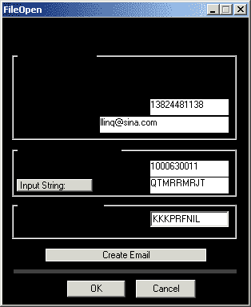

# Cisco 某个学习资料

> 原文：[`www.pediy.com/kssd/pediy05/pediy50586.htm`](https://www.pediy.com/kssd/pediy05/pediy50586.htm)

简单算法——某个学习资料(FileOpen 保护）  
  
  
下载地址：http://www.helpexam.com/dow/UpLoad/640-910.exe  
软件大小：566K

【软件简介】：某个考试的资料。呵呵，我不考某某认证，没用过。 

【软件限制】：必须注册

【作者声明】：初学 Crack，只是感兴趣，没有其它目的。失误之处敬请诸位大侠赐教！

【破解工具】：TRW2000 娃娃修改版、Ollydbg1.09、PEiD、W32Dasm 10 修改版

—————————————————————————————————   
【过    程】：

  
640-910.exe 无壳。Visual C++编写。

呵呵，终于有足够的时间来看几个程序了。  
fnila 兄出手真快，早已搞定了这个东东，我所做的只是再记录一下而已。  
另外，程序有好几处大幅度的“星际跳跃”，如果没有 fnila 兄的指点，我肯定会晕头转向的。  
  
Product   ID ：1000630011  
Input  String：QTMRRMRJT  
试    炼   码：RSTUVWXYZ

————————————————————————————————— 

  
\* Referenced by a (U)nconditional or (C)onditional Jump at Addresses:  
|:0040779A(C), :00407828(C), :00407831(C)  
|  
:0040784D 837C241409              cmp dword ptr \[esp+14\], 00000009  
:00407852 7565                    jne 004078B9

\* Possible StringData Ref from Data Obj ->"692837429"  
                                 |  
:00407854 68744C4100              push 00414C74  
:00407859 BF109E4100              mov edi, 00419E10  
                                 ====>EDI\=QTMRRMRJT    Input  String

:0040785E C7056440410001000000    mov dword ptr \[00414064\], 00000001  
:00407868 6860724100              push 00417260  
:0040786D E8EE0E0000              call 00408760  
                                 ====>还原我的硬盘序列号！

:00407872 83C408                  add esp, 00000008  
:00407875 B9FFFFFFFF              mov ecx, FFFFFFFF  
:0040787A 2BC0                    sub eax, eax  
:0040787C F2                      repnz  
:0040787D AE                      scasb  
:0040787E F7D1                    not ecx  
:00407880 2BF9                    sub edi, ecx  
:00407882 8BC1                    mov eax, ecx  
:00407884 C1E902                  shr ecx, 02  
:00407887 8BF7                    mov esi, edi  
                                 ====>ESI\=EDI\=555490825

:00407889 BF20A04100              mov edi, 0041A020  
:0040788E F3                      repz  
:0040788F A5                      movsd  
:00407890 8BC8                    mov ecx, eax  
:00407892 6820A04100              push 0041A020  
:00407897 83E103                  and ecx, 00000003  
:0040789A 6840B04100              push 0041B040  
:0040789F F3                      repz  
:004078A0 A4                      movsb  
:004078A1 E8BA0E0000              call 00408760  
                                 ====>和上面还原硬盘序列号的算法相同！  
                        用我输入的试炼码和硬盘序列号计算得出一组新值！

:004078A6 83C408                  add esp, 00000008  
:004078A9 68109E4100              push 00419E10  
:004078AE 6800B14100              push 0041B100

\* Reference To: KERNEL32.lstrcpyA, Ord:0296h  
                                 |  
:004078B3 FF150CD34100            Call dword ptr \[0041D30C\]

\* Referenced by a (U)nconditional or (C)onditional Jump at Address:  
|:00407852(C)  
|  
:004078B9 682A994100              push 0041992A

\* Reference To: KERNEL32.lstrlenA, Ord:029Ch  
                                 |  
:004078BE FF1510D34100            Call dword ptr \[0041D310\]  
:004078C4 83F802                  cmp eax, 00000002  
:004078C7 7E4A                    jle 00407913  
                                 ====>跳走！

  …… ……省 略…… ……

  
:00407B3F BE00B14100              mov esi, 0041B100  
                                 ====>ESI\=789;7A:A?

:00407B44 BFB6874100              mov edi, 004187B6  
                                 ====>EDI\=000630011    是 Product ID 的后 9 位

:00407B49 B909000000              mov ecx, 00000009  
:00407B4E F3                      repz  
:00407B4F A6                      cmpsb  
                                 ====>比较是否相同！

:00407B50 7525                    jne 00407B77  
                                 ====>跳则 OVER！

:00407B52 6A01                    push 00000001  
:00407B54 53                      push ebx

\* Reference To: USER32.EndDialog, Ord:00B4h  
                                 |  
:00407B55 FF154CD44100            Call dword ptr \[0041D44C\]  
:00407B5B C7058840410000000000    mov dword ptr \[00414088\], 00000000  
:00407B65 6A00                    push 00000000

\* Reference To: USER32.PostQuitMessage, Ord:01B3h  
                                 |  
:00407B67 FF1558D44100            Call dword ptr \[0041D458\]  
:00407B6D B801000000              mov eax, 00000001  
:00407B72 E9F80A0000              jmp 0040866F

\* Referenced by a (U)nconditional or (C)onditional Jump at Address:  
|:00407B50(C)  
|  
:00407B77 BE00B14100              mov esi, 0041B100  
:00407B7C BFB6874100              mov edi, 004187B6  
:00407B81 B909000000              mov ecx, 00000009  
:00407B86 F3                      repz  
:00407B87 A6                      cmpsb  
:00407B88 746E                    je 00407BF8  
:00407B8A 6A01                    push 00000001  
:00407B8C 53                      push ebx

\* Reference To: USER32.EndDialog, Ord:00B4h  
                                 |  
:00407B8D FF154CD44100            Call dword ptr \[0041D44C\]  
:00407B93 833D4440410001          cmp dword ptr \[00414044\], 00000001  
:00407B9A 7530                    jne 00407BCC  
:00407B9C 6A10                    push 00000010

\* Possible StringData Ref from Data Obj ->"Authorization Failure"  
                                 |  
:00407B9E 68644B4100              push 00414B64

\* Possible StringData Ref from Data Obj ->"22"  
                                 |  
:00407BA3 68004B4100              push 00414B00  
:00407BA8 6A00                    push 00000000  
:00407BAA FFD5                    call ebp  
:00407BAC 6A10                    push 00000010

\* Possible StringData Ref from Data Obj ->"OldstyleExpAuthString"  
                                 |  
:00407BAE 68E84A4100              push 00414AE8  
:00407BB3 6800B14100              push 0041B100  
:00407BB8 6A00                    push 00000000  
:00407BBA FFD5                    call ebp  
:00407BBC 6A10                    push 00000010

\* Possible StringData Ref from Data Obj ->"fo.OldstyleServiceNumberString"  
                                 |  
:00407BBE 68C84A4100              push 00414AC8  
:00407BC3 68B6874100              push 004187B6  
:00407BC8 6A00                    push 00000000  
:00407BCA FFD5                    call ebp

\* Referenced by a (U)nconditional or (C)onditional Jump at Address:  
|:00407B9A(C)  
|  
:00407BCC 6A10                    push 00000010

\* Possible StringData Ref from Data Obj ->"Authorization Failure"  
                                 |  
:00407BCE 68644B4100              push 00414B64

\* Possible StringData Ref from Data Obj ->"The string you entered is incorrect."  
                                 ====>BAD BOY！

  
—————————————————————————————————  
两次进入 call 00408760

  
\* Referenced by a CALL at Addresses:  
|:00403FD5   , :004040A1   , :0040786D   , :004078A1   , :004078DD     
|:00407935   , :00407969   , :00407990   , :004079C4   , :00407A0C     
|:00407A33   , :00407A6E   , :00407DA6     
|  
:00408760 8B542404                mov edx, dword ptr \[esp+04\]  
                                 ====>EDX\=QTMRRMRJT

:00408764 83EC04                  sub esp, 00000004  
:00408767 53                      push ebx  
:00408768 56                      push esi  
:00408769 57                      push edi  
:0040876A 33DB                    xor ebx, ebx  
:0040876C 55                      push ebp  
:0040876D 85D2                    test edx, edx  
:0040876F 746A                    je 004087DB  
:00408771 8B74241C                mov esi, dword ptr \[esp+1C\]  
                                 ====>ESI\=692837429

:00408775 3BF3                    cmp esi, ebx  
:00408777 7462                    je 004087DB  
:00408779 8BFA                    mov edi, edx  
                                 ====>EDI\=EDX\=QTMRRMRJT

:0040877B B9FFFFFFFF              mov ecx, FFFFFFFF  
:00408780 2BC0                    sub eax, eax  
:00408782 F2                      repnz  
:00408783 AE                      scasb  
:00408784 F7D1                    not ecx  
:00408786 49                      dec ecx  
:00408787 8BFE                    mov edi, esi  
:00408789 2BC0                    sub eax, eax  
:0040878B 894C2410                mov dword ptr \[esp+10\], ecx  
:0040878F B9FFFFFFFF              mov ecx, FFFFFFFF  
:00408794 F2                      repnz  
:00408795 AE                      scasb  
:00408796 F7D1                    not ecx  
:00408798 49                      dec ecx  
:00408799 33FF                    xor edi, edi  
:0040879B 395C2410                cmp dword ptr \[esp+10\], ebx  
:0040879F 7E26                    jle 004087C7

\* Referenced by a (U)nconditional or (C)onditional Jump at Address:  
|:004087C5(C)  
|  
:004087A1 3BF9                    cmp edi, ecx  
:004087A3 7C02                    jl 004087A7  
:004087A5 33FF                    xor edi, edi

\* Referenced by a (U)nconditional or (C)onditional Jump at Address:  
|:004087A3(C)  
|  
:004087A7 0FBE041A                movsx eax, byte ptr \[edx+ebx\]  
                       一、      ====>依次取 QTMRRMRJT 字符的 HEX 值  
                           1、   ====>EAX\=51  
                           2、   ====>EAX\=54  
                           3、   ====>EAX\=4D  
                           4、   ====>EAX\=52  
                           5、   ====>EAX\=52  
                           6、   ====>EAX\=4D  
                           7、   ====>EAX\=52  
                           8、   ====>EAX\=4A  
                           9、   ====>EAX\=54  
             ———————————————————————————  
                       二、      ====>依次取 RSTUVWXYZ 字符的 HEX 值  
                              …… ……省 略…… ……

  
:004087AB 0FBE2C3E                movsx ebp, byte ptr \[esi+edi\]  
                       一、      ====>依次取 692837429 字符的 HEX 值  
                           1、   ====>EBP\=36  
                           2、   ====>EBP\=39  
                           3、   ====>EBP\=32  
                           4、   ====>EBP\=38  
                           5、   ====>EBP\=33  
                           6、   ====>EBP\=37  
                           7、   ====>EBP\=34  
                           8、   ====>EBP\=32  
                           9、   ====>EBP\=39  
             ———————————————————————————  
                       二、      ====>依次取 555490825 字符的 HEX 值  
                              …… ……省 略…… ……

  
:004087AF 2BC5                    sub eax, ebp  
                     一、  1、   ====>EAX\=51 - 36=1B  
                           2、   ====>EAX\=54 - 39=1B  
                           3、   ====>EAX\=4D - 32=1B  
                           4、   ====>EAX\=52 - 38=1A  
                           5、   ====>EAX\=52 - 33=1F  
                           6、   ====>EAX\=4D - 37=16  
                           7、   ====>EAX\=52 - 34=1E  
                           8、   ====>EAX\=4A - 32=18  
                           9、   ====>EAX\=54 - 39=1B  
             ———————————————————————————  
                     二、  1、   ====>EAX\=52 - 35=1D  
                           2、   ====>EAX\=53 - 35=1E  
                           3、   ====>EAX\=54 - 35=1F  
                           4、   ====>EAX\=55 - 34=21  
                           5、   ====>EAX\=56 - 39=1D  
                           6、   ====>EAX\=57 - 30=27  
                           7、   ====>EAX\=58 - 38=20  
                           8、   ====>EAX\=59 - 32=27  
                           9、   ====>EAX\=5A - 35=25

  
:004087B1 83F841                  cmp eax, 00000041  
:004087B4 7D03                    jge 004087B9  
:004087B6 83C01A                  add eax, 0000001A  
                     一、  1、   ====>EAX\=1B + 1A=35  
                           2、   ====>EAX\=1B + 1A=35  
                           3、   ====>EAX\=1B + 1A=35  
                           4、   ====>EAX\=1A + 1A=34  
                           5、   ====>EAX\=1F + 1A=39  
                           6、   ====>EAX\=16 + 1A=30  
                           7、   ====>EAX\=1E + 1A=38  
                           8、   ====>EAX\=18 + 1A=32  
                           9、   ====>EAX\=1B + 1A=35  
             ———————————————————————————  
                     二、  1、   ====>EAX\=1D + 1A=37  
                           2、   ====>EAX\=1E + 1A=38  
                           3、   ====>EAX\=1F + 1A=39  
                           4、   ====>EAX\=21 + 1A=3B  
                           5、   ====>EAX\=1D + 1A=37  
                           6、   ====>EAX\=27 + 1A=41  
                           7、   ====>EAX\=20 + 1A=3A  
                           8、   ====>EAX\=27 + 1A=41  
                           9、   ====>EAX\=25 + 1A=3F

  
\* Referenced by a (U)nconditional or (C)onditional Jump at Address:  
|:004087B4(C)  
|  
:004087B9 8883109E4100            mov byte ptr \[ebx+00419E10\], al  
                                 ====>AL 保存在 \[ebx+00419E10\]处  
                       一、      ====>循环 9 次后得出 555490825，呵呵，正是我硬盘序列号！  
             ———————————————————————————  
                       二、      ====>循环 9 次后得出 789;7A:A?  这组字符进行比较！

  
:004087BF 47                      inc edi  
:004087C0 43                      inc ebx  
:004087C1 3B5C2410                cmp ebx, dword ptr \[esp+10\]  
:004087C5 7CDA                    jl 004087A1  
                                 ====>循环 9 次！

\* Referenced by a (U)nconditional or (C)onditional Jump at Address:  
|:0040879F(C)  
|  
:004087C7 B801000000              mov eax, 00000001  
:004087CC 5D                      pop ebp  
:004087CD C683109E410000          mov byte ptr \[ebx+00419E10\], 00  
:004087D4 5F                      pop edi  
:004087D5 5E                      pop esi  
:004087D6 5B                      pop ebx  
:004087D7 83C404                  add esp, 00000004  
:004087DA C3                      ret

  
—————————————————————————————————   
【简 单  求 逆】：

  
程序将硬盘序列号和我输入的试炼码进行简单运算，然后与产品 ID 的后 9 位比较，若相同就 OK 了！  
因此，我的目标是：000630011

              
:004087B6 83C01A                  add eax, 0000001A

           1、   ====>EAX\=1D + 1A=37            ①、30 - 1A=16  
           2、   ====>EAX\=1E + 1A=38            ②、30 - 1A=16  
           3、   ====>EAX\=1F + 1A=39            ③、30 - 1A=16  
           4、   ====>EAX\=21 + 1A=3B            ④、36 - 1A=1C  
           5、   ====>EAX\=1D + 1A=37            ⑤、33 - 1A=19  
           6、   ====>EAX\=27 + 1A=41            ⑥、30 - 1A=16  
           7、   ====>EAX\=20 + 1A=3A            ⑦、30 - 1A=16  
           8、   ====>EAX\=27 + 1A=41            ⑧、31 - 1A=17  
           9、   ====>EAX\=25 + 1A=3F            ⑨、31 - 1A=17

  
:004087AF 2BC5                    sub eax, ebp

           1、   ====>EAX\=52 - 35=1D            ①、16 + 35=4B  
           2、   ====>EAX\=53 - 35=1E            ②、16 + 35=4B  
           3、   ====>EAX\=54 - 35=1F            ③、16 + 35=4B  
           4、   ====>EAX\=55 - 34=21            ④、1C + 34=50  
           5、   ====>EAX\=56 - 39=1D            ⑤、19 + 39=52  
           6、   ====>EAX\=57 - 30=27            ⑥、16 + 30=46  
           7、   ====>EAX\=58 - 38=20            ⑦、16 + 38=4E  
           8、   ====>EAX\=59 - 32=27            ⑧、17 + 32=49  
           9、   ====>EAX\=5A - 35=25            ⑨、17 + 35=4C

  
所以，我的注册码应为：KKKPRFNIL

—————————————————————————————————   
【注册信息保存】：

  
注册成功后会在目录下生成一个同名的 pdf 文件。

—————————————————————————————————   
【整        理】：

  
Product    ID：1000630011  
Input  String：QTMRRMRJT  
Authorization：KKKPRFNIL

—————————————————————————————————  

     
                   Cracked By 巢水工作坊——fly【OCN】

                           2003-10-11  0:38  
 4dd466d0e1e0cc123afbe504da2462ca