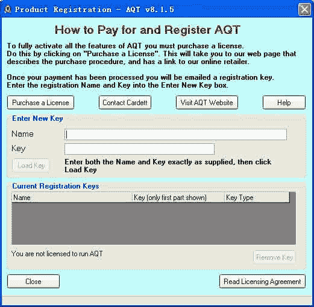
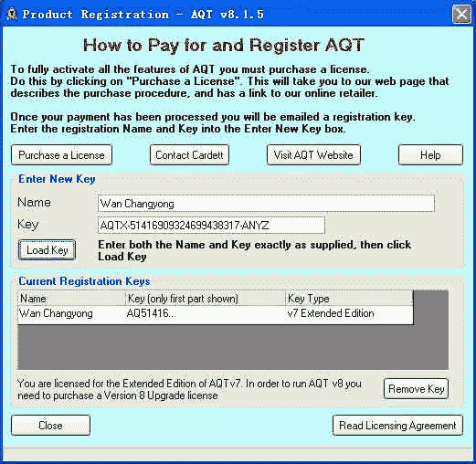
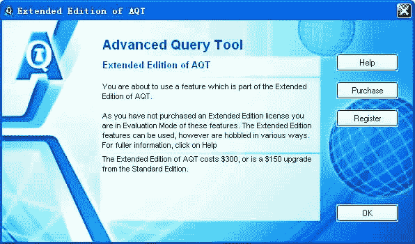

# 重发 Advanced Query Tool V8 的注册分析

> 原文：[`www.pediy.com/kssd/pediy10/58415.html`](https://www.pediy.com/kssd/pediy10/58415.html)

　　前面曾发过一次，但版主说不怎么简明。加上有些问题没有彻底解决，需要作以补充，所以对原文整理一下，重发上来。没别的意思，纯粹为了交流。  
注：大家提到的功能限制的问题已经解决。由于过程比较复杂，所以会紧接着发一个补遗。  
  
Advanced Query Tool V8 的注册分析  
  
　　平时忙于工作，经常在看雪论坛潜行。现发文一篇，与大家共勉。  
　　Advanced Query Tool(AQT) 是一款专门用于数据库查询设计以及数据查询的工具软件，对于数据分析和数据库程序的编制是十分有用的。某日在 www.download.com 下载到此软件，便利用业余时间分析之。  
　　该软件的主程序为 aqt.exe。用 OllyICE 加载，发现程序是 VB 编写的。按 F9 运行之，首先映入眼帘的就是 AQT 的欢迎窗口。  
  
　　该窗口提示着评估版的限制等信息。单击"输入注册码(Enter Registration Key)"按钮，就会看到产品注册窗口。  
  
　　在注册名(Name)文本框中输入注册名，在注册码(Key)文本框中随便输入一些字符。当输入的注册码有 20 个及以上的字符时，装入注册码(Load Key)按钮就会被激活。此时单击之，便立即出现注册码错误(Registration key incorrect)的提示。  
  
　　执行查找参考字符串功能，便会在 4CAE64 处找到错误提示字符串。不过，OllyICE 中显示不出正确的字符串引用地址，只好对错误提示字符串设置内存访问断点。再次单击 Load Key 按钮，程序就会中断在 OLEAUT32 的代码空间中。逐级返回，先是 MSVBVM60，然后是 AQT 的 9AD078 处。向上查看，得知其所在过程开始于 9AB447。把原来的内存访问断点去掉，在 9AB447 处设置断点，就可以正常跟踪、分析了。下面就依据反汇编代码逐步分析之：  
  

代码:

```
009AB447 ... ...          ; 做一些准备工作

009AB5C4 ... ...          ; 取得 RegKey 和 RegName

009AB6FD and     dword ptr \[ebp-17C\], 0
009AB704 push    0
009AB706 push    -1
009AB708 push    1
009AB70A push    004998F0        ; vbNull
009AB70F push    00499674        ; Space
009AB714 push    dword ptr \[ebp-7C\]
009AB717 call    <jmp.&MSVBVM60.rtcReplace>    ; 去掉 RegName 中的空格得 NewRegName
009AB71C mov     edx, eax
009AB71E lea     ecx, dword ptr \[ebp-80\]
009AB721 call    <jmp.&MSVBVM60.\_\_vbaStrMove>
009AB726 push    eax
009AB727 call    <jmp.&MSVBVM60.rtcUpperCaseBstr>  ; NewRegName 转成大写
009AB72C mov     dword ptr \[ebp-90\], eax
009AB732 mov     dword ptr \[ebp-98\], 8
009AB73C lea     eax, dword ptr \[ebp-98\]
009AB742 push    eax
009AB743 lea     eax, dword ptr \[ebp-A8\]
009AB749 push    eax
009AB74A call    <jmp.&MSVBVM60.rtcTrimVar>    ; NewRegName=Trim(NewRegName)
009AB74F lea     eax, dword ptr \[ebp-A8\]
009AB755 push    eax
009AB756 call    <jmp.&MSVBVM60.\_\_vbaStrVarMove>
009AB75B mov     edx, eax
009AB75D lea     ecx, dword ptr \[ebp-74\]
009AB760 call    <jmp.&MSVBVM60.\_\_vbaStrMove>

... ...

009AB79A mov     dword ptr \[ebp-4\], 0F
009AB7A1 push    dword ptr \[ebp-74\]
009AB7A4 call    <jmp.&MSVBVM60.\_\_vbaLenBstr>    ; 取 NewRegName 的长度
009AB7A9 cmp     eax, 3
009AB7AC jge     short 009AB7B3        ; 不能小于 3
009AB7AE jmp     009AD3D4
009AB7B3 mov     dword ptr \[ebp-4\], 12
009AB7BA mov     eax, dword ptr \[ebp+8\]
009AB7BD mov     eax, dword ptr \[eax\]

; 取得 RegKey
... ...

; BCE816 始的函数用以将一个字符串去掉连字符后的内容分成字母部分和数字部分
009AB849 lea     eax, dword ptr \[ebp-30\]    ; 用以存放 RegKey 的字母部分(AlphaOfKey)
009AB84C push    eax
009AB84D lea     eax, dword ptr \[ebp-24\]    ; 用以存放 RegKey 的数字部分(NumOfKey)
009AB850 push    eax
009AB851 lea     eax, dword ptr \[ebp-80\]    ; RegKey
009AB854 push    eax
009AB855 call    00BCE816
009AB85A lea     ecx, dword ptr \[ebp-80\]
009AB85D call    <jmp.&MSVBVM60.\_\_vbaFreeStr>
009AB862 lea     ecx, dword ptr \[ebp-88\]
009AB868 call    <jmp.&MSVBVM60.\_\_vbaFreeObj>
009AB86D mov     dword ptr \[ebp-4\], 13
009AB874 push    dword ptr \[ebp-74\]
009AB877 push    dword ptr \[ebp-30\]
009AB87A call    <jmp.&MSVBVM60.rtcUpperCaseBstr>  ; UCAlphaOfKey=UCase(AlphaOfKey)
009AB87F mov     edx, eax
009AB881 lea     ecx, dword ptr \[ebp-7C\]
009AB884 call    <jmp.&MSVBVM60.\_\_vbaStrMove>
009AB889 push    eax
009AB88A call    <jmp.&MSVBVM60.\_\_vbaStrCat>    ; NewRegName=NewRegName & UCAlphaOfKey
009AB88F mov     edx, eax
009AB891 lea     ecx, dword ptr \[ebp-74\]
009AB894 call    <jmp.&MSVBVM60.\_\_vbaStrMove>
009AB899 lea     ecx, dword ptr \[ebp-7C\]
009AB89C call    <jmp.&MSVBVM60.\_\_vbaFreeStr>
009AB8A1 mov     dword ptr \[ebp-4\], 14
009AB8A8 push    dword ptr \[ebp-74\]
009AB8AB call    <jmp.&MSVBVM60.\_\_vbaLenBstr>
009AB8B0 cmp     eax, 14
009AB8B3 jle     short 009AB8D0
009AB8B5 mov     dword ptr \[ebp-4\], 15
009AB8BC push    14
009AB8BE push    dword ptr \[ebp-74\]
009AB8C1 call    <jmp.&MSVBVM60.rtcRightCharBstr>  ; NewRegName 长度大于 20 则从右边取 20 个字符
009AB8C6 mov     edx, eax
009AB8C8 lea     ecx, dword ptr \[ebp-74\]
009AB8CB call    <jmp.&MSVBVM60.\_\_vbaStrMove>

; 三个 NewRegName 连接
009AB8D0 mov     dword ptr \[ebp-4\], 17
009AB8D7 push    dword ptr \[ebp-74\]
009AB8DA push    dword ptr \[ebp-74\]
009AB8DD call    <jmp.&MSVBVM60.\_\_vbaStrCat>
009AB8E2 mov     edx, eax
009AB8E4 lea     ecx, dword ptr \[ebp-7C\]
009AB8E7 call    <jmp.&MSVBVM60.\_\_vbaStrMove>
009AB8EC push    eax
009AB8ED push    dword ptr \[ebp-74\]
009AB8F0 call    <jmp.&MSVBVM60.\_\_vbaStrCat>
009AB8F5 mov     edx, eax
009AB8F7 lea     ecx, dword ptr \[ebp-80\]
009AB8FA call    <jmp.&MSVBVM60.\_\_vbaStrMove>
009AB8FF push    eax
009AB900 push    dword ptr \[ebp-74\]
009AB903 call    <jmp.&MSVBVM60.\_\_vbaStrCat>
009AB908 mov     edx, eax
009AB90A lea     ecx, dword ptr \[ebp-74\]
009AB90D call    <jmp.&MSVBVM60.\_\_vbaStrMove>
009AB912 lea     eax, dword ptr \[ebp-80\]
009AB915 push    eax
009AB916 lea     eax, dword ptr \[ebp-7C\]
009AB919 push    eax
009AB91A push    2
009AB91C call    <jmp.&MSVBVM60.\_\_vbaFreeStrList>
009AB921 add     esp, 0C
009AB924 mov     dword ptr \[ebp-4\], 18

; 下面这个循环计算 NewRegName 前 20 个字符的 ASCII 值与其序号乘积的累加和
009AB92B mov     dword ptr \[ebp-13C\], 14    ; 循环 20 次
009AB935 mov     dword ptr \[ebp-138\], 1
009AB93F mov     dword ptr \[C7D304\], 1
009AB949 jmp     short 009AB961
009AB94B mov     eax, dword ptr \[C7D304\]
009AB950 add     eax, dword ptr \[ebp-138\]
009AB956 jo      009AD49E
009AB95C mov     dword ptr \[C7D304\], eax
009AB961 mov     eax, dword ptr \[C7D304\]
009AB966 cmp     eax, dword ptr \[ebp-13C\]
009AB96C jg      009ABA4B
009AB972 mov     dword ptr \[ebp-4\], 19
009AB979 mov     dword ptr \[ebp-90\], 1
009AB983 mov     dword ptr \[ebp-98\], 2
009AB98D lea     eax, dword ptr \[ebp-74\]
009AB990 mov     dword ptr \[ebp-D0\], eax
009AB996 mov     dword ptr \[ebp-D8\], 4008
009AB9A0 lea     eax, dword ptr \[ebp-98\]
009AB9A6 push    eax
009AB9A7 push    dword ptr \[C7D304\]
009AB9AD lea     eax, dword ptr \[ebp-D8\]
009AB9B3 push    eax
009AB9B4 lea     eax, dword ptr \[ebp-A8\]
009AB9BA push    eax
009AB9BB call    <jmp.&MSVBVM60.rtcMidCharVar>    ; 取 NewRegName 的一个字符
009AB9C0 lea     eax, dword ptr \[ebp-A8\]
009AB9C6 push    eax
009AB9C7 lea     eax, dword ptr \[ebp-7C\]
009AB9CA push    eax
009AB9CB call    <jmp.&MSVBVM60.\_\_vbaStrVarVal>
009AB9D0 push    eax
009AB9D1 call    <jmp.&MSVBVM60.rtcAnsiValueBstr>  ; 取所取字符的 ASCII 值
009AB9D6 mov     word ptr \[ebp-10C\], ax
009AB9DD mov     eax, dword ptr \[ebp+8\]
009AB9E0 movsx   ecx, word ptr \[ebp-10C\]
009AB9E7 imul    ecx, dword ptr \[C7D304\]    ; 与字符序号相乘
009AB9EE jo      009AD49E
009AB9F4 mov     dword ptr \[ebp-184\], ecx
009AB9FA fild    dword ptr \[ebp-184\]
009ABA00 fstp    qword ptr \[ebp-18C\]
009ABA06 fld     qword ptr \[ebp-18C\]
009ABA0C fadd    qword ptr \[eax+38\]
009ABA0F mov     ecx, dword ptr \[ebp+8\]
009ABA12 fstp    qword ptr \[ecx+38\]      ; 累加
009ABA15 fstsw   ax
009ABA17 test    al, 0D
009ABA19 jnz     009AD499
009ABA1F lea     ecx, dword ptr \[ebp-7C\]
009ABA22 call    <jmp.&MSVBVM60.\_\_vbaFreeStr>
009ABA27 lea     eax, dword ptr \[ebp-A8\]
009ABA2D push    eax
009ABA2E lea     eax, dword ptr \[ebp-98\]
009ABA34 push    eax
009ABA35 push    2
009ABA37 call    <jmp.&MSVBVM60.\_\_vbaFreeVarList>
009ABA3C add     esp, 0C
009ABA3F mov     dword ptr \[ebp-4\], 1A
009ABA46 jmp     009AB94B

; 取得 RegName
... ...

; 调用 855D81，若 AlphaOfKey 的后三位字符是"nnn"，则返回-1
; 或者，将 RegName 去掉空格后转成小写，计算前面最多 20 个字符与其序号乘积的累加和，
; 用该累加和除以 26 所得余数为索引，从串"NTKMLQGUZBORYHFCXASPJEVDIW"中取出一个字符，
; 该字符的小写形式与 AlphaOfKey 的第八个字符的小写形式进行比较，相等则返回-1。
; 其他情况返回零值。
009ABAED lea     eax, dword ptr \[ebp-30\]    ; AlphaOfKey
009ABAF0 push    eax
009ABAF1 lea     eax, dword ptr \[ebp-80\]    ; RegName
009ABAF4 push    eax
009ABAF5 call    00855D81
009ABAFA not     ax
009ABAFD mov     word ptr \[ebp-128\], ax      ; 返回值取反后保存
009ABB04 lea     ecx, dword ptr \[ebp-80\]
009ABB07 call    <jmp.&MSVBVM60.\_\_vbaFreeStr>
009ABB0C lea     ecx, dword ptr \[ebp-88\]
009ABB12 call    <jmp.&MSVBVM60.\_\_vbaFreeObj>
009ABB17 movsx   eax, word ptr \[ebp-128\]
009ABB1E test    eax, eax
009ABB20 je      short 009ABB27        ; 若调用 855D81 后返回-1 则转 9ABB27
009ABB22 jmp     009ACEDB        ; 否则转 9ACEDB（错误提示）
009ABB27 mov     dword ptr \[ebp-4\], 1F
009ABB2E mov     dword ptr \[ebp-90\], 1
009ABB38 mov     dword ptr \[ebp-98\], 2
009ABB42 lea     eax, dword ptr \[ebp-98\]
009ABB48 push    eax
009ABB49 push    4
009ABB4B push    dword ptr \[ebp-30\]
009ABB4E call    <jmp.&MSVBVM60.rtcMidCharBstr>    ; C4OfAlphaOfKey=Mid(AlphaOfKey,4,1)
009ABB53 mov     edx, eax
009ABB55 lea     ecx, dword ptr \[ebp-7C\]
009ABB58 call    <jmp.&MSVBVM60.\_\_vbaStrMove>
009ABB5D push    eax
009ABB5E call    <jmp.&MSVBVM60.rtcLowerCaseBstr>  ; C4OfAlphaOfKey=LCase(C4OfAlphaOfKey)
009ABB63 mov     edx, eax
009ABB65 lea     ecx, dword ptr \[ebp-70\]
009ABB68 call    <jmp.&MSVBVM60.\_\_vbaStrMove>
009ABB6D lea     ecx, dword ptr \[ebp-7C\]
009ABB70 call    <jmp.&MSVBVM60.\_\_vbaFreeStr>
009ABB75 lea     ecx, dword ptr \[ebp-98\]
009ABB7B call    <jmp.&MSVBVM60.\_\_vbaFreeVar>
009ABB80 mov     dword ptr \[ebp-4\], 20
009ABB87 mov     edx, dword ptr \[ebp-70\]
009ABB8A lea     ecx, dword ptr \[ebp-130\]
009ABB90 call    <jmp.&MSVBVM60.\_\_vbaStrCopy>    ; CopyC4OfAlphaOfKey=C4OfAlphaOfKey
009ABB95 mov     dword ptr \[ebp-4\], 21
009ABB9C push    dword ptr \[ebp-130\]
009ABBA2 push    004AF690        ; "s"
009ABBA7 call    <jmp.&MSVBVM60.\_\_vbaStrCmp>    ; 与"s"比较
009ABBAC test    eax, eax
009ABBAE je      short 009ABBC4        ; 是则转到 9ABC0A
009ABBB0 push    dword ptr \[ebp-130\]
009ABBB6 push    004AE8E0        ; "x"
009ABBBB call    <jmp.&MSVBVM60.\_\_vbaStrCmp>    ; 若非"s"则与"x"比较
009ABBC0 test    eax, eax
009ABBC2 jnz     short 009ABBC8
009ABBC4 jmp     short 009ABC0A        ; 是则转到 9ABC0A
009ABBC6 jmp     short 009ABC0A
009ABBC8 mov     dword ptr \[ebp-4\], 23
009ABBCF push    dword ptr \[ebp-130\]
009ABBD5 push    004B02CC        ; "u"
009ABBDA call    <jmp.&MSVBVM60.\_\_vbaStrCmp>    ; 若非"s"、"x"则与"u"比较
009ABBDF test    eax, eax
009ABBE1 jnz     short 009ABBEA
009ABBE3 jmp     009AC2DA        ; 是则转 9AC2DA
009ABBE8 jmp     short 009ABC0A
009ABBEA mov     dword ptr \[ebp-4\], 25
009ABBF1 push    dword ptr \[ebp-130\]
009ABBF7 push    004AF958        ; "v"
009ABBFC call    <jmp.&MSVBVM60.\_\_vbaStrCmp>    ; 若非"s"、"x"、"u"则与"v"比较
009ABC01 test    eax, eax
009ABC03 jnz     short 009ABC0A
009ABC05 jmp     009AC901        ; 是则转 9AC901

009ABC0A mov     dword ptr \[ebp-4\], 2B

; 调用 9A908B，其中：
; 1、传入的 NumOfKey 去掉"-"，长度不小于 20，且必须都是数字
; 2、去掉"-"的 NumOfKey 的前 10 位转成整数 VF10，紧接着的 10 位转成整数 VS10
; 3、VF10 除以 CheckSumOfName 的商，即 NumOfKey 除以 CheckSumOfName 的商的高位存入第三个压入堆栈的参数，余数设为 R1
; 4、VT=10000000000\*R1+VS10
; 5、VT 除以 CheckSumOfName 的商，即 NumOfKey 除以 CheckSumOfName 的商的低位存入第二个压入堆栈的参数，余数存入第一个压入堆栈的参数
009ABC11 lea     eax, dword ptr \[ebp-11C\]
009ABC17 push    eax          ; 存放 NumOfKey 除以 CheckSumOfName 的余数
009ABC18 push    00C7D3EC        ; 存放 NumOfKey 除以 CheckSumOfName 的商的低位
009ABC1D push    00C7D3E4        ; 存放 NumOfKey 除以 CheckSumOfName 的商的高位
009ABC22 mov     eax, dword ptr \[ebp+8\]
009ABC25 add     eax, 38
009ABC28 push    eax          ; 指向 CheckSumOfName
009ABC29 lea     eax, dword ptr \[ebp-24\]    ; NumOfKey
009ABC2C push    eax
009ABC2D mov     eax, dword ptr \[ebp+8\]
009ABC30 mov     eax, dword ptr \[eax\]
009ABC32 push    dword ptr \[ebp+8\]
009ABC35 call    dword ptr \[eax+6FC\]      ; 调用 9A908B
009ABC3B mov     dword ptr \[ebp-120\], eax
009ABC41 cmp     dword ptr \[ebp-120\], 0
009ABC48 jge     short 009ABC6A
009ABC4A push    6FC
009ABC4F push    004BB72C
009ABC54 push    dword ptr \[ebp+8\]
009ABC57 push    dword ptr \[ebp-120\]
009ABC5D call    <jmp.&MSVBVM60.\_\_vbaHresultCheck>
009ABC62 mov     dword ptr \[ebp-194\], eax
009ABC68 jmp     short 009ABC71
009ABC6A and     dword ptr \[ebp-194\], 0
009ABC71 fld     qword ptr \[ebp-11C\]
009ABC77 fstp    qword ptr \[ebp-3C\]
009ABC7A mov     dword ptr \[ebp-4\], 2C
009ABC81 fld     qword ptr \[ebp-3C\]
009ABC84 fcomp   qword ptr \[401CA8\]      ; 前面调用返回的余数与 0 比较
009ABC8A fstsw   ax
009ABC8C sahf
009ABC8D je      short 009ABC9B
009ABC8F mov     dword ptr \[ebp-198\], 1      ; 非零则\[ebp-198\]w=1
009ABC99 jmp     short 009ABCA2
009ABC9B and     dword ptr \[ebp-198\], 0      ; 为零则\[ebp-198\]w=0
009ABCA2 push    dword ptr \[ebp-70\]
009ABCA5 push    004AF690
009ABCAA call    <jmp.&MSVBVM60.\_\_vbaStrCmp>    ; C4OfAlphaOfKey 与"s"比较
009ABCAF mov     esi, eax
009ABCB1 neg     esi
009ABCB3 sbb     esi, esi
009ABCB5 neg     esi
009ABCB7 push    dword ptr \[ebp-70\]
009ABCBA push    004998F0
009ABCBF call    <jmp.&MSVBVM60.\_\_vbaStrCmp>    ; C4OfAlphaOfKey 与空串比较
009ABCC4 neg     eax
009ABCC6 sbb     eax, eax
009ABCC8 neg     eax
009ABCCA and     esi, eax
009ABCCC neg     esi
009ABCCE sbb     esi, esi
009ABCD0 neg     esi
009ABCD2 mov     eax, dword ptr \[ebp-198\]
009ABCD8 or      eax, esi
009ABCDA test    eax, eax
009ABCDC jnz     short 009ABD03

; 若 C4OfAlphaOfKey 为"s"或空串，且前面调用返回的余数为零则
009ABCDE mov     dword ptr \[ebp-4\], 2D
009ABCE5 push    004A9C84        ; "R"
009ABCEA push    00C7E4CC        ; "F"
009ABCEF push    1
009ABCF1 call    <jmp.&MSVBVM60.\_\_vbaLsetFixstr>
009ABCF6 mov     dword ptr \[ebp-4\], 2E
009ABCFD mov     word ptr \[ebp-60\], 1
009ABD03 mov     dword ptr \[ebp-4\], 30
009ABD0A fld     qword ptr \[ebp-3C\]
009ABD0D fcomp   qword ptr \[405B30\]      ; 前面调用返回的余数与 19 比较
009ABD13 fstsw   ax
009ABD15 sahf
009ABD16 je      short 009ABD24
009ABD18 mov     dword ptr \[ebp-19C\], 1      ; 不等于 19 则\[ebp-19C\]w=1
009ABD22 jmp     short 009ABD2B
009ABD24 and     dword ptr \[ebp-19C\], 0      ; 等于 19 则\[ebp-19C\]w=0
009ABD2B push    dword ptr \[ebp-70\]
009ABD2E push    004AE8E0        ; "x"
009ABD33 call    <jmp.&MSVBVM60.\_\_vbaStrCmp>    ; C4OfAlphaOfKey 与"x"比较
009ABD38 mov     esi, eax
009ABD3A neg     esi
009ABD3C sbb     esi, esi
009ABD3E neg     esi
009ABD40 push    dword ptr \[ebp-70\]
009ABD43 push    004998F0
009ABD48 call    <jmp.&MSVBVM60.\_\_vbaStrCmp>    ; C4OfAlphaOfKey 与空串比较
009ABD4D neg     eax
009ABD4F sbb     eax, eax
009ABD51 neg     eax
009ABD53 and     esi, eax
009ABD55 neg     esi
009ABD57 sbb     esi, esi
009ABD59 neg     esi
009ABD5B mov     eax, dword ptr \[ebp-19C\]
009ABD61 or      eax, esi
009ABD63 test    eax, eax
009ABD65 jnz     short 009ABD9A

; 若 C4OfAlphaOfKey 为"x"或空串，且前面调用返回的余数等于 19 则
009ABD67 mov     dword ptr \[ebp-4\], 31
009ABD6E push    004A9C8C        ; "X"
009ABD73 push    00C7E4CC        ; "F"
009ABD78 push    1
009ABD7A call    <jmp.&MSVBVM60.\_\_vbaLsetFixstr>
009ABD7F mov     dword ptr \[ebp-4\], 32
009ABD86 mov     word ptr \[ebp-60\], 2
009ABD8C mov     dword ptr \[ebp-4\], 33
009ABD93 and     dword ptr \[C7EC44\], 0
009ABD9A mov     dword ptr \[ebp-4\], 35
009ABDA1 cmp     word ptr \[ebp-60\], 0
009ABDA6 jle     009AC2BB        ; 若非前两种情况则转 9AC2BB
009ABDAC mov     dword ptr \[ebp-4\], 36

; 取 RegName
... ...

009ABE27 fldz
009ABE29 fstp    qword ptr \[ebp-11C\]
009ABE2F mov     edx, 004B02C4        ; "k"
009ABE34 lea     ecx, dword ptr \[ebp-84\]
009ABE3A call    <jmp.&MSVBVM60.\_\_vbaStrCopy>
009ABE3F mov     eax, dword ptr \[ebp-7C\]    ; RegName
009ABE42 mov     dword ptr \[ebp-15C\], eax
009ABE48 and     dword ptr \[ebp-7C\], 0
009ABE4C mov     edx, dword ptr \[ebp-15C\]
009ABE52 lea     ecx, dword ptr \[ebp-80\]
009ABE55 call    <jmp.&MSVBVM60.\_\_vbaStrMove>
009ABE5A lea     eax, dword ptr \[ebp-11C\]    ; 0.0
009ABE60 push    eax
009ABE61 lea     eax, dword ptr \[ebp-30\]    ; AlphaOfKey
009ABE64 push    eax
009ABE65 lea     eax, dword ptr \[ebp-84\]    ; "k"
009ABE6B push    eax
009ABE6C lea     eax, dword ptr \[ebp-80\]    ; RegName
009ABE6F push    eax
009ABE70 call    00845426        ; 返回评估版的剩余天数
009ABE75 not     ax
009ABE78 mov     word ptr \[ebp-128\], ax

... ...

009ABE9F movsx   eax, word ptr \[ebp-128\]
009ABEA6 test    eax, eax
009ABEA8 je      short 009ABEAF
009ABEAA jmp     009ACECF
009ABEAF mov     dword ptr \[ebp-4\], 39
009ABEB6 fld     qword ptr \[ebp-3C\]
009ABEB9 fstp    qword ptr \[C7D360\]

; 取 RegName
... ...

009ABF3A mov     eax, dword ptr \[ebp-7C\]
009ABF3D mov     dword ptr \[ebp-160\], eax
009ABF43 and     dword ptr \[ebp-7C\], 0
009ABF47 mov     edx, dword ptr \[ebp-160\]
009ABF4D mov     ecx, 00C7E4D0
009ABF52 call    <jmp.&MSVBVM60.\_\_vbaStrMove>    ; \[C7E4D0\]指向 RegName
009ABF57 lea     ecx, dword ptr \[ebp-88\]
009ABF5D call    <jmp.&MSVBVM60.\_\_vbaFreeObj>
009ABF62 mov     dword ptr \[ebp-4\], 3B
009ABF69 mov     edx, dword ptr \[ebp-24\]
009ABF6C mov     ecx, 00C7E4E4
009ABF71 call    <jmp.&MSVBVM60.\_\_vbaStrCopy>    ; \[C7E4E4\]指向 NumberOfKey
009ABF76 mov     dword ptr \[ebp-4\], 3C
009ABF7D mov     edx, dword ptr \[ebp-30\]
009ABF80 mov     ecx, 00C7E4F8
009ABF85 call    <jmp.&MSVBVM60.\_\_vbaStrCopy>    ; \[C7E4F8\]指向 AlphaOfKey
009ABF8A mov     dword ptr \[ebp-4\], 3D
009ABF91 push    00C7E54C
009ABF96 push    00C7E550
009ABF9B push    00C7E4E4
009ABFA0 call    00BD4C31        ; 对 NumberOfKey 进行变换
009ABFA5 mov     edx, eax
009ABFA7 lea     ecx, dword ptr \[ebp-24\]
009ABFAA call    <jmp.&MSVBVM60.\_\_vbaStrMove>

; 在注册表中记录注册信息
... ...

009AC1A0 mov     dword ptr \[ebp-4\], 41
009AC1A7 and     word ptr \[C7D512\], 0
009AC1AF mov     dword ptr \[ebp-4\], 42
009AC1B6 push    dword ptr \[C7E4F8\]      ; AlphaOfKey
009AC1BC push    004998F0        ; vbNull
009AC1C1 call    <jmp.&MSVBVM60.\_\_vbaStrCmp>
009AC1C6 test    eax, eax
009AC1C8 je      009AC26E
009AC1CE mov     dword ptr \[ebp-4\], 43
009AC1D5 mov     dword ptr \[ebp-90\], 1
009AC1DF mov     dword ptr \[ebp-98\], 2
009AC1E9 lea     eax, dword ptr \[ebp-98\]
009AC1EF push    eax
009AC1F0 push    4
009AC1F2 push    dword ptr \[C7E4F8\]
009AC1F8 call    <jmp.&MSVBVM60.rtcMidCharBstr>
009AC1FD mov     edx, eax
009AC1FF lea     ecx, dword ptr \[ebp-7C\]
009AC202 call    <jmp.&MSVBVM60.\_\_vbaStrMove>
009AC207 push    eax
009AC208 call    <jmp.&MSVBVM60.rtcLowerCaseBstr>
009AC20D mov     edx, eax
009AC20F lea     ecx, dword ptr \[ebp-6C\]
009AC212 call    <jmp.&MSVBVM60.\_\_vbaStrMove>
009AC217 lea     ecx, dword ptr \[ebp-7C\]
009AC21A call    <jmp.&MSVBVM60.\_\_vbaFreeStr>
009AC21F lea     ecx, dword ptr \[ebp-98\]
009AC225 call    <jmp.&MSVBVM60.\_\_vbaFreeVar>
009AC22A mov     dword ptr \[ebp-4\], 44
009AC231 push    dword ptr \[ebp-6C\]
009AC234 push    004AF690        ; "s"
009AC239 call    <jmp.&MSVBVM60.\_\_vbaStrCmp>
009AC23E mov     esi, eax
009AC240 neg     esi
009AC242 sbb     esi, esi
009AC244 neg     esi
009AC246 push    dword ptr \[ebp-6C\]
009AC249 push    004AE8E0        ; "x"
009AC24E call    <jmp.&MSVBVM60.\_\_vbaStrCmp>
009AC253 neg     eax
009AC255 sbb     eax, eax
009AC257 neg     eax
009AC259 and     esi, eax
009AC25B test    esi, esi
009AC25D jnz     short 009AC26E
009AC25F mov     dword ptr \[ebp-4\], 45
009AC266 or      word ptr \[C7D512\], 0FFFF
009AC26E mov     dword ptr \[ebp-4\], 48
009AC275 mov     eax, dword ptr \[ebp+8\]
009AC278 mov     eax, dword ptr \[eax\]
009AC27A push    dword ptr \[ebp+8\]
009AC27D call    dword ptr \[eax+714\]
009AC283 mov     dword ptr \[ebp-120\], eax
009AC289 cmp     dword ptr \[ebp-120\], 0
009AC290 jge     short 009AC2B2
009AC292 push    714
009AC297 push    004BB72C
009AC29C push    dword ptr \[ebp+8\]
009AC29F push    dword ptr \[ebp-120\]
009AC2A5 call    <jmp.&MSVBVM60.\_\_vbaHresultCheck>
009AC2AA mov     dword ptr \[ebp-1A8\], eax
009AC2B0 jmp     short 009AC2B9
009AC2B2 and     dword ptr \[ebp-1A8\], 0
009AC2B9 jmp     short 009AC2D5

009AC2BB mov     dword ptr \[ebp-4\], 4A
009AC2C2 push    dword ptr \[ebp-30\]
009AC2C5 push    004998F0
009AC2CA call    <jmp.&MSVBVM60.\_\_vbaStrCmp>    ; AlphaOfKey 与空串比较
009AC2CF test    eax, eax
009AC2D1 jnz     short 009AC2D5        ; 若非空串则转 9ACEDB（出错提示）
009AC2D3 jmp     short 009AC2DA
009AC2D5 jmp     009ACEDB

; C4OfAlphaOfKey="u"时的处理过程
... ...

; C4OfAlphaOfKey="v"时的处理过程
... ...

009ACECF mov     dword ptr \[ebp-4\], 80
009ACED6 and     word ptr \[ebp-60\], 0
009ACEDB mov     dword ptr \[ebp-4\], 82
009ACEE2 mov     ax, word ptr \[ebp-60\]
009ACEE6 mov     word ptr \[ebp-134\], ax
009ACEED movsx   eax, word ptr \[ebp-134\]
009ACEF4 mov     dword ptr \[ebp-1C4\], eax
009ACEFA cmp     dword ptr \[ebp-1C4\], 0
009ACF01 je      short 009ACF0D
009ACF03 jmp     009AD2D8
009ACF08 jmp     009AD389

; 注册信息有误时的处理过程，其中要进行提示
... ...

009AD2D8 mov     dword ptr \[ebp-4\], 90
009AD2DF mov     dword ptr \[ebp-C0\], 80020004
009AD2E9 mov     dword ptr \[ebp-C8\], 0A
009AD2F3 mov     dword ptr \[ebp-B0\], 80020004
009AD2FD mov     dword ptr \[ebp-B8\], 0A
009AD307 mov     dword ptr \[ebp-A0\], 80020004
009AD311 mov     dword ptr \[ebp-A8\], 0A
009AD31B mov     dword ptr \[ebp-D0\], 004CAF0C    ; UNICODE "License Key loaded OK"
009AD325 mov     dword ptr \[ebp-D8\], 8
009AD32F lea     edx, dword ptr \[ebp-D8\]
009AD335 lea     ecx, dword ptr \[ebp-98\]
009AD33B call    <jmp.&MSVBVM60.\_\_vbaVarDup>
009AD340 lea     eax, dword ptr \[ebp-C8\]
009AD346 push    eax
009AD347 lea     eax, dword ptr \[ebp-B8\]
009AD34D push    eax
009AD34E lea     eax, dword ptr \[ebp-A8\]
009AD354 push    eax
009AD355 push    40
009AD357 lea     eax, dword ptr \[ebp-98\]
009AD35D push    eax
009AD35E call    <jmp.&MSVBVM60.rtcMsgBox>

... ...

009AD389 mov     dword ptr \[ebp-4\], 92
009AD390 mov     eax, dword ptr \[ebp+8\]
009AD393 mov     eax, dword ptr \[eax\]
009AD395 push    dword ptr \[ebp+8\]
009AD398 call    dword ptr \[eax+70C\]      ; 调用 9AA7F8，在注册信息窗体中显示注册类型
009AD39E mov     dword ptr \[ebp-120\], eax
009AD3A4 cmp     dword ptr \[ebp-120\], 0
009AD3AB jge     short 009AD3CD
009AD3AD push    70C
009AD3B2 push    004BB72C
009AD3B7 push    dword ptr \[ebp+8\]
009AD3BA push    dword ptr \[ebp-120\]
009AD3C0 call    <jmp.&MSVBVM60.\_\_vbaHresultCheck>
009AD3C5 mov     dword ptr \[ebp-1E8\], eax
009AD3CB jmp     short 009AD3D4
009AD3CD and     dword ptr \[ebp-1E8\], 0
009AD3D4 mov     dword ptr \[ebp-10\], 0
009AD3DB wait
009AD3DC push    009AD47A
009AD3E1 jmp     short 009AD42E

... ...

; 从过程返回时的一些善后工作
... ...

009AD499 jmp     <jmp.&MSVBVM60.\_\_vbaFPException>
009AD49E call    <jmp.&MSVBVM60.\_\_vbaErrorOverflo>

```

　　由于代码很长，其它过程的代码就不再往上贴了。不过需要说明的是：  
　　1、调用 9A908B 时，实际上计算的是 20 位的 NumOfKey 除以 CheckSumOfName 的商和余数。  
　　2、表面上看，AlphaOfKey 的末三个字符可以是“nnn”。在后面调用 845426 时，会调用始于 81DA26 的过程。其中表明，AlphaOfKey 的末三个字符是“nnn”意味着 AlphaOfKey 中包含有评估版的限制天数。  
　　从分析中可以总结出如下几点：  
　　1、注册名去掉空白后不得少于三个字符；  
　　2、注册码中要有 20 位的数字；  
　　3、若 AlphaOfKey 的第 4 个字符的小写为 s，且 NumOfKey 除以 CheckSumOfName 的余数为 0，则为标准版；  
　　4、若 AlphaOfKey 的第 4 个字符的小写为 x，且 NumOfKey 除以 CheckSumOfName 的余数为 19，则为扩展版；  
　　5、若 AlphaOfKey 的第 4 个字符的小写为 u，且 NumOfKey 除以 CheckSumOfName 的余数为 7，则为 v7 的升级版；  
　　6、若 AlphaOfKey 的第 4 个字符的小写为 v，且 NumOfKey 除以 CheckSumOfName 的余数为 7，则为 v8 的升级版；  
　　7、AlphaOfKey 的第 8 个字符应符合 855D81 过程的算法。  
　　表面上看，分析到此就为止了，我们可以根据前面的分析写出注册机，但有一个算法、策略的问题需要给大家交流。  
　　用一个 20 位的符合条件的数值来反推出 AlphaOfKey 显然是不可能的事情。我的做法是，AlphaOfKey 的前三个字符固定，第四个字符定为 s、x、u、v 之一，第五到第七个字符交互输入，第八个字符根据分析中的算法用注册名计算出来，计算 CheckSumOfName 后，用随机数逐位生成一个 20 位的整数。这个大整数除以 CheckSumOfName 的余数若不是 0、19、7，则把它调整一下，使其达到要求。  
　　这时，我满怀信心地用注册机生成了一个扩展版的 Key，输入后却发现注册信息窗口下面显示的是“v7 Extended Edtion”。  
  
　　这就有点不爽了。经过进一步的跟踪发现，原来在调用 9AA7F8 时，程序会进一步调用 9A9A6D 始的过程。这个过程会进一步验证 AlphaOfKey 的第四个字符是否是小写的"x"。只有当 AlphaOfKey 的第四个字符是小写的"x"时，生成的版本标识串才能是我们期望的“Extended Edtion”。把注册机修改一下，最后终于如愿以偿。 

《Advanced Query Tool V8 的注册分析》之补遗  
　　前段时间曾在“新兵论坛”上发表拙文《Advanced Query Tool V8 的注册分析》。文章发表后，还受到了几位同志的的关注。加之用注册机产生的注册码注册后，注册信息窗体中回显了预期的信息，所以心里着实得意了好一阵子。殊不知接下来发生的事情给了我当头棒喝。  
　　那是因为公司里的一个数据库应用系统需要维护。这个系统采用的是 Microsoft SQL Server 2000 的数据库。心里想着这回可以尝试一下自己的劳动成果了吧，于是便踌躇满志地启动了 AQT。  
　　因为是“已经注册了”，所以直接来到了“Database Sign on”窗口。输入 UserID 和 Password，AQT 得主操作界面就完整地呈现在了眼前（心里头有点儿激动）。因为查询量比较小，所以查询等操作基本正常，没有出现大家所说的只能显示前 50 条记录的情况。但就在我单击 Create 菜单下的 Procedure，准备创建一个存储过程的时候，显示屏上跳出了让我大吃一惊的提示窗口（如下）。  
　　看来我得继续努力了……  
　　最直接的莫过于察看对窗口中出现的内容的访问情况。这时我们请出 IDA Pro 5.0，反汇编 AQT，在反汇编窗口中查找上面那个窗口中的第一段文字，发现这段文字位于 0x4E26D0 处，其调用点只有一个，在 0xBDD644 处，属于起始于 0xBDD588 的子程序。这段子程序仅仅只是显示了那个窗口，从中不能分析出显示这个窗口的任何原因，加上只在这个子程序中访问了那段文字，所以我们断定这是一个公用的过程。我们再向上追溯，发现这个子程序是从 0x42A0E8 跳转过来的，而该地址是 0x429A84 处所描述的窗体（进一步分析可知，该窗体名为“dbaregx”。）的方法入口之一。  
　　要想调用这个方法，就必须访问窗体对象。我们在 0x429A84 的交叉引用列表中查找，发现代码中有 5 个地方引用了 0x429A84，分别是 0x8C194E、0x8C897B、0x8E82AC、0x8EBD44 和 0xBDB40F。这 5 个地址分别属于 0x8C17FB、0x8C88E1、0x8E820C、0x8EBC9B 和 0xBDB2CB 始的子程序。我们重新用 OllyICE 加载 AQT，在上面那 5 个子程序的开始处设置断点，然后执行。当执行创建存储过程的操作时，程序果然断在了 0x8C17FB 处。向下单步跟踪我们发现，原来是程序要比较 0xC7E4CC 处存放的字符是不是"X"。如果不是，程序才会显示上面那个窗口。而此时 0xC7E4CC 处存放的字符是"F"。  
　　0xC7E4CC 处的内容是如何变化的呢？  
　　我们重新开始调试，在数据窗格中观察 0xC7E4CC 处的内容，发现在“Database Sign on”窗口中点击“Sign on”按钮之前，0xC7E4CC 处的字符一直都是"X"，在此之后就变成了"F"。所以我们重新调试时，在点击“Sign on”按钮之前对 0xC7E4CC 处的内容设置内存写入断点。点击“Sign on”按钮后，程序会中断在 MSVBVM60 中。从中返回后，会来到 AQT 的 0xC48E09 处。看上面一条指令，方知程序是调用了 MSVBVM60 的\_\_vbaLsetFixstr 来设置 0xC7E4CC 处的内容。这条指令位于 0xC47F30 开始的子程序。我们重新开始调试，在 0xC47F30 处设置断点后开始执行。程序被断下后，我们仔细跟踪，发现下面一段程序值得关注：  
  
00C4833C  
; 比较 0xC7E4CC 处的字符是不是"S"或"X"  
... ...  
  
00C483BA  test    eax, eax  
00C483BC  je      short 00C483C3      ; 若是则继续（实际上是"X"）  
00C483BE  jmp     00C48E39        ; 否则跳转  
00C483C3  mov     dword ptr \[ebp-4\], 12  
00C483CA  cmp     dword ptr \[C7E90C\], 0  
00C483D1  jnz     short 00C483EE  
00C483D3  push    00C7E90C  
00C483D8  push    004446C4        ; IDA 中显示是名为"dbamdi"的窗体对象  
00C483DD  call    <jmp.&MSVBVM60.\_\_vbaNew2>  
00C483E2  mov     dword ptr \[ebp-138\], 00C7E90C  
00C483EC  jmp     short 00C483F8  
00C483EE  mov     dword ptr \[ebp-138\], 00C7E90C  
00C483F8  push    004A9C90        ; CLSID {2C247F24-8591-11D1-B16A-00C0F0283628}  
00C483FD  push    0  
00C483FF  push    4  
00C48401  mov     eax, dword ptr \[ebp-138\]  
00C48407  mov     eax, dword ptr \[eax\]  
00C48409  mov     ecx, dword ptr \[ebp-138\]  
00C4840F  mov     ecx, dword ptr \[ecx\]  
00C48411  mov     ecx, dword ptr \[ecx\]  
00C48413  push    eax  
00C48414  call    dword ptr \[ecx+380\]  
00C4841A  push    eax  
00C4841B  lea     eax, dword ptr \[ebp-70\]  
00C4841E  push    eax  
00C4841F  call    <jmp.&MSVBVM60.\_\_vbaObjSet>  
00C48424  push    eax  
00C48425  lea     eax, dword ptr \[ebp-88\]  
00C4842B  push    eax  
00C4842C  call    <jmp.&MSVBVM60.\_\_vbaLateIdCallLd>  
00C48431  add     esp, 10  
00C48434  push    eax  
00C48435  call    <jmp.&MSVBVM60.\_\_vbaCastObjVar>  
00C4843A  push    eax  
00C4843B  lea     eax, dword ptr \[ebp-74\]  
00C4843E  push    eax  
00C4843F  call    <jmp.&MSVBVM60.\_\_vbaObjSet>  
00C48444  mov     dword ptr \[ebp-F4\], eax  
00C4844A  mov     dword ptr \[ebp-90\], 3  
00C48454  mov     dword ptr \[ebp-98\], 2  
00C4845E  lea     eax, dword ptr \[ebp-78\]  
00C48461  push    eax  
00C48462  lea     eax, dword ptr \[ebp-98\]  
00C48468  push    eax  
00C48469  mov     eax, dword ptr \[ebp-F4\]  
00C4846F  mov     eax, dword ptr \[eax\]  
00C48471  push    dword ptr \[ebp-F4\]  
00C48477  call    dword ptr \[eax+24\]  
00C4847A  fclex  
00C4847C  mov     dword ptr \[ebp-F8\], eax  
00C48482  cmp     dword ptr \[ebp-F8\], 0  
00C48489  jge     short 00C484AB  
00C4848B  push    24  
00C4848D  push    004A9C90  
00C48492  push    dword ptr \[ebp-F4\]  
00C48498  push    dword ptr \[ebp-F8\]  
00C4849E  call    <jmp.&MSVBVM60.\_\_vbaHresultCheckObj>  
00C484A3  mov     dword ptr \[ebp-13C\], eax  
00C484A9  jmp     short 00C484B2  
00C484AB  and     dword ptr \[ebp-13C\], 0  
00C484B2  mov     eax, dword ptr \[ebp-78\]  
00C484B5  mov     dword ptr \[ebp-FC\], eax  
00C484BB  lea     eax, dword ptr \[ebp-A8\]  
00C484C1  push    eax  
00C484C2  mov     eax, dword ptr \[ebp-FC\]  
00C484C8  mov     eax, dword ptr \[eax\]  
00C484CA  push    dword ptr \[ebp-FC\]  
00C484D0  call    dword ptr \[eax+2C\]        ; 该调用返回一个包含 16 个数字的字符串  
00C484D3  fclex  
00C484D5  mov     dword ptr \[ebp-100\], eax  
00C484DB  cmp     dword ptr \[ebp-100\], 0  
00C484E2  jge     short 00C48504  
00C484E4  push    2C  
00C484E6  push    004A9CA0          ; CLSID {2C247F26-8591-11D1-B16A-00C0F0283628}  
00C484EB  push    dword ptr \[ebp-FC\]  
00C484F1  push    dword ptr \[ebp-100\]  
00C484F7  call    <jmp.&MSVBVM60.\_\_vbaHresultCheckObj>  
00C484FC  mov     dword ptr \[ebp-140\], eax  
00C48502  jmp     short 00C4850B  
00C48504  and     dword ptr \[ebp-140\], 0  
00C4850B  lea     eax, dword ptr \[ebp-A8\]  
00C48511  push    eax  
00C48512  call    <jmp.&MSVBVM60.\_\_vbaStrVarMove>  
00C48517  mov     edx, eax  
00C48519  lea     ecx, dword ptr \[ebp-24\]  
00C4851C  call    <jmp.&MSVBVM60.\_\_vbaStrMove>  
  
... ...  
  
00C48556  mov     dword ptr \[ebp-4\], 13  
00C4855D  push    dword ptr \[ebp-24\]  
00C48560  call    <jmp.&MSVBVM60.\_\_vbaLenBstr>  
00C48565  test    eax, eax  
00C48567  jnz     short 00C4856E        ; 前面返回的字符串非空则继续  
00C48569  jmp     00C48E39  
00C4856E  mov     dword ptr \[ebp-4\], 16  
00C48575  lea     eax, dword ptr \[ebp-24\]  
00C48578  mov     dword ptr \[ebp-B0\], eax  
00C4857E  mov     dword ptr \[ebp-B8\], 4008  
00C48588  lea     eax, dword ptr \[ebp-B8\]  
00C4858E  push    eax  
00C4858F  call    <jmp.&MSVBVM60.rtcIsNumeric>  
00C48594  movsx   eax, ax  
00C48597  test    eax, eax  
00C48599  jnz     short 00C485A0        ; 前面返回的字符串纯数字则继续  
00C4859B  jmp     00C48DF1  
00C485A0  mov     dword ptr \[ebp-4\], 19  
00C485A7  and     word ptr \[ebp-4C\], 0        ; 累加值清零  
00C485AC  mov     dword ptr \[ebp-4\], 1A  
00C485B3  push    dword ptr \[ebp-24\]  
00C485B6  call    <jmp.&MSVBVM60.\_\_vbaLenBstr>  
00C485BB  mov     dword ptr \[ebp-108\], eax      ; 循环终值为串长  
00C485C1  mov     dword ptr \[ebp-104\], 1      ; 循环步长为 1  
00C485CB  mov     dword ptr \[C7D304\], 1        ; 循环初值为 1  
00C485D5  jmp     short 00C485ED  
00C485D7  mov     eax, dword ptr \[C7D304\]  
00C485DC  add     eax, dword ptr \[ebp-104\]  
00C485E2  jo      00C48EFC  
00C485E8  mov     dword ptr \[C7D304\], eax  
00C485ED  mov     eax, dword ptr \[C7D304\]  
00C485F2  cmp     eax, dword ptr \[ebp-108\]  
00C485F8  jg      00C486D8          ; 超过字符串尾部则结束循环  
00C485FE  mov     dword ptr \[ebp-4\], 1B  
00C48605  mov     dword ptr \[ebp-80\], 1  
00C4860C  mov     dword ptr \[ebp-88\], 2  
00C48616  lea     eax, dword ptr \[ebp-24\]  
00C48619  mov     dword ptr \[ebp-B0\], eax  
00C4861F  mov     dword ptr \[ebp-B8\], 4008  
00C48629  lea     eax, dword ptr \[ebp-88\]  
00C4862F  push    eax  
00C48630  push    dword ptr \[C7D304\]  
00C48636  lea     eax, dword ptr \[ebp-B8\]  
00C4863C  push    eax  
00C4863D  lea     eax, dword ptr \[ebp-98\]  
00C48643  push    eax  
00C48644  call    <jmp.&MSVBVM60.rtcMidCharVar>      ; 取一个字符  
00C48649  lea     eax, dword ptr \[ebp-98\]  
00C4864F  push    eax  
00C48650  lea     eax, dword ptr \[ebp-58\]  
00C48653  push    eax  
00C48654  call    <jmp.&MSVBVM60.\_\_vbaStrVarVal>  
00C48659  push    eax  
00C4865A  call    <jmp.&MSVBVM60.rtcR8ValFromBstr>    ; 转换成数值  
00C4865F  fstp    qword ptr \[ebp-F0\]  
00C48665  movsx   eax, word ptr \[ebp-4C\]  
00C48669  mov     dword ptr \[ebp-144\], eax  
00C4866F  fild    dword ptr \[ebp-144\]  
00C48675  fstp    qword ptr \[ebp-14C\]  
00C4867B  fild    dword ptr \[C7D304\]  
00C48681  fstp    qword ptr \[ebp-154\]  
00C48687  fld     qword ptr \[ebp-F0\]  
00C4868D  fmul    qword ptr \[ebp-154\]        ; 乘以循环变量  
00C48693  fadd    qword ptr \[ebp-14C\]        ; 累加  
00C48699  fstsw   ax  
00C4869B  test    al, 0D  
00C4869D  jnz     00C48EF7  
00C486A3  call    <jmp.&MSVBVM60.\_\_vbaFpI2>      ; 取整  
00C486A8  mov     word ptr \[ebp-4C\], ax        ; 回存  
  
... ...  
  
00C486CC  mov     dword ptr \[ebp-4\], 1C  
00C486D3  jmp     00C485D7  
00C486D8  mov     dword ptr \[ebp-4\], 1D  
00C486DF  cmp     word ptr \[ebp-4C\], 2EA      ; 累加值等于 746?  
00C486E5  je      short 00C486F4  
00C486E7  cmp     word ptr \[ebp-4C\], 257      ; 累加值等于 599?  
00C486ED  je      short 00C486F4  
00C486EF  jmp     00C48DF1          ; 都不是则去修改 0xC7E4CC 处的内容为"F"  
  
　　事情已经很清楚了，只要 0xC484D0 处的调用所取得的字符串是数字串，且各位的值与其序号乘积的累加和为 746 或 599，就可以保证 0xC7E4CC 处的内容维持不变。但 0xC484D0 处的调用是一个什么样的调用，所取得的字符串是从哪里来的呢？  
　　很显然，0xC484D0 处的调用一定是取得某个控件的属性值。那个控件就是 0xC484E6 处的指令中的 CLSID 所标识的控件，因为接下来要在调用失败时检查控件是否存活。  
　　这个控件是什么控件呢？我们启动 RegEdit，在注册表中搜索这个 CLSID，发现这个控件原来是 IImage 控件，也就是 ImageList 中的 ListImage。  
　　然而，那个调用又是取得了 ListImage 的那一个属性呢？  
　　刚好机器上装的有 VB 6.0，急忙启动开，写了一个纯粹关于 ImageList 控件属性访问和方法调用的短程序，编译后用 IDA 5.0 反汇编，经过对比发现，0xC48477 处的指令实际上就是取得 ImageList 中的某个 ListImage 对象，而 0xC484D0 处的指令访问的就是 ListImage 对象的 Tag 属性，  
对 ListImage 对象的 Tag 属性进行设置的指令应该是“call    dword ptr \[eax+30\]”的形式。  
　　我们立即在 IDA 5.0 下 AQT 的反汇编结果中查找对 0x4A9CA0 的引用，而且其附近的某个指令符合前面那个形式。我们发现只有 0x8DC71C 始的子程序的三个地方符合要求，它们分别是 0x8DCB34、0x8DCD4E 和 0x8DCF68。  
　　我们用 OllyICE 重新加载 AQT，在 0x8DC71C 处设置断点后执行之。当程序被中断后仔细跟踪，分析结果如下：  
  
008DC8F0  
; 比较 0xC7E4CC 处的字符是不是"S"或"X"  
... ...  
  
008DC959  je      008DCFBA        ; 不是则另当别论  
008DC95F  mov     edi, 004B9624        ; UNICODE "##########"  
008DC964  mov     dword ptr \[ebp-168\], edi  
008DC96A  mov     dword ptr \[ebp-170\], 8  
008DC974  lea     edx, dword ptr \[ebp-170\]  
008DC97A  lea     ecx, dword ptr \[ebp-100\]  
008DC980  call    <jmp.&MSVBVM60.\_\_vbaVarDup>  
008DC985  mov     dword ptr \[ebp-158\], 00C7D3E4  
008DC98F  mov     dword ptr \[ebp-160\], 4005  
008DC999  push    1  
008DC99B  push    1  
008DC99D  lea     eax, dword ptr \[ebp-100\]  
008DC9A3  push    eax  
008DC9A4  lea     eax, dword ptr \[ebp-160\]  
008DC9AA  push    eax  
008DC9AB  lea     eax, dword ptr \[ebp-110\]  
008DC9B1  push    eax  
008DC9B2  call    <jmp.&MSVBVM60.rtcVarFromFormatVar>  ; 0xC7D3E4 处的数值格式化为字符串  
008DC9B7  mov     dword ptr \[ebp-188\], edi  
008DC9BD  mov     dword ptr \[ebp-190\], 8  
008DC9C7  lea     edx, dword ptr \[ebp-190\]  
008DC9CD  lea     ecx, dword ptr \[ebp-120\]  
008DC9D3  call    <jmp.&MSVBVM60.\_\_vbaVarDup>  
008DC9D8  mov     dword ptr \[ebp-178\], 00C7D3EC  
008DC9E2  mov     dword ptr \[ebp-180\], 4005  
008DC9EC  push    1  
008DC9EE  push    1  
008DC9F0  lea     eax, dword ptr \[ebp-120\]  
008DC9F6  push    eax  
008DC9F7  lea     eax, dword ptr \[ebp-180\]  
008DC9FD  push    eax  
008DC9FE  lea     eax, dword ptr \[ebp-130\]  
008DCA04  push    eax  
008DCA05  call    <jmp.&MSVBVM60.rtcVarFromFormatVar>  ; 0xC7D3EC 处的数值格式化为字符串  
008DCA0A  lea     eax, dword ptr \[ebp-110\]  
008DCA10  push    eax  
008DCA11  lea     eax, dword ptr \[ebp-130\]  
008DCA17  push    eax  
008DCA18  lea     eax, dword ptr \[ebp-140\]  
008DCA1E  push    eax  
008DCA1F  call    <jmp.&MSVBVM60.\_\_vbaVarCat>    ; 第二个串连接到第一个串后面  
008DCA24  push    eax  
008DCA25  call    <jmp.&MSVBVM60.\_\_vbaStrVarMove>  
008DCA2A  mov     edx, eax  
008DCA2C  lea     ecx, dword ptr \[ebp-20\]  
008DCA2F  call    <jmp.&MSVBVM60.\_\_vbaStrMove>  
  
... ...  
  
008DCA61  mov     eax, dword ptr \[C7E90C\]  
008DCA66  cmp     eax, esi  
008DCA68  jnz     short 008DCA7E  
008DCA6A  push    00C7E90C  
008DCA6F  push    004446C4  
008DCA74  call    <jmp.&MSVBVM60.\_\_vbaNew2>  
008DCA79  mov     eax, dword ptr \[C7E90C\]  
008DCA7E  mov     edi, 004A9C90  
008DCA83  push    edi  
008DCA84  push    esi  
008DCA85  push    4  
008DCA87  mov     ecx, dword ptr \[eax\]  
008DCA89  push    eax  
008DCA8A  call    dword ptr \[ecx+380\]  
008DCA90  push    eax  
008DCA91  lea     eax, dword ptr \[ebp-E8\]  
008DCA97  push    eax  
008DCA98  call    <jmp.&MSVBVM60.\_\_vbaObjSet>  
008DCA9D  push    eax  
008DCA9E  lea     eax, dword ptr \[ebp-100\]  
008DCAA4  push    eax  
008DCAA5  call    <jmp.&MSVBVM60.\_\_vbaLateIdCallLd>  
008DCAAA  add     esp, 10  
008DCAAD  push    eax  
008DCAAE  call    <jmp.&MSVBVM60.\_\_vbaCastObjVar>  
008DCAB3  push    eax  
008DCAB4  lea     eax, dword ptr \[ebp-EC\]  
008DCABA  push    eax  
008DCABB  call    <jmp.&MSVBVM60.\_\_vbaObjSet>  
008DCAC0  mov     dword ptr \[ebp-1CC\], eax  
008DCAC6  mov     dword ptr \[ebp-108\], 3  
008DCAD0  mov     dword ptr \[ebp-110\], 2  
008DCADA  mov     ecx, dword ptr \[eax\]  
008DCADC  lea     edx, dword ptr \[ebp-F0\]  
008DCAE2  push    edx  
008DCAE3  lea     edx, dword ptr \[ebp-110\]  
008DCAE9  push    edx  
008DCAEA  push    eax  
008DCAEB  call    dword ptr \[ecx+24\]  
008DCAEE  fclex  
008DCAF0  cmp     eax, esi  
008DCAF2  jge     short 008DCB03  
008DCAF4  push    24  
008DCAF6  push    edi  
008DCAF7  push    dword ptr \[ebp-1CC\]  
008DCAFD  push    eax  
008DCAFE  call    <jmp.&MSVBVM60.\_\_vbaHresultCheckObj>  
008DCB03  mov     eax, dword ptr \[ebp-F0\]  
008DCB09  mov     dword ptr \[ebp-1D4\], eax  
008DCB0F  mov     ecx, dword ptr \[ebp-20\]  
008DCB12  mov     dword ptr \[ebp-168\], ecx  
008DCB18  mov     dword ptr \[ebp-170\], 8  
008DCB22  mov     ecx, dword ptr \[eax\]  
008DCB24  sub     esp, 10  
008DCB27  lea     esi, dword ptr \[ebp-170\]  
008DCB2D  mov     edi, esp  
008DCB2F  movs    dword ptr es:\[edi\], dword ptr \[esi\]  
008DCB30  movs    dword ptr es:\[edi\], dword ptr \[esi\]  
008DCB31  movs    dword ptr es:\[edi\], dword ptr \[esi\]  
008DCB32  movs    dword ptr es:\[edi\], dword ptr \[esi\]  
008DCB33  push    eax  
008DCB34  call    dword ptr \[ecx+30\]      ; 设置 ListImage 的 Tag 属性  
  
　　0xC7D3E4 和 0xC7D3EC 是不是有些似曾相识？这不就是《Advanced Query Tool V8 的注册分析》一文中存放 NumOfKey 除以 CheckSumOfName 的商的高位和低位的地址吗？再仔细确认一下，现在这个值就是 NumOfKey 除以 CheckSumOfName 的商。  
　　一切都真相大白了。AQT 的注册信息不但要符合《Advanced Query Tool V8 的注册分析》一文的要求，而且 NumOfKey 除以 CheckSumOfName 的商的各位值与序号乘积的累加和还必须是 746 或 599。马上修改注册机，生成注册码，重新注册、试用。哇！我的 AQT 已经是全功能版的了。这心里那个爽啊……