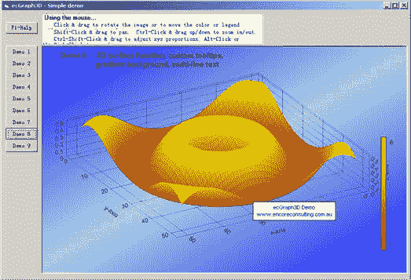
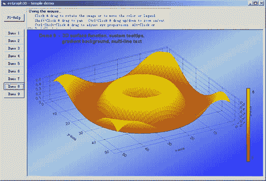
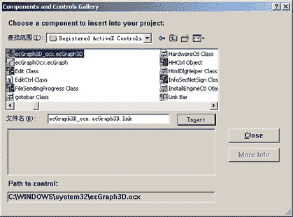
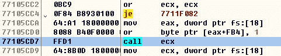
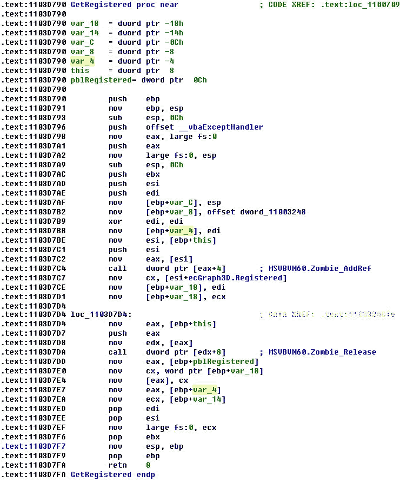
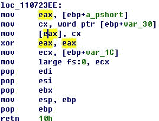
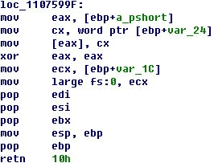
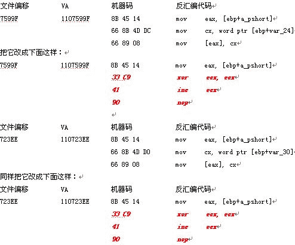
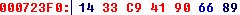
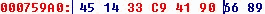

# 一个外国人编写的名为 ecGraph3D 的三维控件的破解

> 原文：[`www.pediy.com/kssd/pediy10/79278.html`](https://www.pediy.com/kssd/pediy10/79278.html)

【破文标题】一个外国人编写的名为 ecGraph3D 的三维控件的破解  
【破文作者】zhuliang  
【作者邮箱】huangzhuliang@sina.com  
【破解工具】PEiD,OD,IDA,C32ASM  
【破解平台】Windows XP  
【软件大小】2.40 MB  
【软件授权】国外软件/三维控件  
【软件语言】英文  
【原版下载】http://www.encoreconsulting.com.au/downloads/ecgraph3d-112-setup.exe  
【保护方式】注册验证  
【软件简介】ecGraph3D 控件是一个能把给定的数据用三维的形式显示出来的控件，用它来显示一些统计数据可以说是相当的形象（如图 1 所示），能把数据直观地表现出来。  
【破解声明】一点心得，愿与大家分享。 版权所有，转载注明来自看雪论坛！  
【破解内容】  
用 ecGraph3D 控件来显示一些统计数据可以说是相当的形象（如图 1 所示），ecGraph3D 控件能把数据直观地表现出来，对于我们气象行业来说是一个相当有用的控件，因为，气象行业有大量的统计数据要显示和输出。  
这个控件的使用也比较简单，它带有一个针对 VB 的帮助文档，告诉用户如何在 VB 中使用该控件。按理说，因为这个 Active X 控件不仅仅能在 VB 使用，也能在 VC 中使用，所以不仅要提供对 VB 的帮助文档也要提供对 VC 的使用文档的。但是它没提供针对 VC 的帮助文档，我想这可能是因为这个控件是用 VB 写的吧。  
这个控件使用注册验证保护，注册版与未注册版的区别在于控件的右下角有没有个带链接的框（如图 1 和图 2）。  
   
图 1 未注册版  
   
图 2 注册版  
    按照帮助文档上的说明，以从官方得到的注册码为参数调用 RegisterecGraph3D 方法，就可以把未注册版转变为注册版。帮助文档上对 RegisterecGraph3D 方法的说明如下。  
    RegisterecGraph3D     Procedure (Sub)  
      Public Sub RegisterecGraph3D(S$)   
      Attempts to register this implementation of ecGraph using a registration key that can be obtained from [www.encoreconsulting.com.au ](http://www.encoreconsulting.com.au )  
     If successful, this converts ecGraph from a demo version to a registered version, removing the demo message printed on each graph.   
     Parameter  Type  Description  
     S$                  String  S  
     See Also..  
     Registered     
     Example..  
     Call ecGraph3D1.RegisterecGraph3D(s)  
按照它给出的例子，可以用下面的代码进行注册。  
   Const ecGraph3DRegistrationKey$="98765-,3210-ABCDE-01234-56789"  
Private Sub Form\_Load()  
     Dim k As Integer, KeyWords$  
     '\*\*\*\*\*\*\*\*\*\*\*\*\*\*\*\*\*\*\*\*\*\*\*\*\*\*\*\*\*\*\*\*\*\*\*\*\*\*\*\*\*\*\*\*\*\*\*\*\*\*\*\*\*\*\*\*\*\*\*\*\*\*\*\*\*\*\*\*\*\*\*\*\*\*\*\*\*\*\*\*\*\*\*\*\*\*\*\*  
     '\*\*\* Register all ecGraph3D controls on your form with your registration key obtained  
     '\*\*\* from http://www.encoreconsulting.com.au,?otherwise?it?will?function?in?Demo?mode  
     '\*\*\*\*\*\*\*\*\*\*\*\*\*\*\*\*\*\*\*\*\*\*\*\*\*\*\*\*\*\*\*\*\*\*\*\*\*\*\*\*\*\*\*\*\*\*\*\*\*\*\*\*\*\*\*\*\*\*\*\*\*\*\*\*\*\*\*\*\*\*\*\*\*\*\*\*\*\*\*\*\*\*\*\*\*\*\*\*  
     'in this demo program there are two ecGraph3D controls on the form: ecGraph3D1  
     Call ecGraph3D1.RegisterecGraph3D(ecGraph3DRegistrationKey$)  
     Me.Caption = "ecGraph3D - Simple demo"  
     Call Command1\_Click(1)  
End Sub  
      跟注册相关的随了 RegisterecGraph3D 方法外，还跟 Registered 属性有关。在 VB 中使用下面的代码可以知道是否已经注册。  
    Registered     Property  
      Property Registered() As Boolean 'Read only  
      Returns True if this implementation of ecGraph has been successfully registered.  
      See Also..  
      RegisterecGraph3D   Version     
      Example..  
      x = ecGraph3D1.Registered  
      看到这里，控件有一个属性 Registered ，猜想控件有一个变量用于保存是否注册了的信息，要想验证是不是这样，可以通过跟踪来证实，如果真是这样的话，那么修改这个变量让这个变量恒为 true 就可以实现爆破了。而跟踪 RegisterecGraph3D 方法就可以得到它的注册算法了，思路就是这简单，下面进行操作。  
由于本人不会用 VB，就用 VC 写了一个小程序来访问控件的 Registered 属性和调用它的 RegisterecGraph3D 方法。先用 VC 创建一个基于对话框的 MFC 工程，然后依次点“Project”菜单 、“Add To Project”子菜单、“Components And Controls”命令，在弹出的对话框里选择 ecGraph3D\_ocx.ecGraph3D.lnk，如图 3 所示，再点“Insert”,这样便把该控件增加到工程中了，之后工程中多了一个 C\_ecGraph3D 类，而在类中的函数声明中有下面两语句：  
BOOL GetRegistered();  
void RegisterecGraph3D(BSTR\* S);  
   
图 3  
这两个成员函数就分别对应着控件的 Registered 属性和它的 RegisterecGraph3D 方法，原来 VB 的 Active X 控件中的属性和方法是通过类的成员函数来实现的，题外话。呵呵。  
对于 COM 里面某个函数的定位我参考了看雪论坛上的一篇文章《跟踪调试 COM 组件的接口》，思路是：由于在调用 COM 里面某个函数时，会由 DispCallFunc 去分发，然后再调用 COM 里面的函数，那么，我们就在它分发的时候先把它拦截下来，之后再单步跟入某个函数。关键函数：DispCallFunc，位于 OLEAUT32.dll。  
对于我写的这个程序也是一样，用 OD 载入生成的.exe 文件，在 DispCallFunc 下断，然后，运行程序，断下来后，往下面看，执行到 call ecx，如下图：  
   
在这里 F7 跟进去后，经过一个跳转，便到达了 GetRegistered()函数，这函数在 IDA 里如下图所示。  
  
注意到这几条汇编语句：  
.text:1103D7C7         mov     cx, \[esi+ecGraph3D.Registered\]  
.text:1103D7D1         mov     \[ebp+var\_18\], ecx  
.text:1103D7DD         mov     eax, \[ebp+pblRegistered\]  
.text:1103D7E0         mov     cx, word ptr \[ebp+var\_18\]  
.text:1103D7E4         mov     \[eax\], cx  
看到这几句可以知道，控件真的如我们猜想的那样用一个变量（Registered）用来标识控件是否已注册，而这个变量的值是 RegisterecGraph3D 函数中被设置的，那么修改相应的汇编代码让这个变量恒为 true 就可以实现爆破了，而跟踪 RegisterecGraph3D 方法就可以得到它的注册算法。由于我不熟悉 VB，而注册算法里用到了很多从 MSVBM60.dll 中导出的如\_\_vbaI2I4、rtcMidCharBstr、rtcR8ValFromBstr、\_\_vbaFpI2 的函数，这些函数的功能是什么在 MSDN 里也没有介绍，要知道它的功能只能通过分析函数的代码，这样的工作不是我等菜鸟能做的，希望大侠分析出来后告诉我。在这里我只给出它的爆破方法，而不给出它的注册码，况且论坛也不希望我们在这里散布注册码。  
用同样的方法可以定位 RegisterecGraph3D 函数，下面是其代码：  
.text:11041760 RegisterecGraph3D proc near             ; CODE XREF: .text:loc\_110071F1 j  
.text:11041760  
.text:11041760 var\_CC  = dword ptr -0CCh  
.text:11041760 var\_C8  = dword ptr -0C8h  
.text:11041760 var\_C4  = dword ptr -0C4h  
.text:11041760 var\_C0  = dword ptr -0C0h  
.text:11041760 var\_BC  = dword ptr -0BCh  
.text:11041760 var\_A8  = word ptr -0A8h  
.text:11041760 var\_90  = qword ptr -90h  
.text:11041760 var\_88  = dword ptr -88h  
.text:11041760 var\_84  = dword ptr -84h  
.text:11041760 var\_70  = dword ptr -70h  
.text:11041760 var\_68  = dword ptr -68h  
.text:11041760 var\_60  = dword ptr -60h  
.text:11041760 var\_50  = dword ptr -50h  
.text:11041760 var\_48  = dword ptr -48h  
.text:11041760 var\_40  = dword ptr -40h  
.text:11041760 var\_3C  = dword ptr -3Ch  
.text:11041760 var\_38  = dword ptr -38h  
.text:11041760 var\_34  = dword ptr -34h  
.text:11041760 var\_30  = dword ptr -30h  
.text:11041760 var\_2C  = dword ptr -2Ch  
.text:11041760 v\_short = dword ptr -28h  
.text:11041760 v\_str2  = dword ptr -24h  
.text:11041760 v\_str   = dword ptr -20h  
.text:11041760 var\_1C  = dword ptr -1Ch  
.text:11041760 var\_14  = dword ptr -14h  
.text:11041760 var\_10  = dword ptr -10h  
.text:11041760 var\_C   = dword ptr -0Ch  
.text:11041760 var\_8   = dword ptr -8  
.text:11041760 this    = dword ptr  8  
.text:11041760 pStrcode= dword ptr  0Ch ；这让我不明白了，  
.text:11041760 arg\_8   = dword ptr  10h ；返回明明是.text:110418CE  retn  8  
.text:11041760 arg\_C   = dword ptr  14h ；按理说不外就是两个参数吗  
.text:11041760 arg\_10  = dword ptr  18h ；为什么 IDA 分析出来有这么多参数的  
.text:11041760 arg\_14  = dword ptr  1Ch  
.text:11041760 arg\_18  = dword ptr  20h  
.text:11041760 arg\_1C  = dword ptr  24h  
.text:11041760 arg\_20  = dword ptr  28h  
.text:11041760  
.text:11041760         push    ebp  
.text:11041761         mov     ebp, esp  
.text:11041763         sub     esp, 14h  
.text:11041766         push    offset \_\_vbaExceptHandler  
.text:1104176B         mov     eax, large fs:0  
.text:11041771         push    eax  
.text:11041772         mov     large fs:0, esp  
.text:11041779         sub     esp, 24h  
.text:1104177C         push    ebx  
.text:1104177D         push    esi  
.text:1104177E         push    edi  
.text:1104177F         mov     \[ebp+var\_14\], esp  
.text:11041782         mov     \[ebp+var\_10\], offset dword\_11003600  
.text:11041789         xor     edi, edi  
.text:1104178B         mov     \[ebp+var\_C\], edi  
.text:1104178E         mov     \[ebp+var\_8\], edi  
.text:11041791         mov     esi, \[ebp+this\]  
.text:11041794         mov     eax, \[esi\]  
.text:11041796         push    esi  
.text:11041797         call    dword ptr \[eax+4\]       ; MSVBVM60.Zombie\_AddRef  
.text:1104179A         mov     \[ebp+v\_str\], edi  
.text:1104179D         mov     \[ebp+v\_str2\], edi  
.text:110417A0         mov     \[ebp+v\_short\], edi  
.text:110417A3         push    1  
.text:110417A5         call    ds:\_\_vbaOnError  
.text:110417AB         mov     edx, offset aEcgraph3d  ; "ecGraph3D"  
.text:110417B0         lea     ecx, \[ebp+v\_str\]  
.text:110417B3         mov     ebx, ds:\_\_vbaStrCopy  
.text:110417B9         call    ebx ; \_\_vbaStrCopy  
.text:110417BB         mov     ecx, \[esi\]  
.text:110417BD         lea     edx, \[ebp+v\_short\]      ; 0 or -1  
.text:110417C0         push    edx  
.text:110417C1         lea     eax, \[ebp+v\_str\]  
.text:110417C4         push    eax  
.text:110417C5         mov     edx, \[ebp+pStrcode\]  
.text:110417C8         push    edx  
.text:110417C9         push    esi  
.text:110417CA         call    dword ptr \[ecx+0A7Ch\]   ; sub\_11072170  
.text:110417D0         mov     ax, word ptr \[ebp+v\_short\]  
.text:110417D4         mov     \[esi+ecGraph3D.Registered\], ax  
.text:110417DB         lea     ecx, \[ebp+v\_str\]  
.text:110417DE         call    ds:\_\_vbaFreeStr  
.text:110417E4         lea     edi, \[esi+ecGraph3D.m\_strRegCode\]  
.text:110417EA         mov     ecx, \[ebp+pStrcode\]  
.text:110417ED         mov     edx, \[ecx\]  
.text:110417EF         mov     ecx, edi                ; ecx=m\_strRegCode  
.text:110417F1         call    ebx ; \_\_vbaStrCopy  
.text:110417F3         mov     edx, \[esi\]  
.text:110417F5         lea     eax, \[ebp+v\_str\]  
.text:110417F8         push    eax  
.text:110417F9         push    esi  
.text:110417FA         call    dword ptr \[edx+0A84h\]   ; sub\_11072BB0  
.text:11041800         mov     edx, \[ebp+v\_str\]  
.text:11041803         mov     \[ebp+v\_str\], 0  
.text:1104180A         lea     ecx, \[ebp+v\_str2\]  
.text:1104180D         call    ds:\_\_vbaStrMove  
.text:11041813         mov     ecx, \[esi\]  
.text:11041815         lea     edx, \[ebp+v\_short\]  
.text:11041818         push    edx  
.text:11041819         lea     eax, \[ebp+v\_str2\]  
.text:1104181C         push    eax  
.text:1104181D         mov     edx, \[edi\]  
.text:1104181F         push    edx  
.text:11041820         push    esi  
.text:11041821         call    dword ptr \[ecx+0AB0h\]   ; sub\_11075780  
.text:11041827         mov     ax, word ptr \[ebp+v\_short\]  
.text:1104182B         mov     \[esi+ecGraph3D.m\_dw\_180\], ax  
.text:11041832         lea     ecx, \[ebp+v\_str2\]  
.text:11041835         call    ds:\_\_vbaFreeStr  
.text:1104183B         mov     ecx, \[esi\]  
.text:1104183D         push    esi  
.text:1104183E         call    dword ptr \[ecx+9C4h\]    ; sub\_1104B620  
.text:11041844         test    eax, eax  
.text:11041846         jge     short loc\_11041890  
.text:11041848         push    9C4h  
.text:1104184D         push    offset nullsub\_1  
.text:11041852         push    esi  
.text:11041853         push    eax  
.text:11041854         call    ds:\_\_vbaHresultCheckObj  
.text:1104185A         jmp     short loc\_11041890  
.text:1104185C ; ---------------------------------------------------------------------------  
.text:1104185C  
.text:1104185C loc\_1104185C:                           ; DATA XREF: .text:11003620 o  
.text:1104185C         push    (offset dword\_110080FC+4)  
.text:11041861         push    (offset dword\_1100C2F4+4)  
.text:11041866         call    ds:\_\_vbaStrCat  
.text:1104186C         mov     edx, eax  
.text:1104186E         lea     ecx, \[ebp+v\_str\]  
.text:11041871         call    ds:\_\_vbaStrMove  
.text:11041877         mov     eax, \[ebp+this\]  
.text:1104187A         mov     edx, \[eax\]  
.text:1104187C         lea     ecx, \[ebp+v\_str\]  
.text:1104187F         push    ecx  
.text:11041880         push    eax  
.text:11041881         call    dword ptr \[edx+984h\]  
.text:11041887         lea     ecx, \[ebp+v\_str\]  
.text:1104188A         call    ds:\_\_vbaFreeStr  
.text:11041890  
.text:11041890 loc\_11041890:                           ; CODE XREF: RegisterecGraph3D+E6 j  
.text:11041890                                         ; RegisterecGraph3D+FA j  
.text:11041890         call    ds:\_\_vbaExitProc  
.text:11041896  
.text:11041896 loc\_11041896:                           ; DATA XREF: .text:11003604 o  
.text:11041896         push    offset loc\_110418B2  
.text:1104189B         jmp     short locret\_110418B1  
.text:1104189D ; ---------------------------------------------------------------------------  
.text:1104189D  
.text:1104189D loc\_1104189D:                           ; DATA XREF: .text:1100360C o  
.text:1104189D         lea     edx, \[ebp+v\_str2\]  
.text:110418A0         push    edx  
.text:110418A1         lea     eax, \[ebp+v\_str\]  
.text:110418A4         push    eax  
.text:110418A5         push    2  
.text:110418A7         call    ds:\_\_vbaFreeStrList  
.text:110418AD         add     esp, 0Ch  
.text:110418B0         retn  
.text:110418B1 ; ---------------------------------------------------------------------------  
.text:110418B1  
.text:110418B1 locret\_110418B1:                        ; CODE XREF: RegisterecGraph3D+13B j  
.text:110418B1         retn  
.text:110418B2 ; ---------------------------------------------------------------------------  
.text:110418B2  
.text:110418B2 loc\_110418B2:                           ; DATA XREF: RegisterecGraph3D:loc\_11041896 o  
.text:110418B2         mov     eax, \[ebp+this\]  
.text:110418B5         mov     ecx, \[eax\]  
.text:110418B7         push    eax  
.text:110418B8         call    dword ptr \[ecx+8\]  
.text:110418BB         mov     eax, \[ebp+var\_C\]  
.text:110418BE         mov     ecx, \[ebp+var\_1C\]  
.text:110418C1         mov     large fs:0, ecx  
.text:110418C8         pop     edi  
.text:110418C9         pop     esi  
.text:110418CA         pop     ebx  
.text:110418CB         mov     esp, ebp  
.text:110418CD         pop     ebp  
.text:110418CE         retn    8  
.text:110418CE RegisterecGraph3D endp ; sp-analysis failed  
上面的代码用 C 代码大致可表示为：  
RegisterecGraph3D(CObject\* this,char \*pstrcode)  
{  
  char\* v\_str;  //v\_str 和 v\_str2 应该都是像 CString 类的对象  
  char\* v\_str2; //对象只有一个成员，为指向字符串的指针  
  short v\_short;  
  strcpy(v\_str,"ecGrapgh3D");  
  sub\_11072170(this,pstrcode,&v\_str,&v\_short);//call    dword ptr \[ecx+0A7Ch\]  
  this->REGISTERED=v\_short;  
  this->m\_strRegCode=\*pstrcode;  
  Free(v\_str);  
  sub\_11072BB0(this,&v\_str);//call    dword ptr \[edx+0A84h\]  
  sub\_11075780(this,&this->m\_strRegCode,&v\_str2,&v\_short);//call    dword ptr \[ecx+0AB0h\]  
  this->m\_dw\_180=v\_short;  
  free(v\_str2);  
  if (sub\_1104B620(this)<0)  
  {  
    vbahresultCheckObj(ecx,esi,&null\_sub\_1,0x9c4);  
  }  
}  
对我们来说关键的地方是下面这两个函数的调用，因为函数返回后，控件的成员变量马上被赋值。我们只要修改 sub\_11072170 函数和 sub\_11075780 函数的汇编代码，使函数返回后，变量 v\_short 的值为 TRUE。但可实现爆破了。  
  sub\_11072170(this,pstrcode,&v\_str,&v\_short);//call    dword ptr \[ecx+0A7Ch\]  
  this->REGISTERED=v\_short;  
  sub\_11075780(this,&this->m\_strRegCode,&v\_str2,&v\_short);//call    dword ptr \[ecx+0AB0h\]  
  this->m\_dw\_180=v\_short;  
跟进 sub\_11072170 函数和 sub\_11075780 函数，它们通过传进来的地址修改变量 v\_short 的值的代码如下：  
    
  
用 C32ASM 打开 ecGraph3D.ocx 文件，输入上面的机器码，如下图：  
   
   
将保存后的 ecGraph3D.ocx 复制到 C:\\WINDOWS\\system32 下并覆盖原来的 ecGraph3D.ocx 文件，便实现爆破了。爆破后的控件如图 2 所示。附件里为爆破后的 ecGraph3D.ocx 文件。