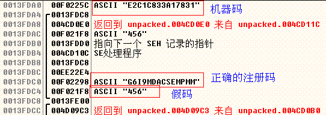
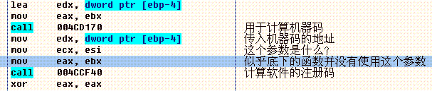
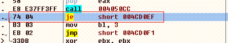

# 对 USBKiller 注册过程薄弱环节的分析

> 原文：[`www.pediy.com/kssd/pediy10/79254.html`](https://www.pediy.com/kssd/pediy10/79254.html)

【文章标题】: 对 USBKiller 注册过程薄弱环节的分析  
【文章作者】: tihty  
【使用工具】: OD，C32Asm，IDA  
【作者声明】: 我还是一个学习加密与解密的新手，为了能更好地和坛友们交流，特写此文。文中如有不对的地方请大家帮忙指出，感谢你阅读本文。  
\------------------->8-------------------------------------------------------------  
【详细过程】  
  
先介绍一些基本情况。  
  
软件版本：USBKiller V2.3 Build0103  
  
验证方式：重启验证  
  
程序外壳：UPX 0.89.6 - 1.02 / 1.05 - 1.24 (Delphi) stub -> Markus & Laszlo  
  
\------------------->8-------------------------------------------------------------  
  
我的思路：  
  
既然是重启验证，那么我们输入的注册码（以下简称假  
码）肯定会被保存在文件或者注册表中。等软件重启的时候再读取之，与正确的注册码进行比较。所以我们可以下断文件 API 和注册表 API。  
  
各方面都经过下断分析之后，找到了程序保存假码的位置：  
C:\\Documents and Settings\\\[当前用户\]\\Application Data\\svighost.dll  
  
别相信它的名字，其实这是一个假的动态链接库文件。用记事本打开，就可以看到里面保存的假码了。  
  
\------------------->8-------------------------------------------------------------  
  
既然找出了保存假码的位置，就容易下断了。我再次下断文件 API，然后 Ctrl + F2。  
  
追踪到了程序启动时对 svighost.dll 的读取，这时肯定要和正确的注册码相比较了。  
  
于是 F8，正确的注册码就跟出来了。  
  
  
  
图 01  
  
\------------------->8-------------------------------------------------------------  
  
当然这样并不满意，最好是逆向出它的注册算法。索性它的算法不算太难。   
  
  
  
图 02  
  
如图，F7 跟入其中那个计算注册码的函数。一番分析之后，我得出的结论：  
  
注册码 = 机器码 + 2 \* n (n = 1,2,3...)  
  
n 代表从左向右开始数的位数。  
  
\------------------->8-------------------------------------------------------------  
  
最后是爆破了。  
  
  
  
图 03  
  
图中的那一行，把 74 改为 75 就可以爆破了。呵呵  
  
\------------------->8-------------------------------------------------------------  
  
【经验总结】  
学习软件加密与解密需要多思考，需要有耐心，需要有一定的基础。 

昨天有些着急，所以忘了贴上。  
这样内容确实充实了不少，不过恐怕我分析得不太好哦。   
  

代码:

```
004CCF40  /$  55            push    ebp
004CCF41  |.  8BEC          mov     ebp, esp
004CCF43  |.  83C4 F0       add     esp, -10
004CCF46  |.  53            push    ebx
004CCF47  |.  56            push    esi
004CCF48  |.  57            push    edi
004CCF49  |.  33DB          xor     ebx, ebx
004CCF4B  |.  895D F0       mov     dword ptr \[ebp-10\], ebx
004CCF4E  |.  895D F4       mov     dword ptr \[ebp-C\], ebx
004CCF51  |.  894D F8       mov     dword ptr \[ebp-8\], ecx
004CCF54  |.  8955 FC       mov     dword ptr \[ebp-4\], edx           ;  把机器码的地址存入局部变量\[ebp-4\]
004CCF57  |.  8B45 FC       mov     eax, dword ptr \[ebp-4\]
004CCF5A  |.  E8 1182F3FF   call    00405170                         ;  这个函数只是检查机器码的引用计数
004CCF5F  |.  33C0          xor     eax, eax
004CCF61  |.  55            push    ebp
004CCF62  |.  68 0DD04C00   push    004CD00D
004CCF67  |.  64:FF30       push    dword ptr fs:\[eax\]
004CCF6A  |.  64:8920       mov     dword ptr fs:\[eax\], esp
004CCF6D  |.  8D45 F4       lea     eax, dword ptr \[ebp-C\]           ;  取\[ebp-c\]的地址调用下面的函数
004CCF70  |.  E8 4B7DF3FF   call    00404CC0                         ;  这个函数只是检查了\[ebp-c\]的值
004CCF75  |.  8B45 FC       mov     eax, dword ptr \[ebp-4\]
004CCF78  |.  E8 0380F3FF   call    00404F80                         ;  这个函数将机器码的长度取到 eax
004CCF7D  |.  8BF8          mov     edi, eax                         ;  把机器码的长度保存到局部变量 edi
004CCF7F  |.  85FF          test    edi, edi
004CCF81  |.  7E 5C         jle     short 004CCFDF                   ;  机器码的长度小于等于 0 则跳转
004CCF83  |.  BB 01000000   mov     ebx, 1                           ;  初始化 ebx 为 1
004CCF88  |>  8D43 1E       /lea     eax, dword ptr \[ebx+1E\]       ;  循环开始
004CCF8B  |.  50            |push    eax
004CCF8C  |.  8BC3          |mov     eax, ebx
004CCF8E  |.  5A            |pop     edx
004CCF8F  |.  8BCA          |mov     ecx, edx
004CCF91  |.  99            |cdq
004CCF92  |.  F7F9          |idiv    ecx                             ;  以上指令是 ebx 除以(ebx+30)
004CCF94  |.  8BF2          |mov     esi, edx                        ;  余数放到局部变量 esi
004CCF96  |.  8D43 14       |lea     eax, dword ptr \[ebx+14\]
004CCF99  |.  50            |push    eax
004CCF9A  |.  8BC3          |mov     eax, ebx
004CCF9C  |.  5A            |pop     edx
004CCF9D  |.  8BCA          |mov     ecx, edx
004CCF9F  |.  99            |cdq
004CCFA0  |.  F7F9          |idiv    ecx                             ;  以上指令是 ebx 除以(ebx+20)
004CCFA2  |.  03F2          |add     esi, edx                        ;  余数累加到局部变量 esi
004CCFA4  |.  8B45 FC       |mov     eax, dword ptr \[ebp-4\]
004CCFA7  |.  0FB64418 FF   |movzx   eax, byte ptr \[eax+ebx-1\]       ;  从机器码中取一个字符的 ASCII 码扩展到 eax
004CCFAC  |.  03C6          |add     eax, esi                        ;  把前面两次除法运算的余数加到 ASCII 码上
004CCFAE  |.  83C0 D0       |add     eax, -30                        ;  以上结果 - 48
004CCFB1  |.  83E8 0A       |sub     eax, 0A                         ;  以上结果 - 10
004CCFB4  |.  72 08         |jb      short 004CCFBE
004CCFB6  |.  83C0 F9       |add     eax, -7
004CCFB9  |.  83E8 1A       |sub     eax, 1A
004CCFBC  |.  73 1D         |jnb     short 004CCFDB
004CCFBE  |>  8D45 F0       |lea     eax, dword ptr \[ebp-10\]         ;  传入\[ebp-10\]的地址
004CCFC1  |.  8B55 FC       |mov     edx, dword ptr \[ebp-4\]
004CCFC4  |.  0FB6541A FF   |movzx   edx, byte ptr \[edx+ebx-1\]
004CCFC9  |.  03D6          |add     edx, esi                        ;  传入(机器码中一个字符的 ASCII 加两次除法的余数)
004CCFCB  |.  E8 D87EF3FF   |call    00404EA8                        ;  不明白这个函数的作用
004CCFD0  |.  8B55 F0       |mov     edx, dword ptr \[ebp-10\]         ;  传入\[ebp-10\]的值
004CCFD3  |.  8D45 F4       |lea     eax, dword ptr \[ebp-C\]          ;  传入\[ebp-c\]的地址
004CCFD6  |.  E8 AD7FF3FF   |call    00404F88                        ;  在这个函数里写入下一位正确的注册码
004CCFDB  |>  43            |inc     ebx
004CCFDC  |.  4F            |dec     edi
004CCFDD  |.^ 75 A9         \\jnz     short 004CCF88         ;  循环结束
004CCFDF  |>  8B45 F8       mov     eax, dword ptr \[ebp-8\]
004CCFE2  |.  8B55 F4       mov     edx, dword ptr \[ebp-C\]
004CCFE5  |.  E8 2A7DF3FF   call    00404D14
004CCFEA  |.  33C0          xor     eax, eax
004CCFEC  |.  5A            pop     edx
004CCFED  |.  59            pop     ecx
004CCFEE  |.  59            pop     ecx
004CCFEF  |.  64:8910       mov     dword ptr fs:\[eax\], edx
004CCFF2  |.  68 14D04C00   push    004CD014
004CCFF7  |>  8D45 F0       lea     eax, dword ptr \[ebp-10\]
004CCFFA  |.  BA 02000000   mov     edx, 2
004CCFFF  |.  E8 E07CF3FF   call    00404CE4
004CD004  |.  8D45 FC       lea     eax, dword ptr \[ebp-4\]
004CD007  |.  E8 B47CF3FF   call    00404CC0
004CD00C  \\.  C3            retn
004CD00D   .^ E9 6A76F3FF   jmp     0040467C
004CD012   .^ EB E3         jmp     short 004CCFF7
004CD014   .  5F            pop     edi
004CD015   .  5E            pop     esi
004CD016   .  5B            pop     ebx
004CD017   .  8BE5          mov     esp, ebp
004CD019   .  5D            pop     ebp
004CD01A   .  C3            retn

```

自我感觉有很多模糊的地方，希望以后能多向坛里的前辈们请教。