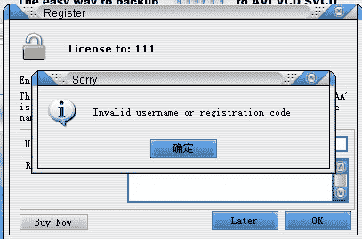

# 菜鸟分析 aheaddvd 注册算法

> 原文：[`www.pediy.com/kssd/pediy11/109202.html`](https://www.pediy.com/kssd/pediy11/109202.html)

上学期学校其他系信息安全课后的一个小题目[`tech.cuit.edu.cn/forum/thread-4719-1-1.html`](http://tech.cuit.edu.cn/forum/thread-4719-1-1.html)  
 今天逛论坛看到下下来分析分析，希望能对和我一样菜的新手有所帮助。  
Ahead DVD Ripper 是一款能将 DVD 备份为 VCD2.0, SVCD1.0 或 AVI(divx...)的小工具。它制作高质量 AVI , MPEG1/2 格式的影片只有原始大小的 1/10。   
  
首先运行软件，随意输入 111,fafageeeg  
  
当然是试试搜索字串的方法，OD 载入，搜索字符串 Invalid username or registration code 来到 00412F20  
\---------------------------------------------------------------华丽的分割线  
00412F03   .  8B4E 60       mov     ecx, dword ptr \[esi+60\]  
00412F06   .  50            push    eax  
00412F07   .  51            push    ecx  
00412F08   .  C64424 18 01  mov     byte ptr \[esp+18\], 1  
00412F0D   .  E8 DEFCFFFF   call    00412BF0  
00412F12   .  83C4 08       add     esp, 8  
00412F15   .  85C0          test    eax, eax  
00412F17   .  75 15         jnz     short 00412F2E                         ;  eax 不为 0 就成功  
00412F19   .  6A 40         push    40  
00412F1B   .  68 982D4D00   push    004D2D98                               ;  ASCII "Sorry"  
00412F20   .  68 6C2D4D00   push    004D2D6C                               ;  ASCII "Invalid username or registration code      "  
00412F25   .  8BCE          mov     ecx, esi  
00412F27   .  E8 1C6B0800   call    <jmp.&MFC42.#4224\_CWnd::MessageBoxA>  
00412F2C   .  EB 54         jmp     short 00412F82  
00412F2E   >  8B46 60       mov     eax, dword ptr \[esi+60\]  
00412F31   .  8D4C24 04     lea     ecx, dword ptr \[esp+4\]  
00412F35   .  50            push    eax  
00412F36   .  68 502D4D00   push    004D2D50                               ;  ASCII "License To:%s             "  
00412F3B   .  51            push    ecx  
00412F3C   .  E8 D76A0800   call    <jmp.&MFC42.#2818\_CString::Format>  
00412F41   .  8B5424 10     mov     edx, dword ptr \[esp+10\]  
00412F45   .  83C4 0C       add     esp, 0C  
00412F48   .  8BCE          mov     ecx, esi  
00412F4A   .  6A 40         push    40  
00412F4C   .  68 442D4D00   push    004D2D44                               ;  ASCII "Thank you"  
\----------------------------------------------------------------华丽的分割线  
  
看看附近，显示 License To:%s ;"Thank you"就应该是成功了，我们看到只要 00412F17 处的跳转实现，就表示注册成功，倒推回去，影响 eax 的应该是 00412F0D 处的 CALL，所以这里非常重要，F2 设个断点，重新载入程序，单步走，到 00412F0D 处的 CALL 再 F7 进去：  
  
\----------------------------------------------------------------华丽的分割线  
00412BF0  /$  53            push    ebx  
00412BF1  |.  55            push    ebp  
00412BF2  |.  8B6C24 0C     mov     ebp, dword ptr \[esp+C\]  
00412BF6  |.  56            push    esi  
00412BF7  |.  57            push    edi  
00412BF8  |.  BE 9C404F00   mov     esi, 004F409C  
00412BFD  |.  8BC5          mov     eax, ebp  
00412BFF  |>  8A10          /mov     dl, byte ptr \[eax\]  
00412C01  |.  8A1E          |mov     bl, byte ptr \[esi\]  
00412C03  |.  8ACA          |mov     cl, dl  
00412C05  |.  3AD3          |cmp     dl, bl  
00412C07  |.  75 1E         |jnz     short 00412C27  
00412C09  |.  84C9          |test    cl, cl                                ;  cl 不能为 0  
00412C0B  |.  74 16         |je      short 00412C23  
00412C0D  |.  8A50 01       |mov     dl, byte ptr \[eax+1\]  
00412C10  |.  8A5E 01       |mov     bl, byte ptr \[esi+1\]  
00412C13  |.  8ACA          |mov     cl, dl  
00412C15  |.  3AD3          |cmp     dl, bl  
00412C17  |.  75 0E         |jnz     short 00412C27  
00412C19  |.  83C0 02       |add     eax, 2  
00412C1C  |.  83C6 02       |add     esi, 2  
00412C1F  |.  84C9          |test    cl, cl  
00412C21  |.^ 75 DC         \\jnz     short 00412BFF  
00412C23  |>  33C0          xor     eax, eax                               ;  不能让这里实现  
00412C25  |.  EB 05         jmp     short 00412C2C  
00412C27  |>  1BC0          sbb     eax, eax  
00412C29  |.  83D8 FF       sbb     eax, -1  
00412C2C  |>  85C0          test    eax, eax                               ;  eax 不能为 0  
00412C2E  |.  74 62         je      short 00412C92                         ;  不能让这里实现  
00412C30  |.  8B7C24 18     mov     edi, dword ptr \[esp+18\]  
00412C34  |.  BE 9C404F00   mov     esi, 004F409C  
00412C39  |.  8BC7          mov     eax, edi  
00412C3B  |>  8A10          /mov     dl, byte ptr \[eax\]  
00412C3D  |.  8A1E          |mov     bl, byte ptr \[esi\]  
00412C3F  |.  8ACA          |mov     cl, dl  
00412C41  |.  3AD3          |cmp     dl, bl  
00412C43  |.  75 1E         |jnz     short 00412C63  
00412C45  |.  84C9          |test    cl, cl  
00412C47  |.  74 16         |je      short 00412C5F  
00412C49  |.  8A50 01       |mov     dl, byte ptr \[eax+1\]  
00412C4C  |.  8A5E 01       |mov     bl, byte ptr \[esi+1\]  
00412C4F  |.  8ACA          |mov     cl, dl  
00412C51  |.  3AD3          |cmp     dl, bl  
00412C53  |.  75 0E         |jnz     short 00412C63  
00412C55  |.  83C0 02       |add     eax, 2  
00412C58  |.  83C6 02       |add     esi, 2  
00412C5B  |.  84C9          |test    cl, cl  
00412C5D  |.^ 75 DC         \\jnz     short 00412C3B  
00412C5F  |>  33C0          xor     eax, eax  
00412C61  |.  EB 05         jmp     short 00412C68  
00412C63  |>  1BC0          sbb     eax, eax  
00412C65  |.  83D8 FF       sbb     eax, -1  
00412C68  |>  85C0          test    eax, eax  
00412C6A  |.  74 26         je      short 00412C92                         ;  这里实现就失败  
00412C6C  |.  57            push    edi  
00412C6D  |.  55            push    ebp  
00412C6E  |.  E8 6DF9FFFF   call    004125E0                               ;  这个函数使我们失败  
00412C73  |.  83C4 08       add     esp, 8  
00412C76  |.  85C0          test    eax, eax  
00412C78  |.  75 0E         jnz     short 00412C88                         ;  eax 不为 0 就成功  
00412C7A  |.  57            push    edi  
00412C7B  |.  55            push    ebp  
00412C7C  |.  E8 8FFBFFFF   call    00412810  
00412C81  |.  83C4 08       add     esp, 8  
00412C84  |.  85C0          test    eax, eax  
00412C86  |.  74 0A         je      short 00412C92                         ;  不能让这里实现  
00412C88  |>  5F            pop     edi  
00412C89  |.  5E            pop     esi  
00412C8A  |.  5D            pop     ebp  
00412C8B  |.  B8 01000000   mov     eax, 1  
00412C90  |.  5B            pop     ebx  
00412C91  |.  C3            ret  
00412C92  |>  5F            pop     edi  
00412C93  |.  5E            pop     esi  
00412C94  |.  5D            pop     ebp  
00412C95  |.  33C0          xor     eax, eax                               ;  不能让这里实现  
00412C97  |.  5B            pop     ebx  
00412C98  \\.  C3            ret  
\----------------------------------------------------------------华丽的分割线  
  
我们看到这里有 2 个 ret(00412C91,00412C98),而 00412C98 处的 ret 前面是 xor eax 清零，显然不能运行到这个 ret,否则 eax 返回 0 回到主程序就如前面分析的会失败。。所以 00412C91 处的 ret 是关键，再倒推回去必须实现 00412C78 处的跳转，再倒推，00412C76 处的 eax 就不能为 0，而影响 00412C76 处的 eax 正是 00412C6E 处的 CALL，而通过我们 F8 单步走，我们发现，正是因为 00412C6E 处的 CALL 使 eax 返回 0 的，所以这又是关键 CALL。。F7 进去：  
  
\----------------------------------------------------------------华丽的分割线  
004125E0  /$  6A FF         push    -1  
004125E2  |.  68 40C84900   push    0049C840                               ;  SE 处理程序安装  
004125E7  |.  64:A1 0000000>mov     eax, dword ptr fs:\[0\]  
004125ED  |.  50            push    eax  
004125EE  |.  64:8925 00000>mov     dword ptr fs:\[0\], esp  
004125F5  |.  83EC 14       sub     esp, 14  
004125F8  |.  8B4424 24     mov     eax, dword ptr \[esp+24\]  
004125FC  |.  53            push    ebx  
004125FD  |.  55            push    ebp  
004125FE  |.  56            push    esi  
004125FF  |.  57            push    edi  
00412600  |.  50            push    eax  
00412601  |.  8D4C24 18     lea     ecx, dword ptr \[esp+18\]                ;  ecx 13EE80  
00412605  |.  E8 9E740800   call    <jmp.&MFC42.#537\_CString::CString>  
0041260A  |.  8D4C24 14     lea     ecx, dword ptr \[esp+14\]  
0041260E  |.  C74424 2C 000>mov     dword ptr \[esp+2C\], 0  
00412616  |.  E8 57770800   call    <jmp.&MFC42.#6282\_CString::TrimLeft>  
0041261B  |.  8D4C24 14     lea     ecx, dword ptr \[esp+14\]  
0041261F  |.  E8 48770800   call    <jmp.&MFC42.#6283\_CString::TrimRight>  
00412624  |.  6A 20         push    20  
00412626  |.  8D4C24 18     lea     ecx, dword ptr \[esp+18\]  
0041262A  |.  E8 25740800   call    <jmp.&MFC42.#2915\_CString::GetBuffer>  
0041262F  |.  8B4C24 38     mov     ecx, dword ptr \[esp+38\]  
00412633  |.  8BD8          mov     ebx, eax  
00412635  |.  51            push    ecx  
00412636  |.  8D4C24 14     lea     ecx, dword ptr \[esp+14\]  
0041263A  |.  E8 69740800   call    <jmp.&MFC42.#537\_CString::CString>  
0041263F  |.  8D4C24 10     lea     ecx, dword ptr \[esp+10\]  
00412643  |.  C64424 2C 01  mov     byte ptr \[esp+2C\], 1  
00412648  |.  E8 25770800   call    <jmp.&MFC42.#6282\_CString::TrimLeft>  
0041264D  |.  8D4C24 10     lea     ecx, dword ptr \[esp+10\]  
00412651  |.  E8 16770800   call    <jmp.&MFC42.#6283\_CString::TrimRight>  
00412656  |.  6A 20         push    20  
00412658  |.  8D4C24 14     lea     ecx, dword ptr \[esp+14\]  
0041265C  |.  E8 F3730800   call    <jmp.&MFC42.#2915\_CString::GetBuffer>  
00412661  |.  8BD0          mov     edx, eax  
00412663  |.  83CE FF       or      esi, FFFFFFFF  
00412666  |.  8BFA          mov     edi, edx  
00412668  |.  8BCE          mov     ecx, esi  
0041266A  |.  33C0          xor     eax, eax  
0041266C  |.  895424 20     mov     dword ptr \[esp+20\], edx  
00412670  |.  F2:AE         repne   scas byte ptr es:\[edi\]  
00412672  |.  F7D1          not     ecx  
00412674  |.  49            dec     ecx  
00412675  |.  8BFB          mov     edi, ebx  
00412677  |.  8BE9          mov     ebp, ecx  
00412679  |.  8BCE          mov     ecx, esi  
0041267B  |.  F2:AE         repne   scas byte ptr es:\[edi\]  
0041267D  |.  F7D1          not     ecx  
0041267F  |.  49            dec     ecx  
00412680  |.  3BCD          cmp     ecx, ebp  
00412682  |.  0F87 54010000 ja      004127DC                               ;  不能让这里实现  
00412688  |.  8BFB          mov     edi, ebx  
0041268A  |.  8BCE          mov     ecx, esi  
0041268C  |.  F2:AE         repne   scas byte ptr es:\[edi\]  
0041268E  |.  F7D1          not     ecx  
00412690  |.  49            dec     ecx  
00412691  |.  0F84 45010000 je      004127DC                               ;  不能让这里实现  
00412697  |.  8BFA          mov     edi, edx  
00412699  |.  8BCE          mov     ecx, esi  
0041269B  |.  F2:AE         repne   scas byte ptr es:\[edi\]  
0041269D  |.  F7D1          not     ecx  
0041269F  |.  49            dec     ecx  
004126A0  |.  0F84 36010000 je      004127DC                               ;  不能让这里实现  
004126A6  |.  894424 38     mov     dword ptr \[esp+38\], eax  
004126AA  |>  8B5424 38     /mov     edx, dword ptr \[esp+38\]  
004126AE  |.  8D4C24 34     |lea     ecx, dword ptr \[esp+34\]  
004126B2  |.  8A82 B02C4D00 |mov     al, byte ptr \[edx+4D2CB0\]  
004126B8  |.  884424 18     |mov     byte ptr \[esp+18\], al  
004126BC  |.  E8 09730800   |call    <jmp.&MFC42.#540\_CString::CString>  
004126C1  |.  8BFB          |mov     edi, ebx  
004126C3  |.  83C9 FF       |or      ecx, FFFFFFFF  
004126C6  |.  33C0          |xor     eax, eax  
004126C8  |.  33ED          |xor     ebp, ebp  
004126CA  |.  F2:AE         |repne   scas byte ptr es:\[edi\]  
004126CC  |.  F7D1          |not     ecx  
004126CE  |.  49            |dec     ecx  
004126CF  |.  C64424 2C 02  |mov     byte ptr \[esp+2C\], 2  
004126D4  |.  74 4B         |je      short 00412721  
004126D6  |>  8A042B        |/mov     al, byte ptr \[ebx+ebp\]               ;  用户名  
004126D9  |.  33F6          ||xor     esi, esi                             ;  esi 清零  
004126DB  |>  3A0475 482C4D>||/cmp     al, byte ptr \[esi\*2+4D2C48\]         ;  关键 4D2C48  
004126E2  |.  74 08         |||je      short 004126EC  
004126E4  |.  46            |||inc     esi  
004126E5  |.  83FE 34       |||cmp     esi, 34  
004126E8  |.^ 7C F1         ||\\jl      short 004126DB                      ;  小于  
004126EA  |.  EB 11         ||jmp     short 004126FD  
004126EC  |>  8A0C75 492C4D>||mov     cl, byte ptr \[esi\*2+4D2C49\]  
004126F3  |.  51            ||push    ecx  
004126F4  |.  8D4C24 38     ||lea     ecx, dword ptr \[esp+38\]  
004126F8  |.  E8 69760800   ||call    <jmp.&MFC42.#940\_CString::operator+=>  
004126FD  |>  83FE 34       ||cmp     esi, 34  
00412700  |.  75 0E         ||jnz     short 00412710  
00412702  |.  8B5424 18     ||mov     edx, dword ptr \[esp+18\]  
00412706  |.  8D4C24 34     ||lea     ecx, dword ptr \[esp+34\]  
0041270A  |.  52            ||push    edx  
0041270B  |.  E8 56760800   ||call    <jmp.&MFC42.#940\_CString::operator+=>  
00412710  |>  8BFB          ||mov     edi, ebx  
00412712  |.  83C9 FF       ||or      ecx, FFFFFFFF  
00412715  |.  33C0          ||xor     eax, eax  
00412717  |.  45            ||inc     ebp  
00412718  |.  F2:AE         ||repne   scas byte ptr es:\[edi\]  
0041271A  |.  F7D1          ||not     ecx  
0041271C  |.  49            ||dec     ecx  
0041271D  |.  3BE9          ||cmp     ebp, ecx  
0041271F  |.^ 72 B5         |\\jb      short 004126D6  
00412721  |>  8B4424 34     |mov     eax, dword ptr \[esp+34\]  
00412725  |.  8B48 F8       |mov     ecx, dword ptr \[eax-8\]  
00412728  |.  83F9 10       |cmp     ecx, 10  
0041272B  |.  7D 3A         |jge     short 00412767  
0041272D  |.  8BC1          |mov     eax, ecx  
0041272F  |.  B9 10000000   |mov     ecx, 10  
00412734  |.  2BC8          |sub     ecx, eax  
00412736  |.  8D5424 1C     |lea     edx, dword ptr \[esp+1C\]  
0041273A  |.  51            |push    ecx  
0041273B  |.  52            |push    edx                                   ;  EDX 13EE88  
0041273C  |.  B9 8C155100   |mov     ecx, 0051158C                         ;  ASCII "\`X<"  
00412741  |.  E8 1A760800   |call    <jmp.&MFC42.#4129\_CString::Left>  
00412746  |.  50            |push    eax  
00412747  |.  8D4C24 38     |lea     ecx, dword ptr \[esp+38\]  
0041274B  |.  C64424 30 03  |mov     byte ptr \[esp+30\], 3  
00412750  |.  E8 3B730800   |call    <jmp.&MFC42.#939\_CString::operator+=>  
00412755  |.  8D4C24 1C     |lea     ecx, dword ptr \[esp+1C\]  
00412759  |.  C64424 2C 02  |mov     byte ptr \[esp+2C\], 2  
0041275E  |.  E8 5F710800   |call    <jmp.&MFC42.#800\_CString::~CString>  
00412763  |.  8B4424 34     |mov     eax, dword ptr \[esp+34\]  
00412767  |>  8B4C24 20     |mov     ecx, dword ptr \[esp+20\]               ;  算法肯定在上面  
0041276B  |.  51            |push    ecx                                   ; /s2  
0041276C  |.  50            |push    eax                                   ; |s1  
0041276D  |.  FF15 34F94900 |call    dword ptr \[<&MSVCRT.\_mbscmp>\]         ; \\\_mbscmp  
00412773  |.  83C4 08       |add     esp, 8  
00412776  |.  8D4C24 34     |lea     ecx, dword ptr \[esp+34\]  
0041277A  |.  85C0          |test    eax, eax  
0041277C  |.  C64424 2C 01  |mov     byte ptr \[esp+2C\], 1  
00412781  |.  74 1B         |je      short 0041279E  
00412783  |.  33F6          |xor     esi, esi  
00412785  |.  E8 38710800   |call    <jmp.&MFC42.#800\_CString::~CString>  
0041278A  |.  8B4424 38     |mov     eax, dword ptr \[esp+38\]  
0041278E  |.  40            |inc     eax  
0041278F  |.  83F8 03       |cmp     eax, 3  
00412792  |.  894424 38     |mov     dword ptr \[esp+38\], eax  
00412796  |.^ 0F8C 0EFFFFFF \\jl      004126AA  
0041279C  |.  EB 0A         jmp     short 004127A8  
0041279E  |>  BE 01000000   mov     esi, 1  
004127A3  |.  E8 1A710800   call    <jmp.&MFC42.#800\_CString::~CString>  
004127A8  |>  8D4C24 10     lea     ecx, dword ptr \[esp+10\]  
004127AC  |.  C64424 2C 00  mov     byte ptr \[esp+2C\], 0  
004127B1  |.  E8 0C710800   call    <jmp.&MFC42.#800\_CString::~CString>  
004127B6  |.  8D4C24 14     lea     ecx, dword ptr \[esp+14\]  
004127BA  |.  C74424 2C FFF>mov     dword ptr \[esp+2C\], -1  
004127C2  |.  E8 FB700800   call    <jmp.&MFC42.#800\_CString::~CString>  
004127C7  |.  8BC6          mov     eax, esi  
004127C9  |.  5F            pop     edi  
004127CA  |.  5E            pop     esi  
004127CB  |.  5D            pop     ebp  
004127CC  |.  5B            pop     ebx  
004127CD  |.  8B4C24 14     mov     ecx, dword ptr \[esp+14\]  
004127D1  |.  64:890D 00000>mov     dword ptr fs:\[0\], ecx  
004127D8  |.  83C4 20       add     esp, 20  
004127DB  |.  C3            ret                                            ;  这里返回就成功  
004127DC  |>  8D4C24 10     lea     ecx, dword ptr \[esp+10\]  
004127E0  |.  C64424 2C 00  mov     byte ptr \[esp+2C\], 0  
004127E5  |.  E8 D8700800   call    <jmp.&MFC42.#800\_CString::~CString>  
004127EA  |.  8D4C24 14     lea     ecx, dword ptr \[esp+14\]  
004127EE  |.  897424 2C     mov     dword ptr \[esp+2C\], esi  
004127F2  |.  E8 CB700800   call    <jmp.&MFC42.#800\_CString::~CString>  
004127F7  |.  8B4C24 24     mov     ecx, dword ptr \[esp+24\]  
004127FB  |.  5F            pop     edi  
004127FC  |.  5E            pop     esi  
004127FD  |.  5D            pop     ebp  
004127FE  |.  33C0          xor     eax, eax                               ;  失败  
00412800  |.  5B            pop     ebx  
00412801  |.  64:890D 00000>mov     dword ptr fs:\[0\], ecx  
00412808  |.  83C4 20       add     esp, 20  
0041280B  \\.  C3            ret  
\----------------------------------------------------------------华丽的分割线  
  
我们看到这里又是 2 个 ret（004127DB，0041280B），同上面原理一样，eax 返回 0 就失败，所以又根据要实现 004127DB 处的 ret 又倒推回去，看看哪些跳转要实现，哪些不能实现。。  
我们刚进入这个 CALL 时，一路 F8 下来（眼睛紧盯右上方的寄存器框），会发现（我这里以 111 为用户名，F8 到 00412767 时，EAX 里会出现一串 ZZZHLWsCbMErpAQO,这个估计就是密码了，试试，果然成功了）。。说明就是我们在这一路 F8 的时候产生的密码，算法就应该在这里了，我们再回头来分析汇编代码，00412682，00412691，004126A0 这几处的跳转应该是对用户名和密码的检测，比如用户名和密码长度不为 0 等。。  
我们重点来看看刚才 F8 时蹦出来的 ZZZHLWsCbMErpAQO，在这之前可能会发现首先产生了个 ZZZ，那这个 ZZZ 又是怎么来的？  
重点来看从 004126D6 开始的这一段汇编:  
004126D6  |> /8A042B        |/mov     al, byte ptr \[ebx+ebp\]         ;  用户名  
004126D9  |. |33F6          ||xor     esi, esi                       ;  esi 清零  
004126DB  |> |3A0475 482C4D>||/cmp     al, byte ptr \[esi\*2+4D2C48\]   ;  关键 4D2C48  
004126E2  |. |74 08         |||je      short 004126EC  
004126E4  |. |46            |||inc     esi  
004126E5  |. |83FE 34       |||cmp     esi, 34  
004126E8  |.^|7C F1         ||\\jl      short 004126DB                ;  小于  
这里是取用户名（比如我输入的用户名‘111’的‘1’）和 byte ptr \[esi\*2+4D2C48\]比较，那么 4D2C48 这个是什么东西？  
我们来到 OD 左下方的数据窗口，查找 4D2C48，是一串奇怪的字符 aCbqcidHeSfXgMhkiEjVkZlemRnyoBpKqdrTsAtFuWvlwjxDyIzPAzBxCpDOEkFgGYHmItJaKrLQMnNsOuPUQGRJSLTNUbVcWfXhYoZwZQY  
通过 cmp     al, byte ptr \[esi\*2+4D2C48\]我们知道程序就是用我们输入的用户名和这一串奇怪的字符从'a'（4D2C48）开始隔一个字符依次比较（和 abcdefghijk...ABCDEFG...比较，刚好 52 个字符，也就是为什么是 cmp     esi, 0x34）  
如果找到相同的字符，就用这个字符的下一个字符作为密码（比如用户名为 aaa，那么密码就是 CCC）  
但是如果我们的用户名不在这一串奇怪的字符里呢？看看汇编：  
  
004126E5  |.  83FE 34       |||cmp     esi, 34  
004126E8  |.^ 7C F1         ||\\jl      short 004126DB                ;  小于  
004126EA  |. /EB 11         ||jmp     short 004126FD  
  
只要循环超出 0x34（也就是没在字符表里找到相应字符）就来到 004126FD：  
  
004126FD  |> \\83FE 34       ||cmp     esi, 34  
00412700  |.  75 0E         ||jnz     short 00412710  
00412702  |.  8B5424 18     ||mov     edx, dword ptr \[esp+18\]  
  
这里向 edx 传入了 dword ptr \[esp+18\]，我们再往上看：  
  
004126B2  |.  8A82 B02C4D00 |mov     al, byte ptr \[edx+4D2CB0\]  
004126B8  |.  884424 18     |mov     byte ptr \[esp+18\], al  
  
可以发现 4D2CB0 处正是字符‘Z’，也就是为什么用户名为 111 时，密码为 ZZZ。。。  
现在终于搞清楚算法了，别急，下面还有，如果用户名没达 0x10，就用字符串‘HLWsCbMErpAQOXWK’补足。  
  
所以最终的算法，以下用 C 写的：  
  
#include<stdio.h>  
#include<string.h>  
void main()  
{  
char a=0;  
char b='Z';  
char len=0;  
char user\[100\];  
char psw\[100\]={0};  
char lentmp=0;  
char\* str1="aCbqcidHeSfXgMhkiEjVkZlemRnyoBpKqdrTsAtFuWvlwjxDyIzPAzBxCpDOEkFgGYHmItJaKrLQMnNsOuPUQGRJSLTNUbVcWfXhYoZwZQY";  
char\* str2="HLWsCbMErpAQOXWK";  
printf("请输入用户名：");  
scanf("%s",user);  
len=strlen(user);  
for(int i=0;i<len;i++)  
{  
for(int j=0;j<=0x34;j++)  
{  
   if(user\[i\]==str1\[j\*2\])  
   {  
    psw\[i\]=str1\[j\*2+1\];  
    break;  
   }  
   psw\[i\]=b;  
}  
}  
if(len<=0x10)  
{  
  lentmp=0x10-len;  
  for(int n=0;n<lentmp;n++)  
  {  
    psw\[len+n\]=str2\[n\];  
  }  
printf("密码为：%s\\n",psw);  
getchar();   
getchar();  
return;  
}  
printf("用户名长度小于 16：\\n " );  
}  
  
总结：CALL,跳转等指令是关键，从这个程序来说还是比较容易的，像我这样的菜鸟没什么破解经验开始时一定要耐心慢慢跟。。另外碰到关键算法时，可以输入一些特别的值，比如 111（3 位长），1111（4 位长），aaaaaaa 等等，在关键地方单步走观察 OD 右上方寄存器的值变化，再结合汇编语句反复推敲，应该就能理解算法的原理。。。