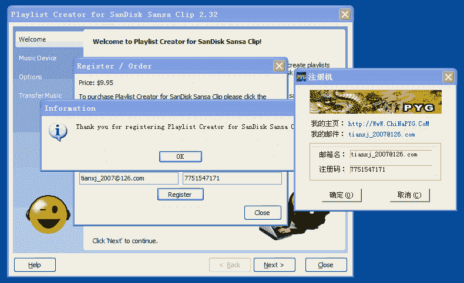

# Playlist Creator for SanDisk Sansa Clip 2.32 算法分析

> 原文：[`www.pediy.com/kssd/pediy11/112543.html`](https://www.pediy.com/kssd/pediy11/112543.html)

【破文标题】Playlist Creator for SanDisk Sansa Clip 2.32 算法分析  
【破文作者】tianxj  
【作者邮箱】tianxj\_2007@126.com  
【作者主页】[WwW.ChiNaPYG.CoM](http://WwW.ChiNaPYG.CoM)  
【破解工具】PEiD,OD  
【破解平台】Windows XP sp3  
【软件名称】Playlist Creator for SanDisk Sansa Clip 2.32  
【软件大小】1722KB   
【软件类别】国外软件/音频播放    
【软件授权】共享版   
【软件语言】英文   
【运行环境】Winxp/vista/win7/2000/2003   
【更新时间】2010-4-30   
【原版下载】[`www.onlinedown.net/soft/102510.htm`](http://www.onlinedown.net/soft/102510.htm)  
【保护方式】注册码  
【软件简介】Playlist Creator for SanDisk Sansa Clip 是一款音频播放软件，可以自动创建你的 Sansa 音乐播放。它的工作原理是通过搜索设备上的所有音乐和文件夹，将被自  
  
动转移到新创建音乐播放列表。  
【破解声明】我是一只小菜鸟，偶得一点心得，愿与大家分享：）  
\--------------------------------------------------------------  
【破解内容】  
\--------------------------------------------------------------  
\*\*\*\*\*\*\*\*\*\*\*\*\*\*\*\*\*\*\*\*\*\*\*\*\*\*\*\*\*\*\*\*\*\*\*\*\*\*\*\*\*\*\*\*\*\*\*\*\*\*\*\*\*\*\*\*\*\*\*\*\*\*  
一、运行程序，进行注册，输入错误的注册信息进行检测，有提示信息  
\*\*\*\*\*\*\*\*\*\*\*\*\*\*\*\*\*\*\*\*\*\*\*\*\*\*\*\*\*\*\*\*\*\*\*\*\*\*\*\*\*\*\*\*\*\*\*\*\*\*\*\*\*\*\*\*\*\*\*\*\*\*  
二、用 PEiD 对 playlistcreatorforsandisksansaclip.exe 查壳，为 Borland Delphi 6.0 - 7.0 \[Overlay\]  
\*\*\*\*\*\*\*\*\*\*\*\*\*\*\*\*\*\*\*\*\*\*\*\*\*\*\*\*\*\*\*\*\*\*\*\*\*\*\*\*\*\*\*\*\*\*\*\*\*\*\*\*\*\*\*\*\*\*\*\*\*\*  
三、运行 OD，利用字符串来到关键  
\==============================================================  

代码:

```
00546F6C  /.  55            push    ebp
00546F6D  |.  8BEC          mov     ebp, esp
00546F6F  |.  B9 09000000   mov     ecx, 9
00546F74  |>  6A 00         /push    0
00546F76  |.  6A 00         |push    0
00546F78  |.  49            |dec     ecx
00546F79  |.^ 75 F9         \\jnz     short 00546F74
00546F7B  |.  51            push    ecx
00546F7C  |.  53            push    ebx
00546F7D  |.  56            push    esi
00546F7E  |.  8BD8          mov     ebx, eax
00546F80  |.  33C0          xor     eax, eax
00546F82  |.  55            push    ebp
00546F83  |.  68 F4715400   push    005471F4
00546F88  |.  64:FF30       push    dword ptr fs:\[eax\]
00546F8B  |.  64:8920       mov     dword ptr fs:\[eax\], esp
00546F8E  |.  8D55 F0       lea     edx, dword ptr \[ebp-10\]
00546F91  |.  8BB3 F0020000 mov     esi, dword ptr \[ebx+2F0\]
00546F97  |.  8BC6          mov     eax, esi
00546F99  |.  E8 D2FCEFFF   call    00446C70
00546F9E  |.  8B55 F0       mov     edx, dword ptr \[ebp-10\]          ;  //邮箱名
00546FA1  |.  8D45 F4       lea     eax, dword ptr \[ebp-C\]
00546FA4  |.  E8 B7E3EBFF   call    00405360
00546FA9  |.  8B45 F4       mov     eax, dword ptr \[ebp-C\]
00546FAC  |.  8D55 F8       lea     edx, dword ptr \[ebp-8\]
00546FAF  |.  E8 3055F8FF   call    004CC4E4
00546FB4  |.  8B55 F8       mov     edx, dword ptr \[ebp-8\]
00546FB7  |.  8D45 FC       lea     eax, dword ptr \[ebp-4\]
00546FBA  |.  E8 25DDEBFF   call    00404CE4
00546FBF  |.  8B55 FC       mov     edx, dword ptr \[ebp-4\]
00546FC2  |.  8BC6          mov     eax, esi
00546FC4  |.  E8 D7FCEFFF   call    00446CA0
00546FC9  |.  8D55 E0       lea     edx, dword ptr \[ebp-20\]
00546FCC  |.  8BB3 F4020000 mov     esi, dword ptr \[ebx+2F4\]
00546FD2  |.  8BC6          mov     eax, esi
00546FD4  |.  E8 97FCEFFF   call    00446C70
00546FD9  |.  8B55 E0       mov     edx, dword ptr \[ebp-20\]          ;  //试炼码
00546FDC  |.  8D45 E4       lea     eax, dword ptr \[ebp-1C\]
00546FDF  |.  E8 7CE3EBFF   call    00405360
00546FE4  |.  8B45 E4       mov     eax, dword ptr \[ebp-1C\]
00546FE7  |.  8D55 E8       lea     edx, dword ptr \[ebp-18\]
00546FEA  |.  E8 F554F8FF   call    004CC4E4
00546FEF  |.  8B55 E8       mov     edx, dword ptr \[ebp-18\]
00546FF2  |.  8D45 EC       lea     eax, dword ptr \[ebp-14\]
00546FF5  |.  E8 EADCEBFF   call    00404CE4
00546FFA  |.  8B55 EC       mov     edx, dword ptr \[ebp-14\]
00546FFD  |.  8BC6          mov     eax, esi
00546FFF  |.  E8 9CFCEFFF   call    00446CA0
00547004  |.  8D55 D8       lea     edx, dword ptr \[ebp-28\]
00547007  |.  8B83 F4020000 mov     eax, dword ptr \[ebx+2F4\]
0054700D  |.  E8 5EFCEFFF   call    00446C70
00547012  |.  8B45 D8       mov     eax, dword ptr \[ebp-28\]
00547015  |.  8D55 DC       lea     edx, dword ptr \[ebp-24\]
00547018  |.  E8 AB24ECFF   call    004094C8
0054701D  |.  8B45 DC       mov     eax, dword ptr \[ebp-24\]
00547020  |.  50            push    eax
00547021  |.  8D55 D0       lea     edx, dword ptr \[ebp-30\]
00547024  |.  8B83 F0020000 mov     eax, dword ptr \[ebx+2F0\]
0054702A  |.  E8 41FCEFFF   call    00446C70
0054702F  |.  8B45 D0       mov     eax, dword ptr \[ebp-30\]          ;  //邮箱名
00547032  |.  8D4D D4       lea     ecx, dword ptr \[ebp-2C\]
00547035  |.  8B93 1C030000 mov     edx, dword ptr \[ebx+31C\]         ;  //字符串"Playlist Creator for SanDisk Sansa Clip"
0054703B  |.  E8 E0FDFFFF   call    00546E20                         ;  //算法 CALL
00547040  |.  8B55 D4       mov     edx, dword ptr \[ebp-2C\]          ;  //注册码
00547043  |.  58            pop     eax                              ;  //试炼码
00547044  |.  E8 17DEEBFF   call    00404E60                         ;  //比较 CALL
00547049  |.  0F85 F4000000 jnz     00547143                         ;  //关键跳转
0054704F  |.  8D55 C8       lea     edx, dword ptr \[ebp-38\]
00547052  |.  8B83 F0020000 mov     eax, dword ptr \[ebx+2F0\]
00547058  |.  E8 13FCEFFF   call    00446C70
0054705D  |.  8B45 C8       mov     eax, dword ptr \[ebp-38\]
00547060  |.  8D55 CC       lea     edx, dword ptr \[ebp-34\]
00547063  |.  E8 6024ECFF   call    004094C8
00547068  |.  8B45 CC       mov     eax, dword ptr \[ebp-34\]
0054706B  |.  50            push    eax
0054706C  |.  8D45 C4       lea     eax, dword ptr \[ebp-3C\]
0054706F  |.  8B8B 1C030000 mov     ecx, dword ptr \[ebx+31C\]
00547075  |.  BA 0C725400   mov     edx, 0054720C                    ;  software\\rinjanisoft\\
0054707A  |.  E8 E9DCEBFF   call    00404D68
0054707F  |.  8B45 C4       mov     eax, dword ptr \[ebp-3C\]
00547082  |.  BA 2C725400   mov     edx, 0054722C                    ;  email
00547087  |.  59            pop     ecx
00547088  |.  E8 C353F8FF   call    004CC450
0054708D  |.  8D55 C0       lea     edx, dword ptr \[ebp-40\]
00547090  |.  8B83 F4020000 mov     eax, dword ptr \[ebx+2F4\]
00547096  |.  E8 D5FBEFFF   call    00446C70
0054709B  |.  8B45 C0       mov     eax, dword ptr \[ebp-40\]
0054709E  |.  50            push    eax
0054709F  |.  8D45 BC       lea     eax, dword ptr \[ebp-44\]
005470A2  |.  8B8B 1C030000 mov     ecx, dword ptr \[ebx+31C\]
005470A8  |.  BA 0C725400   mov     edx, 0054720C                    ;  software\\rinjanisoft\\
005470AD  |.  E8 B6DCEBFF   call    00404D68
005470B2  |.  8B45 BC       mov     eax, dword ptr \[ebp-44\]
005470B5  |.  BA 3C725400   mov     edx, 0054723C                    ;  key
005470BA  |.  59            pop     ecx
005470BB  |.  E8 9053F8FF   call    004CC450
005470C0  |.  C783 4C020000>mov     dword ptr \[ebx+24C\], 1
005470CA  |.  B1 01         mov     cl, 1
005470CC  |.  B2 01         mov     dl, 1
005470CE  |.  A1 C0695400   mov     eax, dword ptr \[5469C0\]
005470D3  |.  E8 84ADEDFF   call    00421E5C
005470D8  |.  8983 28030000 mov     dword ptr \[ebx+328\], eax
005470DE  |.  8D55 B8       lea     edx, dword ptr \[ebp-48\]
005470E1  |.  8B83 F0020000 mov     eax, dword ptr \[ebx+2F0\]
005470E7  |.  E8 84FBEFFF   call    00446C70
005470EC  |.  8B55 B8       mov     edx, dword ptr \[ebp-48\]
005470EF  |.  8B83 28030000 mov     eax, dword ptr \[ebx+328\]
005470F5  |.  83C0 38       add     eax, 38
005470F8  |.  E8 8FD9EBFF   call    00404A8C
005470FD  |.  8B83 28030000 mov     eax, dword ptr \[ebx+328\]
00547103  |.  83C0 34       add     eax, 34
00547106  |.  8B93 1C030000 mov     edx, dword ptr \[ebx+31C\]
0054710C  |.  E8 7BD9EBFF   call    00404A8C
00547111  |.  8B83 28030000 mov     eax, dword ptr \[ebx+328\]
00547117  |.  E8 8CB0EDFF   call    004221A8
0054711C  |.  68 48725400   push    00547248                         ;  thank you for registering
00547121  |.  FFB3 1C030000 push    dword ptr \[ebx+31C\]
00547127  |.  68 6C725400   push    0054726C                         ;  !
0054712C  |.  8D45 B4       lea     eax, dword ptr \[ebp-4C\]
0054712F  |.  BA 03000000   mov     edx, 3
00547134  |.  E8 A3DCEBFF   call    00404DDC
00547139  |.  8B45 B4       mov     eax, dword ptr \[ebp-4C\]
0054713C  |.  E8 F34BF8FF   call    004CBD34
00547141  |.  EB 11         jmp     short 00547154
00547143  |>  8BC3          mov     eax, ebx
00547145  |.  E8 DE61F0FF   call    0044D328
0054714A  |.  BA 74725400   mov     edx, 00547274                    ;  u
0054714F  |.  E8 A44CF8FF   call    004CBDF8
00547154  |>  33C0          xor     eax, eax
00547156  |.  5A            pop     edx
00547157  |.  59            pop     ecx
00547158  |.  59            pop     ecx
00547159  |.  64:8910       mov     dword ptr fs:\[eax\], edx
0054715C  |.  68 FE715400   push    005471FE
00547161  |>  8D45 B4       lea     eax, dword ptr \[ebp-4C\]
00547164  |.  E8 CFD8EBFF   call    00404A38
00547169  |.  8D45 B8       lea     eax, dword ptr \[ebp-48\]
0054716C  |.  E8 C7D8EBFF   call    00404A38
00547171  |.  8D45 BC       lea     eax, dword ptr \[ebp-44\]
00547174  |.  E8 BFD8EBFF   call    00404A38
00547179  |.  8D45 C0       lea     eax, dword ptr \[ebp-40\]
0054717C  |.  E8 B7D8EBFF   call    00404A38
00547181  |.  8D45 C4       lea     eax, dword ptr \[ebp-3C\]
00547184  |.  E8 AFD8EBFF   call    00404A38
00547189  |.  8D45 C8       lea     eax, dword ptr \[ebp-38\]
0054718C  |.  E8 A7D8EBFF   call    00404A38
00547191  |.  8D45 CC       lea     eax, dword ptr \[ebp-34\]
00547194  |.  E8 9FD8EBFF   call    00404A38
00547199  |.  8D45 D0       lea     eax, dword ptr \[ebp-30\]
0054719C  |.  E8 97D8EBFF   call    00404A38
005471A1  |.  8D45 D4       lea     eax, dword ptr \[ebp-2C\]
005471A4  |.  E8 8FD8EBFF   call    00404A38
005471A9  |.  8D45 D8       lea     eax, dword ptr \[ebp-28\]
005471AC  |.  E8 87D8EBFF   call    00404A38
005471B1  |.  8D45 DC       lea     eax, dword ptr \[ebp-24\]
005471B4  |.  E8 7FD8EBFF   call    00404A38
005471B9  |.  8D45 E0       lea     eax, dword ptr \[ebp-20\]
005471BC  |.  E8 77D8EBFF   call    00404A38
005471C1  |.  8D45 E4       lea     eax, dword ptr \[ebp-1C\]
005471C4  |.  BA 02000000   mov     edx, 2
005471C9  |.  E8 D2DFEBFF   call    004051A0
005471CE  |.  8D45 EC       lea     eax, dword ptr \[ebp-14\]
005471D1  |.  E8 62D8EBFF   call    00404A38
005471D6  |.  8D45 F0       lea     eax, dword ptr \[ebp-10\]
005471D9  |.  E8 5AD8EBFF   call    00404A38
005471DE  |.  8D45 F4       lea     eax, dword ptr \[ebp-C\]
005471E1  |.  BA 02000000   mov     edx, 2
005471E6  |.  E8 B5DFEBFF   call    004051A0
005471EB  |.  8D45 FC       lea     eax, dword ptr \[ebp-4\]
005471EE  |.  E8 45D8EBFF   call    00404A38
005471F3  \\.  C3            retn
005471F4   .^ E9 E3D0EBFF   jmp     004042DC
005471F9   .^ E9 63FFFFFF   jmp     00547161
005471FE   .  5E            pop     esi
005471FF   .  5B            pop     ebx
00547200   .  8BE5          mov     esp, ebp
00547202   .  5D            pop     ebp
00547203   .  C3            retn
\==============================================================
00546E20  /$  55            push    ebp
00546E21  |.  8BEC          mov     ebp, esp
00546E23  |.  6A 00         push    0
00546E25  |.  6A 00         push    0
00546E27  |.  6A 00         push    0
00546E29  |.  6A 00         push    0
00546E2B  |.  6A 00         push    0
00546E2D  |.  6A 00         push    0
00546E2F  |.  53            push    ebx
00546E30  |.  56            push    esi
00546E31  |.  8BF1          mov     esi, ecx
00546E33  |.  8955 F8       mov     dword ptr \[ebp-8\], edx
00546E36  |.  8945 FC       mov     dword ptr \[ebp-4\], eax
00546E39  |.  8B45 FC       mov     eax, dword ptr \[ebp-4\]           ;  //邮箱名
00546E3C  |.  E8 C3E0EBFF   call    00404F04
00546E41  |.  8B45 F8       mov     eax, dword ptr \[ebp-8\]           ;  //字符串"Playlist Creator for SanDisk Sansa Clip"
00546E44  |.  E8 BBE0EBFF   call    00404F04
00546E49  |.  33C0          xor     eax, eax
00546E4B  |.  55            push    ebp
00546E4C  |.  68 246F5400   push    00546F24
00546E51  |.  64:FF30       push    dword ptr fs:\[eax\]
00546E54  |.  64:8920       mov     dword ptr fs:\[eax\], esp
00546E57  |.  8BC6          mov     eax, esi
00546E59  |.  BA 3C6F5400   mov     edx, 00546F3C                    ;  sdfasdfasdfsdf
00546E5E  |.  E8 29DCEBFF   call    00404A8C
00546E63  |.  837D FC 00    cmp     dword ptr \[ebp-4\], 0
00546E67  |.  0F84 9C000000 je      00546F09                         ;  //邮箱名为空则跳
00546E6D  |.  8D55 EC       lea     edx, dword ptr \[ebp-14\]
00546E70  |.  8B45 FC       mov     eax, dword ptr \[ebp-4\]
00546E73  |.  E8 5026ECFF   call    004094C8
00546E78  |.  8B55 EC       mov     edx, dword ptr \[ebp-14\]
00546E7B  |.  8D45 FC       lea     eax, dword ptr \[ebp-4\]
00546E7E  |.  E8 4DDCEBFF   call    00404AD0
00546E83  |.  8D4D E8       lea     ecx, dword ptr \[ebp-18\]
00546E86  |.  BA 13000000   mov     edx, 13
00546E8B  |.  8B45 F8       mov     eax, dword ptr \[ebp-8\]           ;  //字符串"Playlist Creator for SanDisk Sansa Clip"
00546E8E  |.  E8 ED57F8FF   call    004CC680                         ;  //取字符串右边 19 位
00546E93  |.  8B45 E8       mov     eax, dword ptr \[ebp-18\]          ;  //字符串"or SanDisk Sansa Clip"
00546E96  |.  8D4D F4       lea     ecx, dword ptr \[ebp-C\]
00546E99  |.  BA 0A000000   mov     edx, 0A
00546E9E  |.  E8 8557F8FF   call    004CC628                         ;  //取字符串左边 10 位
00546EA3  |.  837D F4 00    cmp     dword ptr \[ebp-C\], 0
00546EA7  |.  74 60         je      short 00546F09                   ;  //字符串"or SanDisk"为空则跳
00546EA9  |.  BB 01000000   mov     ebx, 1                           ;  //计数器
00546EAE  |>  8B45 FC       /mov     eax, dword ptr \[ebp-4\]          ;  //邮箱名
00546EB1  |.  E8 66DEEBFF   |call    00404D1C                        ;  //取邮箱名长度
00546EB6  |.  50            |push    eax
00546EB7  |.  8BC3          |mov     eax, ebx
00546EB9  |.  48            |dec     eax
00546EBA  |.  5A            |pop     edx
00546EBB  |.  8BCA          |mov     ecx, edx
00546EBD  |.  99            |cdq
00546EBE  |.  F7F9          |idiv    ecx
00546EC0  |.  8B45 FC       |mov     eax, dword ptr \[ebp-4\]          ;  //邮箱名
00546EC3  |.  8A0410        |mov     al, byte ptr \[eax+edx\]          ;  //逐位取邮箱名
00546EC6  |.  8B55 F4       |mov     edx, dword ptr \[ebp-C\]          ;  //字符串"or SanDisk"
00546EC9  |.  8A541A FF     |mov     dl, byte ptr \[edx+ebx-1\]        ;  //逐位取字符串"or SanDisk"
00546ECD  |.  32C2          |xor     al, dl                          ;  //al=al XOR dl
00546ECF  |.  25 FF000000   |and     eax, 0FF                        ;  //eax=eax AND 0FFh
00546ED4  |.  8D55 F0       |lea     edx, dword ptr \[ebp-10\]
00546ED7  |.  E8 E02BECFF   |call    00409ABC                        ;  //将 eax 转 10 进制字符串
00546EDC  |.  8B45 F0       |mov     eax, dword ptr \[ebp-10\]         ;  //10 进制字符串
00546EDF  |.  E8 38DEEBFF   |call    00404D1C                        ;  //取 10 进制字符串长度
00546EE4  |.  8B55 F0       |mov     edx, dword ptr \[ebp-10\]         ;  //10 进制字符串
00546EE7  |.  8A4402 FF     |mov     al, byte ptr \[edx+eax-1\]        ;  //取 10 进制字符串最右边 1 位
00546EEB  |.  50            |push    eax
00546EEC  |.  8D45 F4       |lea     eax, dword ptr \[ebp-C\]
00546EEF  |.  E8 78E0EBFF   |call    00404F6C
00546EF4  |.  5A            |pop     edx
00546EF5  |.  885418 FF     |mov     byte ptr \[eax+ebx-1\], dl        ;  //保存 dl
00546EF9  |.  43            |inc     ebx
00546EFA  |.  83FB 0B       |cmp     ebx, 0B
00546EFD  |.^ 75 AF         \\jnz     short 00546EAE                  ;  //循环
00546EFF  |.  8BC6          mov     eax, esi
00546F01  |.  8B55 F4       mov     edx, dword ptr \[ebp-C\]           ;  //注册码
00546F04  |.  E8 83DBEBFF   call    00404A8C
00546F09  |>  33C0          xor     eax, eax
00546F0B  |.  5A            pop     edx
00546F0C  |.  59            pop     ecx
00546F0D  |.  59            pop     ecx
00546F0E  |.  64:8910       mov     dword ptr fs:\[eax\], edx
00546F11  |.  68 2B6F5400   push    00546F2B
00546F16  |>  8D45 E8       lea     eax, dword ptr \[ebp-18\]
00546F19  |.  BA 06000000   mov     edx, 6
00546F1E  |.  E8 39DBEBFF   call    00404A5C
00546F23  \\.  C3            retn
00546F24   .^ E9 B3D3EBFF   jmp     004042DC
00546F29   .^ EB EB         jmp     short 00546F16
00546F2B   .  5E            pop     esi
00546F2C   .  5B            pop     ebx
00546F2D   .  8BE5          mov     esp, ebp
00546F2F   .  5D            pop     ebp
00546F30   .  C3            retn

```

\*\*\*\*\*\*\*\*\*\*\*\*\*\*\*\*\*\*\*\*\*\*\*\*\*\*\*\*\*\*\*\*\*\*\*\*\*\*\*\*\*\*\*\*\*\*\*\*\*\*\*\*\*\*\*\*\*\*\*\*\*\*    
【破解总结】  
\--------------------------------------------------------------  
【算法注册机】  
用 Keymake 来模拟下算法  
KeyGen.rek  
  
.data   
szHomePage db "http://www.chinapyg.com",0   
szEmail    db "mailto:tianxj\_2007@126.com",0   
szErrMess  db "请输入邮箱名！",0   
szChar    db "or SanDisk",0   
szFMT     db '%d',0  
szTemp    db 20 dup(0)   
szBuffer  db 50 dup(0)   
  
.code  
  mov     ebx, 1h  
L002:  
  lea     eax, hInput1   
  invoke  lstrlen, eax   
  push    eax  
  mov     eax, ebx  
  dec     eax  
  pop     edx  
  mov     ecx, edx  
  cdq  
  idiv    ecx  
  lea     eax, hInput1   
  mov     al, byte ptr \[eax+edx\]  
  lea     edx, szChar  
  mov     dl, byte ptr \[edx+ebx-1\]  
  xor     al, dl  
  and     eax, 0FFh  
  invoke wsprintf,addr szTemp,addr szFMT,eax  
  lea     eax, szTemp  
  invoke  lstrlen, eax   
  lea     edx, szTemp  
  mov     al, byte ptr \[edx+eax-1\]  
  mov     byte ptr \[szBuffer+ebx-1\], al  
  inc     ebx  
  cmp     ebx, 0Bh  
  jnz L002  
  lea     eax, szBuffer  
\--------------------------------------------------------------  
感谢飘云老大、猫老大、Nisy 老大以及很多前辈们的学习教程以及所有帮助过我的论坛兄弟姐妹们！  
感谢您能看完！谢谢  
\--------------------------------------------------------------  
【版权声明】破文是学习的手记，兴趣是成功的源泉；本破文纯属技术交流, 转载请注明作者并保持文章的完整, 谢谢!  
  
