# ScriptCryptor. V 2.9.7.0 英文版

> 原文：[`www.pediy.com/kssd/pediy11/115339.html`](https://www.pediy.com/kssd/pediy11/115339.html)

ScriptCryptor. V 2.9.7.0 英文版的下载地址：http://www.abyssmedia.com/scriptcryptor/  
\---------------------------------------------------------  
  
开场白：  
  
我学破解都有都快两个月了，自己从未真正破解过一个软件，看着看雪的高手们的原创文章不断涌现，心有不甘，下决心要好好实战一回！  
这是我第五次碰它了，之前都没有成功. 但我没有放弃。  
终于在几个小时不吃不喝的奋战下找到他的”关键”了~ 呵呵. （高手见笑了）  
  
  
软件:  
自己偶尔会写点 VBS 程序玩玩，经常要用到“ScriptCryptor”编译器，但编译器没有注册当然是件麻烦事，编译成的 EXE 程序会有那么一个”Demo Version”提示框，有影响美观.  
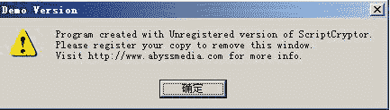  
  
  
  
以下是对 ScriptCryptor. V 2.9.7.0 的破解总结,就说详细点，好让新手看明白：  
  
先打开软件注册下，看有什么可用信息。  
  
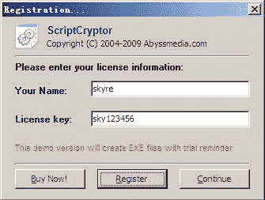  
在注册框输入用户名和注册码，按 Register，注册窗就立即关闭了，没有任何提示。再打开以下注册窗，发现刚才的注册名和 KEY 还在，如上图.可以判断是重起验证的。  
在它的目录没有发现什么可疑的文件，估计是保存在注册表的。  
  
大概了解下软件的注册机制了，接着用 PEID 查下壳是 UPX 0.89 的，这个壳不难脱，马上动手：  
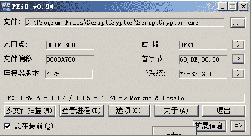  
  
载入 OD 用 ESP 定律脱  
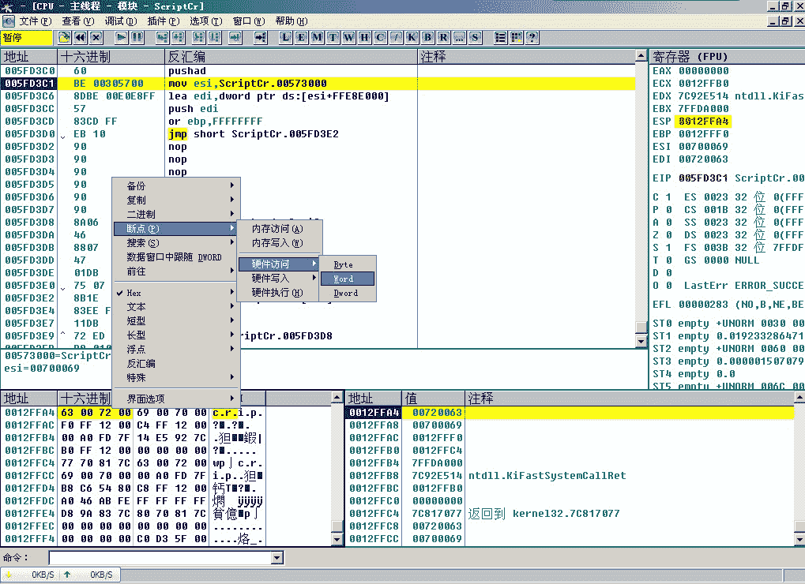  
  
下了硬件访问断点后，F9 运行，来到这里就能看到跳向 OEP 的 JMP，但这里有个回跳，在回跳下 F4，再 F8 几步到 OEP 了：  
005FD55E    8D4424 80       lea eax,dword ptr ss:\[esp-80\]  
005FD562    6A 00           push 0  
005FD564    39C4            cmp esp,eax  
005FD566  ^ 75 FA           jnz short ScriptCr.005FD562  
005FD568    83EC 80         sub esp,-80  
005FD56B  - E9 E0A7F2FF     jmp ScriptCr.00527D50  
  
OEP：  
00527D50    55              push ebp  
00527D51    8BEC            mov ebp,esp  
00527D53    83C4 F0         add esp,-10  
  
到达 OEP 后，在用 LordPE 脱壳，先纠 正一下映像大小 ，然后完整转存，保存为 dumped.exe  
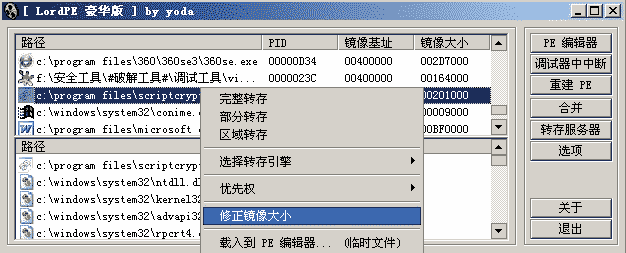  
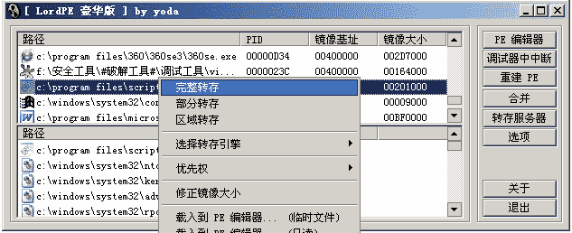  
完整转存后，就可以用 ImportREC 修复了：  
在“附加到一个活动进程”的选项框里找到 scriptcryptor.exe 的进程---再使用 OD 的脱壳插件把 OEP 的地址复制下来，填到 mportREC 的 OEP 小框上---点自动查找 IAT--获取输入表--显示无效函数（如果有无效的就剪掉）--修复转存文件---打开刚才用 LordPE 脱壳的 dumped.exe 就修复完成了。  
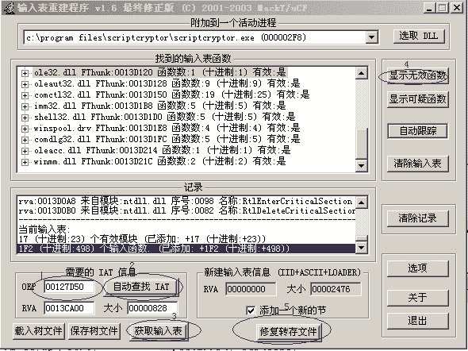  
  
再用 PEID 查下刚才已脱壳修复的，发现已经没有壳了，是用 Delphi 写的:  
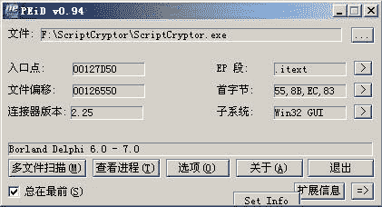  
  
用 OD 载入，OD 分析代码后，搜索字符串“Register”发现几处标为"Registered Version"（“注册版本”的意思）：  
  
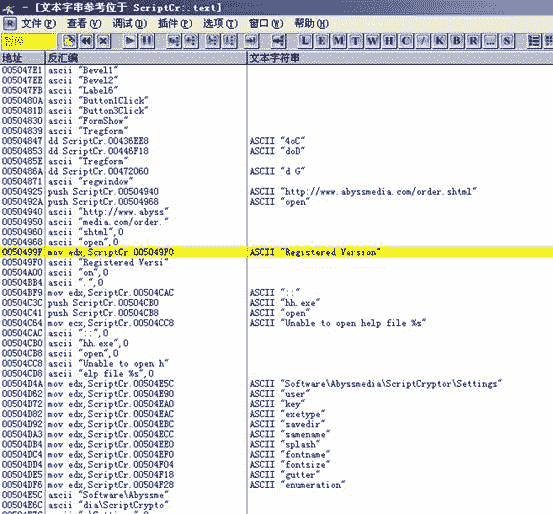  
双击第一处的"Registered Version"进去，找到段首下 F2 断点，按 Crlt+F2 重新载入程序，F9 运行起来后，点软件的菜单 Help-Register 就中断在刚才的地方了：  
  
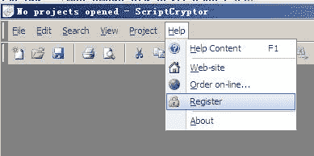  
  
中断后，跟下去会发现之前输入的用户密码出来了，这里是它的重起验证的第一个地方，找到他们的关键：  
00504983   .  E8 38E70100   call ScriptCr.005230C0                   ;  关键 CALL  
00504988   .  84C0          test al,al  
0050498A   .  74 57         je short ScriptCr.005049E3                 ;  关键跳  ：  
跳是由 al 控制的，当 al 等于 0 时就跳，原本程序是跳的，所以要把 al 不等于 0.  
  
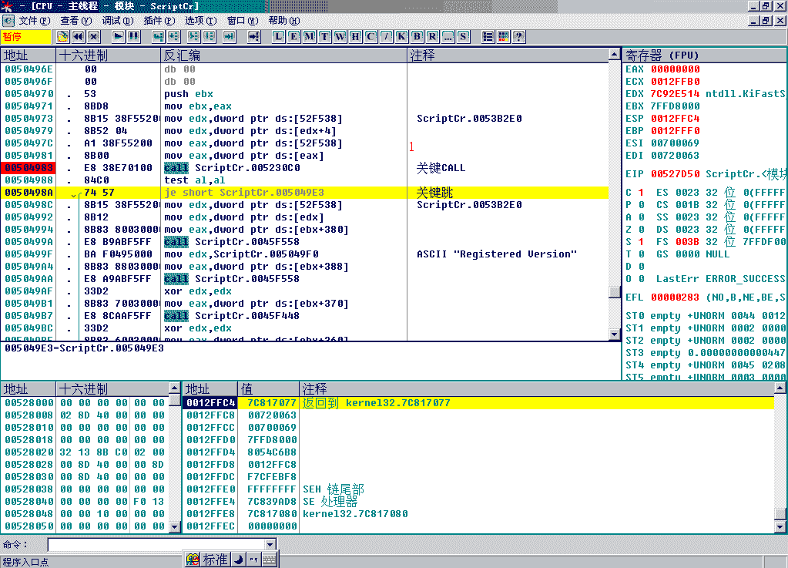  
  
我这里就直接把关键跳 NOP 掉..保存一下，然后载入保存的文件.  
  
接着搜索字符串，查找下一处字符串"Registered Version"，双击进去，可以看到 je short 00523D28 是跳过 mov edx,ScriptCr.0052406C 的，零跳转是由上面的 EAX 的底位 al 控制，而 al 的值是由 byte ptr ss:\[ebp-11\]给的，此时 byte ptr ss:\[ebp-11\]是等于 0 的，所以跳了：  
  
00523D00  |.  0FB645 EF     movzx eax,byte ptr ss:\[ebp-11\]  
00523D04  |.  84C0          test al,al  
00523D06  |.  74 20         je short ScriptCr.00523D28  
00523D08  |.  8B83 60030000 mov eax,dword ptr ds:\[ebx+360\]  
00523D0E  |.  8B80 50020000 mov eax,dword ptr ds:\[eax+250\]  
00523D14  |.  BA 01000000   mov edx,1  
00523D19  |.  E8 8AD6F6FF   call ScriptCr.004913A8  
00523D1E  |.  BA 6C405200   mov edx,ScriptCr.0052406C   ;  ASCII "Registered Version"  
00523D23  |.  E8 DCD5F6FF   call ScriptCr.00491304  
00523D28  |>  33C9          xor ecx,ecx  
  
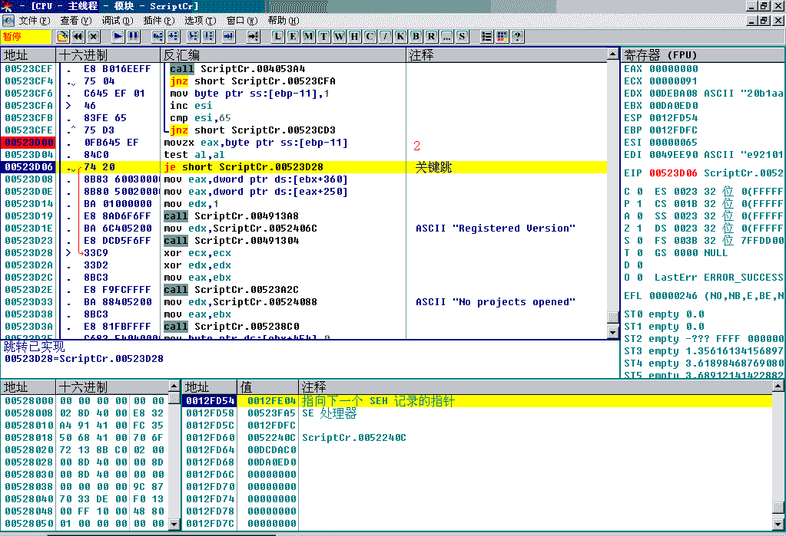  
  
直接 NOP 掉红色的那三句，然后写上 mov eax, 1   
让 eax 为 true 状态（不知有没效果呢^-^）  
  
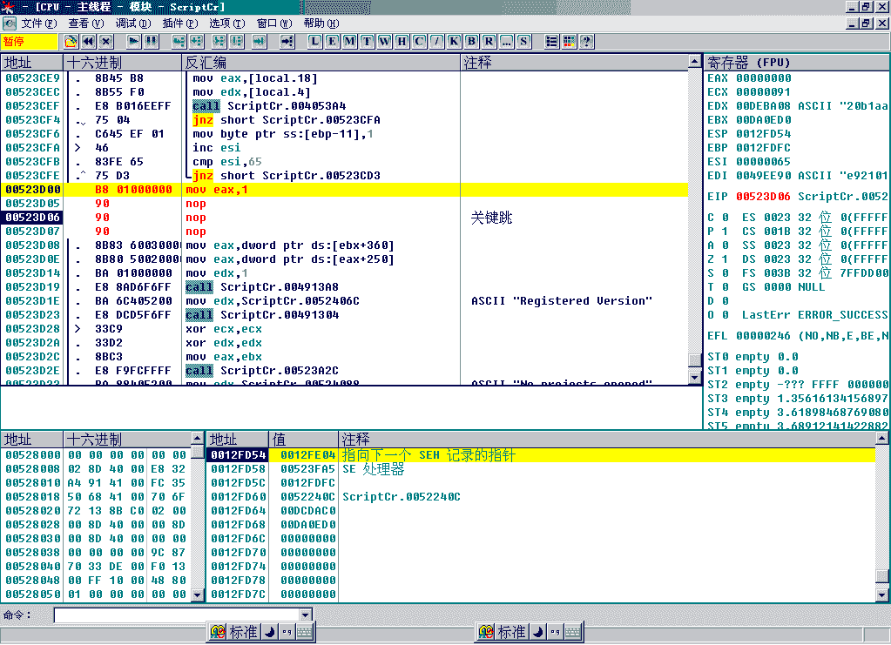  
  
\--跟踪时发现注册信息是保存在注册表的"HKCU\\Software\\Abyssmedia\\ScriptCryptor\\Settings"位置.  
修改好了，就保存下，以防一起保存不完全.  然后载入保存的文件.  
.  
接着搜索最后一处字符串"Registered Version"，会看到这里有个"Registration Successful!"（注册成功）可想到我们已经来到注册的地方了，刚才的那两处是重起验证的。  
  
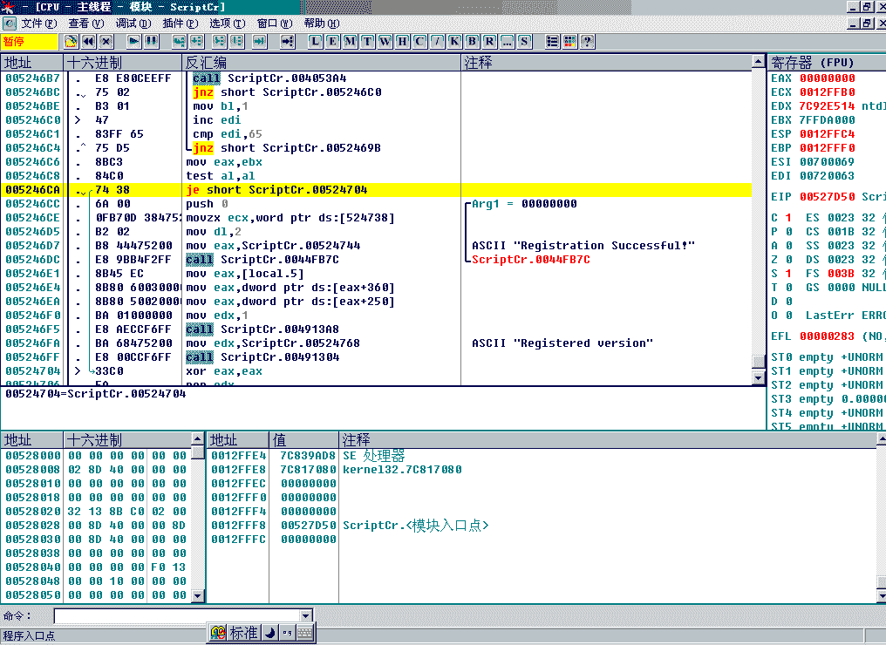  
  
这里的修改方法和上面的一样，直接 NOP 掉这三句：  
005246C6      8BC3          mov eax,ebx  
005246C8      84C0          test al,al  
005246CA      74 38         je short ScriptCr.00524704  
再填上 mov eax, 1.  
可能有的朋友会问了，直接修改这里不就可以了吗？  
答案：是不可以的，因为这个软件是重起验证的，就因为是重起验证的，我们只要通过验证，那么这个改不改也无所谓，所以这个可以不改.只改上面那两个就可以了  
  
所有都改完了，打开一看哈终于是注册版本了，真高兴：  
  
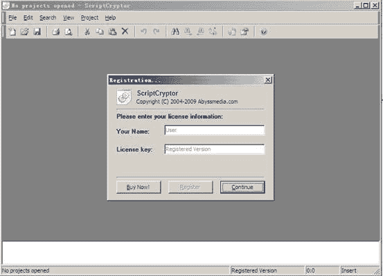  
  
生个程序看..可以生成 EXE 程序，打开这个 EXE 看看，晕了，还是有”Demo Version”提示框，.想它应该是启动就放入了一个判断值。  
那这个值会在什么时候出现用到呢？软件既然前面的都过了，但编译出的程序依然是试用版的，那么这个值应该就在编译的代码段那了。  
Delphi 写的可以用 DEDE 找它的编译（compile）按钮事件，放入到 DEDE 里，用 PE Explorer 辅助查找到编译按钮属性名称为：ProjectCompile1Execute 地址：00524398  
只能再载入 OD 里找找看了，跳到地址 00524398 ，下 F2 断点，F9 运行，打开一个 VBS 文件，点编译，就断在 00524398 了。  
然后在辛苦的 F7 进入每个 CALL 跟踪，终于找到了编译主 CALL，接下只要进这个 CALL 找提示处理的 CALL 即可：  
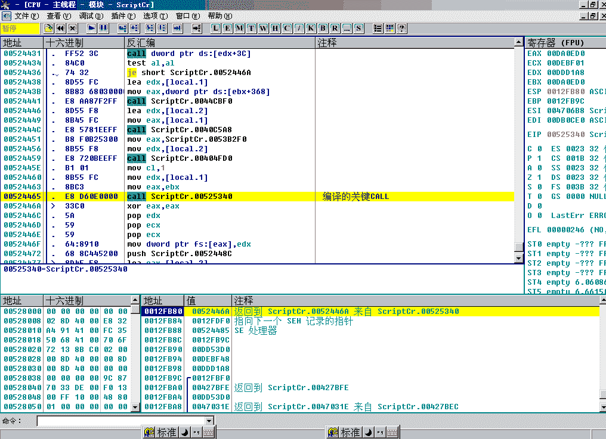  
  
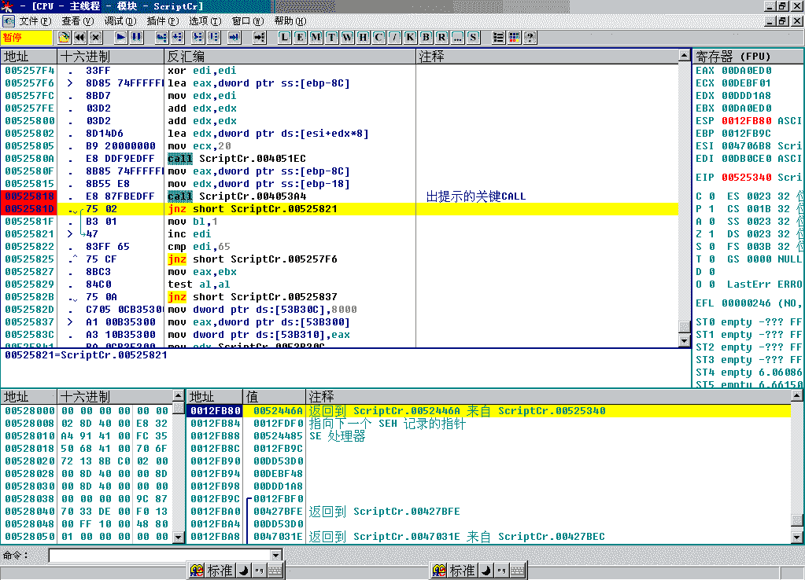  
F7 进入编译 CALL 里后，不久就找到处理提示的关键 CALL 了，是根据下面的分析得知的  
（意外的让这个 CALL 里的一个 jns 跳实现了，结果运行生成的程序是没有"Demo Version"提示的！所以肯定是这里.）：  
  
00525818   .  E8 87FBEDFF   call ScriptCr.004053A4       ;  处理提示的关键 CALL  
0052581D   .  75 02         jnz short ScriptCr.00525821  
\--------------------------------------------------------------------------------------------  
这个“处理提示的 CALL”可以分析下，但也可以不理哈：  
F7 进入关键发现果然了前面提到的关键值，实际是个内存值（dword ptr ds:\[eax-4\]），使用这个值 mov 给 ecx，再跳到逻辑运行代码，然后下面用一个 jns（非负数转移指令）来判断 ECX 的值是不是负数，负数的就不跳，如果正数就跳回已注册，但跟踪这个内存值发现是 ebx 动态放入的，进去研究了 2 个小时的算法- -~（看不懂）汗，很多办法用上了都不行，提示错误.  
还是回来看看这个 CALL 的关键部分好了：  
004053BA  |.  53            push ebx  
004053BB  |.  83D1 FF       adc ecx,-1  
004053BE  |.  21D9          and ecx,ebx        \\\\与运行，ecx 等于 0  
004053C0  |.  2B48 FC       sub ecx,dword ptr ds:\[eax-4\]     \\\\ds:\[eax-4\]此时等于十六进制的 20，相减后等于负数 FFFFFFE0（-32）  
004053C3  |.  29C8          sub eax,ecx  
004053C5  |.  29CA          sub edx,ecx  
004053C7  |>  8B1C01        /mov ebx,dword ptr ds:\[ecx+eax\]  
004053CA  |.  331C11        |xor ebx,dword ptr ds:\[ecx+edx\]  
004053CD  |.  75 0A         |jnz short ScriptCr.004053D9     \\\\跳了  
004053CF  |.  83C1 04       |add ecx,4  
004053D2  |.^ 78 F3         \\js short ScriptCr.004053C7  
004053D4  |>  58            pop eax  
004053D5  |.  01C0          add eax,eax  
004053D7  |.  5B            pop ebx  
004053D8  |>  C3            retn  
004053D9  |>  0FBCDB        bsf ebx,ebx                 \\\\跳到这 什么指令?  
004053DC  |.  C1EB 03       shr ebx,3                        \\\\08 逻辑右移三位等于 1  
004053DF  |.  01D9          add ecx,ebx                         \\\\ECX 加 1，还是等于负数  
004053E1  |.^ 79 F1         jns short ScriptCr.004053D4   \\\\关键跳，但没有跳回去，下面 retn 是去到非注册的，这里不能改，改了会出错.  
004053E3  |.  8A0401        mov al,byte ptr ds:\[ecx+eax\]  
004053E6  |.  3A0411        cmp al,byte ptr ds:\[ecx+edx\]  
004053E9  |.  5B            pop ebx  
004053EA  |.  5B            pop ebx  
004053EB  |.  C3            retn  
既然这里是编译部分的判断注册关键 ，那我们 NOP 掉这个处理提示的关键 CALL 和 CALL 下面的 jnz 跳，不让他调用不就可以了吗？  
\------------------------------------------------------------------------------------------------------  
  
.. 结果直接 NOP 掉这两句，保存就可以了 ，最终还是 NOP 好使 呵呵！  
  
  
已经没有"Demo Version"的提示框了：  
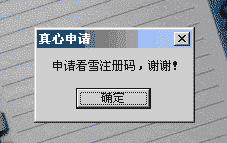