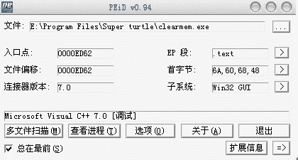
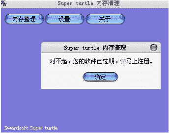
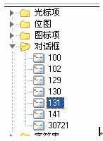
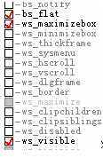
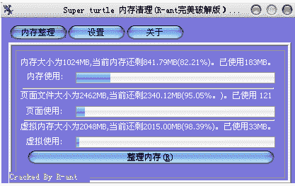
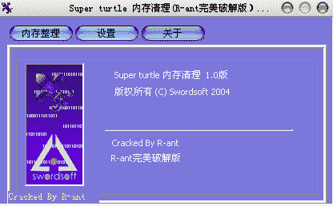

# 一个软件的破解思路+过程比较简单，大神绕路。。

> 原文：[`www.pediy.com/kssd/pediy11/119709.html`](https://www.pediy.com/kssd/pediy11/119709.html)

标题：一个小内存整理软件的破解  
目标：SUPER TURTLE 内存清理  
作者：R-ant（红蚂蚁）  
工具：OD，PEID, PE explorer  
时间：2010/9/1  
下载地址：thunder://QUFodHRwOi8vNjEuMTYzLjkyLjE2Nzo4Mi9kb3duL3N1cGVydHVydGxlU2V0dXAucmFyWlo=  
   
做破解，本人认为最重要的是一个思路，思路有了，破解起来自然也比较轻松，怎么才能有思路呢？首先呢要观察你所要破解的目标，找到他的注册机制等。。。  
就拿今天的目标软件来说吧！这个软件呢注册时有提示错误，可以按照这个来找出真正注册码。。但是根据其中的字符串可知它是有重启验证的。。那么它肯定在软件运行之前会从一个地方读取注册信息。。如果匹配则正常运行，如果不匹配则是试用版。。。另外这个软件最致命的一个地方是它是一个有着 30 次试用的，完全可以断定在软件运行之前，它是从计算机某个位置读取已使用次数，从而进行判断是否软件已经过期。。这个地方要么是一个.ini  
文件，要么是注册表，那么我们就可以下相应的 API 断点来看它是从哪个地方读取的，从而得出他的计算方法来加以修改。。从而达到无限次使用的目的啦。。。。这就是这个软件的破解思路，当然破解这个软件还有其他几个思路，本文呢就从这个思路入手吧。。。  
1.首先 PEi    D 查壳  
   
可以看到并没有加壳，Microsoft Visual C++ 7.0 \[调试\]写的，这对我们破解带来了很大的方便，不像有的加穿山甲，ASProtect 等强壳，哈哈，继续。。。。  
2.OD 载入  
停在了入口点  
0040ED62 > 6A 60 push 60  
0040ED64 68 48BF4200 push clearmem.0042BF48  
0040ED69 E8 9A2B0000 call clearmem.00411908  
0040ED6E BF 94000000 mov edi,94  
0040ED73 8BC7 mov eax,edi  
0040ED75 E8 46FFFFFF call clearmem.0040ECC0  
0040ED7A 8965 E8 mov dword ptr ss:\[ebp-18\],esp  
0040ED7D 8BF4 mov esi,esp  
0040ED7F 893E mov dword ptr ds:\[esi\],edi  
0040ED81 56 push esi  
   
因为我们思路是他可能是从注册表读取相关的使用次数信息。。。所以下 bp RegOpenKeyExA 断点。断点下好后，F9 运行，注意堆栈窗口哦。。。那里有我们想要的信息。。  
第一次 F9，中断在  
77DA7852 > 8BFF mov edi,edi  
77DA7854 55 push ebp  
77DA7855 8BEC mov ebp,esp  
77DA7857 83EC 0C sub esp,0C  
77DA785A 8365 FC 00 and dword ptr ss:\[ebp-4\],0  
77DA785E 53 push ebx  
   
堆栈窗口中显示：  
0012FE48 00423E14 /CALL 到 RegOpenKeyExA 来自 clearmem.00423E0E  
0012FE4C 80000001 |hKey = HKEY\_CURRENT\_USER  
0012FE50 0042ABC4 |Subkey = "Software\\Microsoft\\Windows\\CurrentVersion\\Policies\\Explorer"  
0012FE54 00000000 |Reserved = 0  
0012FE58 00000001 |Access = KEY\_QUERY\_VALUE  
0012FE5C 0012FE7C \\pHandle = 0012FE7C  
这里读取的是"Software\\Microsoft\\Windows\\CurrentVersion\\Policies\\Explorer"注册表，这显然不是我们想要的。。。  
继续 F9 运行，由于字数问题，我不把每次中断的地方都贴出来啦。。  
大概 22 次 F9 之后中断在  
77DA7852 > 8BFF mov edi,edi ; kernel32.GetProfileStringA  
77DA7854 55 push ebp  
77DA7855 8BEC mov ebp,esp  
77DA7857 83EC 0C sub esp,0C  
77DA785A 8365 FC 00 and dword ptr ss:\[ebp-4\],0  
77DA785E 53 push ebx  
堆栈中信息是  
0012EFE4 77DAEFF6 /CALL 到 RegOpenKeyExA 来自 ADVAPI32.77DAEFF1  
0012EFE8 80000002 |hKey = HKEY\_LOCAL\_MACHINE  
0012EFEC 004288AC |Subkey = "SOFTWARE"  
0012EFF0 00000000 |Reserved = 0  
0012EFF4 02000000 |Access = 2000000  
0012EFF8 0012F03C \\pHandle = 0012F03C  
0012EFFC 009752D8 ASCII "11111111111111111"  
这里就是我们想要的的注册表信息啦。。。（至于 0012EFFC 处的很多 1 是那我在试注册时的假码，这里不需要太去关注）  
我们打开这里显示的注册表看下。。。HKEY\_LOCAL\_MACHINE\\SOFTWARE 就是这个位置。。而其中的 DiskNum 键值就是保存使用次数的啦。。。我们把他改成 0，再运行 SUPER TURTLE 发现使用次数只有 1 次啦。。  
我们再把键值改成大于 1E 的值，1E 就是 30 的十六进制表示法。。。因为它是试用 30 次的。  
改好之后我们再运行发现它要我们注册了  
   
OK。。这说明我们找对注册表位置了。。。把注册表那个键值改回 0  
再来 OD 载入。。  
跟上面下断一样。。。到  
77DA7852 > 8BFF mov edi,edi ; kernel32.GetProfileStringA  
77DA7854 55 push ebp  
77DA7855 8BEC mov ebp,esp  
77DA7857 83EC 0C sub esp,0C  
77DA785A 8365 FC 00 and dword ptr ss:\[ebp-4\],0  
77DA785E 53 push ebx  
再来 F8 单步。。看下。。  
77DA7852 > 8BFF mov edi,edi  
77DA7854 55 push ebp  
77DA7855 8BEC mov ebp,esp  
77DA7857 83EC 0C sub esp,0C  
77DA785A 8365 FC 00 and dword ptr ss:\[ebp-4\],0  
77DA785E 53 push ebx ; 将我们的假码压入堆栈，假码是从一个文件中读取的，下 bp CreateFileA 或 bp GetPrivateProfileStringA 会断到是从哪读取的。。。这里就不深入了  
77DA785F 56 push esi  
77DA7860 8B75 08 mov esi,dword ptr ss:\[ebp+8\]  
继续往下单步是判断我们的假码是不是和真码相同，如果相同则是注册版本，如果不同则是试用版。。试用版就会从注册表读取试用次数啦。。继续 F8 单步走。。。下面的很多过程我就不贴了，那不是我们的主角  
单步到这里  
77DA793A 5F pop edi  
77DA793B 5E pop esi  
77DA793C 5B pop ebx  
77DA793D C9 leave  
77DA793E C2 1400 retn 14  
retn 14 运行到这之后就返回到  
77DAEFF6 5D pop ebp ; 009752D8  
77DAEFF7 C2 0C00 retn 0C  
再单步 2 次，返回到  
004023AF 8D4C24 30 lea ecx,dword ptr ss:\[esp+30\]  
004023B3 51 push ecx  
这里就是主程序啦。。下面就要注意啦。。  
004023C1 50 push eax  
004023C2 6A 00 push 0  
004023C4 68 A4884200 push clearmem.004288A4 ; ASCII "DiskNum"  
004023C9 51 push ecx  
004023CA FF15 00804200 call dword ptr ds:\[<&ADVAPI32.RegQueryVa>; 这里就是开始从注册表的那个键值读取试用信息啦、  
004023D0 8B4424 10 mov eax,dword ptr ss:\[esp+10\] ; 将读来的已试用次数放到 EAX 寄存器  
004023D4 40 inc eax ; 因为软件运行了，所以这里试用次数就+1。。  
004023D5 83F8 1E cmp eax,1E ; 这里是与已使用的次数与 30 次比较。。  
004023D8 894424 10 mov dword ptr ss:\[esp+10\],eax  
004023DC 0F8E FB000000 jle clearmem.004024DD ; 如果比较结果小于 30 次，则跳走，跳到软件运行  
我们让它跳走。。。跳到了这里  
004024DD E8 EAC40100 call clearmem.0041E9CC  
004024E2 8B10 mov edx,dword ptr ds:\[eax\]  
004024E4 8BC8 mov ecx,eax  
004024E6 FF52 0C call dword ptr ds:\[edx+C\]  
004024E9 83C0 10 add eax,10  
如果不跳。。。就会提示你使用次数已满，需要你注册。。。  
关键位置我们找到了，其实到这里我脑子里已经有 N 种破解思路了，在这里是完全可以把真正注册码找出来的，但是那不是我的目的加上本人比较懒。。哈哈。。没去研究。。还是按着原来的思路来。。。有兴趣的兄弟自己去研究分享吧。。  
刚才有个非常关键的地方，就是  
004023D4 40 inc eax 这里是将你的试用次数+1，那我们将它 NOP 掉，它不就不加了嘛。。。呵呵。。就那么简单。。我们将它 nop 掉。。保存。。运行软件，发现试用次数已经不变了，当然也可以改 004023D5 83F8 1E cmp eax,1E 这里，本人认为改了等于没改。。。还是不管你允许试用次数有多大，但还是是有限制的，不爽。。  
当我们运行软件时，发现虽然次数不变了，但是标题栏的试用信息和“关于”里的信息让我们很不爽的啦。。  
没关系，这里就用到 pexplorer 这个资源管理工具了。。。将我们的修改过的程序载入到 PE explorer。。  
打开对话框。。。发现很多。。其中 102 和 131 是我们要修改的。。  
   
先看 131 吧，双击 131。。进入编辑模式。。  
把注册给: Unregistered user  
注册类型:30 次试用版改成  
Crack By R-ant  
R-ant 完美破解版  
把马上注册那个按钮改成不可见。。  
  
将图中左边的 WS-visible 前面的勾去掉就好啦。。  
在版权所有下面有个邮箱地址的，把那个也设置成不可见， 和上面方法一样  
   
确定。。。  
再双击 102，进入编辑模式。。  
我发现其中标题栏并没有试用信息，那应该是软件运行时加上去的，说过啦。。本人比较懒。。没有再去找是从哪里加进去的。。所以决定还是从这里修改。。多加几个字就可以把使用信息掩盖啦。。因为标题栏本来就那么大点地方放不开那么多字的嘛。。呵呵   
我改的方法是将标题栏那些字前面加几个空格，在后面加（R-ant 破解版），根据自己的情况修改吧。。。呵呵。。不贴图了。。还有一些地方根据自己的喜好修改吧。。  
我把我修改好的贴出来  
   
   
可以下载 DOC 文档看破解.doc  
呵呵，还算完美吧。。。希望有不对的地方，各位高手指点哈。。。  
最后希望能够获得看雪学院的一个邀请码。。来进一步学习交流，呵呵，如果各位感觉写的不好，那我就继续努力吧。。呵呵