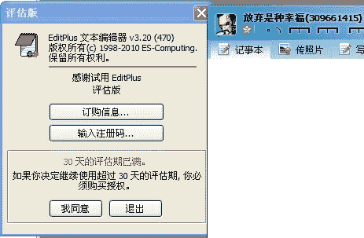
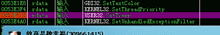
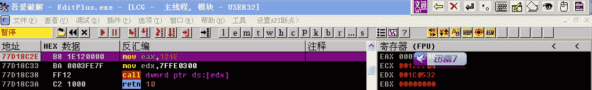
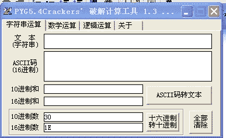
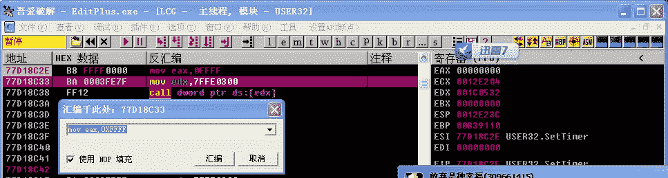
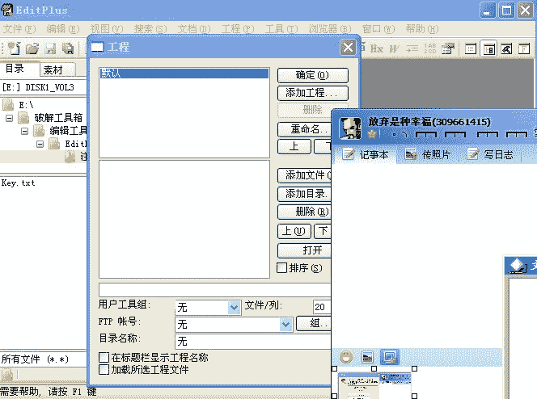
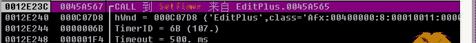
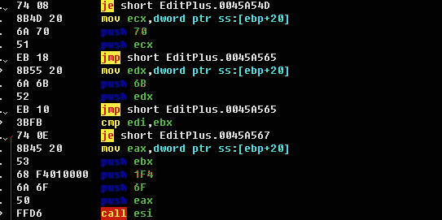
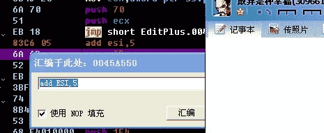

# EditPlus 另类破解

> 原文：[`www.pediy.com/kssd/pediy12/141294.html`](https://www.pediy.com/kssd/pediy12/141294.html)

由于需要 EditPlus 来编写一些东东，就下载了这个软件。虽然网上有好的注册码和破解版的软件。  
呵呵~~好久没有玩破解软件了。就想自已来破解看看~~~~~~~，找注册码的算法要的时间太长了~  
因为软件只有 30 天的试用我们把时间调一下在运行下软件看看~一运行就直接出现了  
  
没有哪么多的时间！于是就想到了爆破~~~~~~。爆破点选择是注册码还时间呢，我晕打开 OD 看看吧~  
看有什么好的信息~~  
  
SetTimer 这个 API 有什么用呢百度一下就可以知道了我们下个断点吧！！！！！！按 F9 就来到了  
  
看看   

代码:

```
mov eax,121E

```

哪 AL ＝＝ 1E  
打开计算器看看 1E 是 10 进制的多少  
  
喔 是 30 啊！！！！！！！！！！！！呵呵在想想我们我软件试用多少天啊，好像是 30 天喔   
哪我们改改看改成试试  
  
F9 运行看看发现可以用了  
  
呵呵有的朋友就会想哪保存一下吧~~  
可是这个动态链接库中不修改数据  
  
我们反汇编跟随一下看看来到  
  
ESI 中保存的就 SetTimer 这个 API  
我们在来看看  
  
我就想可不可以跳过  
mov eax,0X121E   不执行它呢  
我发现如果 ESI+5.我们 CALL ESI 时它就跳过了  
mov eax,0X121E  
直接从 mov edx,7FFE0300   
F9 一下哈哈竞然 OK 了  
哪我们就来 PATH 一下吧  
  
F9 运行一下 OK 没有问题就保存一份吧~~~~~~~~~~~~  
打玩收功吧~~~~~~~~~~~~~~~~