# MP3 音频录音机 v5.10 脱壳

> 原文：[`www.pediy.com/kssd/pediy12/sdp2.html`](https://www.pediy.com/kssd/pediy12/sdp2.html)

不清楚这个 SDP 究竟是什么版本,总之不是以前碰过的那个 J。用的是修改版的 OllyDbg 110,OllyScript 0.92。

 

**1\. ****测试**

 

事先已经知道是用 SDP 做的,想看看是否为双进程版本。直接运行,用 LoadPE 只看见一个进程。用 OD 加载,因为 Single Step Event 停在这里:

 

\[if gte vml 1\]><v:shapetype id="\_x0000\_t75" coordsize="21600,21600" o:spt="75" o:preferrelative="t" path="m@4@5l@4@11@9@11@9@5xe" filled="f" stroked="f"> <v:stroke joinstyle="miter"/> <v:formulas> <v:f eqn="if lineDrawn pixelLineWidth 0"/> <v:f eqn="sum @0 1 0"/> <v:f eqn="sum 0 0 @1"/> <v:f eqn="prod @2 1 2"/> <v:f eqn="prod @3 21600 pixelWidth"/> <v:f eqn="prod @3 21600 pixelHeight"/> <v:f eqn="sum @0 0 1"/> <v:f eqn="prod @6 1 2"/> <v:f eqn="prod @7 21600 pixelWidth"/> <v:f eqn="sum @8 21600 0"/> <v:f eqn="prod @7 21600 pixelHeight"/> <v:f eqn="sum @10 21600 0"/> </v:formulas> <v:path o:extrusionok="f" gradientshapeok="t" o:connecttype="rect"/> <o:lock v:ext="edit" aspectratio="t"/> </v:shapetype><v:shape id="\_x0000\_i1025" type="#\_x0000\_t75" style='width:404.25pt; height:181.5pt'> <v:imagedata src="sdp2.files/image001.jpg" o:title="1"/> </v:shape><!\[endif\]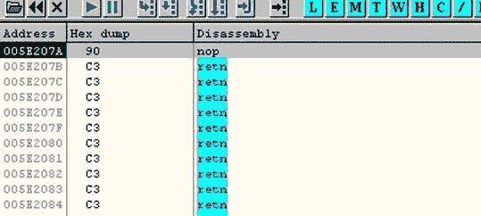

 

在 IDA 中的 EP 是 5E2000,而且不象 ExeCryptor,没有 TLS Callback Function。修改 OD 设置:

  
\[if gte vml 1\]><v:shape id="\_x0000\_i1026" type="#\_x0000\_t75" style='width:261pt; height:107.25pt'> <v:imagedata src="sdp2.files/image003.jpg" o:title="1"/> </v:shape><!\[endif\]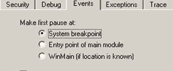

 

停在 ntdll 中。再对 5E2000 下断,可以停下。清除该断点,不忽略所有异常,用 IsDebuggerPresent 隐藏 OD,F9 运行。

 

\[if gte vml 1\]><v:shape id="\_x0000\_i1027" type="#\_x0000\_t75" style='width:261pt;height:144.75pt'> <v:imagedata src="sdp2.files/image005.jpg" o:title="1"/> </v:shape><!\[endif\]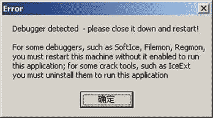

直接运行,用 WinHex 搜索,用什么版本保护的?文件头中的标记:

 

\[if gte vml 1\]><v:shape id="\_x0000\_i1028" type="#\_x0000\_t75" style='width:481.5pt;height:60pt'> <v:imagedata src="sdp2.files/image007.jpg" o:title="1"/> </v:shape><!\[endif\]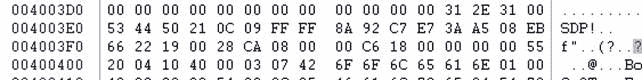

 

提示信息:

\[if gte vml 1\]><v:shape id="\_x0000\_i1029" type="#\_x0000\_t75" style='width:261pt;height:236.25pt'> <v:imagedata src="sdp2.files/image009.jpg" o:title="1"/> </v:shape><!\[endif\]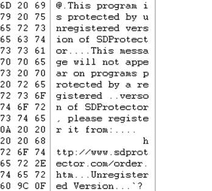

 

不会是破解版本吧,或许注册版本也有这个?  
  

写个简单的 OllyScript,记录异常次数。之所以用 script 而不是直接用手按,是因为 SDP 对运行时间的检测很严 J。  
\[if gte vml 1\]><v:shape id="\_x0000\_i1030" type="#\_x0000\_t75" style='width:375.75pt; height:369.75pt'> <v:imagedata src="sdp2.files/image011.jpg" o:title="1"/> </v:shape><!\[endif\]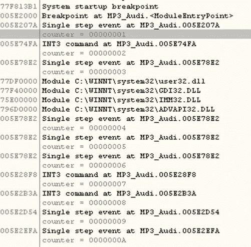

 

可以看到,10 次 shift-F9 后报 debugger detected。

 

 

**2\. debugger****检测**

 

10 次 shift-F9 后,这里异常:  
\[if gte vml 1\]><v:shape id="\_x0000\_i1031" type="#\_x0000\_t75" style='width:387pt; height:26.25pt'> <v:imagedata src="sdp2.files/image013.jpg" o:title="1"/> </v:shape><!\[endif\]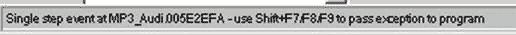

 

用 script 走到 5E2EFA,这个异常的 handler 没有改变 context 中的 eip,从 SEH handler 中返回异常地址继续执行。dump 解出的代码,去掉 Junk codeJ。

 

跟第 10 次异常后的代码,唯一的一次判断在这里(不跳,往下执行即显示 debugger detected):

 

\[if gte vml 1\]><v:shape id="\_x0000\_i1032" type="#\_x0000\_t75" style='width:481.5pt;height:214.5pt'> <v:imagedata src="sdp2.files/image015.jpg" o:title="1"/> </v:shape><!\[endif\]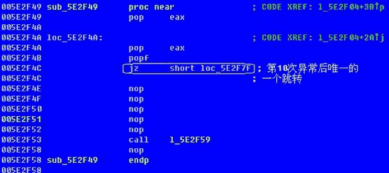

 

修改 script,在这里 jmp 到 5E2F7F。程序继续运行了。下面又是一次异常,  
  

\[if gte vml 1\]><v:shape id="\_x0000\_i1033" type="#\_x0000\_t75" style='width:368.25pt;height:27pt'> <v:imagedata src="sdp2.files/image017.jpg" o:title="1"/> </v:shape><!\[endif\]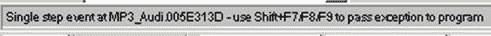

 

这里如果 shift-F9,原来的进程结束了。新启动一个进程继续运行。

 

 

**3\. ****进程逃逸**

 

从上面这个异常(5E313D)的 handler 开始跟。有个问题:在 debugger 下运行有时会失败,不能启动子进程。一旦失败一次,就再也不能正常运行起来了。不知道是不是程序做了什么手脚。在我的 W2K SP4 和 WinXP Pro 下都如此。

 

\[if gte vml 1\]><v:shape id="\_x0000\_i1034" type="#\_x0000\_t75" style='width:481.5pt;height:158.25pt'> <v:imagedata src="sdp2.files/image019.jpg" o:title="1"/> </v:shape><!\[endif\]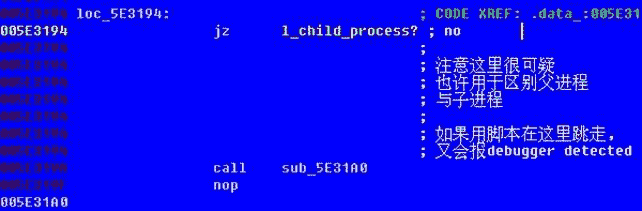

 

这是创建新进程的代码:  
  

\[if gte vml 1\]><v:shape id="\_x0000\_i1035" type="#\_x0000\_t75" style='width:342pt;height:192pt'> <v:imagedata src="sdp2.files/image021.jpg" o:title="1"/> </v:shape><!\[endif\]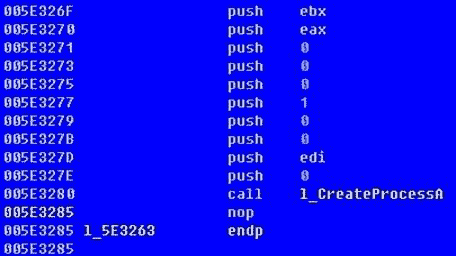

 

创建进程时的参数:  
  

\[if gte vml 1\]><v:shape id="\_x0000\_i1036" type="#\_x0000\_t75" style='width:481.5pt;height:124.5pt'> <v:imagedata src="sdp2.files/image023.jpg" o:title="1"/> </v:shape><!\[endif\]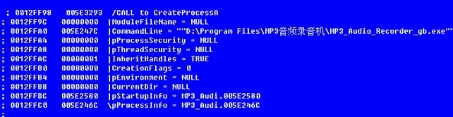

 

父进程和子进程使用同一个 EXE 文件,参数也没有任何特殊之处。

执行 CreateProcessA 后的返回地址。

 

\[if gte vml 1\]><v:shape id="\_x0000\_i1037" type="#\_x0000\_t75" style='width:315pt;height:180.75pt'> <v:imagedata src="sdp2.files/image025.jpg" o:title="1"/> </v:shape><!\[endif\]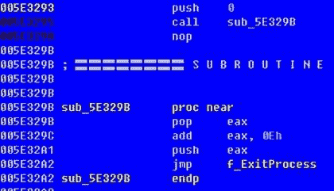

 

创建新进程之后,父进程立即就退出了,子进程独立运行。显然,这里并不象 Armadillo 的 Nanaomites 那样让人头疼 J 。创建新进程的唯一目的就是摆脱 debugger。

 

为什么新的进程不能运行了?注意在调用 CreateProcess 时传递的 StartInfo 结构没有正确填入数据。

\[if gte vml 1\]><v:shape id="\_x0000\_i1038" type="#\_x0000\_t75" style='width:481.5pt;height:93.75pt'> <v:imagedata src="sdp2.files/image027.jpg" o:title="1"/> </v:shape><!\[endif\]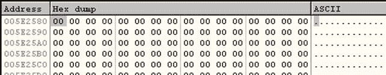

 

全部为 0。是否程序发现正在被调试,设置了某些标记? 试试手动填入 cb 等数据,仍然不行。从任务管理器的显示看,似乎这个新创建的进程仍然在把自己当父进程运行, 大概是某些用于同步的内核对象出了问题。

 

既然子进程完全独立运行,可以甩开上面的问题,直接使程序以子进程方式运行,继续调试。

 

 

**4\. ****分离子进程**

 

用 OllyScript 在上面的 5E3194 处 jmp,强制以子进程方式运行。记录异常和中断。

 

\[if gte vml 1\]><v:shape id="\_x0000\_i1039" type="#\_x0000\_t75" style='width:405pt;height:401.25pt'> <v:imagedata src="sdp2.files/image029.jpg" o:title="1"/> </v:shape><!\[endif\]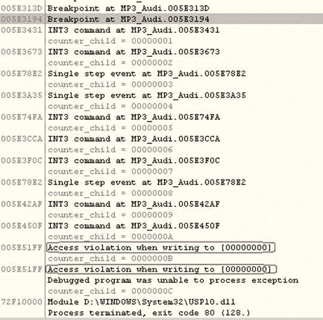

 

也是 10 次,后面的 2 个记录是异常。程序直接退出了,弄错了? 从 log 看,判断应该是正确的。跟一下。

\[if gte vml 1\]><v:shape id="\_x0000\_i1040" type="#\_x0000\_t75" style='width:216.75pt;height:24.75pt'> <v:imagedata src="sdp2.files/image031.jpg" o:title="1"/> </v:shape><!\[endif\]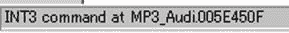

 

从 handler 5E4590 跟起。到这里,出现 log 中的第 1 个内存访问异常。

 

\[if gte vml 1\]><v:shape id="\_x0000\_i1041" type="#\_x0000\_t75" style='width:414pt;height:169.5pt'> <v:imagedata src="sdp2.files/image033.jpg" o:title="1"/> </v:shape><!\[endif\]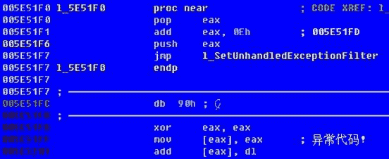

 

\[if gte vml 1\]><v:shape id="\_x0000\_i1042" type="#\_x0000\_t75" style='width:480pt;height:96.75pt'> <v:imagedata src="sdp2.files/image035.jpg" o:title="1"/> </v:shape><!\[endif\]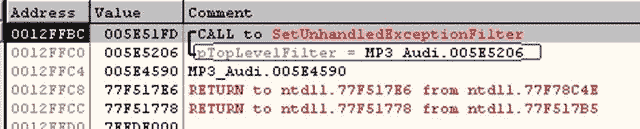

 

这个异常被 OllyDbg 处理了。用插件避开这个 anti-debug 技巧。

\[if gte vml 1\]><v:shapetype id="\_x0000\_t202" coordsize="21600,21600" o:spt="202" path="m,l,21600r21600,l21600,xe"> <v:stroke joinstyle="miter"/> <v:path gradientshapeok="t" o:connecttype="rect"/> </v:shapetype><v:shape id="\_x0000\_s1026" type="#\_x0000\_t202" style='position:absolute; left:0;text-align:left;margin-left:0;margin-top:7.95pt;width:477pt;height:218.4pt; z-index:1' fillcolor="#cfc"> <v:fill opacity=".5"/> <v:textbox> <!\[if !mso\]> <table cellpadding=0 cellspacing=0 width="100%"> <tr> <td><!\[endif\]> 
 
THEORY:<o:p></o:p>
 
<o:p>&nbsp;</o:p>
 
When&nbsp; exception happens, Win2K/XP gives control to NTDLL!KiUserExceptionFilter,<o:p></o:p>
 
which&nbsp; in turn calls KERNEL32!UnhandledExceptionFilter. This function checks if<o:p></o:p>
 
faulty&nbsp; software&nbsp; is&nbsp; being&nbsp; debugged.&nbsp; If&nbsp; not, UnhandledExceptionFilter calls<o:p></o:p>
 
softwares' exception handler.<o:p></o:p>
 
<o:p>&nbsp;</o:p>
 
SOLUTION:<o:p></o:p>
 
&nbsp;<o:p></o:p>
 
Patch&nbsp; KERNEL32!UnhandledExceptionFilter&nbsp; so that softwares' exception handler<o:p></o:p>
 
is&nbsp; always&nbsp; called.&nbsp; Used&nbsp; signatures&nbsp; work&nbsp; for both Win2K SP4/WinXP SP1, and<o:p></o:p>
 
hopefully for all other versions.
 
 <!\[if !mso\]></td> </tr> </table> <!\[endif\]></v:textbox> </v:shape><!\[endif\] 

 

 

 

 

 

 

 

 

 

 

 

 

 

 

 

  

在 OllyDbg 中停在系统断点时就运行 UnhandledExeptionFilter 插件。仍然用前面的 script 记录。这次程序正常运行了。

 

\[if gte vml 1\]><v:shape id="\_x0000\_i1043" type="#\_x0000\_t75" style='width:282pt;height:116.25pt'> <v:imagedata src="sdp2.files/image038.jpg" o:title="1"/> </v:shape><!\[endif\]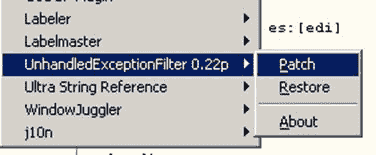

 

\[if gte vml 1\]><v:shape id="\_x0000\_i1044" type="#\_x0000\_t75" style='width:359.25pt;height:78.75pt'> <v:imagedata src="sdp2.files/image040.jpg" o:title="1"/> </v:shape><!\[endif\]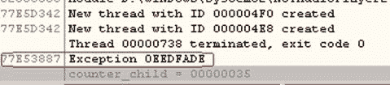

 

这次记录为 0x35。注意异常地址并不在壳代码空间(因为程序在开始运行时总有一个数组越界错误,脱壳后倒好了 J),后面的可能是控件抛出的。

 

这是壳代码执行的最后一个异常,计数为 0x2E。

\[if gte vml 1\]><v:shape id="\_x0000\_i1045" type="#\_x0000\_t75" style='width:351pt;height:126pt'> <v:imagedata src="sdp2.files/image042.jpg" o:title="1"/> </v:shape><!\[endif\]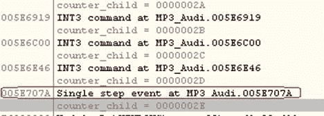

 

另外,注意这里:  
  

\[if gte vml 1\]><v:shape id="\_x0000\_i1046" type="#\_x0000\_t75" style='width:368.25pt;height:116.25pt'> <v:imagedata src="sdp2.files/image044.jpg" o:title="1"/> </v:shape><!\[endif\]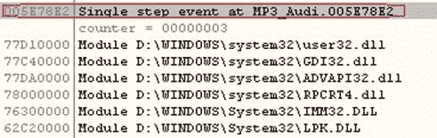

 

5E78E2 这个地址在 log 中反复出现,后面往往有 Module 载入。这里是处理 IAT 的地方?

 

 

**5\. ****寻找****OEP**

 

用 Script 停在上面记录的壳代码最后一个异常处(5E707A)。handler 结束后回到异常处继续。

F7 单步几次就到 OEP 了。

 

\[if gte vml 1\]><v:shape id="\_x0000\_i1047" type="#\_x0000\_t75" style='width:468pt;height:132pt'> <v:imagedata src="sdp2.files/image046.jpg" o:title="1"/> </v:shape><!\[endif\]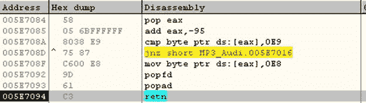

 

ret 到这里。

 

\[if gte vml 1\]><v:shape id="\_x0000\_i1048" type="#\_x0000\_t75" style='width:481.5pt;height:174pt'> <v:imagedata src="sdp2.files/image048.jpg" o:title="1"/> </v:shape><!\[endif\]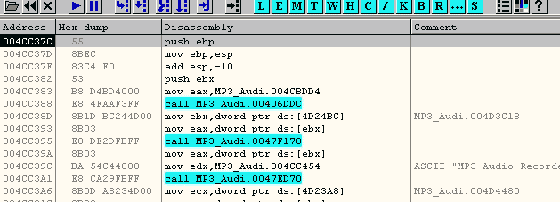

 

没有 stolen code?不会吧。可能找错了。先 dump 出来再说。用 OllyDump。

 

\[if gte vml 1\]><v:shape id="\_x0000\_i1049" type="#\_x0000\_t75" style='width:324pt;height:100.5pt'> <v:imagedata src="sdp2.files/image049.jpg" o:title="1"/> </v:shape><!\[endif\]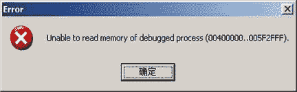

 

anti-dumpJ。直接在 OllyDbg 中修改每个 section 的内存块属性。

 

\[if gte vml 1\]><v:shape id="\_x0000\_i1050" type="#\_x0000\_t75" style='width:481.5pt;height:215.25pt'> <v:imagedata src="sdp2.files/image051.jpg" o:title="1"/> </v:shape><!\[endif\]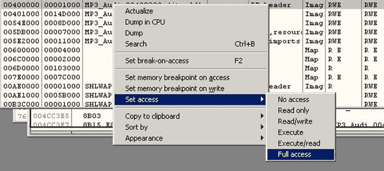

 

这次可以了。

 

\[if gte vml 1\]><v:shape id="\_x0000\_i1051" type="#\_x0000\_t75" style='width:368.25pt;height:290.25pt'> <v:imagedata src="sdp2.files/image053.jpg" o:title="1"/> </v:shape><!\[endif\]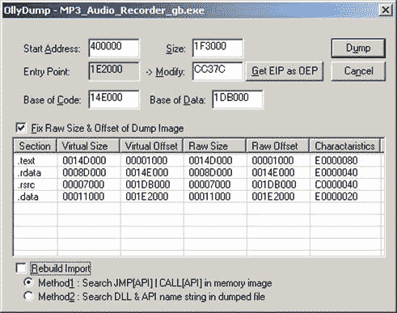

用资源编辑器看看,是 Delphi/BCB 程序。用 IDA 反编译一下 dumped.exe。

 

\[if gte vml 1\]><v:shape id="\_x0000\_i1052" type="#\_x0000\_t75" style='width:481.5pt;height:157.5pt'> <v:imagedata src="sdp2.files/image055.jpg" o:title="1"/> </v:shape><!\[endif\]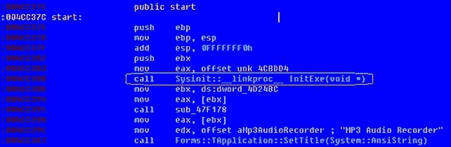

 

看起来 OEP 是对的 J。

 

 

**6\. ****修复****IAT**

 

IAT 从这里开始:  
  

\[if gte vml 1\]><v:shape id="\_x0000\_i1053" type="#\_x0000\_t75" style='width:434.25pt;height:114pt'> <v:imagedata src="sdp2.files/image057.jpg" o:title="1"/> </v:shape><!\[endif\]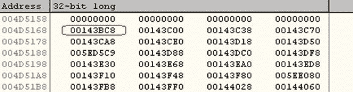

 

结束:  
\[if gte vml 1\]><v:shape id="\_x0000\_i1054" type="#\_x0000\_t75" style='width:423pt; height:117.75pt'> <v:imagedata src="sdp2.files/image059.jpg" o:title="1"/> </v:shape><!\[endif\]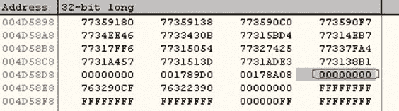

 

size = 4D58E4 – 4D5168 = 77C

 

单步跟了几个 API 调用,既有 redirected 到壳中的,也有由壳代码 emulate 的。从 5E78E2 处的异常入手, 在第一次断下开始跟(counter=3)。

\[if gte vml 1\]><v:shape id="\_x0000\_i1055" type="#\_x0000\_t75" style='width:481.5pt;height:196.5pt'> <v:imagedata src="sdp2.files/image061.jpg" o:title="1"/> </v:shape><!\[endif\]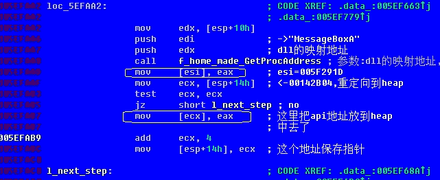

 

把 API(MessageBoxA)的地址保存在了 2 个地方:壳空间和 heap。这个地址比进程的映射地址更低。在 OEP 可以看到,IAT 中很多 entry 是指向这里的。

 

\[if gte vml 1\]><v:shape id="\_x0000\_i1056" type="#\_x0000\_t75" style='width:6in;height:172.5pt'> <v:imagedata src="sdp2.files/image062.jpg" o:title="1"/> </v:shape><!\[endif\]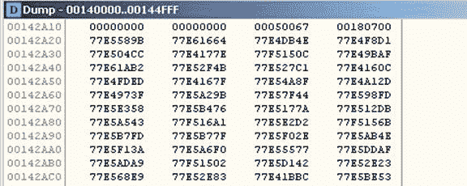

 

在 5E78E2 第 1 次异常时,处理 user32,GDI32, ADVAPI32, RPCRT4, IMM32,LPK 共 6 个 dll。KERNEL32 的 api 已经在更早的时候处理过了。此时上面已经填入了约 60 项 kernel32 的 api 地址。

 

相关代码与 SDP 以前的版本相似:  
  

\[if gte vml 1\]><v:shape id="\_x0000\_i1057" type="#\_x0000\_t75" style='width:481.5pt;height:176.25pt'> <v:imagedata src="sdp2.files/image064.jpg" o:title="1"/> </v:shape><!\[endif\]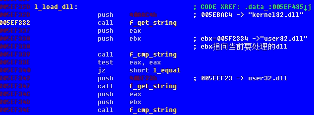

 

需要注意的 dll 仍然是: kernel32, user32, advapi32, shell32,gdi32,以及 sdprotector.dll。

在决定以子进程运行前,壳代码处理了上述几个 dll,获得的 API 地址保存了 2 份,分别在壳空间和堆中。

 

现在试试跟从按子进程运行后,这段代码的处理。试跟了 2 个,并非 5E78E2 异常都与 IAT 相关。用脚本试试:  
  

\[if gte vml 1\]><v:shape id="\_x0000\_s1027" type="#\_x0000\_t202" style='position:absolute;left:0;text-align:left;margin-left:0;margin-top:7.95pt; width:324pt;height:46.8pt;z-index:2' fillcolor="#cfc"> <v:fill opacity=".5"/> <v:textbox> <!\[if !mso\]> <table cellpadding=0 cellspacing=0 width="100%"> <tr> <td><!\[endif\]> 
 
005E78E2&nbsp;&nbsp; Single step event at MP3\_Audi.005E78E2<o:p></o:p>
 
&nbsp;&nbsp;&nbsp;&nbsp;&nbsp;&nbsp;&nbsp;&nbsp;&nbsp;&nbsp; &nbsp;&nbsp;counter\_child = 00000013<o:p></o:p>
 
<o:p>&nbsp;</o:p>
 
 <!\[if !mso\]></td> </tr> </table> <!\[endif\]></v:textbox> </v:shape><!\[endif\] 

 

 

 

 

  

到这里 IAT 中已经填入了一些重定向值了。从上一个 int 3 异常开始跟。

 

\[if gte vml 1\]><v:shape id="\_x0000\_i1058" type="#\_x0000\_t75" style='width:481.5pt;height:137.25pt'> <v:imagedata src="sdp2.files/image066.jpg" o:title="1"/> </v:shape><!\[endif\]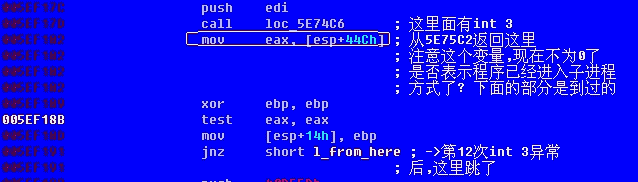

 

这里开始了。注意这 2 个函数:  
  

\[if gte vml 1\]><v:shape id="\_x0000\_i1059" type="#\_x0000\_t75" style='width:441pt;height:292.5pt'> <v:imagedata src="sdp2.files/image067.jpg" o:title="1"/> </v:shape><!\[endif\]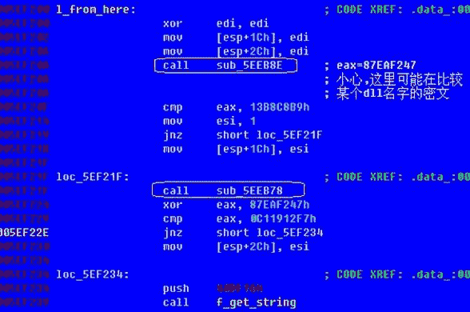

 

进去看看:  
  

\[if gte vml 1\]><v:shape id="\_x0000\_i1060" type="#\_x0000\_t75" style='width:441pt;height:286.5pt'> <v:imagedata src="sdp2.files/image069.jpg" o:title="1"/> </v:shape><!\[endif\]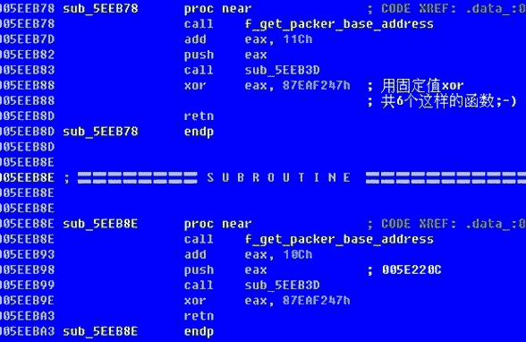

 

连续 6 个这样的函数。5EEB3D 进去有些计算,象 CRC32(有个初始化 256 byte 向量的动作 J)。不过这已经不重要了,只要稍微想一想,就明白这是在干什么。6 个特殊对待的 dll,显然这些函数用于判断 J。

 

 

IAT 中的数据很规范,基本是这样的格式。　

 

\[if gte vml 1\]><v:shape id="\_x0000\_i1061" type="#\_x0000\_t75" style='width:345pt;height:71.25pt'> <v:imagedata src="sdp2.files/image071.jpg" o:title="1"/> </v:shape><!\[endif\]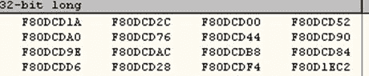

 

什么时候变成指向 14xxxx 或 5Exxxx 就是被处理过了 J。

 

第 0x12 次 int 3 -> 处理 kernel32.dll

 

\[if gte vml 1\]><v:shape id="\_x0000\_i1062" type="#\_x0000\_t75" style='width:431.25pt;height:76.5pt'> <v:imagedata src="sdp2.files/image073.jpg" o:title="1"/> </v:shape><!\[endif\]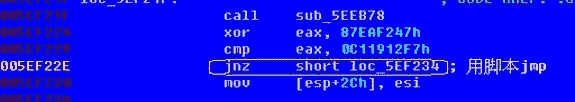

(这个也许不跳也行?我没有试 J)

 

\[if gte vml 1\]><v:shape id="\_x0000\_i1063" type="#\_x0000\_t75" style='width:481.5pt;height:111pt'> <v:imagedata src="sdp2.files/image075.jpg" o:title="1"/> </v:shape><!\[endif\]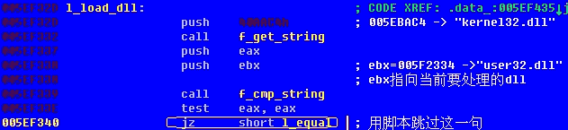

 

第 0x13 次  Single step event -> 处理 user32.dll

 

\[if gte vml 1\]><v:shape id="\_x0000\_i1064" type="#\_x0000\_t75" style='width:481.5pt;height:96pt'> <v:imagedata src="sdp2.files/image076.jpg" o:title="1"/> </v:shape><!\[endif\]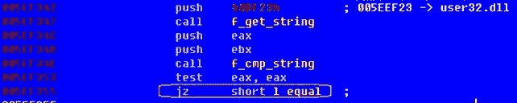

 

\[if gte vml 1\]><v:shape id="\_x0000\_i1065" type="#\_x0000\_t75" style='width:482.25pt;height:140.25pt'> <v:imagedata src="sdp2.files/image078.jpg" o:title="1"/> </v:shape><!\[endif\]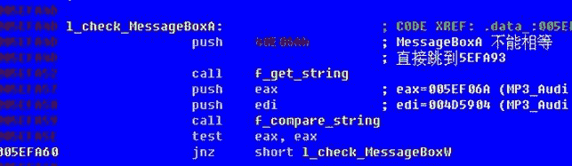

第 0x14 次  Single step event -> 处理 advapi32.dll

 

\[if gte vml 1\]><v:shape id="\_x0000\_i1066" type="#\_x0000\_t75" style='width:481.5pt;height:88.5pt'> <v:imagedata src="sdp2.files/image080.jpg" o:title="1"/> </v:shape><!\[endif\]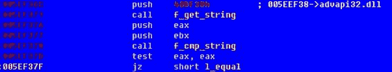

 

依此类推,直到 IAT 全部填充完毕。

 

\[if gte vml 1\]><v:shape id="\_x0000\_i1067" type="#\_x0000\_t75" style='width:459pt;height:366pt'> <v:imagedata src="sdp2.files/image082.jpg" o:title="1"/> </v:shape><!\[endif\]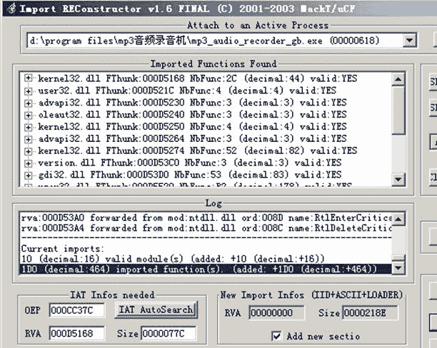

 

全部有效。Fix dump,运行:  
  

\[if gte vml 1\]><v:shape id="\_x0000\_i1068" type="#\_x0000\_t75" style='width:481.5pt;height:420pt'> <v:imagedata src="sdp2.files/image084.jpg" o:title="1"/> </v:shape><!\[endif\]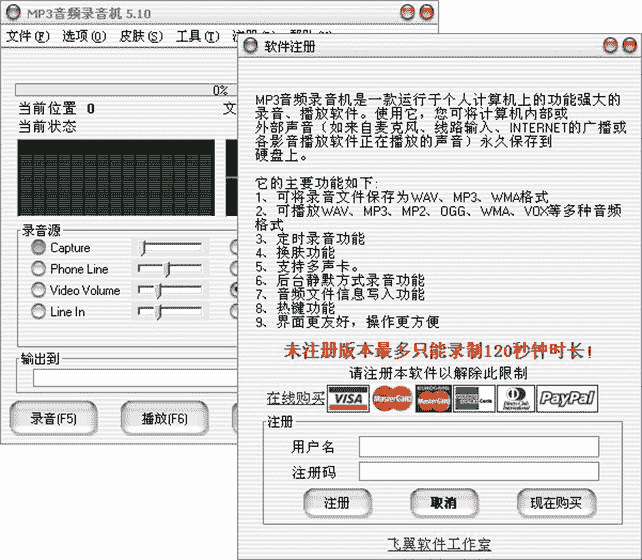

 

 

只脱掉壳,并未破解。