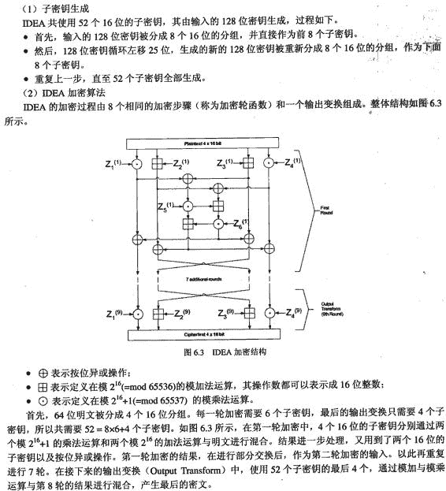
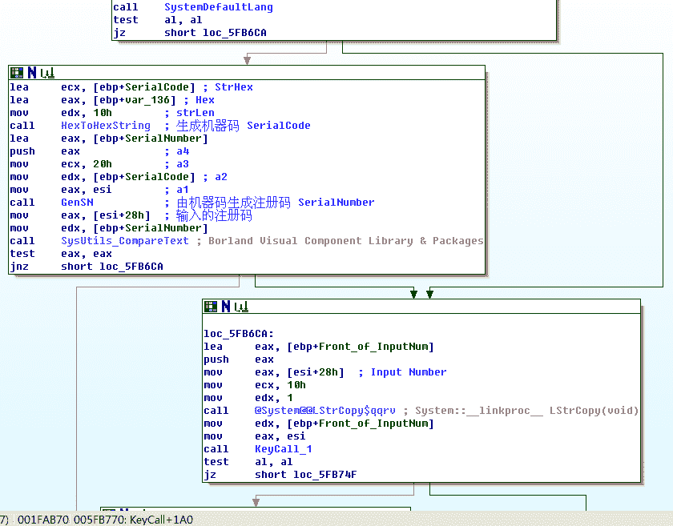

# RVS Lite2011 注册算法 IDEA 分析

> 原文：[`www.pediy.com/kssd/pediy12/130698.html`](https://www.pediy.com/kssd/pediy12/130698.html)

【文章作者】: uuk  
【软件名称】: RVS-Lite-2011（2.1.5.5147）  
【加壳方式】: 无  
【保护方式】: 机器码+序列号  
【编写语言】: Borland Delphi 6.0 - 7.0 \[Overlay\]  
【使用工具】: PEID，IDA Pro with Hex-Rays plugin，DeDe，OllyICE，Syser，VMware  
【软件介绍】: 瑞泰尼尔安全防御系统软件 (英文名称： Returnil Virtual System 2010，以下简称 RVS)是瑞泰尼尔公司采用最新虚拟技术实现的新一代桌面安全系统。和传统的杀毒软件完全不同，瑞泰尼尔防毒系统软件可以瞬间“克隆”用户当前的操作系统，“制造”出实际存在于用户内存中的虚拟操作系统，并利用虚拟的操作系统来替代真实的操作系统，从而以达到保护真实操作系统的目的。  
【作者声明】: 大道向前，一步一个脚印！  
  
  
【破解过程】  
1、前期处理  
    RVS Lite 2011 安装后会在：1）Windows\\System32\\Drivers 目录下复制驱动文件；2）在系统盘根目录下创建 RETURNIL 文件夹，里面存放配置文件和数据；3）在 Program Files 目录下创建 Returnil Virtual System Lite 2011 文件夹，里面只有一个主程序 RvsCore.exe。  
    就先从 RvsCore.exe 下手，用 PEiD 查壳显示 Borland Delphi 6.0 - 7.0 \[Overlay\]，用 KANAL 插件分析有 ADLER32、CRC32、MD5、ZLIB 算法。直接拖到 IDA 里分析，并将几处算法标注上。IDA 分析 Delphi 程序时要手动加载 sig（Barland Visual Component Library & Packages）。默认加载了 SHE for vc7/8，没用，但也不知道怎么去掉。Delphi 程序也有异常处理，不过找不到 sig 就算了，影响不大。有些库函数识别不出来，可以有 DeDe 配合使用。  
    Delphi 逆向分析中较困难的就是一些 VCL、RTL 库函数被 IDA 识别成 unknowlib，还有许多虚函数的调用，例如：call \[edx+0xC\]，此外 Pascal 的参数传递方式也比较让人不习惯。虽然有 DeDe 这样强大的逆向工具，但个人在处理以上问题是仍需要较强的手动分析逆向技巧。Delphi 的参数传递： EAX：第一个参数；  EDX：第二个参数；  ECX：第三个参数；  \[ESP+8\]第四，\[ESP+C\]第五。。。（如果有的话）（引自 myskydog 的《Delphi 逆向分析---quick batch 逆向》http://bbs.pediy.com/showthread.php?t=80205）  
  
2、定位关键代码  
    RvsCore.exe 程序有个注册界面，输入注册码确定后软件会重启计算机进行验证，在 DeDe 是找到确定按键的处理过程，大致看了下，没找到突破口。又看了软件的几个界面，把一些按键试了下，发现在软件主界面的下方有一个提示试用版的状态栏，在 DeDe 是定位此状态栏的创建过程 PROC\_5EBCD0。在 PROC\_5EBCD0 里有条件判断，分别指向 1）Registered； 2）Expired； 3）Trial Version。（软件支持多种语言，字符串有多层引用，有点烦人）  
  
CODE:005EC52D    mov     eax, ds:ppBaseAddress  
CODE:005EC532    mov     eax, \[eax\]  
CODE:005EC534    mov     al, \[eax+0E25h\] ; al = 0(registered), 2(expired),  
CODE:005EC534               ;      4(expired), 1(trial)  
CODE:005EC53A    sub     al, 1  
CODE:005EC53C    jb      short Registered  
CODE:005EC53E    dec     al  
CODE:005EC540    jz      Expired  
CODE:005EC546    sub     al, 2  
CODE:005EC548    jz      Expired  
CODE:005EC54E    jmp     Trial  
CODE:005EC553 ; ---------------------------------------------------------------------------  
CODE:005EC553  
CODE:005EC553 Registered:            ; CODE XREF: PROC\_5EBCD0+86C j  
CODE:005EC553    mov     edx, ds:strRegistered  
CODE:005EC559    mov     edx, \[edx\]  
CODE:005EC55B    mov     eax, \[ebp+var\_4\]  
CODE:005EC55E    mov     eax, \[eax+470h\]  
CODE:005EC564    call    @Controls@TControl@SetText$qqrx17System@AnsiString ; Controls::TControl::SetText(System::AnsiString)  
  
    **\[edx+0E25h\]**是注册标志，只要能找到对它赋值的地方，一般就找到的算法核心的地方。对于面向对象程序而言，想要用静态分析的方法找到某个变量的赋值操作是很困难的，得用动态调试。在 OllyICE 中加载程序，对内存中注册标志所在的位置下断点，运行程序，发现程序只有读注册标志，没有写操作。没有头绪，一顿乱翻，突然发现任务管理器里有两个 RvsCore.exe，想到这种软件一般会往系统里添加服务，一看，果然。将 Rvssrv 服务停止，在 OllyICE 添加程序启动命令 service，下断点，运行，程序直接退出，也没写注册标志的操作，服务没有启动。一步一步运行，缩小范围，发现是在某个与服务有关的 Windows API 调用后程序退出，猜测是系统服务不能以常规方法调试。上网搜，只看到使用注册表用 Windbg 调试系统服务，而我用 OllyICE 试不成功。看来以后要转而用 Windbg 了。现在只能在虚拟机里用 Syser 试试。添加启动命令 service，添加断点，直接运行程序可是退出。偶然情况下，点了重启服务，发现 Syser 断下来了。原来注册标志是放在系统地址里（跟系统的内存管理有关），系统地址的断点在程序结束后是不会被 Syser 清除的，所以当 RvsCore.exe 以服务的方式再次启动并且访问断点所在的地址时被 Syser 断下。找到写注册标志的代码段：  
CODE:005FF787    mov     eax, ds:off\_60BB0C  
CODE:005FF78C    mov     eax, \[eax\]  
CODE:005FF78E    mov     al, \[eax+14h\]   ; \[00E485E8\] 取值  
CODE:005FF791    mov     edx, ds:ppBaseAddress  
CODE:005FF797    mov     edx, \[edx\]  
CODE:005FF799    mov     \[edx+0E25h\], al  
继续跟踪对\[eax+14h\]的操作，找到：  
CODE:005FB085    mov     byte ptr \[esi+14h\], 1 ; \[00E485E8\] 赋值为 1  
前面的分析可知，值为 1 时是试用版，不是我们想要的，我们要找赋 0 的时候。在 CODE:005FB085 上下翻了翻，也没找到赋值为 0 的代码，估计这是注册标志的初始化，之后肯定会有别的操作，但是我们的注册码的错误的，Syser 断不到赋值为 0 的指令。虽然静态分析的方法找到某个变量的赋值操作是很困难的，但也不是没可能。比如：  
CODE:005EC534    mov     al, \[eax+0E25h\]  
CODE:005FF799    mov     \[edx+0E25h\], al  
都是\[exx+0E25h\]，this 指针加偏移的形式，举一反三，会不会有：  
mov     byte ptr \[esi+14h\], 0  
这种形式的汇编代码呢？在 OllyICE 中查找命令，果然找到：（IDA 里不知道怎么查找命令……）  
CODE:005FB6B9                 mov     byte ptr \[esi+14h\], 0  
在这个函数里上下浏览代码，还看到：  
CODE:005FB779                 mov     byte ptr \[esi+14h\], 2  
看来找到目标了，在 Syser 里进行验证，确实是这里。将这个函数 sub\_5FB5D0 命名为 KeyCall。  
  
3、  算法分析  
  
CODE:005FB657    lea     ecx, \[ebp+StrHex\] ; StrHex  
CODE:005FB65D    lea     eax, \[ebp+Hex\]  ; Hex  
CODE:005FB663    mov     edx, 10h        ; strLen  
CODE:005FB668    call    HexToHexString  
CODE:005FB66D    mov     edx, \[ebp+StrHex\]  
CODE:005FB673    lea     eax, \[esi+28h\]  
CODE:005FB676    call    @System@LStrAsg ; Borland Visual Component Library & Packages  
CODE:005FB67B    call    sub\_493C04  
CODE:005FB680    test    al, al  
CODE:005FB682    jz      short loc\_5FB6CA  
CODE:005FB684    lea     ecx, \[ebp+SerialCode\] ; StrHex  
CODE:005FB687    lea     eax, \[ebp+var\_136\] ; Hex  
CODE:005FB68D    mov     edx, 10h        ; strLen  
CODE:005FB692    call    HexToHexString  ; 生成机器码 SerialCode  
CODE:005FB697    lea     eax, \[ebp+SerialNumber\]  
CODE:005FB69A    push    eax             ; a4  
CODE:005FB69B    mov     ecx, 20h        ; a3  
CODE:005FB6A0    mov     edx, \[ebp+SerialCode\] ; a2  
CODE:005FB6A3    mov     eax, esi        ; a1  
CODE:005FB6A5    call      GenSN       ; 由机器码生成注册码 SerialNumber  
CODE:005FB6AA    mov     eax, \[esi+28h\]  ; 输入的注册码  
CODE:005FB6AD    mov     edx, \[ebp+SerialNumber\]  
CODE:005FB6B0    call    SysUtils\_CompareText ; Borland Visual Component Library & Packages  
CODE:005FB6B5    test    eax, eax  
CODE:005FB6B7    jnz     short loc\_5FB6CA  
CODE:005FB6B9    mov     byte ptr \[esi+14h\], 0  
CODE:005FB6BD    xor     eax, eax  
CODE:005FB6BF    pop     edx  
CODE:005FB6C0    pop     ecx  
CODE:005FB6C1    pop     ecx  
CODE:005FB6C2    mov     fs:\[eax\], edx  
CODE:005FB6C5    jmp     loc\_5FB7B7  
CODE:005FB6CA ; ---------------------------------------------------------------------------  
  
分析：CODE:005FB6A5    call    GenSN 是关键，Syser 中显示 GenSN( ) 将机器码 SerialCode 作为输入，生成注册码 SerialNumber，GenSN( ) 汇编代码如下：  
CODE:005FB4EC    push    ebp  
CODE:005FB4ED    mov     ebp, esp  
CODE:005FB4EF    add     esp, 0FFFFFF78h  
CODE:005FB4F5    push    ebx  
CODE:005FB4F6    mov     \[ebp+\_src\], edx  
CODE:005FB4F9    mov     ebx, eax  
CODE:005FB4FB    mov     eax, \[ebp+\_src\]  
CODE:005FB4FE    call    @System@LStrAddRef ; Borland Visual Component Library & Packages  
CODE:005FB503    xor     eax, eax  
CODE:005FB505    push    ebp  
CODE:005FB506    push    offset loc\_5FB55C  
CODE:005FB50B    push    dword ptr fs:\[eax\]  
CODE:005FB50E    mov     fs:\[eax\], esp  
CODE:005FB511    lea     edx, \[ebp+\_ID\_Hex\]  
CODE:005FB514    mov     ecx, 10h  
CODE:005FB519    mov     eax, \[ebp+\_src\]  
CODE:005FB51C    call    HexStringToHex  
CODE:005FB521    push    10h             ; len  
CODE:005FB523    lea     ecx, \[ebp+Hex2\] ; Hex2  
CODE:005FB529    lea     edx, \[ebp+\_ID\_Hex\] ; Hex1  
CODE:005FB52C    mov     eax, ebx        ; this  
CODE:005FB52E    call    sub\_5FC02C  
CODE:005FB533    mov     ecx, \[ebp+dst\]  ; StrHex  
CODE:005FB536    lea     eax, \[ebp+Hex2\] ; Hex  
CODE:005FB53C    mov     edx, 10h        ; strLen  
CODE:005FB541    call    HexToHexString  
CODE:005FB546    xor     eax, eax  
CODE:005FB548    pop     edx  
CODE:005FB549    pop     ecx  
CODE:005FB54A    pop     ecx  
CODE:005FB54B    mov     fs:\[eax\], edx  
CODE:005FB54E    push    offset loc\_5FB563  
CODE:005FB553  
CODE:005FB553 loc\_5FB553:                ; CODE XREF: GenSN+75 j  
CODE:005FB553    lea     eax, \[ebp+\_src\]  
CODE:005FB556    call    @System@LStrClr ; Borland Visual Component Library & Packages  
CODE:005FB55B    retn  
  
分析：CODE:005FB51C    call  HexStringToHex 是将 HexString 形式的机器码转换成 Hex 格式。然后调用 CODE:005FB52E    call  sub\_5FC02C，最后是调用 CODE:005FB541    call  HexToHexString（将注册码转成 HexString）。推进 sub\_5FC02C：  
CODE:005FC02C ; ============= S U B R O U T I N E ===============  
CODE:005FC02C  
CODE:005FC02C ; Attributes: bp-based frame  
CODE:005FC02C  
CODE:005FC02C ; void \_\_fastcall sub\_5FC02C(int this, int Hex1, int Hex2, signed int len)  
CODE:005FC02C sub\_5FC02C      proc near          ; CODE XREF: GenSN+42 p  
CODE:005FC02C                                  ; sub\_5FBDE4+77 p  
CODE:005FC02C  
CODE:005FC02C var\_E8   = byte ptr -0E8h  
CODE:005FC02C \_Hex2   = dword ptr -8  
CODE:005FC02C \_Hex1   = dword ptr -4  
CODE:005FC02C len      = dword ptr  8  
CODE:005FC02C  
CODE:005FC02C    push    ebp  
CODE:005FC02D    mov     ebp, esp  
CODE:005FC02F    add     esp, 0FFFFFF18h  
CODE:005FC035    push    ebx  
CODE:005FC036    push    esi  
CODE:005FC037    mov     \[ebp+\_Hex2\], ecx  
CODE:005FC03A    mov     \[ebp+\_Hex1\], edx  
CODE:005FC03D    mov     ebx, eax  
CODE:005FC03F    lea     eax, \[ebp+var\_E8\]  
CODE:005FC045    xor     ecx, ecx  
CODE:005FC047    mov     edx, 0E0h  
CODE:005FC04C    call    @System@@FillChar$qqrv ; System::\_\_linkproc\_\_ FillChar(void)  
CODE:005FC051    lea     eax, \[ebx+4\]  
CODE:005FC054    push    eax  
CODE:005FC055    lea     edx, \[ebx+4\]  
CODE:005FC058    lea     eax, \[ebp+var\_E8\]  
CODE:005FC05E    mov     ecx, 10h  
CODE:005FC063    call    sub\_5FA470  
CODE:005FC068    mov     esi, \[ebp+len\]  
CODE:005FC06B    test    esi, esi  
CODE:005FC06D    jns     short loc\_5FC072  
CODE:005FC06F    add     esi, 7  
CODE:005FC072  
CODE:005FC072 loc\_5FC072:                ; CODE XREF: sub\_5FC02C+41 j  
CODE:005FC072    sar     esi, 3  
CODE:005FC075    dec     esi  
CODE:005FC076    test    esi, esi  
CODE:005FC078    jl      short loc\_5FC09C  
CODE:005FC07A    inc     esi  
CODE:005FC07B    xor     ebx, ebx  
CODE:005FC07D  
CODE:005FC07D loc\_5FC07D:                ; CODE XREF: sub\_5FC02C+6E j  
CODE:005FC07D    mov     eax, ebx  
CODE:005FC07F    shl     eax, 3  
CODE:005FC082    mov     edx, \[ebp+\_Hex2\]  
CODE:005FC085    lea     ecx, \[edx+eax\]  
CODE:005FC088    mov     edx, \[ebp+\_Hex1\]  
CODE:005FC08B    add     edx, eax  
CODE:005FC08D    lea     eax, \[ebp+var\_E8\]  
CODE:005FC093    call    sub\_5FA75C  
CODE:005FC098    inc     ebx  
CODE:005FC099    dec     esi  
CODE:005FC09A    jnz     short loc\_5FC07D  
CODE:005FC09C  
CODE:005FC09C loc\_5FC09C:                ; CODE XREF: sub\_5FC02C+4C j  
CODE:005FC09C    lea     eax, \[ebp+var\_E8\]  
CODE:005FC0A2    call    sub\_5FA774  
CODE:005FC0A7    lea     eax, \[ebp+var\_E8\]  
CODE:005FC0AD    call    ComObj\_ClearExcepInfo  
CODE:005FC0B2    mov     al, 1  
CODE:005FC0B4    pop     esi  
CODE:005FC0B5    pop     ebx  
CODE:005FC0B6    mov     esp, ebp  
CODE:005FC0B8    pop     ebp  
CODE:005FC0B9    retn    4  
CODE:005FC0B9 sub\_5FC02C      endp  
  
分析：里面有三个未知 Call：sub\_5FA470、sub\_5FA75C、sub\_5FA774。先看 sub\_5FA470，里面有一段很有规律的代码，按 F5 生成 C 代码，部分如下：  
  
  j = 6;  
  do  
  {  
    LOWORD(v7) = \*(\_WORD \*)(v5 + 2);  
    v9 = v7 << 9;  
    \*(\_WORD \*)(v5 + 16) = ((unsigned int)\*(\_WORD \*)(v5 + 4) >> 7) | v9;  
    LOWORD(v9) = \*(\_WORD \*)(v5 + 4);  
    v9 <<= 9;  
    \*(\_WORD \*)(v5 + 18) = ((unsigned int)\*(\_WORD \*)(v5 + 6) >> 7) | v9;  
    LOWORD(v9) = \*(\_WORD \*)(v5 + 6);  
    v9 <<= 9;  
    \*(\_WORD \*)(v5 + 20) = ((unsigned int)\*(\_WORD \*)(v5 + 8) >> 7) | v9;  
    LOWORD(v9) = \*(\_WORD \*)(v5 + 8);  
    v9 <<= 9;  
    \*(\_WORD \*)(v5 + 22) = ((unsigned int)\*(\_WORD \*)(v5 + 10) >> 7) | v9;  
    LOWORD(v9) = \*(\_WORD \*)(v5 + 10);  
    v9 <<= 9;  
    \*(\_WORD \*)(v5 + 24) = ((unsigned int)\*(\_WORD \*)(v5 + 12) >> 7) | v9;  
    LOWORD(v9) = \*(\_WORD \*)(v5 + 12);  
    v9 <<= 9;  
    \*(\_WORD \*)(v5 + 26) = ((unsigned int)\*(\_WORD \*)(v5 + 14) >> 7) | v9;  
    LOWORD(v9) = \*(\_WORD \*)(v5 + 14);  
    v9 <<= 9;  
    \*(\_WORD \*)(v5 + 28) = ((unsigned int)\*(\_WORD \*)v5 >> 7) | v9;  
    LOWORD(v9) = \*(\_WORD \*)v5;  
    v7 = v9 << 9;  
    \*(\_WORD \*)(v5 + 30) = ((unsigned int)\*(\_WORD \*)(v5 + 2) >> 7) | v7;  
    v5 += 16;  
    --j;  
  }  
  while ( j );  
  
然后看看 sub\_5FA75C，部分如下：  
  
  \_word\_1 = \*(\_WORD \*)Hex64\_1;  
  \_word\_2 = \*(\_WORD \*)(Hex64\_1 + 2);  
  \_word\_3 = \*(\_WORD \*)(Hex64\_1 + 4);  
  \_word\_4 = \*(\_WORD \*)(Hex64\_1 + 6);  
  i = 8;  
  do  
  {  
    sub\_5FA22C((int)&\_word\_1, \*(\_WORD \*)v3);  
    v5 = (unsigned \_\_int16 \*)(v3 + 2);  
    \_word\_2 += \*v5;  
    ++v5;  
    \_word\_3 += \*v5;  
    ++v5;  
    sub\_5FA22C((int)&\_word\_4, \*v5);  
    ++v5;  
    v6 = \_word\_3;  
    \_word\_3 ^= \_word\_1;  
    sub\_5FA22C((int)&\_word\_3, \*v5);  
    ++v5;  
    v7 = \_word\_2;  
    \_word\_2 ^= \_word\_4;  
    \_word\_2 += \_word\_3;  
    sub\_5FA22C((int)&\_word\_2, \*v5);  
    v3 = (int)(v5 + 1);  
    \_word\_3 += \_word\_2;  
    \_word\_1 ^= \_word\_2;  
    \_word\_4 ^= \_word\_3;  
    \_word\_2 ^= v6;  
    \_word\_3 ^= v7;  
    --i;  
  }  
  while ( i );  
  
    如此简洁高效的代码，看着就像现成的算法，翻开《加密与解密(第三版)》，看看哪个算法和这类似。嘿嘿~ 原来是 IDEA 算法。网上找到的 IDEA 工具来算这个程序的注册码，结果都不对，猜测可能是工具中字节存取跟程序中的处理不一样。弄了个带有源代码的工具，果然，RvsCore.exe 中是按 char 存取，网上找到的 IDEA 工具是按 short int 存取。  
    RVS 注册算法的验证过程是：

> 1）  HexStringtoHex(SerialCode)，将机器码转变成 Hex 形式；  
> 2）  SericalNum = IDEA\_Encrypt(SerialCode)，IDEA 的私钥是 bytes(B060D775-C0FE-49)  
> 3）  HextoHexString(SericalNum)，将 Hex 形式的注册码转变成 String 形式。

    用 OpenSSL 算法库写了个 Keygen，OpenSSL 里也是按 short int 存取，所以数据在传给函数前要交叉变换。附 IDEA 的算法过程（RvsCore.exe 程序中 sub\_5FA470 是生成子密钥，sub\_5FA75C 是 IDEA 加密）：  
  
  
  
之前疏忽了，软件对于非简体中文系统的注册算法是不一样的。  
  
它用一个解密函数解密输入序列号的前 16 位，然后把前四位与特定值比较：F6 D9 00 00  
  
CODE:00495DF8 CallEncrypt\_1   proc near    ; CODE XREF: KeyCall\_1+73 p  
CODE:00495DF8  
CODE:00495DF8 \_hex1 = dword ptr -8  
CODE:00495DF8 \_hex2 = dword ptr -4  
CODE:00495DF8  
CODE:00495DF8    add     esp, 0FFFFFFF8h  
CODE:00495DFB    mov     ecx, \[edx\]  
CODE:00495DFD    mov     \[esp+8+\_hex1\], ecx  
CODE:00495E00    mov     ecx, \[edx+4\]  
CODE:00495E03    mov     \[esp+8+\_hex2\], ecx  
CODE:00495E07    mov     edx, esp  
CODE:00495E09    xor     ecx, ecx  
**CODE:00495E0B    call    Encrypt      ; int Encrypt(int table, int64 hex, bool op)  
CODE:00495E10    cmp     word ptr \[esp+8+\_hex1\], 0D9F6h**  
CODE:00495E16    setz    al  
CODE:00495E19    pop     ecx  
CODE:00495E1A    pop     edx  
CODE:00495E1B    retn  
CODE:00495E1B CallEncrypt\_1   endp  
  
CODE:00495E1C sub\_495E1C  proc near    ; CODE XREF: KeyCall\_2+86 p  
CODE:00495E1C  
CODE:00495E1C \_hex1 = dword ptr -10h  
CODE:00495E1C \_hex2 = dword ptr -0Ch  
CODE:00495E1C var\_8 = qword ptr -8  
CODE:00495E1C  
CODE:00495E1C    add     esp, 0FFFFFFF0h  
CODE:00495E1F    mov     ecx, \[edx\]  
CODE:00495E21    mov     \[esp+10h+\_hex1\], ecx  
CODE:00495E24    mov     ecx, \[edx+4\]  
CODE:00495E27    mov     \[esp+10h+\_hex2\], ecx  
CODE:00495E2B    mov     edx, esp  
CODE:00495E2D    xor     ecx, ecx  
**CODE:00495E2F    call    Encrypt      ; int Encrypt(int table, int64 hex, bool op)  
CODE:00495E34    mov     ax, word ptr \[esp+10h+\_hex1+2\]  
CODE:00495E39    call    SetExpiredDate**  
CODE:00495E3E    fstp    \[esp+10h+var\_8\]  
CODE:00495E42    wait  
CODE:00495E43    call    @Sysutils@Date$qqrv ; Sysutils::Date(void)  
CODE:00495E48    fcomp   \[esp+10h+var\_8\]  
CODE:00495E4C    fnstsw  ax  
CODE:00495E4E    sahf  
CODE:00495E4F    setnbe  al  
CODE:00495E52    add     esp, 10h  
CODE:00495E55    retn  
CODE:00495E55 sub\_495E1C      endp  
  
Encrypt () 的伪 C 代码如下：  
**// int Encrypt (int table, int64 hex, bool op)**  
int \_\_fastcall  Encrypt (int table, int hex, unsigned \_\_int8 op)  
{  
  \_size = op;  \_hex = hex;  \_table = table;  
  \_hex1 = \*(\_DWORD \*)hex;  \_hex2 = \*(\_DWORD \*)(hex + 4);  
  i = 4;  \_index = &INDEX;  
  do  
  {  
    v4 = \*(\_DWORD \*)(\_table + 4 \* \_index\[12 \* \_size + 2\]);  
    v5 = ((unsigned int)(v4 + \_hex1) >> 7) ^ (v4 + \_hex1);  
    v6 = v5 + \*(\_DWORD \*)(\_table + 4 \* \_index\[12 \* \_size\]);  
    v7 = v6 + v5;  
    v8 = (v6 << 13) ^ v6;  
    v9 = v8 + \*(\_DWORD \*)(\_table + 4 \* \_index\[12 \* \_size + 1\]);  
    v10 = v9 + v8;  
    v11 = (v9 >> 17) ^ v9;  
    v12 = v11 + v4 + \_hex1 + v4;  
    v13 = v12 + v11;  
    v14 = (v12 << 9) ^ v12;  
    v15 = v14 + v7;  
    v16 = (((v15 + v14) >> 15) ^ ((((((v15 >> 3) ^ v15) + v10) << 7) ^ (((v15 >> 3) ^ v15) + v10)) + v13)) + v15 + v14;  
    v17 = (v16 << 11) ^ v16 ^ \_hex2;  
    \_hex2 = \_hex1;  
    \_hex1 = v17;  
    \_index += 3;  
  }  
  while ( i-- != 1 );  
  \*(\_DWORD \*)\_hex = \_hex2;  
  result = \_hex;  
  \*(\_DWORD \*)(\_hex + 4) = \_hex1;  
  return result;  
}  
  
解密函数 Encrypt ( ) 具体用的什么算法目前还不确定，不过它有一个参数 op 代表是加密操作还是解密操作。可以构造满足要求的明文，用 Encrypt ( ) 加密即可得到序列号的前 16 位。序列号的后 16 号好像没有要求。比如：明文（F6D900004C45524F）经 Encrypt ( )得到密文（5F3DA1B551FE4451），序列号可以是：5F3DA1B551FE44510000000000000000  
  
  
注册机 Keygen.rar  Word 版 RVS 注册算法.doc