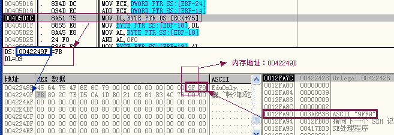
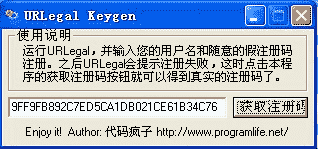

# 初探逆向之 URLegal 破解

> 原文：[`www.pediy.com/kssd/pediy12/130918.html`](https://www.pediy.com/kssd/pediy12/130918.html)

【文章标题】: 初探逆向之 URLegal 破解  
【文章作者】: 代码疯子  
【作者邮箱】: stackexploit@gmail.com  
【操作系统】: Windows XP  
【软件名称】: URLegal 3.3.0.0  
【软件介绍】: 可以自动找出 HTML 文件中的断链接并自动对其进行修复  
【加壳方式】: 无  
【保护方式】: 注册码  
【编写语言】: Microsoft Visual C++ 6.0  
【使用工具】: OD + PEID + IDA  
【作者声明】: 纯属技术交流，没有其他目的。仅以本文献给跟我一样刚接触逆向的朋友，文章写得比较嗦，大牛们请飘过！  
  
本人小菜，刚接触逆向，前几天看了传说中的天草破解教程，看到里面有一个拿一个国外软件 URLegal 来做例子，很是感兴趣，于是视频还没看完就自己动起手来进行分析，试图去分析注册码计算算法，奈何功底不足，最终只做了个内存注册机，但仍然倍感兴奋，故发帖于看雪。失误之处请指正。附件为内存注册机汇编源码。  
  
这个 URLegal 3.3.0.0 网上很多大型软件下载站有下载，请朋友们自己下载和安装。  
首先，用 PEID 对目标程序进行查壳，发现没有加壳，显示“Microsoft Visual C++ 6.0”，很好，省的像我这样的初学者去脱壳了。  
  
接下来，试着去注册一下，在“File->Register”菜单下可以进行注册，试着输入假码进行一下测试：Name 填 ForEduOnly，Code 填 112233445566778899。点击“Validate My Codes”，提示“Name / Code mis-match. Try again.”的消息框。以前看别人的分析帖子时，往往提到去搜索消息框中的字符串，那我们也来试试。  
  
打开 OD，将 Urlegal.exe 载入，然后在反汇编窗口中单击右键，选择“超级字串参考->ASCII”，接着在弹出的字符串窗口中 Ctrl+F 查找“Name / Code mis-match. Try again.”这个字符串。在找到字符串之后双击改行，来到程序中对应的位置，对应的子程序反汇编代码如下：  

代码:

```
004025C6  /.  55            PUSH EBP
004025C7  |.  8BEC          MOV EBP,ESP
004025C9  |.  6A FF         PUSH -1
004025CB  |.  68 AA754100   PUSH Urlegal.004175AA                    ;  SE 处理程序安装
004025D0  |.  64:A1 0000000>MOV EAX,DWORD PTR FS:\[0\]
004025D6  |.  50            PUSH EAX
004025D7  |.  64:8925 00000>MOV DWORD PTR FS:\[0\],ESP
004025DE  |.  81EC 80000000 SUB ESP,80
004025E4  |.  898D 7CFFFFFF MOV DWORD PTR SS:\[EBP-84\],ECX
004025EA  |.  6A 00         PUSH 0                                   ; /Arg1 = 00000000
004025EC  |.  8D4D 8C       LEA ECX,DWORD PTR SS:\[EBP-74\]            ; |
004025EF  |.  E8 8C120000   CALL Urlegal.00403880                    ; \\Urlegal.00403880
004025F4  |.  C745 FC 00000>MOV DWORD PTR SS:\[EBP-4\],0
004025FB  |.  8D4D 8C       LEA ECX,DWORD PTR SS:\[EBP-74\]
004025FE  |.  E8 09430100   CALL <JMP.&MFC42.#2514\_?DoModal@CDialog@>
00402603  |.  83F8 01       CMP EAX,1
00402606  |.  0F85 D5000000 JNZ Urlegal.004026E1
0040260C  |.  E8 7FEEFFFF   CALL Urlegal.00401490
00402611  |.  8945 84       MOV DWORD PTR SS:\[EBP-7C\],EAX
00402614  |.  51            PUSH ECX
00402615  |.  8BCC          MOV ECX,ESP
00402617  |.  8965 80       MOV DWORD PTR SS:\[EBP-80\],ESP
0040261A  |.  8D45 F0       LEA EAX,DWORD PTR SS:\[EBP-10\]
0040261D  |.  50            PUSH EAX
0040261E  |.  E8 71450100   CALL <JMP.&MFC42.#535\_??0CString@@QAE@AB>
00402623  |.  8985 78FFFFFF MOV DWORD PTR SS:\[EBP-88\],EAX            ; |
00402629  |.  8D4D 88       LEA ECX,DWORD PTR SS:\[EBP-78\]            ; |
0040262C  |.  51            PUSH ECX                                 ; |Arg1
0040262D  |.  8B4D 84       MOV ECX,DWORD PTR SS:\[EBP-7C\]            ; |
00402630  |.  81C1 D0000000 ADD ECX,0D0                              ; |
00402636  |.  E8 AE310000   CALL Urlegal.004057E9                    ; \\Urlegal.004057E9
0040263B  |.  8985 74FFFFFF MOV DWORD PTR SS:\[EBP-8C\],EAX
00402641  |.  C645 FC 01    MOV BYTE PTR SS:\[EBP-4\],1
00402645  |.  8D4D 88       LEA ECX,DWORD PTR SS:\[EBP-78\]
00402648  |.  E8 C3050000   CALL Urlegal.00402C10
0040264D  |.  85C0          TEST EAX,EAX
0040264F  |.  75 76         JNZ SHORT Urlegal.004026C7
00402651  |.  8D55 EC       LEA EDX,DWORD PTR SS:\[EBP-14\]
00402654  |.  52            PUSH EDX                                 ; /Arg2
00402655  |.  8D45 88       LEA EAX,DWORD PTR SS:\[EBP-78\]            ; |
00402658  |.  50            PUSH EAX                                 ; |Arg1
00402659  |.  E8 02060000   CALL Urlegal.00402C60                    ; \\Urlegal.00402C60
0040265E  |.  25 FF000000   AND EAX,0FF
00402663  |.  85C0          TEST EAX,EAX
00402665  |.  74 60         JE SHORT Urlegal.004026C7
00402667  |.  8D4D F0       LEA ECX,DWORD PTR SS:\[EBP-10\]
0040266A  |.  E8 E1050000   CALL Urlegal.00402C50
0040266F  |.  50            PUSH EAX                                 ; /Arg3
00402670  |.  68 04E24100   PUSH Urlegal.0041E204                    ; |name
00402675  |.  68 0CE24100   PUSH Urlegal.0041E20C                    ; |user
0040267A  |.  8B4D 84       MOV ECX,DWORD PTR SS:\[EBP-7C\]            ; |
0040267D  |.  81C1 C4000000 ADD ECX,0C4                              ; |
00402683  |.  E8 AD450000   CALL Urlegal.00406C35                    ; \\Urlegal.00406C35
00402688  |.  8D4D EC       LEA ECX,DWORD PTR SS:\[EBP-14\]
0040268B  |.  E8 C0050000   CALL Urlegal.00402C50
00402690  |.  50            PUSH EAX                                 ; /Arg3
00402691  |.  68 14E24100   PUSH Urlegal.0041E214                    ; |code
00402696  |.  68 1CE24100   PUSH Urlegal.0041E21C                    ; |user
0040269B  |.  8B4D 84       MOV ECX,DWORD PTR SS:\[EBP-7C\]            ; |
0040269E  |.  81C1 C4000000 ADD ECX,0C4                              ; |
004026A4  |.  E8 8C450000   CALL Urlegal.00406C35                    ; \\Urlegal.00406C35
004026A9  |.  8B4D 84       MOV ECX,DWORD PTR SS:\[EBP-7C\]
004026AC  |.  81C1 D0000000 ADD ECX,0D0
004026B2  |.  E8 72170000   CALL Urlegal.00403E29
004026B7  |.  6A 00         PUSH 0
004026B9  |.  6A 00         PUSH 0
004026BB  |.  68 24E24100   PUSH Urlegal.0041E224                    ;  thank you for registering!
004026C0  |.  E8 B1440100   CALL <JMP.&MFC42.#1200\_?AfxMessageBox@@Y>
004026C5  |.  EB 0E         JMP SHORT Urlegal.004026D5
004026C7  |>  6A 00         PUSH 0
004026C9  |.  6A 00         PUSH 0
004026CB  |.  68 40E24100   PUSH Urlegal.0041E240                    ;  name / code mis-match. try again.
004026D0  |.  E8 A1440100   CALL <JMP.&MFC42.#1200\_?AfxMessageBox@@Y>
004026D5  |>  C645 FC 00    MOV BYTE PTR SS:\[EBP-4\],0
004026D9  |.  8D4D 88       LEA ECX,DWORD PTR SS:\[EBP-78\]
004026DC  |.  E8 DF420100   CALL <JMP.&MFC42.#800\_??1CString@@QAE@XZ>
004026E1  |>  C745 FC FFFFF>MOV DWORD PTR SS:\[EBP-4\],-1
004026E8  |.  8D4D 8C       LEA ECX,DWORD PTR SS:\[EBP-74\]
004026EB  |.  E8 C0040000   CALL Urlegal.00402BB0
004026F0  |.  8B4D F4       MOV ECX,DWORD PTR SS:\[EBP-C\]
004026F3  |.  64:890D 00000>MOV DWORD PTR FS:\[0\],ECX
004026FA  |.  8BE5          MOV ESP,EBP
004026FC  |.  5D            POP EBP
004026FD  \\.  C3            RETN

```

004026C7 至 004026D0 处的代码为错误提示的消息框，我们选中 004026C7 这一行，可以看到可以从两个地方跳转过来，分别是：  
代码:

```
0040264F  |.  75 76         JNZ SHORT Urlegal.004026C7        ;一个关键跳转
0040264F  |.  75 76         JNZ SHORT Urlegal.004026C7        ;一个关键跳转

```

不管怎么样，先在这个过程的头部下个断点吧。接下来 F9 运行，并填入刚才的 Name 和 Code 进行注册……，还没有输入就断下了，那就 F8 单步吧。单步到这样一条的时候就可以输入 Name 和 Code 了：  
代码:

```
004025FE  |.  E8 09430100   CALL <JMP.&MFC42.#2514\_?DoModal@CDialog@> ;显示一个模态对话框供用户进行注册

```

继续小心的按 F8 进行单步跟踪。来到 0040260C 处的 CALL，用 F7 单步跟进去一看，没什么，就是调用了 AfxGetModuleState 这个函数（这个什么函数具体我也不清楚，我以前 MFC 编程没有看到过，网上查了下，说跟数据库相关的，这里就忽略了）。  
代码:

```
0040260C  |.  E8 7FEEFFFF   CALL Urlegal.00401490

```

接下来继续跟踪，发现经过 00402636 和 00402648 以及 00402659 处的三个 CALL 之后，程序跳转到了错误提示消息框，说明算法就在者三个 CALL 里面了。细心的朋友相信早就发现了 OD 堆栈窗口早就出现了明文了，但是我们是来分析加密算法的，不能就此满足，所以，还是继续分析吧。  
  
细心的朋友应该已经发现，在 00402659 处的 CALL 里面看到了密钥的对比。现在我们仔细看看 00402659 处的这个 call 到底传了什么参数进去。  
代码:

```
00402651  |.  8D55 EC       LEA EDX,DWORD PTR SS:\[EBP-14\]
00402654  |.  52            PUSH EDX                                                 ; /Arg2
00402655  |.  8D45 88       LEA EAX,DWORD PTR SS:\[EBP-78\]                            ; |
00402658  |.  50            PUSH EAX                                                 ; |Arg1
00402659  |.  E8 02060000   CALL Urlegal.00402C60                                    ; \\Urlegal.00402C60

```

发现传入了两个堆栈偏移值，观察堆栈窗口：  
代码:

```
0012FB1C   0012FB38  |Arg1 = 0012FB38
0012FB20   0012FB9C  \\Arg2 = 0012FB9C

```

再看看这两个堆栈偏移值（即 0012FB38 和 0012FB9C）在堆栈中到底有什么：  
代码:

```
……
0012FB38   003AE688  ASCII "9FF9FB892C7ED5CA1DB021CE61B34C76"
……
0012FB9C   003AE598  ASCII "112233445566778899"
……

```

果然，是对密钥的一个比较，可以肯定 9FF9FB892C7ED5CA1DB021CE61B34C76 就是 ForEduOnly 所对应的真实的注册码了。也说明了生成注册码的算法在前面，而前面没有跟踪的只有两个 CALL。  
代码:

```
00402623  |.  8985 78FFFFFF MOV DWORD PTR SS:\[EBP-88\],EAX                            ; |
00402629  |.  8D4D 88       LEA ECX,DWORD PTR SS:\[EBP-78\]                            ; |
0040262C  |.  51            PUSH ECX                                                 ; |Arg1
0040262D  |.  8B4D 84       MOV ECX,DWORD PTR SS:\[EBP-7C\]                            ; |
00402630  |.  81C1 D0000000 ADD ECX,0D0                                              ; |
00402636  |.  E8 AE310000   CALL Urlegal.004057E9                                    ; \\Urlegal.004057E9
0040263B  |.  8985 74FFFFFF MOV DWORD PTR SS:\[EBP-8C\],EAX
00402641  |.  C645 FC 01    MOV BYTE PTR SS:\[EBP-4\],1
00402645  |.  8D4D 88       LEA ECX,DWORD PTR SS:\[EBP-78\]
00402648  |.  E8 C3050000   CALL Urlegal.00402C10

```

现在重新加载程序，输入注册码，断下，F8 单步来到第一个 CALL，这时候观察一下堆栈窗口，没有看到真正的注册码。为了弄明白是哪个 CALL 进行了算法分析工作，这里继续 F8，当这个 CALL 执行完之后，我们发现堆栈里面有注册码了，可以肯定这个 CALL 就是生成注册码的 CALL，现在范围已经缩小到这个 CALL 了。  
  
那好，继续重新加载分析。接下来，要跟进 00402636 处的这个 CALL，看看里面做了什么事情（通过堆栈窗口可以发现，我们的用户名 ForEduOnly 被当做参数传进去了）。我们发现执行完这一句：  
代码:

```
00405833  |.  E8 5C130100   CALL <JMP.&MFC42.#535\_??0CString@@QAE@ABV0@@Z>

```

之后堆栈窗口中多了一个字符串："YKC0YX9XTHTLAA7V"（比较敏感，先记下来），接下来又是一个 CALL：  
代码:

```
00405833  |.  E8 5C130100   CALL <JMP.&MFC42.#535\_??0CString@@QAE@ABV0@@Z>   ;YKC0YX9XTHTLAA7V
00405838  |.  8945 C0       MOV DWORD PTR SS:\[EBP-40\],EAX                            ; |
0040583B  |.  8B4D C4       MOV ECX,DWORD PTR SS:\[EBP-3C\]                            ; |
0040583E  |.  E8 CD010000   CALL Urlegal.00405A10                                    ; \\Urlegal.00405A10
00405843  |.  8945 BC       MOV DWORD PTR SS:\[EBP-44\],EAX
00405846  |.  8B4D BC       MOV ECX,DWORD PTR SS:\[EBP-44\]
00405849  |.  894D E8       MOV DWORD PTR SS:\[EBP-18\],ECX
0040584C  |.  837D E8 00    CMP DWORD PTR SS:\[EBP-18\],0
00405850  |.  75 34         JNZ SHORT Urlegal.00405886

```

即 0040583E（对于这些暂时不分析的 CALL，先记下来）处的 CALL，进去看了一下，感觉有点复杂，执行完之后也没看到什么，先不管。继续向下跟踪。下面又有连个 CALL，代码很简单，应该不是注册码算法，忽略。  
代码:

```
00405897  |> /8D4D 0C       /LEA ECX,DWORD PTR SS:\[EBP+C\]
0040589A  |. |E8 A1D8FFFF   |CALL Urlegal.00403140                           ;一个 CALL
0040589F  |. |8945 E4       |MOV DWORD PTR SS:\[EBP-1C\],EAX
004058A2  |. |8D4D 0C       |LEA ECX,DWORD PTR SS:\[EBP+C\]
004058A5  |. |E8 96D8FFFF   |CALL Urlegal.00403140                           ;一个 CALL
004058AA  |. |83F8 10       |CMP EAX,10
004058AD  |. |7E 6D         |JLE SHORT Urlegal.0040591C                       ;跳转实现，中间一段代码忽略

```

对于下面 00405944（对于这些暂时不分析的 CALL，先记下来）处这一个 CALL，算法比较复杂，先记下，继续跟踪：  
代码:

```
0040593E  |.  8945 A8       |MOV DWORD PTR SS:\[EBP-58\],EAX                           ; |
00405941  |.  8B4D C4       |MOV ECX,DWORD PTR SS:\[EBP-3C\]                           ; |
00405944  |.  E8 2A020000   |CALL Urlegal.00405B73                                   ; 这个 CALL 我们先忽略
00405949  |.  8D4D D0       |LEA ECX,DWORD PTR SS:\[EBP-30\]
0040594C  |.  51            |PUSH ECX                                                ; /Arg1
0040594D  |.  8B4D C4       |MOV ECX,DWORD PTR SS:\[EBP-3C\]                           ; |
00405950  |.  E8 6C030000   |CALL Urlegal.00405CC1                                   ; 这个 CALL 我们跟进去看看

```

上面提到 00405950 这个 CALL 跟进去看看，我发现里面有一段代码重复执行了很多次，而且，观察到堆栈中生成了注册码。  
代码:

```
00405D03  |> /8B45 EC       /MOV EAX,DWORD PTR SS:\[EBP-14\]
00405D06  |. |83C0 01       |ADD EAX,1
00405D09  |. |8945 EC       |MOV DWORD PTR SS:\[EBP-14\],EAX
00405D0C  |> |837D EC 10     CMP DWORD PTR SS:\[EBP-14\],10
00405D10  |. |0F8D AF000000 |JGE Urlegal.00405DC5
00405D16  |. |8B4D DC       |MOV ECX,DWORD PTR SS:\[EBP-24\]
00405D19  |. |034D EC       |ADD ECX,DWORD PTR SS:\[EBP-14\]
00405D1C  |. |8A51 75       |MOV DL,BYTE PTR DS:\[ECX+75\]         ;注意这里在从内存中取值，可疑！！！
00405D1F  |. |8855 E8       |MOV BYTE PTR SS:\[EBP-18\],DL
00405D22  |. |8A45 E8       |MOV AL,BYTE PTR SS:\[EBP-18\]
00405D25  |. |24 F0         |AND AL,0F0
00405D27  |. |8845 E8       |MOV BYTE PTR SS:\[EBP-18\],AL
00405D2A  |. |8B4D E8       |MOV ECX,DWORD PTR SS:\[EBP-18\]
00405D2D  |. |81E1 FF000000 |AND ECX,0FF
00405D33  |. |C1F9 04       |SAR ECX,4
00405D36  |. |884D E8       |MOV BYTE PTR SS:\[EBP-18\],CL
00405D39  |. |8B55 E8       |MOV EDX,DWORD PTR SS:\[EBP-18\]
00405D3C  |. |81E2 FF000000 |AND EDX,0FF
00405D42  |. |83FA 0A       |CMP EDX,0A
00405D45  |. |7D 10         |JGE SHORT Urlegal.00405D57
00405D47  |. |8B45 E8       |MOV EAX,DWORD PTR SS:\[EBP-18\]
00405D4A  |. |25 FF000000   |AND EAX,0FF
00405D4F  |. |83C0 30       |ADD EAX,30
00405D52  |. |8845 E4       |MOV BYTE PTR SS:\[EBP-1C\],AL
00405D55  |. |EB 0F         |JMP SHORT Urlegal.00405D66
00405D57  |> |8B4D E8       |MOV ECX,DWORD PTR SS:\[EBP-18\]
00405D5A  |. |81E1 FF000000 |AND ECX,0FF
00405D60  |. |83C1 37       |ADD ECX,37
00405D63  |. |884D E4       |MOV BYTE PTR SS:\[EBP-1C\],CL
00405D66  |> |8A55 E4       |MOV DL,BYTE PTR SS:\[EBP-1C\]
00405D69  |. |52            |PUSH EDX
00405D6A  |. |8D4D F0       |LEA ECX,DWORD PTR SS:\[EBP-10\]
00405D6D  |. |E8 120F0100   |CALL <JMP.&MFC42.#940\_??YCString@@QAEABV0@D@Z>
00405D72  |. |8B45 DC       |MOV EAX,DWORD PTR SS:\[EBP-24\]
00405D75  |. |0345 EC       |ADD EAX,DWORD PTR SS:\[EBP-14\]
00405D78  |. |8A48 75       |MOV CL,BYTE PTR DS:\[EAX+75\]
00405D7B  |. |884D E8       |MOV BYTE PTR SS:\[EBP-18\],CL
00405D7E  |. |8A55 E8       |MOV DL,BYTE PTR SS:\[EBP-18\]
00405D81  |. |80E2 0F       |AND DL,0F
00405D84  |. |8855 E8       |MOV BYTE PTR SS:\[EBP-18\],DL
00405D87  |. |8B45 E8       |MOV EAX,DWORD PTR SS:\[EBP-18\]
00405D8A  |. |25 FF000000   |AND EAX,0FF
00405D8F  |. |83F8 0A       |CMP EAX,0A
00405D92  |. |7D 11         |JGE SHORT Urlegal.00405DA5
00405D94  |. |8B4D E8       |MOV ECX,DWORD PTR SS:\[EBP-18\]
00405D97  |. |81E1 FF000000 |AND ECX,0FF
00405D9D  |. |83C1 30       |ADD ECX,30
00405DA0  |. |884D E4       |MOV BYTE PTR SS:\[EBP-1C\],CL
00405DA3  |. |EB 0F         |JMP SHORT Urlegal.00405DB4
00405DA5  |> |8B55 E8       |MOV EDX,DWORD PTR SS:\[EBP-18\]
00405DA8  |. |81E2 FF000000 |AND EDX,0FF
00405DAE  |. |83C2 37       |ADD EDX,37
00405DB1  |. |8855 E4       |MOV BYTE PTR SS:\[EBP-1C\],DL
00405DB4  |> |8A45 E4       |MOV AL,BYTE PTR SS:\[EBP-1C\]
00405DB7  |. |50            |PUSH EAX
00405DB8  |. |8D4D F0       |LEA ECX,DWORD PTR SS:\[EBP-10\]
00405DBB  |. |E8 C40E0100   |CALL <JMP.&MFC42.#940\_??YCString@@QAEABV0@D@Z>
00405DC0  |.^\\E9 3EFFFFFF   \\JMP Urlegal.00405D03

```

从上面的代码分析中看到 00405D1C 处从内存中取值，内存的位置大概在 0042249F 附近，到 OD 左下角的内存窗口中跟踪一下，发现这里已经生成好了注册码，对比堆栈窗口中还没有完全生成好的注册码，可以知道注册码开始于内存中的 0042249D，如下图：  
  
继续分析待整个子程序结束，可以知道注册码为 9FF9FB892C7ED5CA1DB021CE61B34C76，共 16 个字节；即注册码存在于内存中 0042249D 开始的 16 个字节。既然这个过程只是简单的将内存中的注册码复制过来，可知，注册码肯定在前面的 CALL 中生成。所以要分析前面忽略过的 CALL。  
  
现在我们可以再 0042249D 处下一个内存写入断点，这样在产生注册码时会自动断下。我比较懒，就直接分别 F8 跟过 0040583E 和 00405944 处的 CALL，发现只有在经过 00405944 处的 CALL 之后，内存中才有了注册码，所以，接下来的重点就是分析 00405944 处的 CALL 了。下面是这个 CALL 的代码：  
代码:

```
00405B73  /$  55            PUSH EBP
00405B74  |.  8BEC          MOV EBP,ESP
00405B76  |.  6A FF         PUSH -1
00405B78  |.  68 A97B4100   PUSH Urlegal.00417BA9                                    ;  SE 处理程序安装
00405B7D  |.  64:A1 0000000>MOV EAX,DWORD PTR FS:\[0\]
00405B83  |.  50            PUSH EAX
00405B84  |.  64:8925 00000>MOV DWORD PTR FS:\[0\],ESP
00405B8B  |.  83EC 24       SUB ESP,24
00405B8E  |.  894D D0       MOV DWORD PTR SS:\[EBP-30\],ECX
00405B91  |.  C745 FC 00000>MOV DWORD PTR SS:\[EBP-4\],0
00405B98  |.  6A 11         PUSH 11                                                  ; /n = 11 (17.)
00405B9A  |.  6A 00         PUSH 0                                                   ; |c = 00
00405B9C  |.  8B45 D0       MOV EAX,DWORD PTR SS:\[EBP-30\]                            ; |
00405B9F  |.  83C0 64       ADD EAX,64                                               ; |
00405BA2  |.  50            PUSH EAX                                                 ; |s
00405BA3  |.  E8 1E140100   CALL <JMP.&MSVCRT.memset>                                ; \\memset
00405BA8  |.  83C4 0C       ADD ESP,0C
00405BAB  |.  6A 10         PUSH 10                                                  ; /n = 10 (16.)
00405BAD  |.  6A 00         PUSH 0                                                   ; |c = 00
00405BAF  |.  8B4D D0       MOV ECX,DWORD PTR SS:\[EBP-30\]                            ; |
00405BB2  |.  83C1 75       ADD ECX,75                                               ; |
00405BB5  |.  51            PUSH ECX                                                 ; |s
00405BB6  |.  E8 0B140100   CALL <JMP.&MSVCRT.memset>                                ; \\memset
00405BBB  |.  83C4 0C       ADD ESP,0C
00405BBE  |.  6A 11         PUSH 11                                                  ; /n = 11 (17.)
00405BC0  |.  6A 00         PUSH 0                                                   ; |c = 00
00405BC2  |.  8B55 D0       MOV EDX,DWORD PTR SS:\[EBP-30\]                            ; |
00405BC5  |.  81C2 85000000 ADD EDX,85                                               ; |
00405BCB  |.  52            PUSH EDX                                                 ; |s
00405BCC  |.  E8 F5130100   CALL <JMP.&MSVCRT.memset>                                ; \\memset
00405BD1  |.  83C4 0C       ADD ESP,0C
00405BD4  |.  8D4D 08       LEA ECX,DWORD PTR SS:\[EBP+8\]
00405BD7  |.  E8 64D5FFFF   CALL Urlegal.00403140    
00405BDC  |.  83F8 10       CMP EAX,10
00405BDF  |.  7E 1E         JLE SHORT Urlegal.00405BFF
00405BE1  |.  C745 DC 00000>MOV DWORD PTR SS:\[EBP-24\],0
00405BE8  |.  C745 FC FFFFF>MOV DWORD PTR SS:\[EBP-4\],-1
00405BEF  |.  8D4D 08       LEA ECX,DWORD PTR SS:\[EBP+8\]
00405BF2  |.  E8 C90D0100   CALL <JMP.&MFC42.#800\_??1CString@@QAE@XZ>
00405BF7  |.  8B45 DC       MOV EAX,DWORD PTR SS:\[EBP-24\]
00405BFA  |.  E9 B2000000   JMP Urlegal.00405CB1
00405BFF  |>  8D4D 08       LEA ECX,DWORD PTR SS:\[EBP+8\]
00405C02  |.  E8 39D5FFFF   CALL Urlegal.00403140
00405C07  |.  8945 E0       MOV DWORD PTR SS:\[EBP-20\],EAX
00405C0A  |.  C745 E4 00000>MOV DWORD PTR SS:\[EBP-1C\],0
00405C11  |.  EB 09         JMP SHORT Urlegal.00405C1C
00405C13  |>  8B45 E4       /MOV EAX,DWORD PTR SS:\[EBP-1C\]
00405C16  |.  83C0 01       |ADD EAX,1
00405C19  |.  8945 E4       |MOV DWORD PTR SS:\[EBP-1C\],EAX
00405C1C  |>  8B4D E4        MOV ECX,DWORD PTR SS:\[EBP-1C\]
00405C1F  |.  3B4D E0       |CMP ECX,DWORD PTR SS:\[EBP-20\]
00405C22  |.  7D 17         |JGE SHORT Urlegal.00405C3B
00405C24  |.  8B55 E4       |MOV EDX,DWORD PTR SS:\[EBP-1C\]
00405C27  |.  52            |PUSH EDX                                                ; /Arg1
00405C28  |.  8D4D 08       |LEA ECX,DWORD PTR SS:\[EBP+8\]                            ; |
00405C2B  |.  E8 60040000   |CALL Urlegal.00406090                                   ; \\Urlegal.00406090
00405C30  |.  8B4D D0       |MOV ECX,DWORD PTR SS:\[EBP-30\]
00405C33  |.  034D E4       |ADD ECX,DWORD PTR SS:\[EBP-1C\]
00405C36  |.  8841 64       |MOV BYTE PTR DS:\[ECX+64\],AL
00405C39  |.^ EB D8         \\JMP SHORT Urlegal.00405C13
00405C3B  |>  C745 E8 10000>MOV DWORD PTR SS:\[EBP-18\],10
00405C42  |.  8B55 E8       MOV EDX,DWORD PTR SS:\[EBP-18\]
00405C45  |.  C1E2 03       SHL EDX,3
00405C48  |.  8955 EC       MOV DWORD PTR SS:\[EBP-14\],EDX
00405C4B  |.  8B45 D0       MOV EAX,DWORD PTR SS:\[EBP-30\]
00405C4E  |.  83C0 75       ADD EAX,75
00405C51  |.  50            PUSH EAX                                                 ; /Arg5
00405C52  |.  8B4D E8       MOV ECX,DWORD PTR SS:\[EBP-18\]                            ; |
00405C55  |.  C1E1 03       SHL ECX,3                                                ; |
00405C58  |.  51            PUSH ECX                                                 ; |Arg4
00405C59  |.  8B55 D0       MOV EDX,DWORD PTR SS:\[EBP-30\]                            ; |
00405C5C  |.  83C2 64       ADD EDX,64                                               ; |
00405C5F  |.  52            PUSH EDX                                                 ; |Arg3
00405C60  |.  68 B8014200   PUSH Urlegal.004201B8                                    ; |Arg2 = 004201B8
00405C65  |.  68 90014200   PUSH Urlegal.00420190                                    ; |Arg1 = 00420190
00405C6A  |.  E8 AD460000   CALL Urlegal.0040A31C                                    ; \\Urlegal.0040A31C
00405C6F  |.  83C4 14       ADD ESP,14
00405C72  |.  8945 F0       MOV DWORD PTR SS:\[EBP-10\],EAX
00405C75  |.  8B45 F0       MOV EAX,DWORD PTR SS:\[EBP-10\]
00405C78  |.  3B45 EC       CMP EAX,DWORD PTR SS:\[EBP-14\]
00405C7B  |.  74 1B         JE SHORT Urlegal.00405C98
00405C7D  |.  C745 D8 00000>MOV DWORD PTR SS:\[EBP-28\],0
00405C84  |.  C745 FC FFFFF>MOV DWORD PTR SS:\[EBP-4\],-1
00405C8B  |.  8D4D 08       LEA ECX,DWORD PTR SS:\[EBP+8\]
00405C8E  |.  E8 2D0D0100   CALL <JMP.&MFC42.#800\_??1CString@@QAE@XZ>
00405C93  |.  8B45 D8       MOV EAX,DWORD PTR SS:\[EBP-28\]
00405C96  |.  EB 19         JMP SHORT Urlegal.00405CB1
00405C98  |>  C745 D4 01000>MOV DWORD PTR SS:\[EBP-2C\],1
00405C9F  |.  C745 FC FFFFF>MOV DWORD PTR SS:\[EBP-4\],-1
00405CA6  |.  8D4D 08       LEA ECX,DWORD PTR SS:\[EBP+8\]
00405CA9  |.  E8 120D0100   CALL <JMP.&MFC42.#800\_??1CString@@QAE@XZ>
00405CAE  |.  8B45 D4       MOV EAX,DWORD PTR SS:\[EBP-2C\]
00405CB1  |>  8B4D F4       MOV ECX,DWORD PTR SS:\[EBP-C\]
00405CB4  |.  64:890D 00000>MOV DWORD PTR FS:\[0\],ECX
00405CBB  |.  8BE5          MOV ESP,EBP
00405CBD  |.  5D            POP EBP
00405CBE  \\.  C2 0400       RETN 4

```

经过跟踪，确定了上面红色代码即为注册码生成算法。整个算法很长，也很复杂，用到了大量的抑或和移位操作，大大的打击了我继续分析下去的信心和勇气。听说 IDA 可以将反汇编代码生成 C 语言，于是我把程序拿到 IDA 下面分析，来到这个 CALL 之后，F5 生成 C 代码，好长好长啊，可读性和可理解性极差。  
  
最后，我想到了视频中说用 PEID 的插件来检测算法的，于是我看了下 PEID 的 Krypto ANALyzer 插件对程序的分析结果，是”TWOFISH“算法。马上去 Google 了一下，果然是很复杂，想到自己是初学者，为了能够有兴趣继续学习逆向，这个算法暂时放下。  
  
就如本文开头所说，没能成功分析这个注册算法。但是还是可以处理一下：  
一、爆破（也太没技术含量了 弃之）  
二、内存注册机（可以尝试一下）  
  
前面提到注册码存在于内存中 0042249D 开始的 16 个字节，所以可以去读取这个 KEY。  
大概思路：  
运行 URLegal>输入假码注册>获取 URLegal 的 PID>通过 PID 打开 URLegal 得到进程句柄>读取进程内存>将数据转换成字符串反馈给界面。  
(获取 URLegal 的 PID 可以通过 CreateToolhelp32Snapshot 来查找进程实现)  
  
发一个效果图：  
  
  
总结：虽然算法分析失败，但毕竟这是第一次逆向分析。整个软件采用明文对比，这个是非常危险的。  
P.S. 注册信息保存在注册表的 HKEY\_LOCAL\_MACHINE\\SOFTWARE\\Paul Gerhart Software\\URLegal\\User 分支下面。  
最后，感谢各位朋友的观赏，不正之处敬请指正。  
抱歉，不懂规矩，我把注册机程序删除了，留下源码（MASM）  
Keygen(Src).zip