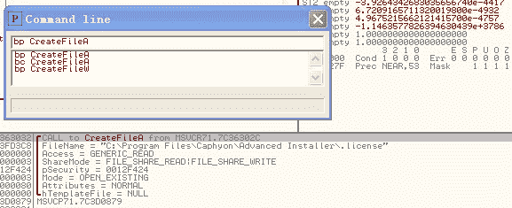

# Advanced Installer 3.81 

> 原文：[`www.pediy.com/kssd/pediy08/pediy8-109.htm`](https://www.pediy.com/kssd/pediy08/pediy8-109.htm)

【标题】【VC】Advanced Installer 3.81 注册文件算法分析  
【作者】forever\[RCT\]  
【语言】VC7.1  
【保护】无壳，注册文件  
【难度】中等  
【工具】ollydbg,ida,peid  
【简介】一个能制作 CAB 安装包的安装制作软件。  
【正文】  
        这个软件用 peid 查不出是什么语言的，直接看到连接版本是 7.1。不过在软件的安装目录下有 msvcr71.dll，  
    msvcp71.dll 这两个 VC 的运行时文件，可以猜测是用 VC 写的。  
        这个软件的注册方式也特别，是要你先输入一个 32 字符的序列号，然后到他的网站上验证，通过后会下载  
    一个协议文件来。网站验证地址是：  
http://www.advancedinstaller.com/register/confirm.php?id=00000000000000000000000000000003&ver=3.8.1&platform=WinXP  
    那个 id 字段就是要你输入的序列号。弄协议文件我是不行啦。随便写个协议文件又异常，看样子是没法分析啦。  
        这里要感谢 LeNgHost，帮助找了一个 2.X 版本的注册机。一般软件的编写都有继承性，即使变化也很少从根  
    本上变化。注册算法也是这样。先生成一个老的注册文件，然后慢慢跟踪分析。  
        下面这段是 ida 里反汇编出来的，结合 ollydbg，可以容易分析软件怎么验证注册文件。  
        用 ollydbg 载入程序，下断点 bp CreateFileA,会来到下面位置：  
           
        逐层返回后来到下面：  
  
004342C6             lea     eax, \[ebp-8Ch\]  
004342CC  
004342CC loc\_4342CC:                          
004342CC             push    esi  
004342CD             push    edi  
004342CE             push    1B6h  
004342D3             push    1  
004342D5             push    eax             ; C:\\Program Files\\Caphyon\\Advanced Installer\\.license  
004342D6             lea     ecx, \[ebp-278h\]  
004342DC             call    ds:std::basic\_ifstream<wchar\_t,std::char\_traits<wchar\_t>>::open(char const \*,int,int)  
004342E2             mov     eax, \[ebp-278h\]  
004342E8             mov     eax, \[eax+4\]  
004342EB             mov     eax, \[ebp+eax-270h\]  
004342F2             test    al, 6  
004342F4             jnz     loc\_4348AF  
004342FA             mov     edi, \[ebp-54h\]  ; 取第一行，即用户名  
004342FD             push    ebx  
004342FE             push    edi  
004342FF             lea     ecx, \[ebp-278h\]  
00434305             call    ds:std::basic\_istream<wchar\_t,std::char\_traits<wchar\_t>>::getline(wchar\_t \*,int)  
0043430B             push    edi  
0043430C             lea     ecx, \[ebp-48h\]  ; 连接上第一行字符串  
0043430F             call    ds:std::basic\_string<wchar\_t,std::char\_traits<wchar\_t>,std::allocator<wchar\_t>>::operator+=(wchar\_t const \*)  
00434315             push    offset a347134d7 ; "347134d7"  
0043431A             lea     ecx, \[ebp-48h\]  ; 连接上"347134d7"  
0043431D             call    ds:std::basic\_string<wchar\_t,std::char\_traits<wchar\_t>,std::allocator<wchar\_t>>::operator+=(wchar\_t const \*)  
00434323             push    edi  
00434324             lea     ecx, \[ebp-2Ch\]  
00434327             call    ds:std::basic\_string<wchar\_t,std::char\_traits<wchar\_t>,std::allocator<wchar\_t>>::basic\_string<wchar\_t,std::char\_traits<wchar\_t>,std::allocator<wchar\_t>>(wchar\_t const \*)  
0043432D             mov     byte ptr \[ebp-4\], 5  
00434331             lea     eax, \[ebp-2Ch\]  
00434334             push    eax  
00434335             lea     eax, \[ebp-74h\]  
00434338             push    eax  
00434339             call    sub\_434B8E      ; 取第一个空格后面的字符串  
0043433E             pop     ecx  
0043433F             pop     ecx  
00434340             mov     byte ptr \[ebp-4\], 6  
00434344             push    eax  
00434345             mov     ecx, offset username\_73CFF4 ; 这里保存用户名  
0043434A             call    ds:std::basic\_string<wchar\_t,std::char\_traits<wchar\_t>,std::allocator<wchar\_t>>::operator=(std::basic\_string<wchar\_t,std::char\_traits<wchar\_t>,std::allocator<wchar\_t>> const &)  
00434350             mov     byte ptr \[ebp-4\], 5  
00434354             lea     ecx, \[ebp-74h\]  
00434357             call    ds:std::basic\_string<wchar\_t,std::char\_traits<wchar\_t>,std::allocator<wchar\_t>>::~basic\_string<wchar\_t,std::char\_traits<wchar\_t>,std::allocator<wchar\_t>>(void)  
0043435D             mov     byte ptr \[ebp-4\], 4  
00434361             lea     ecx, \[ebp-2Ch\]  
00434364             call    ds:std::basic\_string<wchar\_t,std::char\_traits<wchar\_t>,std::allocator<wchar\_t>>::~basic\_string<wchar\_t,std::char\_traits<wchar\_t>,std::allocator<wchar\_t>>(void)  
0043436A             push    ebx  
0043436B             push    edi  
0043436C             lea     ecx, \[ebp-278h\]  
00434372             call    ds:std::basic\_istream<wchar\_t,std::char\_traits<wchar\_t>>::getline(wchar\_t \*,int)  
00434378             push    edi             ; 取第二行，即 email  
00434379             lea     ecx, \[ebp-48h\]  ; 连接上第二行字符串  
0043437C             call    ds:std::basic\_string<wchar\_t,std::char\_traits<wchar\_t>,std::allocator<wchar\_t>>::operator+=(wchar\_t const \*)  
00434382             push    offset a29fbcb9c ; "29fbcb9c"  
00434387             lea     ecx, \[ebp-48h\]  ; 连接上字符串"29fbcb9c"  
0043438A             call    ds:std::basic\_string<wchar\_t,std::char\_traits<wchar\_t>,std::allocator<wchar\_t>>::operator+=(wchar\_t const \*)  
00434390             push    ebx  
00434391             push    edi  
00434392             lea     ecx, \[ebp-278h\]  
00434398             call    ds:std::basic\_istream<wchar\_t,std::char\_traits<wchar\_t>>::getline(wchar\_t \*,int)  
0043439E             push    edi             ; 取第三行，即注册组织  
0043439F             lea     ecx, \[ebp-48h\]  ; 连接上第三行字符串  
004343A2             call    ds:std::basic\_string<wchar\_t,std::char\_traits<wchar\_t>,std::allocator<wchar\_t>>::operator+=(wchar\_t const \*)  
004343A8             push    offset aDb481813 ; "db481813"  
004343AD             lea     ecx, \[ebp-48h\]  ; 连接上字符串"db481813"  
004343B0             call    ds:std::basic\_string<wchar\_t,std::char\_traits<wchar\_t>,std::allocator<wchar\_t>>::operator+=(wchar\_t const \*)  
004343B6             push    edi  
004343B7             lea     ecx, \[ebp-2Ch\]  
004343BA             call    ds:std::basic\_string<wchar\_t,std::char\_traits<wchar\_t>,std::allocator<wchar\_t>>::basic\_string<wchar\_t,std::char\_traits<wchar\_t>,std::allocator<wchar\_t>>(wchar\_t const \*)  
004343C0             mov     byte ptr \[ebp-4\], 7  
004343C4             lea     eax, \[ebp-2Ch\]  
004343C7             push    eax  
004343C8             lea     eax, \[ebp-100h\] ; 第三行  
004343CE             push    eax  
004343CF             call    sub\_434BD6      ; 取第一个空格前面的字符串  
004343D4             pop     ecx  
004343D5             pop     ecx  
004343D6             mov     byte ptr \[ebp-4\], 9  
004343DA             lea     ecx, \[ebp-2Ch\]  
004343DD             call    ds:std::basic\_string<wchar\_t,std::char\_traits<wchar\_t>,std::allocator<wchar\_t>>::~basic\_string<wchar\_t,std::char\_traits<wchar\_t>,std::allocator<wchar\_t>>(void)  
004343E3             lea     eax, \[ebp-100h\]  
004343E9             push    offset unk\_73D0DC ; "IP:"  
004343EE             push    eax  
004343EF             call    ds:std::operator!=<wchar\_t,std::char\_traits<wchar\_t>,std::allocator<wchar\_t>>(std::basic\_string<wchar\_t,std::char\_traits<wchar\_t>,std::allocator<wchar\_t>> const &,std::basic\_string<wchar\_t,std::char\_traits<wchar\_t>,std::allocator<wchar\_t>> const &)  
004343F5             test    al, al          ; 比较是否等于"IP:"  
004343F7             pop     ecx  
004343F8             pop     ecx  
004343F9             jz      short loc\_434417  
004343FB             mov     byte\_73CF79, 1  ; 不等则校验失败  
00434402             mov     byte ptr \[ebp-4\], 4  
00434406             lea     ecx, \[ebp-100h\]  
0043440C             call    ds:std::basic\_string<wchar\_t,std::char\_traits<wchar\_t>,std::allocator<wchar\_t>>::~basic\_string<wchar\_t,std::char\_traits<wchar\_t>,std::allocator<wchar\_t>>(void)  
00434412             jmp     loc\_4348BB  
00434417  
00434417 loc\_434417:                          
00434417             push    ebx  
00434418             push    edi  
00434419             lea     ecx, \[ebp-278h\]  
0043441F             call    ds:std::basic\_istream<wchar\_t,std::char\_traits<wchar\_t>>::getline(wchar\_t \*,int)  
00434425             push    edi             ; 取第四行，即协议类型  
00434426             lea     ecx, \[ebp-48h\]  ; 连接上第四行字符串  
00434429             call    ds:std::basic\_string<wchar\_t,std::char\_traits<wchar\_t>,std::allocator<wchar\_t>>::operator+=(wchar\_t const \*)  
0043442F             push    offset a224c4e11 ; "224c4e11"  
00434434             lea     ecx, \[ebp-48h\]  ; 连接上字符串"224c4e11"  
00434437             call    ds:std::basic\_string<wchar\_t,std::char\_traits<wchar\_t>,std::allocator<wchar\_t>>::operator+=(wchar\_t const \*)  
0043443D             push    edi  
0043443E             lea     ecx, \[ebp-2Ch\]  
00434441             call    ds:std::basic\_string<wchar\_t,std::char\_traits<wchar\_t>,std::allocator<wchar\_t>>::basic\_string<wchar\_t,std::char\_traits<wchar\_t>,std::allocator<wchar\_t>>(wchar\_t const \*)  
00434447             mov     byte ptr \[ebp-4\], 0Ah  
0043444B             lea     eax, \[ebp-2Ch\]  
0043444E             push    eax  
0043444F             lea     eax, \[ebp-74h\]  ; 第四行  
00434452             push    eax  
00434453             call    sub\_434B8E      ; 取第一个空格后面的字符串  
00434458             pop     ecx  
00434459             pop     ecx  
0043445A             mov     byte ptr \[ebp-4\], 0Bh  
0043445E             push    eax  
0043445F             mov     ecx, offset lic\_73D02C ; 这里保存协议类型  
00434464             call    ds:std::basic\_string<wchar\_t,std::char\_traits<wchar\_t>,std::allocator<wchar\_t>>::operator=(std::basic\_string<wchar\_t,std::char\_traits<wchar\_t>,std::allocator<wchar\_t>> const &)  
0043446A             mov     byte ptr \[ebp-4\], 0Ah  
0043446E             lea     ecx, \[ebp-74h\]  
00434471             call    ds:std::basic\_string<wchar\_t,std::char\_traits<wchar\_t>,std::allocator<wchar\_t>>::~basic\_string<wchar\_t,std::char\_traits<wchar\_t>,std::allocator<wchar\_t>>(void)  
00434477             mov     byte ptr \[ebp-4\], 9  
0043447B             lea     ecx, \[ebp-2Ch\]  
0043447E             call    ds:std::basic\_string<wchar\_t,std::char\_traits<wchar\_t>,std::allocator<wchar\_t>>::~basic\_string<wchar\_t,std::char\_traits<wchar\_t>,std::allocator<wchar\_t>>(void)  
00434484             mov     esi, offset lic\_73D02C ; 取协议类型  
00434489             call    sub\_433965      ; 把协议类型字符串转换成数字  
0043448E             push    ebx  
0043448F             push    edi  
00434490             lea     ecx, \[ebp-278h\]  
00434496             mov     licnum\_73CF2C, eax ; 保存在这里  
0043449B             call    ds:std::basic\_istream<wchar\_t,std::char\_traits<wchar\_t>>::getline(wchar\_t \*,int)  
004344A1             push    edi             ; 取第五行，即版本  
004344A2             lea     ecx, \[ebp-48h\]  ; 连接上第五行字符串  
004344A5             call    ds:std::basic\_string<wchar\_t,std::char\_traits<wchar\_t>,std::allocator<wchar\_t>>::operator+=(wchar\_t const \*)  
004344AB             push    ebx  
004344AC             push    edi  
004344AD             lea     ecx, \[ebp-278h\]  
004344B3             call    ds:std::basic\_istream<wchar\_t,std::char\_traits<wchar\_t>>::getline(wchar\_t \*,int)  
004344B9             push    edi             ; 取第六行，即注册日期  
004344BA             lea     ecx, \[ebp-48h\]  ; 连接上第六行字符串  
004344BD             call    ds:std::basic\_string<wchar\_t,std::char\_traits<wchar\_t>,std::allocator<wchar\_t>>::operator+=(wchar\_t const \*)  
004344C3             push    edi  
004344C4             lea     ecx, \[ebp-2Ch\]  
004344C7             call    ds:std::basic\_string<wchar\_t,std::char\_traits<wchar\_t>,std::allocator<wchar\_t>>::basic\_string<wchar\_t,std::char\_traits<wchar\_t>,std::allocator<wchar\_t>>(wchar\_t const \*)  
004344CD             mov     byte ptr \[ebp-4\], 0Ch  
004344D1             lea     eax, \[ebp-2Ch\]  
004344D4             push    eax  
004344D5             lea     eax, \[ebp-74h\]  ; 第六行  
004344D8             push    eax  
004344D9             call    sub\_434B8E      ; 取第一个空格后面的字符串  
004344DE             pop     ecx  
004344DF             pop     ecx  
004344E0             mov     byte ptr \[ebp-4\], 0Dh  
004344E4             push    eax  
004344E5             mov     ecx, offset date\_73D010 ; 这里保存注册日期  
004344EA             call    ds:std::basic\_string<wchar\_t,std::char\_traits<wchar\_t>,std::allocator<wchar\_t>>::operator=(std::basic\_string<wchar\_t,std::char\_traits<wchar\_t>,std::allocator<wchar\_t>> const &)  
004344F0             mov     byte ptr \[ebp-4\], 0Ch  
004344F4             lea     ecx, \[ebp-74h\]  
004344F7             call    ds:std::basic\_string<wchar\_t,std::char\_traits<wchar\_t>,std::allocator<wchar\_t>>::~basic\_string<wchar\_t,std::char\_traits<wchar\_t>,std::allocator<wchar\_t>>(void)  
004344FD             mov     byte ptr \[ebp-4\], 9  
00434501             lea     ecx, \[ebp-2Ch\]  
00434504             call    ds:std::basic\_string<wchar\_t,std::char\_traits<wchar\_t>,std::allocator<wchar\_t>>::~basic\_string<wchar\_t,std::char\_traits<wchar\_t>,std::allocator<wchar\_t>>(void)  
0043450A             push    ebx  
0043450B             push    edi  
0043450C             lea     ecx, \[ebp-278h\]  
00434512             call    ds:std::basic\_istream<wchar\_t,std::char\_traits<wchar\_t>>::getline(wchar\_t \*,int)  
00434518             push    edi             ; 取第七行，即服务时间  
00434519             lea     ecx, \[ebp-2Ch\]  
0043451C             call    ds:std::basic\_string<wchar\_t,std::char\_traits<wchar\_t>,std::allocator<wchar\_t>>::basic\_string<wchar\_t,std::char\_traits<wchar\_t>,std::allocator<wchar\_t>>(wchar\_t const \*)  
00434522             mov     byte ptr \[ebp-4\], 0Eh  
00434526             lea     eax, \[ebp-2Ch\]  
00434529             push    eax  
0043452A             lea     eax, \[ebp-154h\]  
00434530             push    eax  
00434531             call    sub\_434BD6      ; 取第一个空格前面的字符串  
00434536             pop     ecx  
00434537             pop     ecx  
00434538             mov     byte ptr \[ebp-4\], 10h  
0043453C             lea     ecx, \[ebp-2Ch\]  
0043453F             call    ds:std::basic\_string<wchar\_t,std::char\_traits<wchar\_t>,std::allocator<wchar\_t>>::~basic\_string<wchar\_t,std::char\_traits<wchar\_t>,std::allocator<wchar\_t>>(void)  
00434545             mov     esi, ds:std::operator==<wchar\_t,std::char\_traits<wchar\_t>,std::allocator<wchar\_t>>(std::basic\_string<wchar\_t,std::char\_traits<wchar\_t>,std::allocator<wchar\_t>> const &,std::basic\_string<wchar\_t,std::char\_traits<wchar\_t>,std::allocator<wchar\_t>> const &)  
0043454B             lea     eax, \[ebp-154h\]  
00434551             push    offset unk\_73D0F8 ; "MaintenancePlan:"  
00434556             push    eax  
00434557             call    esi ; std::operator==<wchar\_t,std::char\_traits<wchar\_t>,std::allocator<wchar\_t>>(std::basic\_string<wchar\_t,std::char\_traits<wchar\_t>,std::allocator<wchar\_t>> const &,std::basic\_string<wchar\_t,std::char\_traits<wchar\_t>,std::allocator<wchar\_t>> const &)  
00434559             test    al, al  
0043455B             pop     ecx  
0043455C             pop     ecx  
0043455D             jz      short loc\_4345CB ; 不等则跳  
0043455F             push    edi  
00434560             lea     ecx, \[ebp-48h\]  ; 连接上第七行  
00434563             call    ds:std::basic\_string<wchar\_t,std::char\_traits<wchar\_t>,std::allocator<wchar\_t>>::operator+=(wchar\_t const \*)  
00434569             push    edi  
0043456A             lea     ecx, \[ebp-2Ch\]  
0043456D             call    ds:std::basic\_string<wchar\_t,std::char\_traits<wchar\_t>,std::allocator<wchar\_t>>::basic\_string<wchar\_t,std::char\_traits<wchar\_t>,std::allocator<wchar\_t>>(wchar\_t const \*)  
00434573             mov     byte ptr \[ebp-4\], 11h  
00434577             lea     eax, \[ebp-2Ch\]  
0043457A             push    eax  
0043457B             lea     eax, \[ebp-74h\]  
0043457E             push    eax  
0043457F             call    sub\_434B8E      ; 取第一个空格后面的字符串  
00434584             mov     byte ptr \[ebp-4\], 12h  
00434588             push    offset MPL\_73CF20  
0043458D             push    offset MPH\_73CF24  
00434592             mov     edi, eax  
00434594             call    sub\_43BE77      ; 服务时间转换成数字保存  
00434599             add     esp, 10h  
0043459C             mov     byte ptr \[ebp-4\], 11h  
004345A0             lea     ecx, \[ebp-74h\]  
004345A3             call    ds:std::basic\_string<wchar\_t,std::char\_traits<wchar\_t>,std::allocator<wchar\_t>>::~basic\_string<wchar\_t,std::char\_traits<wchar\_t>,std::allocator<wchar\_t>>(void)  
004345A9             mov     byte ptr \[ebp-4\], 10h  
004345AD             lea     ecx, \[ebp-2Ch\]  
004345B0             call    ds:std::basic\_string<wchar\_t,std::char\_traits<wchar\_t>,std::allocator<wchar\_t>>::~basic\_string<wchar\_t,std::char\_traits<wchar\_t>,std::allocator<wchar\_t>>(void)  
004345B6             push    ebx  
004345B7             push    dword ptr \[ebp-54h\]  
004345BA             lea     ecx, \[ebp-278h\]  
004345C0             call    ds:std::basic\_istream<wchar\_t,std::char\_traits<wchar\_t>>::getline(wchar\_t \*,int)  
004345C6             mov     edi, \[ebp-54h\]  ; 取第八行，即校验码  
004345C9             jmp     short loc\_4345DC  
004345CB  
004345CB loc\_4345CB:                           
004345CB             and     MPL\_73CF20, 0  
004345D2             mov     MPH\_73CF24, 1   ; 如果没有服务时间则默认是 1 年  
004345DC  
004345DC loc\_4345DC:                           
004345DC             push    edi  
004345DD             lea     ecx, \[ebp-2Ch\]  
004345E0             call    ds:std::basic\_string<wchar\_t,std::char\_traits<wchar\_t>,std::allocator<wchar\_t>>::basic\_string<wchar\_t,std::char\_traits<wchar\_t>,std::allocator<wchar\_t>>(wchar\_t const \*)  
004345E6             mov     byte ptr \[ebp-4\], 13h  
004345EA             lea     eax, \[ebp-2Ch\]  
004345ED             push    eax  
004345EE             lea     eax, \[ebp-0ACh\] ; 第八行  
004345F4             push    eax  
004345F5             call    sub\_434B8E      ; 取第一个空格后面的字符串  
004345FA             pop     ecx  
004345FB             pop     ecx  
004345FC             mov     byte ptr \[ebp-4\], 15h  
00434600             lea     ecx, \[ebp-2Ch\]  
00434603             call    ds:std::basic\_string<wchar\_t,std::char\_traits<wchar\_t>,std::allocator<wchar\_t>>::~basic\_string<wchar\_t,std::char\_traits<wchar\_t>,std::allocator<wchar\_t>>(void)  
00434609             push    3  
0043460B             push    0  
0043460D             lea     eax, \[ebp-1C4h\] ; 这里保存校验码前 3 个字符  
00434613             push    eax  
00434614             lea     ecx, \[ebp-0ACh\]  
0043461A             call    ds:std::basic\_string<wchar\_t,std::char\_traits<wchar\_t>,std::allocator<wchar\_t>>::substr(uint,uint)  
00434620             mov     byte ptr \[ebp-4\], 16h  
00434624             push    20h  
00434626             push    3  
00434628             lea     eax, \[ebp-1A8h\] ; 这里保存校验码中间 32 个字符  
0043462E             push    eax  
0043462F             lea     ecx, \[ebp-0ACh\]  
00434635             call    ds:std::basic\_string<wchar\_t,std::char\_traits<wchar\_t>,std::allocator<wchar\_t>>::substr(uint,uint)  
0043463B             mov     byte ptr \[ebp-4\], 17h  
0043463F             push    4  
00434641             push    23h  
00434643             lea     eax, \[ebp-1E0h\] ; 这里保存校验码后 4 个字符  
00434649             push    eax  
0043464A             lea     ecx, \[ebp-0ACh\]  
00434650             call    ds:std::basic\_string<wchar\_t,std::char\_traits<wchar\_t>,std::allocator<wchar\_t>>::substr(uint,uint)  
00434656             mov     byte ptr \[ebp-4\], 18h  
0043465A             lea     eax, \[ebp-0C8h\]  
00434660             push    eax  
00434661             lea     ecx, \[ebp-48h\]  
00434664             call    sub\_43B9A3  
00434669             pop     ecx  
0043466A             mov     byte ptr \[ebp-4\], 19h  
0043466E             cmp     dword ptr \[ebp-0B0h\], 10h  
00434675             mov     edx, \[ebp-0C4h\]  
0043467B             jnb     short loc\_434683  
0043467D             lea     edx, \[ebp-0C4h\]  
00434683  
00434683 loc\_434683:                           
00434683             lea     eax, \[ebp-300h\] ; 这里是前面连接在一起的那个字符串  
00434689             call    MD5\_47757C      ; 求 md5  
0043468E             lea     eax, \[ebp-300h\]  
00434694             call    sub\_4775A4      ; 转换成字符串  
00434699             mov     edi, eax  
0043469B             mov     edx, edi  
0043469D             lea     eax, \[ebp-300h\]  
004346A3             call    MD5\_47757C      ; 求 md5  
004346A8             lea     eax, \[ebp-300h\]  
004346AE             call    sub\_4775A4      ; 转换成字符串  
004346B3             push    edi  
004346B4             lea     ecx, \[ebp-170h\] ; 第一次求 md5 后的字符串  
004346BA             mov     ebx, eax  
004346BC             call    ds:std::basic\_string<char,std::char\_traits<char>,std::allocator<char>>::basic\_string<char,std::char\_traits<char>,std::allocator<char>>(char const \*)  
004346C2             mov     byte ptr \[ebp-4\], 1Ah  
004346C6             push    ebx  
004346C7             lea     ecx, \[ebp-11Ch\] ; 第二次求 md5 后的字符串  
004346CD             call    ds:std::basic\_string<char,std::char\_traits<char>,std::allocator<char>>::basic\_string<char,std::char\_traits<char>,std::allocator<char>>(char const \*)  
004346D3             mov     byte ptr \[ebp-4\], 1Bh  
004346D7             push    3  
004346D9             push    5  
004346DB             lea     eax, \[ebp-18Ch\]  
004346E1             push    eax  
004346E2             lea     ecx, \[ebp-11Ch\] ; 从第 6 个字符起取 3 个字符  
004346E8             call    ds:std::basic\_string<char,std::char\_traits<char>,std::allocator<char>>::substr(uint,uint)  
004346EE             mov     byte ptr \[ebp-4\], 1Ch  
004346F2             push    4  
004346F4             push    10  
004346F6             lea     eax, \[ebp-138h\]  
004346FC             push    eax  
004346FD             lea     ecx, \[ebp-11Ch\] ; 从第 11 个字符起取 4 个字符  
00434703             call    ds:std::basic\_string<char,std::char\_traits<char>,std::allocator<char>>::substr(uint,uint)  
00434709             mov     byte ptr \[ebp-4\], 1Dh  
0043470D             push    edi  
0043470E             call    operator delete(void \*)  
00434713             push    ebx  
00434714             call    operator delete(void \*)  
00434719             lea     eax, \[ebp-170h\]  
0043471F             push    eax  
00434720             lea     eax, \[ebp-294h\]  
00434726             push    eax  
00434727             call    sub\_43A9F1  
0043472C             mov     byte ptr \[ebp-4\], 1Eh  
00434730             lea     ecx, \[ebp-1A8h\]  
00434736             push    ecx  
00434737             push    eax  
00434738             mov     dword ptr \[ebp-10h\], 1  
0043473F             call    esi ; std::operator==<wchar\_t,std::char\_traits<wchar\_t>,std::allocator<wchar\_t>>(std::basic\_string<wchar\_t,std::char\_traits<wchar\_t>,std::allocator<wchar\_t>> const &,std::basic\_string<wchar\_t,std::char\_traits<wchar\_t>,std::allocator<wchar\_t>> const &)  
00434741             add     esp, 18h  
00434744             test    al, al          ; 两个 32 字符长的字符串比较  
00434746             push    31  
00434748             pop     edi  
00434749             jz      short loc\_4347A9  
0043474B             lea     eax, \[ebp-18Ch\]  
00434751             push    eax  
00434752             lea     eax, \[ebp-2Ch\]  
00434755             push    eax  
00434756             call    sub\_43A9F1  
0043475B             mov     \[ebp-4\], edi  
0043475E             lea     ecx, \[ebp-1C4h\]  
00434764             push    ecx  
00434765             push    eax  
00434766             mov     dword ptr \[ebp-10h\], 3  
0043476D             call    esi ; std::operator==<wchar\_t,std::char\_traits<wchar\_t>,std::allocator<wchar\_t>>(std::basic\_string<wchar\_t,std::char\_traits<wchar\_t>,std::allocator<wchar\_t>> const &,std::basic\_string<wchar\_t,std::char\_traits<wchar\_t>,std::allocator<wchar\_t>> const &)  
0043476F             add     esp, 10h  
00434772             test    al, al          ; 两个 3 字符长的字符串比较  
00434774             jz      short loc\_4347A9  
00434776             lea     eax, \[ebp-138h\]  
0043477C             push    eax  
0043477D             lea     eax, \[ebp-74h\]  
00434780             push    eax  
00434781             call    sub\_43A9F1  
00434786             mov     dword ptr \[ebp-4\], 20h  
0043478D             lea     ecx, \[ebp-1E0h\]  
00434793             push    ecx  
00434794             push    eax  
00434795             mov     dword ptr \[ebp-10h\], 7  
0043479C             call    esi ; std::operator==<wchar\_t,std::char\_traits<wchar\_t>,std::allocator<wchar\_t>>(std::basic\_string<wchar\_t,std::char\_traits<wchar\_t>,std::allocator<wchar\_t>> const &,std::basic\_string<wchar\_t,std::char\_traits<wchar\_t>,std::allocator<wchar\_t>> const &)  
0043479E             add     esp, 10h  
004347A1             test    al, al          ; 两个 4 字符长的字符串比较  
004347A3             jz      short loc\_4347A9  
004347A5             mov     bl, 1           ; 校验码比较都通过返回 1  
004347A7             jmp     short loc\_4347AB  
004347A9  
004347A9 loc\_4347A9:                          
004347A9                                      
004347A9                                      
004347A9             xor     bl, bl          ; 否则返回 0  
004347AB  
004347AB loc\_4347AB:                           
004347AB             mov     \[ebp-4\], edi  
004347AE             test    byte ptr \[ebp-10h\], 4  
004347B2             jz      short loc\_4347C1  
004347B4             and     dword ptr \[ebp-10h\], 0FFFFFFFBh  
004347B8             lea     ecx, \[ebp-74h\]  
004347BB             call    ds:std::basic\_string<wchar\_t,std::char\_traits<wchar\_t>,std::allocator<wchar\_t>>::~basic\_string<wchar\_t,std::char\_traits<wchar\_t>,std::allocator<wchar\_t>>(void)  
004347C1  
004347C1 loc\_4347C1:                           
004347C1             mov     dword ptr \[ebp-4\], 1Eh  
004347C8             test    byte ptr \[ebp-10h\], 2  
004347CC             jz      short loc\_4347DB  
004347CE             and     dword ptr \[ebp-10h\], 0FFFFFFFDh  
004347D2             lea     ecx, \[ebp-2Ch\]  
004347D5             call    ds:std::basic\_string<wchar\_t,std::char\_traits<wchar\_t>,std::allocator<wchar\_t>>::~basic\_string<wchar\_t,std::char\_traits<wchar\_t>,std::allocator<wchar\_t>>(void)  
004347DB  
004347DB loc\_4347DB:                          
004347DB             mov     dword ptr \[ebp-4\], 1Dh  
004347E2             test    byte ptr \[ebp-10h\], 1  
004347E6             jz      short loc\_4347F4  
004347E8             lea     ecx, \[ebp-294h\]  
004347EE             call    ds:std::basic\_string<wchar\_t,std::char\_traits<wchar\_t>,std::allocator<wchar\_t>>::~basic\_string<wchar\_t,std::char\_traits<wchar\_t>,std::allocator<wchar\_t>>(void)  
004347F4  
004347F4 loc\_4347F4:                          
004347F4             test    bl, bl  
004347F6             jz      short loc\_4347FF  
004347F8             mov     byte\_73CF78, 1  ; 置注册成功标志  
004347FF  
004347FF loc\_4347FF:                           
004347FF             mov     byte ptr \[ebp-4\], 1Ch  
00434803             lea     ecx, \[ebp-138h\]  
00434809             call    ds:std::basic\_string<char,std::char\_traits<char>,std::allocator<char>>::~basic\_string<char,std::char\_traits<char>,std::allocator<char>>(void)  
0043480F             mov     byte ptr \[ebp-4\], 1Bh  
00434813             lea     ecx, \[ebp-18Ch\]  
00434819             call    ds:std::basic\_string<char,std::char\_traits<char>,std::allocator<char>>::~basic\_string<char,std::char\_traits<char>,std::allocator<char>>(void)  
0043481F             mov     byte ptr \[ebp-4\], 1Ah  
00434823             lea     ecx, \[ebp-11Ch\]  
00434829             call    ds:std::basic\_string<char,std::char\_traits<char>,std::allocator<char>>::~basic\_string<char,std::char\_traits<char>,std::allocator<char>>(void)  
0043482F             mov     byte ptr \[ebp-4\], 19h  
00434833             lea     ecx, \[ebp-170h\]  
00434839             call    ds:std::basic\_string<char,std::char\_traits<char>,std::allocator<char>>::~basic\_string<char,std::char\_traits<char>,std::allocator<char>>(void)  
0043483F             mov     byte ptr \[ebp-4\], 18h  
00434843             lea     ecx, \[ebp-0C8h\]  
00434849             call    ds:std::basic\_string<char,std::char\_traits<char>,std::allocator<char>>::~basic\_string<char,std::char\_traits<char>,std::allocator<char>>(void)  
0043484F             mov     byte ptr \[ebp-4\], 17h  
00434853             lea     ecx, \[ebp-1E0h\]  
00434859             call    ds:std::basic\_string<wchar\_t,std::char\_traits<wchar\_t>,std::allocator<wchar\_t>>::~basic\_string<wchar\_t,std::char\_traits<wchar\_t>,std::allocator<wchar\_t>>(void)  
0043485F             mov     byte ptr \[ebp-4\], 16h  
00434863             lea     ecx, \[ebp-1A8h\]  
00434869             call    ds:std::basic\_string<wchar\_t,std::char\_traits<wchar\_t>,std::allocator<wchar\_t>>::~basic\_string<wchar\_t,std::char\_traits<wchar\_t>,std::allocator<wchar\_t>>(void)  
0043486F             mov     byte ptr \[ebp-4\], 15h  
00434873             lea     ecx, \[ebp-1C4h\]  
00434879             call    ds:std::basic\_string<wchar\_t,std::char\_traits<wchar\_t>,std::allocator<wchar\_t>>::~basic\_string<wchar\_t,std::char\_traits<wchar\_t>,std::allocator<wchar\_t>>(void)  
0043487F             mov     byte ptr \[ebp-4\], 10h  
00434883             lea     ecx, \[ebp-0ACh\]  
00434889             call    ds:std::basic\_string<wchar\_t,std::char\_traits<wchar\_t>,std::allocator<wchar\_t>>::~basic\_string<wchar\_t,std::char\_traits<wchar\_t>,std::allocator<wchar\_t>>(void)  
0043488F             mov     byte ptr \[ebp-4\], 9  
00434893             lea     ecx, \[ebp-154h\]  
00434899             call    ds:std::basic\_string<wchar\_t,std::char\_traits<wchar\_t>,std::allocator<wchar\_t>>::~basic\_string<wchar\_t,std::char\_traits<wchar\_t>,std::allocator<wchar\_t>>(void)  
0043489F             mov     byte ptr \[ebp-4\], 4  
004348A3             lea     ecx, \[ebp-100h\]  
004348A9             call    ds:std::basic\_string<wchar\_t,std::char\_traits<wchar\_t>,std::allocator<wchar\_t>>::~basic\_string<wchar\_t,std::char\_traits<wchar\_t>,std::allocator<wchar\_t>>(void)  
004348AF  
004348AF loc\_4348AF:                         
004348AF             mov     byte\_73CF79, 1  
004348B6             call    sub\_4340A0      ; 处理服务时间  
004348BB  
004348BB loc\_4348BB:                          
004348BB             mov     byte ptr \[ebp-4\], 3  
004348BF             lea     ecx, \[ebp-90h\]  
004348C5             call    ds:std::basic\_string<char,std::char\_traits<char>,std::allocator<char>>::~basic\_string<char,std::char\_traits<char>,std::allocator<char>>(void)  
004348CB             mov     byte ptr \[ebp-4\], 2  
004348CF             lea     ecx, \[ebp-278h\]  
004348D5             call    ds:std::basic\_ifstream<wchar\_t,std::char\_traits<wchar\_t>>::\`vbase destructor(void)  
004348DB             mov     byte ptr \[ebp-4\], 1  
004348DF             lea     ecx, \[ebp-48h\]  
004348E2             call    ds:std::basic\_string<wchar\_t,std::char\_traits<wchar\_t>,std::allocator<wchar\_t>>::~basic\_string<wchar\_t,std::char\_traits<wchar\_t>,std::allocator<wchar\_t>>(void)  
004348E8             mov     byte ptr \[ebp-4\], 0  
004348EC             lea     esi, \[ebp-58h\]  
004348EF             call    sub\_53F8FC  
004348F4             or      dword ptr \[ebp-4\], 0FFFFFFFFh  
004348F8             lea     eax, \[ebp-0E4h\]  
004348FE             push    eax  
004348FF             call    sub\_5C35AB  
00434904             pop     edi  
00434905             pop     esi  
00434906             pop     ebx  
00434907  
00434907 loc\_434907:                           
00434907             mov     ecx, \[ebp-0Ch\]  
0043490A             mov     large fs:0, ecx  
00434911             leave  
00434912             retn  
00434912 sub\_434235  endp ; sp =  4  
    
        总结一下：  
            先把下面字符串连接在一起：  
            第一行(用户名）＋ "347134d7" ＋ 第二行（email） ＋ "29fbcb9c" +   
            第三行（注册组织）+ "db481813" + 第四行（协议类型）＋ "224c4e11" ＋  
            第五行（版本） ＋ 第六行（注册日期） ＋ 第七行（服务时间）  
              
            服务时间字符串如果没有则默认是 1 年。  
                          
            把这个字符串求 MD5，得到一串小写的字符串，和校验字符串（第八行）的  
        4－35 位比较。  
            把这个 MD5 字符串再求一遍 MD5,得到一串小写的字符串，取字符串 6－8 位和  
        校验字符串的 1－3 位比较。取 MD5 字符串的 11－14 位和校验字符串的 36－39 比较。  
          
        这里没有什么特别的，需要看一下的就是判断协议类型的 CALL。  
          
.text:00433965                 push    edi  
.text:00433966                 push    0  
.text:00433968                 xor     edi, edi  
.text:0043396A                 push    offset unk\_73D050 ; "java"  
.text:0043396F                 mov     ecx, esi  
.text:00433971                 inc     edi  
.text:00433972                 call    ds:std::basic\_string<wchar\_t,std::char\_traits<wchar\_t>,std::allocator<wchar\_t>>::find(std::basic\_string<wchar\_t,std::char\_traits<wchar\_t>,std::allocator<wchar\_t>> const &,uint)  
.text:00433978                 mov     ecx, ds:uint const std::basic\_string<wchar\_t,std::char\_traits<wchar\_t>,std::allocator<wchar\_t>>::npos  
.text:0043397E                 cmp     eax, \[ecx\]  
.text:00433980                 jz      short loc\_433986  
.text:00433982                 push    2  
.text:00433984                 jmp     short loc\_4339DB  
.text:00433986  
.text:00433986 loc\_433986:                             
.text:00433986                 push    0  
.text:00433988                 push    offset unk\_73D06C ; "professional"  
.text:0043398D                 mov     ecx, esi  
.text:0043398F                 call    ds:std::basic\_string<wchar\_t,std::char\_traits<wchar\_t>,std::allocator<wchar\_t>>::find(std::basic\_string<wchar\_t,std::char\_traits<wchar\_t>,std::allocator<wchar\_t>> const &,uint)  
.text:00433995                 mov     ecx, ds:uint const std::basic\_string<wchar\_t,std::char\_traits<wchar\_t>,std::allocator<wchar\_t>>::npos  
.text:0043399B                 cmp     eax, \[ecx\]  
.text:0043399D                 jz      short loc\_4339A3  
.text:0043399F                 push    3  
.text:004339A1                 jmp     short loc\_4339DB  
.text:004339A3  
.text:004339A3 loc\_4339A3:                              
.text:004339A3                 push    0  
.text:004339A5                 push    offset unk\_73D0A4 ; "patch"  
.text:004339AA                 mov     ecx, esi  
.text:004339AC                 call    ds:std::basic\_string<wchar\_t,std::char\_traits<wchar\_t>,std::allocator<wchar\_t>>::find(std::basic\_string<wchar\_t,std::char\_traits<wchar\_t>,std::allocator<wchar\_t>> const &,uint)  
.text:004339B2                 mov     ecx, ds:uint const std::basic\_string<wchar\_t,std::char\_traits<wchar\_t>,std::allocator<wchar\_t>>::npos  
.text:004339B8                 cmp     eax, \[ecx\]  
.text:004339BA                 jz      short loc\_4339C0  
.text:004339BC                 push    4  
.text:004339BE                 jmp     short loc\_4339DB  
.text:004339C0  
.text:004339C0 loc\_4339C0:                              
.text:004339C0                 push    0  
.text:004339C2                 push    offset unk\_73D0C0 ; "msm"  
.text:004339C7                 mov     ecx, esi  
.text:004339C9                 call    ds:std::basic\_string<wchar\_t,std::char\_traits<wchar\_t>,std::allocator<wchar\_t>>::find(std::basic\_string<wchar\_t,std::char\_traits<wchar\_t>,std::allocator<wchar\_t>> const &,uint)  
.text:004339CF                 mov     ecx, ds:uint const std::basic\_string<wchar\_t,std::char\_traits<wchar\_t>,std::allocator<wchar\_t>>::npos  
.text:004339D5                 cmp     eax, \[ecx\]  
.text:004339D7                 jz      short loc\_4339DC  
.text:004339D9                 push    5  
.text:004339DB  
.text:004339DB loc\_4339DB:                              
.text:004339DB                                          
.text:004339DB                                       
.text:004339DB                 pop     edi  
.text:004339DC  
.text:004339DC loc\_4339DC:                              
.text:004339DC                 mov     eax, edi  
.text:004339DE                 pop     edi  
.text:004339DF                 retn  
  
        可以看出有效的协议类型是："java"，"professional"，"patch"，"msm"。  
          
        【全文完】 

下面是有效的协议内容：  
Name: forever\[RCT\]  
Email: abc@163.com  
IP: RCT  
License: java  
Version: 3.8.1  
Date: 03/15/2006  
MaintenancePlan: 100  
ID: 6fbd4e65db2e55f263d95cf9684c2c3bb5029bb