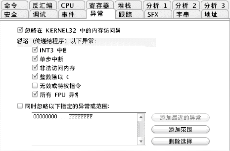
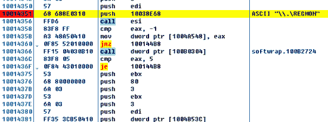
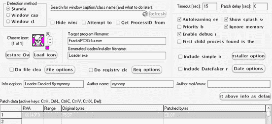

# SoftWrap 6.x 之一：制作内存补丁篇

> 原文：[`www.pediy.com/kssd/pediy09/pediy09-502.htm`](https://www.pediy.com/kssd/pediy09/pediy09-502.htm)

> 【文章标题】: SoftWrap 6.x 之一：制作内存补丁篇  
> 【文章作者】: wynney  
> 【软件名称】: Fractal PC 3.01  
> 【下载地址】: http://www.fractalpc.com/resources/SetupFractalPC30.exe  
> 【保护方式】: SoftWrap 6.x  
> 【使用工具】: OD、ABEL Loader  
> 【作者声明】: SoftWrap 的教程很少，花了点时间研究了下，发出来讨论下  
> \--------------------------------------------------------------------------------  
> 【详细过程】  
>   
>   一、  前言  
>     
>   SoftWrap 保护的程序一是很少，二是体积很大，不太方便找来写教程。  
>   跟踪程序你会发现壳会申请大致 5 个左右的区段来存放壳的代码，并完成加密等操作。  
>   这中间是用壳的 SDK 方式连接的 Anti Debug.dll(Softwrap.dll)，这个 dll 会检测调试器、跟踪工具、CRC 效验等。  
>   说到这里大家可能会问，那岂不是可以通过补区段的法子来脱壳吗？呵呵，是可以的，但是脱壳文件无法跨平台。  
>   介绍 SoftWrap 的教程少之又少，我们将一步一步揭开 SoftWrap 神秘的面纱：）本文介绍的是如何制作内存补丁  
>     
>   二、  找关键点  
>     
>    
> 
>   引用:??  00459000 >  90              nop                             ; EP  
>   00459001    90              nop  
>   00459002    EB 29           jmp     short 0045902D  
>   00459004    CD D4           int     0D4  
>   00459006    F3:67:          prefix rep:  
>   00459008    0000            add     byte ptr \[eax\], al  
>   0045900A    0000            add     byte ptr \[eax\], al  
>    
> 
> ??  
>   忽略所有异常，F9  
>      
>   
>   
>   有个 NAG，我们可以点"Try Now"进入程序  
>   现在我们需要找到一个点使我们跳过这个 NAG，而直接进入到程序当中  
>     
>   1、  设置异常  
>     
>   忽略除了特权指令和指定异常外的所有异常  
>      
>   
>   
>   2、  Shift+F9，中断在第一次特权指令异常  
>   3、  右键查找所有参考文本字串，搜索\\\\.\\REGMON，找到后双击，来到代码处，F2 下断，打埋伏  
>   
>   
>   
>   4、  继续 3 次 Shift+F9 中断下来，F8 走~  
>     
>    
> 
>   引用:??  100143EA    391D 90B50410   cmp     dword ptr \[1004B590\], ebx  
>   100143F0    75 07           jnz     short 100143F9                   ; 没跳  
>   100143F2    E8 10F7FFFF     call    10013B07                         ; F8 过这里后，NAG 出现  
>   100143F7    EB 05           jmp     short 100143FE  
>   100143F9    E8 18F9FFFF     call    10013D16  
>   100143FE    E8 843DFFFF     call    10008187  
>   10014403    E8 7D250000     call    10016985  
>    
> 
> ??  
>   于是，可以更改 100143F0 处的 jnz 为 jmp 就可以跳过 NAG 框了  
>     
>   三、  制作补丁  
>   
>   
>      
>   这样补丁就制作完毕了：）  
>   需要注意的是这样的内存补丁可以跨平台，但是，偶尔补丁失效。  
>     
>   四、  补充  
>     
>   我们也可以这样去处理  
>     
>    
> 
>   引用:??  100143EA    391D 90B50410   cmp     dword ptr \[1004B590\], ebx  
>   100143F0    75 07           jnz     short 100143F9                   ; 没跳  
>   100143F2    E8 10F7FFFF     call    10013B07                         ; F7 进去  
>   100143F7    EB 05           jmp     short 100143FE  
>   100143F9    E8 18F9FFFF     call    10013D16  
>    
> 
> ??  
>    
> 
>   引用:??  10013B54    E8 8F24FFFF     call    10005FE8  
>   10013B59    59              pop     ecx  
>   10013B5A    0FBE45 FF       movsx   eax, byte ptr \[ebp-1\]        ; \[ebp-1\]=4 则跳过 NAG 框  
>   10013B5E    48              dec     eax  
>   10013B5F    74 35           je      short 10013B96               ; 可以直接修改成 jmp 10013B6E  
>   10013B61    48              dec     eax  
>   10013B62    74 28           je      short 10013B8C  
>   10013B64    48              dec     eax  
>   10013B65    74 1B           je      short 10013B82  
>   10013B67    48              dec     eax  
>   10013B68    0F85 A4010000   jnz     10013D12  
>   10013B6E    C705 B8B40410 0>mov     dword ptr \[1004B4B8\], 1      ; 即跳到这里就可以跳过 NAG 框  
>   10013B78    E8 67A0FFFF     call    1000DBE4  
>   10013B7D    E9 90010000     jmp     10013D12  
>    
> 
> ??  
>   还有第 3 个可以 Pass NAG 的点，在下一篇中会提到。  
>     
>   第二篇：Inline Patch SoftWrap 壳的方法  
>     
> 图文 PDF 版下载  
>   
> [SoftWrap 6.x 之一：制作内存补丁篇.pdf](http://bbs.pediy.com/attachment.php?attachmentid=5357&d=1177318801)  
>   
> \--------------------------------------------------------------------------------  
> 【经验总结】  
>   给 SoftWrap 制作内存补丁很容易，难度：易  
>   但是不得不说 SoftWrap 算是一个猛壳了，要完全的处理掉 IAT 加密的确比较麻烦  
>   后面我们将一步一步的来欣赏它。  
>     
> \--------------------------------------------------------------------------------  
> 【版权声明】: 本文原创于看雪技术论坛, 转载请注明作者并保持文章的完整, 谢谢!  
>   
>                                                        2007 年 04 月 23 日

 4dd466d0e1e0cc123afbe504da2462ca