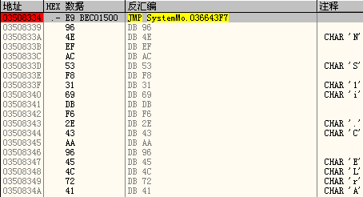
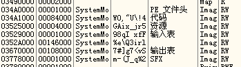
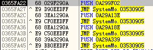
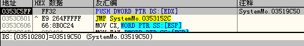
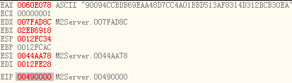
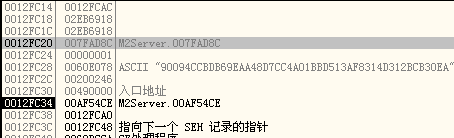

# TMD/WL 代码修复讲解

> 原文：[`www.pediy.com/kssd/pediy11/121433.html`](https://www.pediy.com/kssd/pediy11/121433.html)

TMD/WL 的脱壳并不难，难的是 VM JMP(TMD 的代码替代、偷取功能) 的修复，通常加壳者会在 OEP 或者关键位置偷取代码，以保证你即使脱掉了壳也无法让你正常运行，那么我今天要讲的就是如何修复。  
   
修复是一件体力活儿，同时也是考验你对汇编、反汇编能力，在这里我们主要通过观察寄存器、堆栈的状态，其中堆栈就是为了保证 CALL in/out 的平衡，这样才能让程序走正确。而寄存器就是在 VM 中运行的每一步的状态，通过寄存器完全可以逆向成汇编语言。  
   
这一节主要来讲讲如何简单的进行指令修复，讲之前我先讲下 CALL 指令，当运行到 CALL 会 PUSH 出下一条指令的内存地址，当运行到 CALL 的 RETN 指令时，会返回这个地址，然后 POP 掉，有些花指令就是用了这个原则，修改这个地址可以让 EP 返回指定地址。好，知道了以后我们进入  
正题，如图 1 看到 当前 EIP 为 03508334(处于 CODE 段) 这是一个典型的 VM JMP，而指令下面的都是加密过的代码，直到返回，036643F7(处于 VM 段)，具体可对照图 2。当运行到这里时，我们第一步就是要在 CODE 段设置内存访问断点，执行 F9，当然 F9 之前可以记录下寄存器和堆栈的状态。  
   
执行以后有 2 种状态第一种就是进入 CODE 段领空，处于一个 VM 所要保护的 CALL 的位置，直接进入说明 CALL 之前没有寄存器操作，而观察堆栈主要用于了解是否执行过 PUSH 指令，可以进行执行前后的对比观察，然后做记录。我这里由于是 DLL 的代码修复，所以要在 DLL 的代码段进行断点，EXE 的修复在 401000 处，来到 CALL 以后可以删除断点直接返回（CTRL+F9），或者单步运行到返回，这时又进入 VM 段领空，如图 3 所示就是典型的 VM 代码保护的虚拟指令区，此时依然记录好寄存器和堆栈，在 CODE 段设置内存访问断点，执行 F9，你如果发现 VM 没有直接进入 CODE 领空，而是继续处于 VM 中，如图 4，信息框中提示 DS:\[03510280\]=03519C50 (SystemMo.03519C50) 然后对照寄存器变化，就可以分析出此时的指令应该为 MOV EAX,DWORD PTR DS:\[03510280\]，然后继续 F9 执行，依然在 VM 段信息提示 DS:\[03519C50\]=00000000 说明 VM 执行 MOV EAX, DWORD PTR DS:\[EAX\]具体是不是 EAX 你可以继续执行 F9，直到进入 CODE 段，在此过程中严格记录下寄存器和堆栈变化，确保无误。这就是一个典型的 VM JMP 的指令修复，这里要着重注意堆栈情况。今天就讲到这了，下一节讲解一下段寄存器(DS SS 数据段和堆栈段寄存器)的操作与修复方法。  
   
图 1  
   
  
图 2  
   
  
图 3  
   
  
图 4  

这一节我会解释一下 ESP 的 堆栈段寄存器的修复，过程与第一节类似，具体要观察 EAX EDX ECX EBX ，结合 CPU、寄存器、堆栈进行修复，  
  
如图 1，这是达到 CALL 位置时的寄存器状态，注意 EAX=0060E078 再观察   
  
如图 2 堆栈状态 注意 0012FC28   0060E078  ASCII "90094CCBDB69EAA48D7CC4A01BBD513AF8314D312BCB30EA"  
  
那么 这时你看图 1 ESP 地址是 0012FC34，0012FC34-0012FC28=C 也就是说 SS:\[ESP-C\] 就是 EAX，所以汇编语言表达：MOV EAX,DWORD PTR SS:\[ESP-C\]，在达到这个 CALL 之前 VM 进行了 DS:\[007F09D0\]=007FAD8C (M2Server.007FAD8C) 的操作，你在图 1 中发现 EDX=007FAD8C，所以 MOV EDX,DWORD PTR DS:\[007F09D0\]，而 EDX 与 EBX 就可以先不管  
那么修复的代码就是如此了  
  
MOV EAX,DWORD PTR SS:\[ESP-C\]  
MOV EDX,DWORD PTR DS:\[007F09D0\]  
CALL 490000  
  
OK！这里我们简单的修复了一 SS 堆栈段寄存器和 DS 数据段寄存器的修复。  
  
  
以下是我曾经写过的 VM 寄存器跟踪记录脚本，可以帮你记录下所有进出寄存器的状态  
  
var findbase  
var findsize  
  
var count  
var index  
  
mov findbase, 1AB1000  //跟踪的 CODE 段基址  
mov findsize, 84000    //大小  
mov tempbase, findbase  
add tempbase, findsize  
  
mov index, 0  
mov count, 7 // VM.JMP 次数 首次跟踪时查看 VM.JMP 有多少填入此处  
  
TMD\_START:  
//pause  
add index, 1  
log index  
log "VM.JMP start {"  
  
TMD\_IMAGE:  
log "VM.JMP Trace.IN Start{" //跟踪入口  
log eax  
log ecx  
log edx  
log ebx  
log esp  
log ebp  
log esi  
log edi  
log eip  
log "} VM.JMP Trace.IN Over"  
bprm findbase, findsize  
esto  
bpmc  
cmp eip, tempbase  
jb STD\_IMAGE  
log "VM.JMP Trace.OUT Start{" //跟踪出口  
log eax  
log ecx  
log edx  
log ebx  
log esp  
log ebp  
log esi  
log edi  
log eip  
log "} VM.JMP Trace.OUT Over"  
jmp TMD\_IMAGE  
  
STD\_IMAGE:  
log "} VM.JMP over"  
log "CODE.CALL start {" //代码段 CALL  
log eax  
log ecx  
log edx  
log ebx  
log esp  
log ebp  
log esi  
log edi  
log eip  
log "} CODE.CALL over"  
  
OEP\_IMAGE:  
cmp index, count  
je END                        // stop !!!  
rtr  
find eip, #68????????E9????????# // VM JMP   
cmp $RESULT, 0  
je OEP\_IMAGE  
jmp TMD\_START  
  
END:  
bpmc  
ret  
  
  
图 1  
  
  
图 2 

