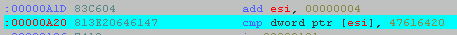

# 使用 OLLYDBG 進入 Xprotector

> 原文：[`www.pediy.com/kssd/pediy07/pediy7-612.htm`](https://www.pediy.com/kssd/pediy07/pediy7-612.htm)

目的:單純研究,討論用...  
  
(1)使用 PEiD 0.93 ,發現為 Xprotector 1.07  
  
  
(2)使用 LordPE ,dump full memory,結果...不能 dump memory  
  
(3) 由於 Xprotector 工作在 Ring 0 ,及有 anti Debug anti Dump  
      所以我們,必須借助,這個工具 R0cmd,來看看,它在搞啥鬼....  
  
(4)先抓出,未變動的 SST AND IDT  
  
r0cmd /dumpsst\_nt:sst1.bin  
r0cmd /viewidt:IDT1.txt   
  
然後再 RUN XP.EXE  
  
(5)再抓出,被修改的 SST AND IDT  
  
r0cmd /dumpsst\_nt:sst2.bin  
r0cmd /viewidt:IDT2.txt  
  
(6) 比較 SST1.BIN SST2.BIN  我們會發現,有 7 個位址,被改變  
  
0044:SST1: 805957E4    ==>SST2: F39AEBC4  ==>NtAllocateVirtualMemory  
00D4:SST1: 805B2404    ==>SST2: F39AECBE  ==>NtCreateThread  
00E8:SST1: 8061CBB4    ==>SST2: F39AF1A0  ==>NtDebugContinue  
02C8:SST1: 8059B7AE    ==>SST2: F39AEACA  ==>NtQueryVirtualMemory  
02E8:SST1: 8059C2DA    ==>SST2: F39AE014  ==>NtReadVirtualMemory  
0404:SST1: 805B3BF2    ==>SST2: F39AE9D0  ==>NtTerminateProcess  
0454:SST1: 8059C3DE    ==>SST2: F39AE000  ==>NtWriteVirtualMemory  
  
(7) 抓出來,看看,寫了啥東東...  
r0cmd /dump xp\_sst.bin F39AE000 2000

  
  
  
  
用 W32Dasm 看看,發現 Xprotector 代碼  
   在位址  0xA20 判斷值 47616420  
  
  
(6) 再比較 IDT1.txt IDT2.txt  我們會發現,有 3 個中斷,被改變  
  
IDT1:1  interrupt 8:8053203C    IDT2:1 interrupt  8:FFFFFFFF  
     3  interrupt 8:80532384         3 interrupt  8:FFFFFFFF  
    14  interrupt 8:80533EEC        14 interrupt  8:F8AAC000  
  
我們可以發現,INT 1 AND INT 3 都為 0xFFFFFFFF,也就是,當使用  
  INT 1 或 INT 3 時,會產生 Page Fault ,也就等於是,產生 INT 14 中斷  
 所以,它的秘密,在 INT 14 裡面,我們 抓出來,看看,寫了啥東東.  
r0cmd /dump int14.bin F8AAC000 200  
  
  
  
  
在位址  0x166 判斷值 47616420  
  
用 W32Dasm 看看,發現以 47616420 值,來決定,是否要產生真正 INT 1 ,INT 3  
   在位址  0x166 判斷值 47616420 ,我們將修改 0x16c=74 19 => EB 19  
  
  
(7)將 SST 還原,及修正 INT 14 CODE  
  
先用  
r0cmd /dump INT14.BIN F8AAC16C 1  
再將 int14.bin 內容 74 改成 EB  
   
在還原....  
r0cmd /loadsst\_nt:sst1.bin  
r0cmd /load INT14.BIN F8AAC16C 1   
  
(8)最後,你現在可以打開 OLLYDBG=> LOAD XP.EXE  功能,去 TRACE  
      
    Xprotector 開始進入點.....  
  
  
期待,大家都能解開 Xprotector 之謎..cc  
  
引用參考網站;  
[`cracklab.ru/art/xprot.php`](http://cracklab.ru/art/xprot.php) 作者:dragon  
[`saccopharynx.iespana.es/`](http://saccopharynx.iespana.es/)  作者:SACCOPHARYNX  
  
附件:R0cmd.rar

 4dd466d0e1e0cc123afbe504da2462ca