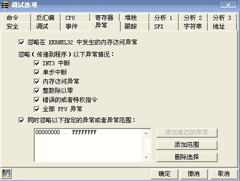

# 飓风 10.4 加密视频提取影音类视频附修改的脚本

> 原文：[`www.pediy.com/kssd/pediy11/106305.html`](https://www.pediy.com/kssd/pediy11/106305.html)

看到论坛上讨论飓风的太多了，也总是有坛友问。新年到了，索性把自己知道的这些都倒出来给大家分享下吧。也算是份小礼物先给看雪。东西没啥技术含量，高手飘过吧。首先声明下，脚本只会小改下，Dll 文件我处理不了，所以如果 MoleBox 的版本不对的话，可能会出现提取不出来的现象，别密我。我太菜也搞不来。  
  第一次看到飓风加密视频破解的教程是吾爱破解的 CHHSUN，自己摆弄了 3 天算是学会了爆破。最近才看到 Himily 放出提取视频的方法，后来去网络上搜索，找到了 Tuts 4 You BBS。那里学到了更多的东西。现在好用点的脚本和对应的 dll 我只知道 2 个（也许有 更好的，但是我孤陋寡闻）。  
一个就是 MoleBox 2.xx Unpacker + OEP Finder v1.10 by Cherry。  
  
MoleBox 2.xx Unpacker + OEP Finder v1.10.rar  
  
另一个就是 Sh4DoVV 的脚本。都是非常好用的。都放上来了。  
MoleBox Package Extractor.rar  
  
  首先设置下 OD 异常选项，全部异常前面都勾选，然后添加 00000000....FFFFFFFF 范围异常  
  
  
  下面说下飓风 10.4 的方法吧，其实很简单。OD 载入需要提前的加密视频，然后 alt+M。在资源段.rsrc 上 F2 下断，F9 运行。然后继续在代码段.text 段上 F2 下断，F9 运行。就到 OEP 了。然后加载修改版 MoleBox 2.xx Unpacker + OEP Finder v1.10 by Cherry.txt 脚本  
Molebox 2.x Unpacker and OEP Finder by Kelvar.rar  
  
其实很简单就是跳过脚本前面到达 OEP 的部分。没啥技术含量。所以一直没好意思贴出来。但是看到这么多人感兴趣，就献丑出来了。技术就是一层窗户纸，自己努力下很多都能自己弄出来。  
\[Note:\]据说提取 exe 类型的文件有更完美的办法，但是偶还不会。等待牛牛放出来一起学习了。  
  
转载请注明出处，原创于看雪论坛。