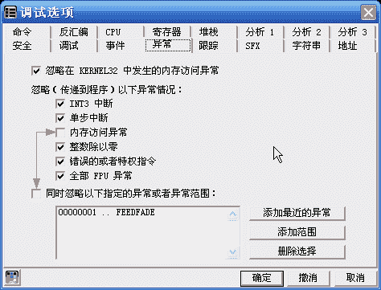
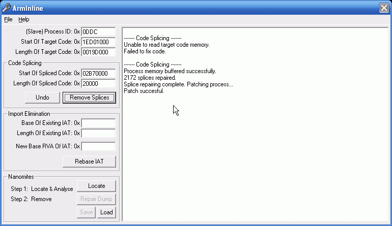
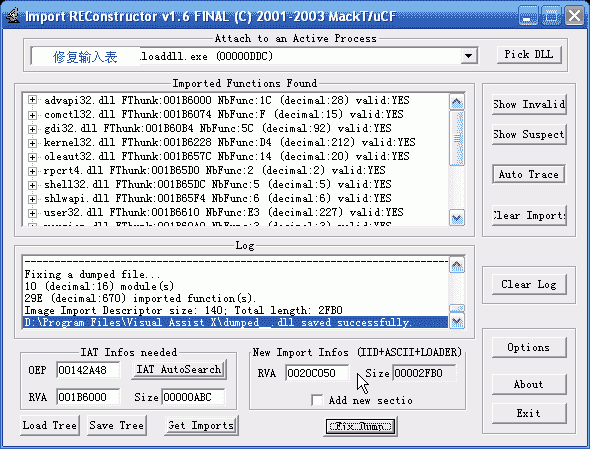
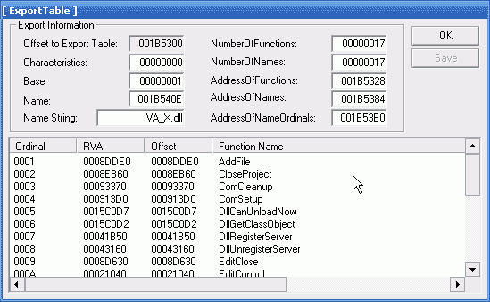
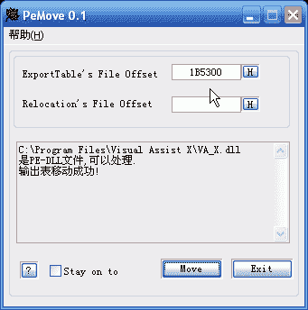
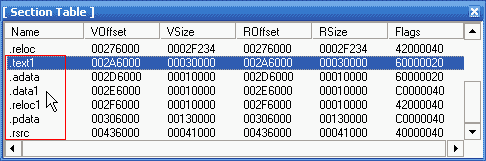
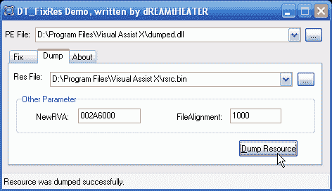

# 用 Ollydbg 手脱 Armadillo 加壳的 DLL——Visual.Assist.X.V10.2.1437.0

> 原文：[`www.pediy.com/kssd/pediy07/pediy7-772.htm`](https://www.pediy.com/kssd/pediy07/pediy7-772.htm)

用 Ollydbg 手脱 Armadillo 加壳的 DLL——Visual.Assist.X.V10.2.1437.0  
              
             
               
下载地址：  http://www.wholetomato.com/downloads/VA\_X\_Setup1437.exe   
软件大小：  3318 KB  
软件语言：  英文  
软件类别：  国外软件 / 共享版 / 其它控件  
应用平台：  Win9x/NT/2000/XP  
加入时间：  2005-12-10  
下载次数：  21401  
开 发 商：  http://www.wholetomato.com/index.html    
软件简介：  Visual.Assist.X 是一款非常好的 Visual Studio .NET 2003、2002 插件，支持 C/C++、C#、ASP、Visual Basic、Java 和 HTML 等语言，也支持 VC++6、VC++5，能自动识别各种关键字、系统函数、成员变量、自动给出输入提示、自动更正大小写错误、自动标示错误等，有助于提高开发过程地自动化和开发效率。    
               
【作者声明】：只是感兴趣，没有其他目的。失误之处敬请诸位大侠赐教！  
               
【调试环境】：WinXP、OllyDBG、PEiD、LordPE、ImportREC、DT\_FixRes、PeMove、WinHex  
               
—————————————————————————————————   
【脱壳过程】：  
            
                   
有兄弟要求再写篇 Armadillo 加壳 DLL 的脱壳教程，所以用 VAX 作个例子了。  
用 VC 的人很多喜欢这个软件，其核心 VA\_X.dll 加了 Armadillo 壳。   
—————————————————————————————————  
一、OllyDBG 设置  
  
  
用修改版 OllyDBG，原版会被检测到。  
   
如何避开这些 Anti 将在 Armadillo V4.0-V4.4.DLL.osc 脚本里面实现。  
  
首先要设置 OllyDBG 忽略除了“内存访问异常”和“异常范围”之外的其他异常选项  
   
否则直接运行下面不好演示清楚  
  
现在我们暂停在第一个内存异常处：  
00999781      8900               mov dword ptr ds:\[eax\],eax  
  
可以设置 OllyDBG 或略所有异常选项了。  
老规矩：用 IsDebug 插件去掉 OllyDBG 的调试器标志。  
  
  
—————————————————————————————————  
二、Magic Jump  
             
    
下断：HE GetModuleHandleA  
如果硬件断点无法中断，可以 Ctrl+G：GetModuleHandleA，在函数末尾设断  
Shift+F9，注意看堆栈  
  
000698E4   00990D97  /CALL 到 GetModuleHandleA 来自 00990D91  
000698E8   009A4D68  \\pModule = "kernel32.dll"  
000698EC   009A5F58  ASCII "VirtualAlloc"  
  
000698E4   00990DB4  /CALL 到 GetModuleHandleA 来自 00990DAE  
000698E8   009A4D68  \\pModule = "kernel32.dll"  
000698EC   009A5F4C  ASCII "VirtualFree"  
  
0006965C   00979A2D  /CALL 到 GetModuleHandleA 来自 00979A27  
00069660   00069798  \\pModule = "kernel32.dll"  
  
当堆栈如上显示变化是，就可以删除 GetModuleHandleA 处硬件断点了，Alt+F9 返回  
  
00979A27      FF15 CCF09900      call dword ptr ds:\[99F0CC\]      ; kernel32.GetModuleHandleA  
00979A2D      8B0D 40A19A00      mov ecx,dword ptr ds:\[9AA140\]  
//返回这里  
00979A33      89040E             mov dword ptr ds:\[esi+ecx\],eax  
00979A36      A1 40A19A00        mov eax,dword ptr ds:\[9AA140\]  
00979A3B      393C06             cmp dword ptr ds:\[esi+eax\],edi  
00979A3E      75 16              jnz short 00979A56  
00979A40      8D85 B4FEFFFF      lea eax,dword ptr ss:\[ebp-14C\]  
00979A46      50                 push eax  
00979A47      FF15 D4F09900      call dword ptr ds:\[99F0D4\]      ; kernel32.LoadLibraryA  
00979A4D      8B0D 40A19A00      mov ecx,dword ptr ds:\[9AA140\]  
00979A53      89040E             mov dword ptr ds:\[esi+ecx\],eax  
00979A56      A1 40A19A00        mov eax,dword ptr ds:\[9AA140\]  
00979A5B      393C06             cmp dword ptr ds:\[esi+eax\],edi  
00979A5E      0F84 B0000000      je 00979B14  
//Magic Jump！ 修改为：jmp 00979B14  ★  
00979A64      33C9               xor ecx,ecx  
00979A66      8B03               mov eax,dword ptr ds:\[ebx\]  
00979A68      3938               cmp dword ptr ds:\[eax\],edi  
00979A6A      74 06              je short 00979A72  
00979A6C      41                 inc ecx  
00979A6D      83C0 0C            add eax,0C  
00979A70      EB F6              jmp short 00979A68  
  
  
—————————————————————————————————  
三、OEP  
  
  
下断：BP \_set\_new\_handler  
Shift+F9，中断后取消断点，Alt+F9 返回  
  
1EFBCD3C      FF15 4061FE1E      call dword ptr ds:\[1EFE6140\] ; msvcrt.\_set\_new\_handler  
1EFBCD42      83C4 04            add esp,4  
//返回这里  
1EFBCD45      837D FC 01         cmp dword ptr ss:\[ebp-4\],1  
1EFBCD49      75 0E              jnz short 1EFBCD59  
1EFBCD4B      68 A896FE1E        push 1EFE96A8  
1EFBCD50      FF15 CC96FE1E      call dword ptr ds:\[1EFE96CC\]  
1EFBCD56      83C4 04            add esp,4  
1EFBCD59      8B45 FC            mov eax,dword ptr ss:\[ebp-4\]  
1EFBCD5C      8BE5               mov esp,ebp  
1EFBCD5E      5D                 pop ebp  
1EFBCD5F      C3                 retn  
//返回 1EFBCDCD  
  
1EFBCDCD      8945 FC            mov dword ptr ss:\[ebp-4\],eax  
1EFBCDD0      837D FC 01         cmp dword ptr ss:\[ebp-4\],1  
1EFBCDD4      75 40              jnz short 1EFBCE16  
1EFBCDD6      833D C496FE1E 00   cmp dword ptr ds:\[1EFE96C4\],0  
1EFBCDDD      74 30              je short 1EFBCE0F  
1EFBCDDF      68 E898FE1E        push 1EFE98E8  
1EFBCDE4      6A 01              push 1  
1EFBCDE6      8B0D 9096FE1E      mov ecx,dword ptr ds:\[1EFE9690\]  
1EFBCDEC      51                 push ecx  
1EFBCDED      FF15 C496FE1E      call dword ptr ds:\[1EFE96C4\] ; VA\_X.1EE42A48  
//飞向光明之巅  
  
  
1EE42A48      6A 0C              push 0C  
//OEP  
1EE42A4A      68 3867EE1E        push 1EEE6738  
1EE42A4F      E8 D4130000        call 1EE43E28  
1EE42A54      33C0               xor eax,eax  
1EE42A56      40                 inc eax  
1EE42A57      8945 E4            mov dword ptr ss:\[ebp-1C\],eax  
1EE42A5A      8B75 0C            mov esi,dword ptr ss:\[ebp+C\]  
1EE42A5D      33FF               xor edi,edi  
1EE42A5F      3BF7               cmp esi,edi  
1EE42A61      75 0C              jnz short 1EE42A6F  
  
  
—————————————————————————————————  
四、Code Splicing  
  
  
某些兄弟对如何知道程序有 Code Splicing 感到困惑，下面提供 2 种方法吧。  
1、一切按正常流程操作，修复后运行程序若有 Code Splicing 肯定会崩溃，而崩溃的地方就能看见 Code Splicing 地址了。  
2、根据 Code Splicing 段的特征来查找  
  
目前版本 Armadillo 的 Code Splicing 区段长度为 00020000，可以根据此特征来判断。  
Alt+M，察看目标程序的区段上下，可以看到 02B70000 段的长度为 00020000  
  
地址        大小       物主       区段       包含  
02B70000   00020000   
1ED00000   00001000   VA\_X   
1ED01000   0019D000   VA\_X       .text   
1EE9E000   00018000   VA\_X       CODE  
1EEB6000   00059000   VA\_X       .rdata   
1EF0F000   00023000   VA\_X       .data   
1EF32000   00001000   VA\_X       .SHARED  
1EF33000   00001000   VA\_X       DATA  
1EF34000   00042000   VA\_X       BSS   
1EF76000   00030000   VA\_X       .reloc  
1EFA6000   00030000   VA\_X       .text1  
1EFD6000   00010000   VA\_X       .adata     code  
1EFE6000   00010000   VA\_X       .data1     imports   
1EFF6000   00010000   VA\_X       .reloc1    relocations  
1F136000   00041000   VA\_X       .rsrc      resources  
5D170000   00001000   COMCTL32              PE header  
  
Alt+C，返回代码窗口，Ctrl+G:02B70000  
02B70000      66:87F3            xchg bx,si  
02B70003      66:96              xchg ax,si  
02B70005      7B 02              jpo short 02B70009  
02B70007      7B 09              jpo short 02B70012  
02B70009      87F9               xchg ecx,edi  
02B7000B      90                 nop  
02B7000C      87F9               xchg ecx,edi  
02B7000E      66:96              xchg ax,si  
02B70010      66:87F3            xchg bx,si  
02B70013      55                 push ebp  
02B70014      8BEC               mov ebp,esp  
02B70016      6A FF              push -1  
02B70018      E9 E80F191C        jmp 1ED01005  
//注意，跳到目标程序空间  
  
1ED01000      E9 FBEFE6E3        jmp 02B70000  
//Code Splicing  
1ED01005      68 606BEB1E        push 1EEB6B60  
1ED0100A      68 78D3E31E        push 1EE3D378  
1ED0100F      64:A1 00000000     mov eax,dword ptr fs:\[0\]  
1ED01015      E9 03F0E6E3        jmp 02B7001D  
  
好了，这样就找到了 Code Splicing 区段，用 ArmInline 来修复吧，注意各参数的填写  
   
可以用 LordPE 把此 DLL 抓取下来了。  
  
  
—————————————————————————————————  
五、输入表修复  
  
  
VA\_X.dll 没有使用 Import Table Elimination，输入表函数都是有序排列的，可以正常获取。  
运行 ImportREC，由于此 DLL 加载后没有进行重定位，所以保留“Use PE Header From Disk”选项  
填入 OEP RVA=00142A48，获取输入表后 Cut 掉函数中填充的无效垃圾指针。  
   
  
可以新增区段来修复输入表，但是这样会增加大小，所以还是放在近似原来的位置吧  
用 WinHex 打开 dump.exe，搜索输入表中函数的 DLL 名，Armadillo 没有清掉输入表的函数 DLL 名，当找到很多 00 中的输入表中函数 DLL 名处就可以放输入表了。当然，Size 要算好，一般是够用的。  
  
0020CF20   00 00 00 00 00 00 00 00  00 00 00 00 00 00 00 00   ................  
0020CF30   00 00 00 00 00 00 4B 45  52 4E 45 4C 33 32 2E 64   ......KERNEL32.d  
0020CF40   6C 6C 00 00 00 00 00 00  00 00 00 00 00 00 00 00   ll..............  
  
此例中输入表可以放在 0X0020C050 处，FixDump  
但是用 LordPE 察看 dumped\_.dll 输入表时会发现最后一个函数显示\[Error\]，怎么回事？  
呵呵，输入表所在段的 Size 有问题，修正 001B6000 段 VSize 和 RSize 为 0020F000-001B6000＝00059000 即可  
  
  
—————————————————————————————————  
六、输出表修复  
  
  
由于上面输入表的修复覆盖了输出表，所以我们要把输出表重新挪个位置  
打开 dumped.dll 把 0020EC10 处输出表数据复制写入到 dumped\_.dll 的 0X001B5300 处  
   
修正 Export Table 各指针，再修正 dumped\_.dll 的 Export Table RVA  
  
也可以用看雪老师的 PeMove 挪移输出表。复制 dumped.dll，用 PeMove 打开，Export Table's File Offset 填入 001B5300，点击 Move 后把 001B5300 处的输出表复制写入到 dumped\_.dll 中，修正 Export Table RVA  
   
修正输出表所在区段 0019E000 段的 VSize 和 RSize 为 001B6000-0019E000＝00018000  
  
  
—————————————————————————————————  
七、重定位表修复  
  
  
Armadillo 对于 DLL 比较友好，没有加密重定位表，因此就没有再调试时跟踪此重定位处理了  
  
LordPE 察看区段，“.reloc”段 RVA 即是重定位表 RVA，Size 看看其结尾的 00 就知道了  
00297590   A3 3A B8 3A D7 3A DC 3D  E0 3D E4 3D E8 3D EC 3D   ????????  
002975A0   F0 3D F4 3D 00 00 00 00  00 00 00 00 00 00 00 00   ??............  
  
修正 dumped\_.dll 的 Relocation RVA=00276000，Size=002975A4-00276000=215A4  
  
  
—————————————————————————————————  
八、Armadillo 脱壳文件的优化  
  
  
其实优化已经在《ArmInline——Armadillo 客户版 Code Splicing+Import Table Elimination 的简便修复方法》中说过了，再重复一次吧。  
用 LordPE 删除“.reloc”区段下的所有壳区段，记住第一个壳区段“.text1”段的 RVA=002A6000  
  
  
用 WinHex 移除 0X002A6000 至末尾的所有数据，另存为 UnPacKed.dll。好了，壳数据基本清理完了。  
  
用 DT\_FixRes 修复资源。DT\_FixRes 打开修复前的 dumped.dll  
   
NewRva=002A6000，FileAlignment=1000，Dump Resource，获得 rsrc.bin  
用 LordPE 把 rsrc.bin 载入 UnPacKed.dll，修正 Resource RVA=002A6000  
  
  
—————————————————————————————————  
九、破解  
  
  
启动 VC 时会弹出“License Error”的提示，无法使用。以这个为线索就很容易定位了  
————————————————————————  
1、License Error  
  
1ED411D3      385C24 13          cmp byte ptr ss:\[esp+13\],bl  
1ED411D7      74 47              je short 1ED41220  
//修改为：jmp 1ED41220  
1ED411D9      A1 C44CF21E        mov eax,dword ptr ds:\[1EF24CC4\]  
1ED411DE      53                 push ebx  
1ED411DF      68 38AFEB1E        push 1EEBAF38 ; ASCII "License"  
1ED411E4      68 30AFEB1E        push 1EEBAF30 ; ASCII "Error"  
1ED411E9      50                 push eax  
1ED411EA      FF15 2C69EB1E      call dword ptr ds:\[1EEB692C\] ; USER32.MessageBoxA  
  
————————————————————————  
2、过期  
  
1ED41384      8B5424 4C          mov edx,dword ptr ss:\[esp+4C\]  
1ED41388      8B4424 50          mov eax,dword ptr ss:\[esp+50\]  
1ED4138C      8B4C24 54          mov ecx,dword ptr ss:\[esp+54\]  
1ED41390      52                 push edx  
1ED41391      50                 push eax  
1ED41392      51                 push ecx  
1ED41393      E8 58D80900        call 1EDDEBF0  
1ED41398      83C4 1C            add esp,1C  
1ED4139B      E8 90DC0900        call 1EDDF030  
1ED413A0      3BC3               cmp eax,ebx  
1ED413A2      0F84 33010000      je 1ED414DB  
//修改为：jmp 1ED414DB  
  
————————————————————————  
3、局域网验证  
  
1ED673FF      68 E495EB1E        push 1EEB95E4 ; ASCII "UserName"  
1ED67404      68 BC95EB1E        push 1EEB95BC ; ASCII "Software\\Whole Tomato\\Visual Assist X"  
1ED67409      8D4424 10          lea eax,dword ptr ss:\[esp+10\]  
1ED6740D      68 01000080        push 80000001  
1ED67412      50                 push eax  
1ED67413      C74424 24 00000000 mov dword ptr ss:\[esp+24\],0  
1ED6741B      E8 602F0000        call 1ED6A380  
1ED67420      8B4C24 18          mov ecx,dword ptr ss:\[esp+18\]  
1ED67424      51                 push ecx  
1ED67425      8D5424 18          lea edx,dword ptr ss:\[esp+18\]  
1ED67429      68 E8EDEB1E        push 1EEBEDE8 ; ASCII "All instances of the license ",LF,"""%s""",LF,"are in use.  Visual Assist X will be disabled.  You must unload or uninstall Visual Assist X ",LF,"and restart your IDE to prevent this PC from being counted by other license checks."  
  
向上回溯：  
1ED67480     55                 push ebp  
1ED67481     8BEC               mov ebp,esp  
1ED67483     6A FF              push -1  
1ED67485     68 0AA5E81E        push 1EE8A50A  
1ED6748A     64:A1 00000000     mov eax,dword ptr fs:\[0\]  
1ED67490     50                 push eax  
1ED67491     64:8925 00000000   mov dword ptr fs:\[0\],esp  
  
//修改为：  
1ED67480     B8 01000000        mov eax,1  
1ED67485     C3                 retn  
  
  
Game Over  
—————————————————————————————————                                    
         ,     \_/   
        /| \_.-~/            \\\_     ,        青春都一晌  
       ( /~   /              \\~-.\_ |\\  
       \`\\\\  \_/                \\   ~\\ )          忍把浮名   
   \_-~~~-.)  )\_\_/;;,.          \\\_  //'  
  /'\_,\\   --~   \\ ~~~-  ,;;\\\_\_\_(  (.-~~~-.        换了破解轻狂  
 \`~ \_( ,\_..--\\ (     ,;'' /    ~--   /.\_\`\\   
  /~~//'   /' \`~\\         ) /--..\_, )\_  \`~  
  "  \`~"  "      \`"      /~'\`\\    \`\\\\~~\\     
                         "     "   "~'  ""  
      
              UnPacked By :  fly  
               2005-12-12 00:00 

**Armadillo V4.0-V4.4.DLL UnPacK Script**  
  
  
/////////////////////////////////////////////////////////////  
// FileName    :  Armadillo V4.0-V4.4.DLL.osc  
// Comment     :  Armadillo V4.0-V4.4.DLL UnPacK Script  
// Environment :  WinXP SP2,OllyDbg V1.10,OllyScript V0.92  
// Author      :  fly  
// WebSite     :  http://www.unpack.cn  
// Date        :  2005-12-12 16:00  
/////////////////////////////////////////////////////////////  
  
/\*  
★ 注意: ★  
如果 OllyDBG 载入目标 DLL 时无法暂停在其 EP 而直接运行  
请先设置 OllyDBG 忽略除了“内存访问异常”和“异常范围”之外的其他异常选项，  
等 OllyDBG 暂停在第一个内存异常处，再忽略所有异常选项，然后运行此脚本。  
  
Attention:    
  if OllyDBG fail to first pause at EP when loading a dll,  
  plz not check the "Memory access violation" & "Igorne also following ..."  
  after is pause at first exceptoin, then check those exceptions options all and run the script.  
\*/  
  
  
#log  
dbh  
  
var T0  
var T1  
var temp  
var bpcnt  
var MagicJMP  
var JmpAddress  
var fiXedOver  
var OpenMutexA   
var GetModuleHandleA  
var set\_new\_handler  
var FindOEP  
  
  
MSGYN "Plz Clear All BreakPoints  And  Set Debugging Option Ignore All Excepions Options  And  Add C000001D..C000001E in custom exceptions !"  
cmp $RESULT, 0  
je TryAgain  
  
  
//OutputDebugStringA————————————————————————————————  
  
gpa "OutputDebugStringA", "KERNEL32.dll"  
mov \[$RESULT\], #C20400#  
  
  
//OpenMutexA————————————————————————————————  
  
gpa "OpenMutexA", "KERNEL32.dll"  
mov OpenMutexA,$RESULT  
mov \[OpenMutexA\], #33C0C20C00#  
  
  
//GetModuleHandleA————————————————————————————————  
  
gpa "GetModuleHandleA", "KERNEL32.dll"  
find $RESULT,#C20400#  
mov GetModuleHandleA,$RESULT  
bp GetModuleHandleA  
  
eob GetModuleHandleA  
GoOn0:  
esto  
  
GetModuleHandleA:  
cmp eip,GetModuleHandleA  
jne GoOn0  
cmp bpcnt,1  
je  VirtualFree  
cmp bpcnt,2  
je  Third  
  
    
/\*  
00129528   00BE6DF3  RETURN to 00BE6DF3 from kernel32.GetModuleHandleA  
0012952C   00BFBC1C  ASCII "kernel32.dll"  
00129530   00BFCEC4  ASCII "VirtualAlloc"  
\*/  
  
VirtualAlloc:    
mov temp,esp  
add temp,4  
log temp  
mov T0,\[temp\]  
cmp \[T0\],6E72656B  
log \[T0\]  
jne GoOn0  
add temp,4  
mov T1,\[temp\]  
cmp \[T1\],74726956  
jne GoOn0  
bc OpenMutexA  
inc bpcnt  
jmp GoOn0  
  
  
/\*  
00129528   00BE6E10  RETURN to 00BE6E10 from kernel32.GetModuleHandleA  
0012952C   00BFBC1C  ASCII "kernel32.dll"  
00129530   00BFCEB8  ASCII "VirtualFree"  
\*/  
  
VirtualFree:  
mov temp,esp  
add temp,4  
mov T1,\[temp\]  
cmp \[T1\],6E72656B  
jne GoOn0  
add temp,4  
mov T1,\[temp\]  
add T1,7  
cmp \[T1\],65657246  
log \[T1\]  
jne GoOn0  
inc bpcnt  
jmp GoOn0  
  
  
/\*  
0012928C   00BD5CE1  RETURN to 00BD5CE1 from kernel32.GetModuleHandleA  
00129290   001293DC  ASCII "kernel32.dll"  
\*/     
  
Third:  
mov temp,esp  
add temp,4  
mov T1,\[temp\]  
cmp \[T1\],6E72656B  
jne GoOn0  
bc GetModuleHandleA  
sti  
  
  
//MagicJMP————————————————————————————————  
  
/\*  
00BD5CDB     FF15 B860BF00      call dword ptr ds:\[BF60B8\]       ; kernel32.GetModuleHandleA  
00BD5CE1     8B0D AC40C000      mov ecx,dword ptr ds:\[C040AC\]  
00BD5CE7     89040E             mov dword ptr ds:\[esi+ecx\],eax  
00BD5CEA     A1 AC40C000        mov eax,dword ptr ds:\[C040AC\]  
00BD5CEF     391C06             cmp dword ptr ds:\[esi+eax\],ebx  
00BD5CF2     75 16              jnz short 00BD5D0A  
00BD5CF4     8D85 B4FEFFFF      lea eax,dword ptr ss:\[ebp-14C\]  
00BD5CFA     50                 push eax  
00BD5CFB     FF15 BC62BF00      call dword ptr ds:\[BF62BC\]       ; kernel32.LoadLibraryA  
00BD5D01     8B0D AC40C000      mov ecx,dword ptr ds:\[C040AC\]  
00BD5D07     89040E             mov dword ptr ds:\[esi+ecx\],eax  
00BD5D0A     A1 AC40C000        mov eax,dword ptr ds:\[C040AC\]  
00BD5D0F     391C06             cmp dword ptr ds:\[esi+eax\],ebx  
00BD5D12     0F84 2F010000      je 00BD5E47  
\*/  
  
find eip,#39????0F84#  
cmp $RESULT,0  
je NoFind  
add $RESULT,3  
mov MagicJMP,$RESULT  
log MagicJMP  
mov T0,$RESULT  
add T0,2  
mov T1, \[T0\]  
add T1,4  
add T1,T0  
mov JmpAddress,T1  
log JmpAddress  
eval "jmp {JmpAddress}"  
asm MagicJMP,$RESULT  
  
  
/\*  
00BD5C8C     391D F0B0BF00      cmp dword ptr ds:\[BFB0F0\],ebx  
00BD5C92     0F84 C4010000      je 00BD5E5C  
\*/  
  
mov temp,MagicJMP  
sub temp,100  
find temp,#39??????????0F84#  
cmp $RESULT,0  
je NoFind  
add $RESULT,6  
mov T0,$RESULT  
add T0,2  
mov T1, \[T0\]  
add T1,4  
add T1,T0  
mov fiXedOver,T1  
log fiXedOver  
eob fiXedOver  
bp fiXedOver  
  
esto  
GoOn1:  
esto  
  
fiXedOver:  
cmp eip,fiXedOver      
jne GoOn1  
bc fiXedOver  
eval "je {JmpAddress}"  
asm MagicJMP,$RESULT  
  
  
//\_set\_new\_handler————————————————————————————————  
  
gpa "?\_set\_new\_handler@@YAP6AHI@ZP6AHI@Z@Z", "msvcrt.dll"  
mov set\_new\_handler,$RESULT  
eob set\_new\_handler  
bp set\_new\_handler  
  
esto  
GoOn2:  
esto  
  
set\_new\_handler:  
cmp eip,set\_new\_handler  
jne GoOn2  
bc set\_new\_handler  
rtu  
rtr  
  
  
//FindOEP————————————————————————————————  
  
/\*  
10320DE6     8B0D 90D63410      mov ecx,dword ptr ds:\[1034D690\]  
10320DEC     51                 push ecx  
10320DED     FF15 C4D63410      call dword ptr ds:\[1034D6C4\]  
\*/  
  
find eip,#8B??????????51FF15#  
cmp $RESULT,0  
je NoFind  
  
add $RESULT,7  
mov FindOEP,$RESULT  
log FindOEP  
eob FindOEP  
bp FindOEP  
  
esto  
  
FindOEP:  
bc FindOEP  
sti  
  
  
//GameOver————————————————————————————————    
  
log eip  
cmt eip, "This is the OEP!  Found By: fly "                                
                                                       
MSG "Just : OEP !  Dump and Fix IAT/Relocation/Code Splicing.  Good Luck   "  
ret                         
  
NoFind:  
MSG "Error! Don't find.     "  
ret  
  
TryAgain:  
MSG " Plz  Try  Again   !   "  
ret  

 4dd466d0e1e0cc123afbe504da2462ca