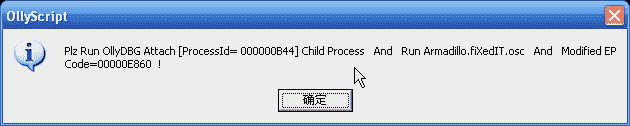

# Armadillo V4.40 主程序脱壳

> 原文：[`www.pediy.com/kssd/pediy07/pediy7-670.htm`](https://www.pediy.com/kssd/pediy07/pediy7-670.htm)

Armadillo V4.40 主程序脱壳  
              
             
下载页面：  http://siliconrealms.com  
软件大小：  2.1 M      
软件简介：  SoftwarePassport is a powerful software protection system, using the proven Armadillo engine to wrap around your program like an armored shell, defending your work from pirates and program crackers with state-of-the-art encryption, data compression, and other security features. It allows you to design and add a complete software protection and registration-key system to your existing programs in five minutes or less, with no changes to your program's code! And it works with any language that produces a 32-bit Windows EXE, SCR, DLL, or OCX file.     
               
【作者声明】：只是感兴趣，没有其他目的。失误之处敬请诸位大侠赐教  
               
【调试环境】：WinXP、OllyDBD、PEiD、LordPE、ImportREC  
               
—————————————————————————————————   
【脱壳过程】：  
            
           
此教程 heXer 创作，fly 整理。  
主要利用脚本来完成脱壳，步骤繁琐，不适合新手练习。  
Get.eXe.PE.Information.osc、DebugActiveProcess.osc、Armadillo.fiXed.IT.osc、WaitForDebugEvent.osc 必须放同一目录下，Disasm.dll 放入目标程序 Armadillo.exe 目录下。  
—————————————————————————————————  
一、DebugActiveProcess  
  
  
设置 OllyDBD 忽略所有异常选项。添加或略异常范围：00000001-FFFFFFFE  
载入 Armadillo.exe，用 IsDebug 插件去掉 OllyDBD 的调试器标志。  
  
004CD000     60                 pushad  
//进入 OllyDbg 后暂停在这  
004CD001     E8 00000000        call 004CD006  
004CD006     5D                 pop ebp  
004CD007     50                 push eax  
004CD008     51                 push ecx  
004CD009     0FCA               bswap edx  
004CD00B     F7D2               not edx  
004CD00D     9C                 pushfd  
004CD00E     F7D2               not edx  
004CD010     0FCA               bswap edx  
004CD012     EB 0F              jmp short 004CD023  
  
每次运行脚本前必须清除以前的所有断点！  ★  
现在运行 DebugActiveProcess.osc  
   
  
子进程 ID=000000B44，开始 4 个字节 EP Code=00000E860  
“确定”后，此脚本完成任务，保留此 OllyDBG 不动。  
此时系统资源耗用厉害，有点卡，不要急，否则就不必脱此壳了。   
  
  
—————————————————————————————————  
二、Armadillo.fiXed.IT  
  
  
新运行一个 OllyDBG，Attach 上 ID=000000B44 的子进程 Armadillo.exe  
  
7C921231     C3                 retn  
//暂停在 ntdll.DbgBreakPoint  
  
运行 Armadillo.fiXed.IT.osc，脚本提示：  
   
  
“确定”后 F12，OllyDBG 暂停在 EP 死循环处  
  
004CD000     EB FE              jmp short 004CD000  
//暂停  
  
还原 EP Code 的 EBFE 为 60E8，Resume 脚本  ★  
   
  
00F9D330     FF15 1861FA00      call dword ptr ds:\[FA6118\] ; kernel32.VirtualProtect  
00F9D336     A0 BC00FB00        mov al,byte ptr ds:\[FB00BC\]  
//脚本运行完毕暂停在这里  
在 Armadillo.fiXed.IT.osc 目录下脚本自动 dump 出一个文件：SaveIat00102B010.bin  
此文件保存的就是所有乱序前的正确函数地址！  
00F9D33B     8885 14A9FFFF      mov byte ptr ss:\[ebp+FFFFA914\],al  
00F9D341     0FB685 14A9FFFF    movzx eax,byte ptr ss:\[ebp+FFFFA914\]  
00F9D348     85C0               test eax,eax  
00F9D34A     74 1D              je short 00F9D369  
00F9D34C     6A 00              push 0  
00F9D34E     FFB5 CCB0FFFF      push dword ptr ss:\[ebp+FFFFB0CC\]  
00F9D354     8B85 0CD8FFFF      mov eax,dword ptr ss:\[ebp-27F4\]  
00F9D35A     0385 BCB0FFFF      add eax,dword ptr ss:\[ebp+FFFFB0BC\]  
00F9D360     50                 push eax  
00F9D361     E8 87110000        call 00F9E4ED  
//解密 CALL   ★  
  
看堆栈:  
00129500   00401000   地址  
00129504   00049001   大小  → 修改为：49000   ★  
其实就是解密 PE header 下面区段的代码  
但是此区段的 Size 为 49000,这里多了 1,将导致其下区段被加密，所以我们要修改这里为 49000  
在数据窗口里定位 00401000，F8 步过上面 CALL 时会发现 00401000 段的代码已经全部解密出来了！  
  
00F9D366     83C4 0C            add esp,0C  
00F9D369     8B85 FCD7FFFF      mov eax,dword ptr ss:\[ebp-2804\]  
00F9D36F     8BB5 0CD8FFFF      mov esi,dword ptr ss:\[ebp-27F4\]  
00F9D375     2B70 34            sub esi,dword ptr ds:\[eax+34\]  
00F9D378     E8 542E0000        call 00FA01D1  
00F9D37D     F7D8               neg eax  
00F9D37F     1BC0               sbb eax,eax  
00F9D381     25 00100000        and eax,1000  
00F9D386     03F0               add esi,eax  
00F9D388     89B5 C4B0FFFF      mov dword ptr ss:\[ebp+FFFFB0C4\],esi  
00F9D38E     83A5 C8B0FFFF 00   and dword ptr ss:\[ebp+FFFFB0C8\],0  
00F9D395     EB 0D              jmp short 00F9D3A4  
  
下面 Armadillo 就要对输入表完成 Import Table Elimination  
把乱序后的函数写入程序中各呼叫地址处。  
  
00F9D397     8B85 C8B0FFFF      mov eax,dword ptr ss:\[ebp+FFFFB0C8\]  
00F9D39D     40                 inc eax  
00F9D39E     8985 C8B0FFFF      mov dword ptr ss:\[ebp+FFFFB0C8\],eax  
00F9D3A4     8B85 C8B0FFFF      mov eax,dword ptr ss:\[ebp+FFFFB0C8\]  
00F9D3AA     8B8D 24D9FFFF      mov ecx,dword ptr ss:\[ebp-26DC\]  
//\[ebp-26DC\]保存的是呼叫 IAT 的地址+2 的表。 不好命名，经大家商量凑个名字给这个表：  
//Table which Record all of IAT Caller address in Armadillo +2     ★  
  
00F9D3B0     833C81 00          cmp dword ptr ds:\[ecx+eax\*4\],0  
00F9D3B4     0F84 90000000      je 00F9D44A  
00F9D3BA     8B85 C8B0FFFF      mov eax,dword ptr ss:\[ebp+FFFFB0C8\]  
00F9D3C0     8B8D 24D9FFFF      mov ecx,dword ptr ss:\[ebp-26DC\]  
00F9D3C6     8B95 0CD8FFFF      mov edx,dword ptr ss:\[ebp-27F4\]  
00F9D3CC     031481             add edx,dword ptr ds:\[ecx+eax\*4\]  
00F9D3CF     8995 B8B0FFFF      mov dword ptr ss:\[ebp+FFFFB0B8\],edx  
00F9D3D5     8B85 B8B0FFFF      mov eax,dword ptr ss:\[ebp+FFFFB0B8\]  
00F9D3DB     8B00               mov eax,dword ptr ds:\[eax\]  
00F9D3DD     8985 B4B0FFFF      mov dword ptr ss:\[ebp+FFFFB0B4\],eax  
00F9D3E3     81BD B4B0FFFF 9090>cmp dword ptr ss:\[ebp+FFFFB0B4\],909090>  
00F9D3ED     74 56              je short 00F9D445  
00F9D3EF     8B85 B4B0FFFF      mov eax,dword ptr ss:\[ebp+FFFFB0B4\]  
00F9D3F5     2B85 C4B0FFFF      sub eax,dword ptr ss:\[ebp+FFFFB0C4\]  
00F9D3FB     8985 B4B0FFFF      mov dword ptr ss:\[ebp+FFFFB0B4\],eax  
00F9D401     FFB5 B4B0FFFF      push dword ptr ss:\[ebp+FFFFB0B4\]  
00F9D407     8B85 C8B0FFFF      mov eax,dword ptr ss:\[ebp+FFFFB0C8\]  
00F9D40D     33D2               xor edx,edx  
00F9D40F     6A 1B              push 1B  
00F9D411     59                 pop ecx  
00F9D412     F7F1               div ecx  
00F9D414     FF1495 9867FA00    call dword ptr ds:\[edx\*4+FA6798\]  
00F9D41B     59                 pop ecx  
00F9D41C     8985 B4B0FFFF      mov dword ptr ss:\[ebp+FFFFB0B4\],eax  
00F9D422     8B85 B4B0FFFF      mov eax,dword ptr ss:\[ebp+FFFFB0B4\]  
00F9D428     8B8D E4D7FFFF      mov ecx,dword ptr ss:\[ebp-281C\]  
//\[ebp-281C\]保存的是乱序后的函数表。Table with Rand order Function   ★  
00F9D42E     8D0481             lea eax,dword ptr ds:\[ecx+eax\*4\]  
00F9D431     8985 B4B0FFFF      mov dword ptr ss:\[ebp+FFFFB0B4\],eax  
00F9D437     8B85 B8B0FFFF      mov eax,dword ptr ss:\[ebp+FFFFB0B8\]  
00F9D43D     8B8D B4B0FFFF      mov ecx,dword ptr ss:\[ebp+FFFFB0B4\]  
00F9D443     8908               mov dword ptr ds:\[eax\],ecx  
00F9D445     E9 4DFFFFFF        jmp 00F9D397  
00F9D44A     A0 BC00FB00        mov al,byte ptr ds:\[FB00BC\]  
//这里处理结束，下断，Shift+F9 中断下来。  
  
设置 0044A000 为完整权限，把 SaveIat00102B010.bin 里面的有序地址全部粘贴到 0044A000 处。  
注意，我们要先去掉非函数地址的数据。  
00000370   1E 31 32 76 33 73 F8 00  30 74 F8 00 69 73 F8 00  
自 0X374 后就可以全部删除了。  
  
0044A000  23 C1 DC 77 10 CC DC 77 1B 76 DA 77 E7 EB DA 77  
0044A010  E5 ED DA 77 F4 EA DA 77 83 78 DA 77 F0 6B DA 77  
0044A020  C3 CA DC 77 71 73 F8 00 A5 45 1B 5D 40 D4 17 5D  
0044A030  DD 15 19 5D 5B BB 17 5D D8 72 F8 00 A6 6C EF 77  
0044A040  C0 6D EF 77 6C 9B EF 77 2C B5 EF 77 D5 5F EF 77  
0044A050  DE 82 EF 77 55 CE EF 77 D7 8D EF 77 F1 5F EF 77  
0044A060  0B 5D EF 77 EE D1 EF 77 60 9C EF 77 89 BD EF 77  
0044A070  07 9D EF 77 0C D1 EF 77 A0 59 EF 77 59 5C EF 77  
0044A080  A7 5B EF 77 10 5E EF 77 3B 6A EF 77 21 A8 EF 77  
0044A090  80 73 F8 00 C1 C9 80 7C 94 22 82 7C AC 92 80 7C  
0044A0A0  2F 08 81 7C 29 B5 80 7C A9 CC 80 7C A1 97 83 7C  
0044A0B0  C7 A0 80 7C AD 9C 80 7C FC B7 80 7C 8D B7 80 7C  
0044A0C0  6C 94 80 7C 8F 0C 81 7C 82 00 81 7C 19 01 81 7C  
0044A0D0  37 97 80 7C A2 CA 81 7C A1 9F 80 7C ED 10 92 7C  
0044A0E0  05 10 92 7C 8A 18 93 7C CB CA 81 7C A2 29 82 7C  
0044A0F0  67 CC 80 7C CF C6 80 7C 65 A0 80 7C F1 BA 80 7C  
0044A100  B1 C7 80 7C 54 2A 82 7C 51 28 81 7C B3 9E 80 7C  
0044A110  4C F0 81 7C 81 9A 80 7C 14 9B 80 7C 29 29 81 7C  
0044A120  10 11 81 7C 69 10 81 7C A9 2C 81 7C CF C6 80 7C  
0044A130  78 2C 81 7C 23 CC 81 7C 5F 48 81 7C 3F DC 81 7C  
0044A140  8A 2B 86 7C C4 CE 80 7C 2B 2E 83 7C ED 09 93 7C  
0044A150  FD 79 93 7C 3D 04 93 7C D4 05 93 7C AB 14 81 7C  
0044A160  8D 2C 81 7C EE 1E 80 7C 0D E0 80 7C 16 1E 80 7C  
0044A170  40 7A 95 7C 6B 17 80 7C AE 94 83 7C 53 00 83 7C  
0044A180  24 1A 80 7C 0E 18 80 7C A6 0D 81 7C B7 2B 82 7C  
0044A190  CF 21 82 7C 59 35 81 7C D7 EF 80 7C 5C E8 81 7C  
0044A1A0  01 6A 82 7C B9 8C 83 7C 80 A4 80 7C CB D8 81 7C  
0044A1B0  58 CD 80 7C 87 1F 82 7C 4D 11 86 7C 3F EB 80 7C  
0044A1C0  67 23 80 7C 31 03 93 7C 2A E9 81 7C 77 9B 80 7C  
0044A1D0  42 24 80 7C 77 1D 80 7C 28 AC 80 7C 57 B3 80 7C  
0044A1E0  7C 36 81 7C 9F 0F 81 7C 6A 48 81 7C A9 26 82 7C  
0044A1F0  E6 2B 81 7C 43 99 80 7C 2A E8 81 7C 50 F8 81 7C  
0044A200  93 D2 80 7C DF 06 86 7C 4E A3 80 7C 33 73 F8 00  
0044A210  80 0E 61 7D 55 0B 61 7D 10 73 F8 00 F0 BE D1 77  
0044A220  65 C4 D1 77 7D BC D1 77 B3 C7 D3 77 4B BE D1 77  
0044A230  C8 BD D1 77 8E BD D1 77 76 BD D1 77 9D 86 D1 77  
0044A240  C7 86 D1 77 9E C5 D1 77 88 C1 D1 77 EC DB D1 77  
0044A250  D4 B6 D1 77 2F BB D1 77 1B C0 D1 77 6C C9 D1 77  
0044A260  42 8C D1 77 9D 8F D1 77 3E F1 D2 77 4F 02 D3 77  
0044A270  05 C5 D1 77 3D 02 D3 77 5D 94 D1 77 33 B9 D1 77  
0044A280  4C 1F D3 77 1A 00 D3 77 2F B7 D1 77 85 CB D1 77  
0044A290  EA E8 D1 77 D8 FF D2 77 0D D6 D1 77 A2 BD D1 77  
0044A2A0  3C 21 D3 77 71 BE D1 77 60 DA D1 77 50 62 D2 77  
0044A2B0  55 E6 D1 77 16 48 D2 77 2E 8C D1 77 B5 37 D2 77  
0044A2C0  9A F3 D2 77 DE F2 D2 77 E2 16 D2 77 80 FD D1 77  
0044A2D0  DF 1A D3 77 0E 97 D1 77 92 0D D3 77 61 C6 D3 77  
0044A2E0  DA 5E D2 77 09 B6 D1 77 AE B6 D1 77 57 C2 D1 77  
0044A2F0  78 8E D1 77 DA C6 D3 77 1D B6 D1 77 9F 03 D3 77  
0044A300  B2 C2 D1 77 11 12 D2 77 EA DA D1 77 EE D4 D1 77  
0044A310  24 13 D2 77 3E 0B D2 77 8C 14 D2 77 5E 02 D2 77  
0044A320  92 0A D2 77 A4 D8 D1 77 F9 D7 D1 77 24 15 D3 77  
0044A330  42 10 D2 77 9C FA D2 77 F6 8B D1 77 B8 96 D1 77  
0044A340  EA 04 D5 77 6C BF D1 77 43 F5 D2 77 1C B1 D3 77  
0044A350  A7 73 F8 00 50 1A BD 77 FF 19 BD 77 BA 18 BD 77  
0044A360  76 73 F8 00 D4 4F A2 71 33 73 F8 00 D8 7C 33 76  
0044A370  1E 31 32 76 00 00 00 00 00 40 FF 00 00 FF FF 00  
  
你也可以放在其他可用的空白处，但是分析发现 44A000 处是程序加壳前存放输入表的地方，正好还原吧。  
接着我们来修复这些乱序的输入表函数，Patch 代码如下。  
  
00F9D44A     60                 pushad  
00F9D44B     8BB5 E4D7FFFF      mov esi,dword ptr ss:\[ebp-281C\]  
//Table with Rand order Function   
00F9D451     8BBD 24D9FFFF      mov edi,dword ptr ss:\[ebp-26DC\]  
//Table which Record all of IAT Caller address in Armadillo +2  
00F9D457     833F 00            cmp dword ptr ds:\[edi\],0  
00F9D45A     74 2E              je short 00F9D48A  
00F9D45C     8B07               mov eax,dword ptr ds:\[edi\]  
00F9D45E     05 00004000        add eax,400000  
00F9D463     8B10               mov edx,dword ptr ds:\[eax\]  
00F9D465     BB 00A04400        mov ebx,44A000  
//44A000：粘贴的有序函数地址表  
00F9D46A     81FA 90909090      cmp edx,90909090  
00F9D470     74 13              je short 00F9D485  
00F9D472     8B12               mov edx,dword ptr ds:\[edx\]  
00F9D474     3B13               cmp edx,dword ptr ds:\[ebx\]  
00F9D476     74 0B              je short 00F9D483  
00F9D478     83C3 04            add ebx,4  
00F9D47B     81FB 78A34400      cmp ebx,44A378  
//44A378：有序函数地址表结束地址  
00F9D481     7C F1              jl short 00F9D474  
00F9D483     8918               mov dword ptr ds:\[eax\],ebx  
//替换成指向有序函数的地址  
00F9D485     83C7 04            add edi,4  
00F9D488     EB CD              jmp short 00F9D457  
00F9D48A     61                 popad  
00F9D48B     90                 nop  
//这里下断，循环出口  
  
OllyDBG 二进制代码复制：  
60 8B B5 E4 D7 FF FF 8B BD 24 D9 FF FF 83 3F 00 74 2E 8B 07 05 00 00 40 00 8B 10 BB 00 A0 44 00  
81 FA 90 90 90 90 74 13 8B 12 3B 13 74 0B 83 C3 04 81 FB 78 A3 44 00 7C F1 89 18 83 C7 04 EB CD  
61 90  
  
F9 在 00F9D489 中断后乱序输入表修复完毕。  
运行 ImportREC，RVA=0004A000，Size=00000374，获取输入表，Cut 掉几个填充在 DLL 间的垃圾数据，保存树文件。  
因为下面 Armadillo 还要再对代码段加密，所以此时运行 LordPE 完全 dump 出此进程！  
  
  
—————————————————————————————————  
三、OEP  
  
  
撤销上面 patch 的代码，把 EIP 重新定位在 00F9D44A 处，我们来找 OEP  
Ctrl+G: CreateThread，在 CreateThread 函数末尾下断，Shift+F9 中断后取消断点。  
  
00F8C494     FF15 5C61FA00      call dword ptr ds:\[FA615C\]   ; kernel32.CreateThread  
00F8C49A     50                 push eax  
//返回这里  
00F8C49B     FF15 4C62FA00      call dword ptr ds:\[FA624C\]   ; kernel32.CloseHandle  
00F8C4A1     5F                 pop edi  
00F8C4A2     5E                 pop esi  
00F8C4A3     C9                 leave  
00F8C4A4     C3                 retn  
  
00F9F8A6     E8 40CBFEFF        call 00F8C3EB  
00F9F8AB     59                 pop ecx  
00F9F8AC     BE 98FAFA00        mov esi,0FAFA98  
00F9F8B1     8BCE               mov ecx,esi  
00F9F8B3     E8 B292FDFF        call 00F78B6A  
00F9F8B8     84C0               test al,al  
00F9F8BA     75 09              jnz short 00F9F8C5  
00F9F8BC     6A 01              push 1  
00F9F8BE     8BCE               mov ecx,esi  
00F9F8C0     E8 83E2FDFF        call 00F7DB48  
00F9F8C5     C705 E0C0FA00 D8CF>mov dword ptr ds:\[FAC0E0\],0FACFD8  
00F9F8CF     B9 00ECFA00        mov ecx,0FAEC00  
00F9F8D4     E8 44590000        call 00FA521D  
00F9F8D9     53                 push ebx  
00F9F8DA     E8 3E590000        call 00FA521D  
00F9F8DF     59                 pop ecx  
00F9F8E0     33D2               xor edx,edx  
00F9F8E2     8955 DC            mov dword ptr ss:\[ebp-24\],edx  
00F9F8E5     895D FC            mov dword ptr ss:\[ebp-4\],ebx  
00F9F8E8     A0 BC00FB00        mov al,byte ptr ds:\[FB00BC\]  
00F9F8ED     8845 C8            mov byte ptr ss:\[ebp-38\],al  
00F9F8F0     84C0               test al,al  
00F9F8F2     75 4A              jnz short 00F9F93E  
00F9F8F4     A1 E400FB00        mov eax,dword ptr ds:\[FB00E4\]  
00F9F8F9     8B48 7C            mov ecx,dword ptr ds:\[eax+7C\]  
00F9F8FC     894D C4            mov dword ptr ss:\[ebp-3C\],ecx  
00F9F8FF     894D D0            mov dword ptr ss:\[ebp-30\],ecx  
00F9F902     8B0D FC00FB00      mov ecx,dword ptr ds:\[FB00FC\]        ; Armadill.00400000  
00F9F908     894D C0            mov dword ptr ss:\[ebp-40\],ecx  
00F9F90B     8B70 50            mov esi,dword ptr ds:\[eax+50\]  
00F9F90E     3370 44            xor esi,dword ptr ds:\[eax+44\]  
00F9F911     3370 24            xor esi,dword ptr ds:\[eax+24\]  
00F9F914     03F1               add esi,ecx  
00F9F916     8975 D4            mov dword ptr ss:\[ebp-2C\],esi  
00F9F919     8B98 90000000      mov ebx,dword ptr ds:\[eax+90\]  
00F9F91F     3358 4C            xor ebx,dword ptr ds:\[eax+4C\]  
00F9F922     3358 08            xor ebx,dword ptr ds:\[eax+8\]  
00F9F925     895D A8            mov dword ptr ss:\[ebp-58\],ebx  
00F9F928     8D4D D0            lea ecx,dword ptr ss:\[ebp-30\]  
00F9F92B     E8 D016FDFF        call 00F71000  
00F9F930     33D2               xor edx,edx  
00F9F932     F7F3               div ebx  
00F9F934     03D6               add edx,esi  
00F9F936     8955 CC            mov dword ptr ss:\[ebp-34\],edx  
00F9F939     8B12               mov edx,dword ptr ds:\[edx\]  
00F9F93B     8955 DC            mov dword ptr ss:\[ebp-24\],edx  
00F9F93E     834D FC FF         or dword ptr ss:\[ebp-4\],FFFFFFFF  
00F9F942     EB 11              jmp short 00F9F955  
00F9F944     6A 01              push 1  
00F9F946     58                 pop eax  
00F9F947     C3                 retn  
00F9F948     8B65 E8            mov esp,dword ptr ss:\[ebp-18\]  
00F9F94B     834D FC FF         or dword ptr ss:\[ebp-4\],FFFFFFFF  
00F9F94F     8B7D 08            mov edi,dword ptr ss:\[ebp+8\]  
00F9F952     8B55 DC            mov edx,dword ptr ss:\[ebp-24\]  
00F9F955     A1 E400FB00        mov eax,dword ptr ds:\[FB00E4\]  
00F9F95A     3150 7C            xor dword ptr ds:\[eax+7C\],edx  
00F9F95D     A1 E400FB00        mov eax,dword ptr ds:\[FB00E4\]  
00F9F962     3150 7C            xor dword ptr ds:\[eax+7C\],edx  
00F9F965     A1 E400FB00        mov eax,dword ptr ds:\[FB00E4\]  
00F9F96A     8B88 8C000000      mov ecx,dword ptr ds:\[eax+8C\]  
00F9F970     3348 08            xor ecx,dword ptr ds:\[eax+8\]  
00F9F973     3348 04            xor ecx,dword ptr ds:\[eax+4\]  
00F9F976     030D FC00FB00      add ecx,dword ptr ds:\[FB00FC\]        ; Armadill.00400000  
00F9F97C     8B17               mov edx,dword ptr ds:\[edi\]  
00F9F97E     85D2               test edx,edx  
00F9F980     75 18              jnz short 00F9F99A  
00F9F982     FF77 18            push dword ptr ds:\[edi+18\]  
00F9F985     FF77 14            push dword ptr ds:\[edi+14\]  
00F9F988     FF77 10            push dword ptr ds:\[edi+10\]  
00F9F98B     8B50 78            mov edx,dword ptr ds:\[eax+78\]  
00F9F98E     3350 64            xor edx,dword ptr ds:\[eax+64\]  
00F9F991     3350 08            xor edx,dword ptr ds:\[eax+8\]  
00F9F994     2BCA               sub ecx,edx  
00F9F996     FFD1               call ecx  
00F9F998     EB 1D              jmp short 00F9F9B7  
00F9F99A     83FA 01            cmp edx,1  
00F9F99D     75 1B              jnz short 00F9F9BA  
00F9F99F     FF77 04            push dword ptr ds:\[edi+4\]  
00F9F9A2     FF77 08            push dword ptr ds:\[edi+8\]  
00F9F9A5     6A 00              push 0  
00F9F9A7     FF77 0C            push dword ptr ds:\[edi+C\]  
00F9F9AA     8B50 78            mov edx,dword ptr ds:\[eax+78\]  
00F9F9AD     3350 64            xor edx,dword ptr ds:\[eax+64\]  
00F9F9B0     3350 08            xor edx,dword ptr ds:\[eax+8\]  
00F9F9B3     2BCA               sub ecx,edx  
00F9F9B5     FFD1               call ecx     ; Armadill.004436E0  
//飞向光明之颠！      ★  
00F9F9B7     8945 E4            mov dword ptr ss:\[ebp-1C\],eax  
00F9F9BA     8B45 E4            mov eax,dword ptr ss:\[ebp-1C\]  
00F9F9BD     8B4D F0            mov ecx,dword ptr ss:\[ebp-10\]  
00F9F9C0     64:890D 00000000   mov dword ptr fs:\[0\],ecx  
00F9F9C7     5F                 pop edi  
00F9F9C8     5E                 pop esi  
00F9F9C9     5B                 pop ebx  
00F9F9CA     C9                 leave  
00F9F9CB     C3                 retn  
  
此时代码段已经被 Armadillo 再次加密，不必管了，上面我们已经抓取了他的解密代码。  
在 ImportREC 里面填入 OEP=000436E0，去掉“Add New Section”选项，“New Import Infos”填入 RVA=0004BA50，Fix Dump。当然，可以新增区段来修复，不过 0X0004BA50 处是其原 IAT RVA 处，所以还原。  
  
  
—————————————————————————————————  
四、CC  
  
  
关掉所有的 OllyDBG 吧，重新用 OllyDBG 载入 Armadillo.exe，还有 Nanomites 在等着我们去征服！  
运行 WaitForDebugEvent.osc，寻找修复的合适点。  
   
  
004AB07B     C785 78EBFFFF 0000>mov dword ptr ss:\[ebp-1488\],0  ; Plz Continue Fix Nanomites !  
//脚本运行后暂停在这里  
//①、004AB07B   第 1 个点  查 CC 表，当前引发 CC 处理的地址是否包含在表中  
004AB085     6A FF              push -1  
004AB087     6A 04              push 4  
004AB089     8D95 34ECFFFF      lea edx,dword ptr ss:\[ebp-13CC\]  
004AB08F     52                 push edx  
004AB090     E8 FB5EFDFF        call Armadill.00480F90  
004AB095     83C4 0C            add esp,0C  
004AB098     8985 4CEEFFFF      mov dword ptr ss:\[ebp-11B4\],eax  
004AB09E     8B85 4CEEFFFF      mov eax,dword ptr ss:\[ebp-11B4\]  
004AB0A4     33D2               xor edx,edx  
004AB0A6     B9 1B000000        mov ecx,1B  
004AB0AB     F7F1               div ecx  
004AB0AD     8995 48EEFFFF      mov dword ptr ss:\[ebp-11B8\],edx  
004AB0B3     8B95 34ECFFFF      mov edx,dword ptr ss:\[ebp-13CC\]  
004AB0B9     52                 push edx  
004AB0BA     8B85 48EEFFFF      mov eax,dword ptr ss:\[ebp-11B8\]  
004AB0C0     FF1485 B81D4E00    call dword ptr ds:\[eax\*4+4E1DB8\]  
004AB0C7     83C4 04            add esp,4  
004AB0CA     8985 78EBFFFF      mov dword ptr ss:\[ebp-1488\],eax  
004AB0D0     C785 74EBFFFF 0000>mov dword ptr ss:\[ebp-148C\],0  
004AB0DA     8B8D 48EEFFFF      mov ecx,dword ptr ss:\[ebp-11B8\]  
004AB0E0     8B148D 38434E00    mov edx,dword ptr ds:\[ecx\*4+4E4338\]  
004AB0E7     8995 54EEFFFF      mov dword ptr ss:\[ebp-11AC\],edx  
004AB0ED     8B85 74EBFFFF      mov eax,dword ptr ss:\[ebp-148C\]  
004AB0F3     3B85 54EEFFFF      cmp eax,dword ptr ss:\[ebp-11AC\]  
004AB0F9     7D 5C              jge short Armadill.004AB157  
004AB0FB     8B85 54EEFFFF      mov eax,dword ptr ss:\[ebp-11AC\]  
004AB101     2B85 74EBFFFF      sub eax,dword ptr ss:\[ebp-148C\]  
004AB107     99                 cdq  
004AB108     2BC2               sub eax,edx  
004AB10A     D1F8               sar eax,1  
004AB10C     8B8D 74EBFFFF      mov ecx,dword ptr ss:\[ebp-148C\]  
004AB112     03C8               add ecx,eax  
004AB114     898D 70EBFFFF      mov dword ptr ss:\[ebp-1490\],ecx  
004AB11A     8B95 48EEFFFF      mov edx,dword ptr ss:\[ebp-11B8\]  
004AB120     8B0495 AC424E00    mov eax,dword ptr ds:\[edx\*4+4E42AC\]  
004AB127     8B8D 70EBFFFF      mov ecx,dword ptr ss:\[ebp-1490\]  
004AB12D     8B95 78EBFFFF      mov edx,dword ptr ss:\[ebp-1488\]  
004AB133     3B1488             cmp edx,dword ptr ds:\[eax+ecx\*4\]  
004AB136     76 11              jbe short Armadill.004AB149  
004AB138     8B85 70EBFFFF      mov eax,dword ptr ss:\[ebp-1490\]  
004AB13E     83C0 01            add eax,1  
004AB141     8985 74EBFFFF      mov dword ptr ss:\[ebp-148C\],eax  
004AB147     EB 0C              jmp short Armadill.004AB155  
004AB149     8B8D 70EBFFFF      mov ecx,dword ptr ss:\[ebp-1490\]  
004AB14F     898D 54EEFFFF      mov dword ptr ss:\[ebp-11AC\],ecx  
004AB155     EB 96              jmp short Armadill.004AB0ED  
004AB157     60                 pushad  
004AB158     33C0               xor eax,eax  
004AB15A     75 02              jnz short Armadill.004AB15E  
004AB15C     EB 15              jmp short Armadill.004AB173  
004AB183     8B0495 AC424E00    mov eax,dword ptr ds:\[edx\*4+4E42AC\]  
004AB18A     8B8D 74EBFFFF      mov ecx,dword ptr ss:\[ebp-148C\]  
004AB190     8B1488             mov edx,dword ptr ds:\[eax+ecx\*4\]  
004AB193     3B95 78EBFFFF      cmp edx,dword ptr ss:\[ebp-1488\]  
004AB199     0F85 90020000      jnz Armadill.004AB42F  
//修改为 ret  ★  
  
004AB1F6     8B85 48EEFFFF      mov eax,dword ptr ss:\[ebp-11B8\]  
//②、004AB1F6  第 2 个点  传入标志位和 ECX，判断是否跳转  
004AB1FC     8B0C85 A4434E00    mov ecx,dword ptr ds:\[eax\*4+4E43A4\]  
004AB203     8B95 74EBFFFF      mov edx,dword ptr ss:\[ebp-148C\]  
004AB209     8B0491             mov eax,dword ptr ds:\[ecx+edx\*4\]  
004AB20C     8985 5CEBFFFF      mov dword ptr ss:\[ebp-14A4\],eax  
004AB212     8B8D 3CECFFFF      mov ecx,dword ptr ss:\[ebp-13C4\]  
004AB218     81E1 D70F0000      and ecx,0FD7  
004AB21E     898D 6CEBFFFF      mov dword ptr ss:\[ebp-1494\],ecx  
004AB224     8B95 5CEBFFFF      mov edx,dword ptr ss:\[ebp-14A4\]  
004AB22A     81E2 000000FF      and edx,FF000000  
004AB230     C1EA 18            shr edx,18  
004AB233     8995 60EBFFFF      mov dword ptr ss:\[ebp-14A0\],edx  
004AB239     8B85 5CEBFFFF      mov eax,dword ptr ss:\[ebp-14A4\]  
004AB23F     25 FFFFFF00        and eax,0FFFFFF  
004AB244     8985 64EBFFFF      mov dword ptr ss:\[ebp-149C\],eax  
004AB24A     8B8D 28ECFFFF      mov ecx,dword ptr ss:\[ebp-13D8\]  
004AB250     51                 push ecx  
004AB251     8B95 6CEBFFFF      mov edx,dword ptr ss:\[ebp-1494\]  
004AB257     52                 push edx  
004AB258     8B85 64EBFFFF      mov eax,dword ptr ss:\[ebp-149C\]  
004AB25E     50                 push eax  
004AB25F     8B8D 60EBFFFF      mov ecx,dword ptr ss:\[ebp-14A0\]  
004AB265     FF148D 14D84D00    call dword ptr ds:\[ecx\*4+4DD814\]  
004AB26C     83C4 0C            add esp,0C  
004AB26F     8985 68EBFFFF      mov dword ptr ss:\[ebp-1498\],eax  
004AB275     8B95 68EBFFFF      mov edx,dword ptr ss:\[ebp-1498\]  
004AB27B     83E2 01            and edx,1  
004AB27E     85D2               test edx,edx  
//修改为 ret  ★  
  
004AB2AC     8B85 48EEFFFF      mov eax,dword ptr ss:\[ebp-11B8\]  
//③、004AB2AC  第 3 个点  跳转长度  
004AB2B2     8B0C85 40424E00    mov ecx,dword ptr ds:\[eax\*4+4E4240\]  
004AB2B9     8B85 74EBFFFF      mov eax,dword ptr ss:\[ebp-148C\]  
004AB2BF     33D2               xor edx,edx  
004AB2C1     BE 17000000        mov esi,17  
004AB2C6     F7F6               div esi  
004AB2C8     8B85 74EBFFFF      mov eax,dword ptr ss:\[ebp-148C\]  
004AB2CE     8B0C81             mov ecx,dword ptr ds:\[ecx+eax\*4\]  
004AB2D1     338C95 70EEFFFF    xor ecx,dword ptr ss:\[ebp+edx\*4-1190\]  
004AB2D8     8B95 34ECFFFF      mov edx,dword ptr ss:\[ebp-13CC\]  
004AB2DE     03D1               add edx,ecx  
004AB2E0     8995 34ECFFFF      mov dword ptr ss:\[ebp-13CC\],edx  
//修改为 ret  ★  
  
004AB33F     8B85 48EEFFFF      mov eax,dword ptr ss:\[ebp-11B8\]  
//④、004AB33F 第 4 个点  若不跳，则距离下个 EIP 的长度  
004AB345     8B0C85 18444E00    mov ecx,dword ptr ds:\[eax\*4+4E4418\]  
004AB34C     8B95 74EBFFFF      mov edx,dword ptr ss:\[ebp-148C\]  
004AB352     33C0               xor eax,eax  
004AB354     8A0411             mov al,byte ptr ds:\[ecx+edx\]  
004AB357     8B8D 34ECFFFF      mov ecx,dword ptr ss:\[ebp-13CC\]  
004AB35D     03C8               add ecx,eax  
004AB35F     898D 34ECFFFF      mov dword ptr ss:\[ebp-13CC\],ecx  
//修改为 ret  ★  
  
  
Alt+M 打开内存察看窗口，设置 00401000、0044A000、0047D000 段为完整权限。  
用 WinHex 打开上面修复的 dump\_.exe，把代码段部分 0X00001000-0X00049FFF 数据复制写入到 OllyDBG 正在调试的 Armadillo.exe 代码段（401000-449FFF）处。  
  
在 0044A000 处写入我们的修复代码，把 Disasm.dll 放入和 Armadillo.exe 同一目录下，以备调用。  
下面是通过穷举标志位来修复 CC。在 044A000 处新建 EIP  
  
0044A000     60                 pushad  
0044A001     E8 00000000        call 0044A006  
0044A006     5B                 pop ebx  
0044A007     83EB 06            sub ebx,6  
0044A00A     E8 0C000000        call 0044A01B  
0044A00F     64:6973 61 736D2E6>imul esi,dword ptr fs:\[ebx+61\],642E6D73  
0044A017     6C                 ins byte ptr es:\[edi\],dx  
0044A018     6C                 ins byte ptr es:\[edi\],dx  
0044A019     0000               add byte ptr ds:\[eax\],al  
//上面是什么？数据窗口看一下就知道了  
0044A01B     E8 A48F437C        call kernel32.LoadLibraryA  
//LoadLibraryA Disasm.dll 对代码段反汇编  
0044A020     05 00100000        add eax,1000  
0044A025     8983 80020000      mov dword ptr ds:\[ebx+280\],eax  
0044A02B     BE 00104000        mov esi,401000  
0044A030     6A 00              push 0  
0044A032     8D83 00050000      lea eax,dword ptr ds:\[ebx+500\]  
0044A038     50                 push eax  
0044A039     8D83 00060000      lea eax,dword ptr ds:\[ebx+600\]  
0044A03F     50                 push eax  
0044A040     6A 00              push 0  
0044A042     56                 push esi  
0044A043     FF93 80020000      call dword ptr ds:\[ebx+280\]  
0044A049     803E CC            cmp byte ptr ds:\[esi\],0CC  
0044A04C     74 0F              je short 0044A05D  
0044A04E     03B3 58050000      add esi,dword ptr ds:\[ebx+558\]  
0044A054     3BF3               cmp esi,ebx  
0044A056     7C D8              jl short 0044A030  
0044A058     E9 C6010000        jmp 0044A223  
0044A05D     46                 inc esi  
0044A05E     66:813E CCCC       cmp word ptr ds:\[esi\],0CCCC  
0044A063     75 08              jnz short 0044A06D  
0044A065     46                 inc esi  
0044A066     803E CC            cmp byte ptr ds:\[esi\],0CC  
0044A069     74 FA              je short 0044A065  
0044A06B     EB C3              jmp short 0044A030  
0044A06D     817E FF CC558BEC   cmp dword ptr ds:\[esi-1\],EC8B55CC  
0044A074     74 BA              je short 0044A030  
0044A076     817E FF CCCC558B   cmp dword ptr ds:\[esi-1\],8B55CCCC  
0044A07D     74 B1              je short 0044A030  
0044A07F     8B46 FE            mov eax,dword ptr ds:\[esi-2\]  
0044A082     25 FFFFFF00        and eax,0FFFFFF  
0044A087     3D C3CCCC00        cmp eax,0CCCCC3  
0044A08C     74 A2              je short 0044A030  
0044A08E     8B46 FC            mov eax,dword ptr ds:\[esi-4\]  
0044A091     25 FF00FFFF        and eax,FFFF00FF  
0044A096     3D C20000CC        cmp eax,CC0000C2  
0044A09B     75 08              jnz short 0044A0A5  
0044A09D     803E CC            cmp byte ptr ds:\[esi\],0CC  
0044A0A0     75 8E              jnz short 0044A030  
0044A0A2     46                 inc esi  
0044A0A3     EB F8              jmp short 0044A09D  
0044A0A5     66:813E FF25       cmp word ptr ds:\[esi\],25FF  
0044A0AA     74 84              je short 0044A030  
0044A0AC     90                 nop  
0044A0AD     89B5 34ECFFFF      mov dword ptr ss:\[ebp-13CC\],esi  
0044A0B3     60                 pushad  
0044A0B4     E8 87010000        call 0044A240  
0044A0B9     61                 popad  
0044A0BA     75 FE              jnz short 0044A0BA  
0044A0BC     60                 pushad  
0044A0BD     8DB3 00030000      lea esi,dword ptr ds:\[ebx+300\]  
0044A0C3     33C9               xor ecx,ecx  
0044A0C5     8DBB 80040000      lea edi,dword ptr ds:\[ebx+480\]  
0044A0CB     8B06               mov eax,dword ptr ds:\[esi\]  
0044A0CD     8985 3CECFFFF      mov dword ptr ss:\[ebp-13C4\],eax  
0044A0D3     8B46 04            mov eax,dword ptr ds:\[esi+4\]  
0044A0D6     8985 28ECFFFF      mov dword ptr ss:\[ebp-13D8\],eax  
0044A0DC     56                 push esi  
0044A0DD     57                 push edi  
0044A0DE     51                 push ecx  
0044A0DF     53                 push ebx  
0044A0E0     E8 63010000        call 0044A248  
0044A0E5     5B                 pop ebx  
0044A0E6     59                 pop ecx  
0044A0E7     5F                 pop edi  
0044A0E8     5E                 pop esi  
0044A0E9     83C6 08            add esi,8  
0044A0EC     880439             mov byte ptr ds:\[ecx+edi\],al  
0044A0EF     80F9 20            cmp cl,20  
0044A0F2     7D 08              jge short 0044A0FC  
0044A0F4     83E0 01            and eax,1  
0044A0F7     D3E0               shl eax,cl  
0044A0F9     0947 28            or dword ptr ds:\[edi+28\],eax  
0044A0FC     41                 inc ecx  
0044A0FD     83F9 24            cmp ecx,24  
0044A100     7C C9              jl short 0044A0CB  
0044A102     61                 popad  
0044A103     56                 push esi  
0044A104     53                 push ebx  
0044A105     E8 46010000        call 0044A250  
0044A10A     51                 push ecx  
0044A10B     E8 48010000        call 0044A258  
0044A110     59                 pop ecx  
0044A111     5B                 pop ebx  
0044A112     5E                 pop esi  
0044A113     8DBB 40040000      lea edi,dword ptr ds:\[ebx+440\]  
0044A119     66:8B93 A8040000   mov dx,word ptr ds:\[ebx+4A8\]  
0044A120     66:3B17            cmp dx,word ptr ds:\[edi\]  
0044A123     74 60              je short 0044A185  
0044A125     83C7 04            add edi,4  
0044A128     833F 00            cmp dword ptr ds:\[edi\],0  
0044A12B     75 F3              jnz short 0044A120  
0044A12D     8DBB 40040000      lea edi,dword ptr ds:\[ebx+440\]  
0044A133     66:8B93 A8040000   mov dx,word ptr ds:\[ebx+4A8\]  
0044A13A     66:F7D2            not dx  
0044A13D     66:3B17            cmp dx,word ptr ds:\[edi\]  
0044A140     74 4E              je short 0044A190  
0044A142     83C7 04            add edi,4  
0044A145     833F 00            cmp dword ptr ds:\[edi\],0  
0044A148     75 F3              jnz short 0044A13D  
0044A14A     66:83BB A8040000 0>cmp word ptr ds:\[ebx+4A8\],0  
0044A152     75 13              jnz short 0044A167  
0044A154     66:8B93 AA040000   mov dx,word ptr ds:\[ebx+4AA\]  
0044A15B     66:83E2 01         and dx,1  
0044A15F     74 59              je short 0044A1BA  
0044A161     66:BA 7A00         mov dx,7A  
0044A165     EB 31              jmp short 0044A198  
0044A167     66:81BB A8040000 F>cmp word ptr ds:\[ebx+4A8\],0FFFF  
0044A170     75 48              jnz short 0044A1BA  
0044A172     66:8B93 AA040000   mov dx,word ptr ds:\[ebx+4AA\]  
0044A179     66:83E2 01         and dx,1  
0044A17D     75 3B              jnz short 0044A1BA  
0044A17F     66:BA 7B00         mov dx,7B  
0044A183     EB 13              jmp short 0044A198  
0044A185     66:8B57 02         mov dx,word ptr ds:\[edi+2\]  
0044A189     66:81E2 FF00       and dx,0FF  
0044A18E     EB 08              jmp short 0044A198  
0044A190     66:8B57 02         mov dx,word ptr ds:\[edi+2\]  
0044A194     66:C1EA 08         shr dx,8  
0044A198     3C 01              cmp al,1  
0044A19A     75 08              jnz short 0044A1A4  
0044A19C     8856 FF            mov byte ptr ds:\[esi-1\],dl  
0044A19F     49                 dec ecx  
0044A1A0     880E               mov byte ptr ds:\[esi\],cl  
0044A1A2     EB 65              jmp short 0044A209  
0044A1A4     3C 05              cmp al,5  
0044A1A6     75 FE              jnz short 0044A1A6  
0044A1A8     C646 FF 0F         mov byte ptr ds:\[esi-1\],0F  
0044A1AC     66:83C2 10         add dx,10  
0044A1B0     8816               mov byte ptr ds:\[esi\],dl  
0044A1B2     83E9 05            sub ecx,5  
0044A1B5     894E 01            mov dword ptr ds:\[esi+1\],ecx  
0044A1B8     EB 4F              jmp short 0044A209  
0044A1BA     83BB A8040000 FF   cmp dword ptr ds:\[ebx+4A8\],-1  
0044A1C1     75 1C              jnz short 0044A1DF  
0044A1C3     3C 01              cmp al,1  
0044A1C5     75 09              jnz short 0044A1D0  
0044A1C7     C646 FF EB         mov byte ptr ds:\[esi-1\],0EB  
0044A1CB     49                 dec ecx  
0044A1CC     880E               mov byte ptr ds:\[esi\],cl  
0044A1CE     EB 39              jmp short 0044A209  
0044A1D0     3C 04              cmp al,4  
0044A1D2     75 FE              jnz short 0044A1D2  
0044A1D4     C646 FF E9         mov byte ptr ds:\[esi-1\],0E9  
0044A1D8     83E9 04            sub ecx,4  
0044A1DB     890E               mov dword ptr ds:\[esi\],ecx  
0044A1DD     EB 2A              jmp short 0044A209  
0044A1DF     8B93 A0040000      mov edx,dword ptr ds:\[ebx+4A0\]  
0044A1E5     83FA 01            cmp edx,1  
0044A1E8     75 09              jnz short 0044A1F3  
0044A1EA     C646 FF E3         mov byte ptr ds:\[esi-1\],0E3  
0044A1EE     49                 dec ecx  
0044A1EF     880E               mov byte ptr ds:\[esi\],cl  
0044A1F1     EB 16              jmp short 0044A209  
0044A1F3     81FA 01010000      cmp edx,101  
0044A1F9     75 09              jnz short 0044A204  
0044A1FB     C646 FF E3         mov byte ptr ds:\[esi-1\],0E3  
0044A1FF     49                 dec ecx  
0044A200     880E               mov byte ptr ds:\[esi\],cl  
0044A202     EB 05              jmp short 0044A209  
0044A204     61                 popad  
0044A205     EB FE              jmp short 0044A205  
0044A207     90                 nop  
0044A208     90                 nop  
0044A209     0FB6C0             movzx eax,al  
0044A20C     03F0               add esi,eax  
0044A20E     33C0               xor eax,eax  
0044A210     8DBB 80040000      lea edi,dword ptr ds:\[ebx+480\]  
0044A216     B9 0C000000        mov ecx,0C  
0044A21B     F3:AB              rep stos dword ptr es:\[edi\]  
0044A21D     E9 0EFEFFFF        jmp 0044A030  
0044A222     90                 nop  
0044A223     61                 popad  
0044A224     C3                 retn  
//这里下断，Shit+F9，中断后 CC 修复完毕  ★  
0044A225     90                 nop  
0044A226     90                 nop  
0044A227     90                 nop  
0044A228     90                 nop  
0044A229     90                 nop  
0044A22A     90                 nop  
0044A22B     90                 nop  
0044A22C     90                 nop  
0044A22D     90                 nop  
0044A22E     90                 nop  
0044A22F     90                 nop  
0044A230     90                 nop  
0044A231     90                 nop  
0044A232     90                 nop  
0044A233     90                 nop  
0044A234     90                 nop  
0044A235     90                 nop  
0044A236     90                 nop  
0044A237     90                 nop  
0044A238     90                 nop  
0044A239     90                 nop  
0044A23A     90                 nop  
0044A23B     90                 nop  
0044A23C     90                 nop  
0044A23D     90                 nop  
0044A23E     90                 nop  
0044A23F     90                 nop  
0044A240     68 7BB04A00        push 4AB07B  
//第 1 个点地址  
0044A245     C3                 retn  
0044A246     90                 nop  
0044A247     90                 nop  
0044A248     68 F6B14A00        push 4AB1F6  
//第 2 个点地址  
0044A24D     C3                 retn  
0044A24E     90                 nop  
0044A24F     90                 nop  
0044A250     68 ACB24A00        push 4AB2AC  
//第 3 个点地址  
0044A255     C3                 retn  
0044A256     90                 nop  
0044A257     90                 nop  
0044A258     68 3FB34A00        push 4AB33F  
//第 4 个点地址  
0044A25D     C3                 retn  
  
  
OllyDBG 二进制代码复制：  
60 E8 00 00 00 00 5B 83 EB 06 E8 0C 00 00 00 64 69 73 61 73 6D 2E 64 6C 6C 00 00 E8 A4 8F 43 7C  
05 00 10 00 00 89 83 80 02 00 00 BE 00 10 40 00 6A 00 8D 83 00 05 00 00 50 8D 83 00 06 00 00 50  
6A 00 56 FF 93 80 02 00 00 80 3E CC 74 0F 03 B3 58 05 00 00 3B F3 7C D8 E9 C6 01 00 00 46 66 81  
3E CC CC 75 08 46 80 3E CC 74 FA EB C3 81 7E FF CC 55 8B EC 74 BA 81 7E FF CC CC 55 8B 74 B1 8B  
46 FE 25 FF FF FF 00 3D C3 CC CC 00 74 A2 8B 46 FC 25 FF 00 FF FF 3D C2 00 00 CC 75 08 80 3E CC  
75 8E 46 EB F8 66 81 3E FF 25 74 84 90 89 B5 34 EC FF FF 60 E8 87 01 00 00 61 75 FE 60 8D B3 00  
03 00 00 33 C9 8D BB 80 04 00 00 8B 06 89 85 3C EC FF FF 8B 46 04 89 85 28 EC FF FF 56 57 51 53  
E8 63 01 00 00 5B 59 5F 5E 83 C6 08 88 04 39 80 F9 20 7D 08 83 E0 01 D3 E0 09 47 28 41 83 F9 24  
7C C9 61 56 53 E8 46 01 00 00 51 E8 48 01 00 00 59 5B 5E 8D BB 40 04 00 00 66 8B 93 A8 04 00 00  
66 3B 17 74 60 83 C7 04 83 3F 00 75 F3 8D BB 40 04 00 00 66 8B 93 A8 04 00 00 66 F7 D2 66 3B 17  
74 4E 83 C7 04 83 3F 00 75 F3 66 83 BB A8 04 00 00 00 75 13 66 8B 93 AA 04 00 00 66 83 E2 01 74  
59 66 BA 7A 00 EB 31 66 81 BB A8 04 00 00 FF FF 75 48 66 8B 93 AA 04 00 00 66 83 E2 01 75 3B 66  
BA 7B 00 EB 13 66 8B 57 02 66 81 E2 FF 00 EB 08 66 8B 57 02 66 C1 EA 08 3C 01 75 08 88 56 FF 49  
88 0E EB 65 3C 05 75 FE C6 46 FF 0F 66 83 C2 10 88 16 83 E9 05 89 4E 01 EB 4F 83 BB A8 04 00 00  
FF 75 1C 3C 01 75 09 C6 46 FF EB 49 88 0E EB 39 3C 04 75 FE C6 46 FF E9 83 E9 04 89 0E EB 2A 8B  
93 A0 04 00 00 83 FA 01 75 09 C6 46 FF E3 49 88 0E EB 16 81 FA 01 01 00 00 75 09 C6 46 FF E3 49  
88 0E EB 05 61 EB FE 90 90 0F B6 C0 03 F0 33 C0 8D BB 80 04 00 00 B9 0C 00 00 00 F3 AB E9 0E FE  
FF FF 90 61 C3 90 90 90 90 90 90 90 90 90 90 90 90 90 90 90 90 90 90 90 90 90 90 90 90 90 90 90  
68 7B B0 4A 00 C3 90 90 68 F6 B1 4A 00 C3 90 90 68 AC B2 4A 00 C3 90 90 68 3F B3 4A 00 C3 90 90  
90 90 90 90 90 90 90 90 90 90 90 90 90 90 90 90 00 00 00 00 00 00 00 00 00 00 00 00 00 00 00 00  
00 00 00 00 00 00 00 00 00 00 00 00 00 00 00 00 00 00 00 00 00 00 00 00 00 00 00 00 00 00 00 00  
00 00 00 00 00 00 00 00 00 00 00 00 00 00 00 00 00 00 00 00 00 00 00 00 00 00 00 00 00 00 00 00  
00 00 00 00 00 00 00 00 00 00 00 00 00 00 00 00 00 00 00 00 00 00 00 00 00 00 00 00 00 00 00 00  
00 00 00 00 00 00 00 00 00 00 00 00 00 00 00 00 00 00 00 00 00 00 00 00 00 00 00 00 00 00 00 00  
00 00 00 00 00 00 00 00 01 00 00 00 00 00 00 00 80 00 00 00 00 00 00 00 81 00 00 00 00 00 00 00  
00 08 00 00 00 00 00 00 01 08 00 00 00 00 00 00 80 08 00 00 00 00 00 00 81 08 00 00 00 00 00 00  
40 00 00 00 00 00 00 00 41 00 00 00 00 00 00 00 C0 00 00 00 00 00 00 00 C1 00 00 00 00 00 00 00  
40 08 00 00 00 00 00 00 41 08 00 00 00 00 00 00 C0 08 00 00 00 00 00 00 C1 08 00 00 00 00 00 00  
04 00 00 00 00 00 00 00 05 00 00 00 00 00 00 00 84 00 00 00 00 00 00 00 85 00 00 00 00 00 00 00  
04 08 00 00 00 00 00 00 05 08 00 00 00 00 00 00 84 08 00 00 00 00 00 00 85 08 00 00 00 00 00 00  
44 00 00 00 00 00 00 00 45 00 00 00 00 00 00 00 C4 00 00 00 00 00 00 00 C5 00 00 00 00 00 00 00  
44 08 00 00 00 00 00 00 45 08 00 00 00 00 00 00 C4 08 00 00 00 00 00 00 C5 08 00 00 00 00 00 00  
00 00 00 00 00 00 00 00 00 00 00 00 01 00 00 00 00 00 00 00 00 00 01 00 00 00 00 00 01 00 01 00  
00 00 00 00 00 00 00 00 00 00 00 00 00 00 00 00 00 00 00 00 00 00 00 00 00 00 00 00 00 00 00 00  
3C FF 7E 7F 3C 3C 7C 7D AA FF 76 77 00 FF 74 75 CC CC 78 79 AA AA 72 73 F0 F0 70 71 00 00 00 00  
00 00 00 00 00 00 00 00 00 00 00 00 00 00 00 00 00 00 00 00 00 00 00 00 00 00 00 00 00 00 00 00  
  
注意：粘贴代码后你需要修正 0044A01B 处 LoadLibraryA 以及 4 个点的地址  
  
Shit+F9 后需要修复一段时间  
修复完毕后把刚才区段的数据再复制写入回 dump\_.exe，有个 CC 误修复了，参考原版改回：  
004427CF     EB B9              jmp short 0044278A  
004427D1     4C                 dec esp  
004427D2     24 0C              and al,0C  
//修改为：  
004427CF     CC                 int3  
004427D0     8B4C24 0C          mov ecx,dword ptr ss:\[esp+C\]  
004427D4     57                 push edi  
004427D5     85C9               test ecx,ecx  
004427D7     74 7A              je short 00442853   
  
  
OK，脱壳完毕。  
至于脱壳后的其他暗桩有时间就慢慢分析吧  
困了，会周公去也  
Game Over  
  
               
—————————————————————————————————                                  
         ,     \_/   
        /| \_.-~/            \\\_     ,        青春都一晌  
       ( /~   /              \\~-.\_ |\\  
       \`\\\\  \_/                \\   ~\\ )          忍把浮名   
   \_-~~~-.)  )\_\_/;;,.          \\\_  //'  
  /'\_,\\   --~   \\ ~~~-  ,;;\\\_\_\_(  (.-~~~-.        换了脱壳轻狂  
 \`~ \_( ,\_..--\\ (     ,;'' /    ~--   /.\_\`\\   
  /~~//'   /' \`~\\         ) /--..\_, )\_  \`~  
  "  \`~"  "      \`"      /~'\`\\    \`\\\\~~\\     
                         "     "   "~'  ""  
      
              UnPacKed By :  heXer  
                2005-11-05 01:00 

附件:armadillo.osc.rar 

 4dd466d0e1e0cc123afbe504da2462ca