# Armadillo 客户版 Code Splicing+Import

> 原文：[`www.pediy.com/kssd/pediy07/pediy7-688.htm`](https://www.pediy.com/kssd/pediy07/pediy7-688.htm)

ArmInline——Armadillo 客户版 Code Splicing+Import Table Elimination 的简便修复方法  
              
                          
目标程序：  Fraps V2.6.4  
下载页面：  http://www.skycn.com/soft/19754.html  
软件大小：  650 KB  
软件语言：  英文  
软件类别：  国外软件 / 共享版 / 系统其它  
应用平台：  Windows2000/XP/2000  
加入时间：  2005-08-16 09:16:56  
下载次数：  17403  
推荐等级：  \*\*\*\*  
软件介绍：  显卡辅助软件，用它可以轻松了解机器在运行游戏时的帧数，从而了解机器的性能！另外它还具备：测试软件：可以在屏幕角上看到每秒桢数。可以执行用户定义的测试和测量任意两点间的桢数。可以储存统计结果到磁盘并用以你自己对看法和应用程序中。抓屏软件:按一下键就可以抓屏。当你抓屏时不用再打开绘图程序。你的抓屏会被自动命名和加上时间标签。实时视频捕捉软件:可以在打游戏的时候捕捉视频。注：Fraps 从 2.0 版开始变为商业版本且只能在 2000/XP 下运行。  
     
【作者声明】：只是感兴趣，没有其他目的。失误之处敬请诸位大侠赐教  
               
【调试环境】：WinXP、OllyDBD、PEiD、LordPE、ImportREC、ArmInline  
               
—————————————————————————————————   
【脱壳过程】：  
            
           
前几天看到 hacnho 在 exetools 发的《Code Splicing+Rebase IAT: GameJack 5.0》教程，推荐的 Armadillo 脱壳辅助工具 ArmInline 很不错。找了 Gamejack V5.0.4.1 脱壳练习，Gamejack 没有使用 Import Table Elimination。  
  
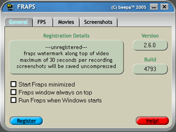  
所以我找了 Fraps V2.6.4 来演示一下如何用 ArmInline 来使得 Armadillo 脱壳变得简单点。  
Fraps V2.6.4 的加壳选项应该如下：  
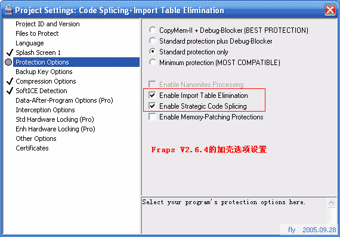  
  
—————————————————————————————————  
一、Armadillo 客户版的功能  
  
  
Armadillo 的作者比较精明，公开试用的是 Public Build，给注册用户的是 Custom Build。  
Custom Build 提供了一些 Public Build 所限制的功能，这些功能就是 Armadillo 立于猛壳之林数年不败所依赖的精华了。  
  
1、Nanomites Processing  
The Nanomites provide additional protection against memory-dumping for your programs. They will protect your program even if it is somehow stripped out of the SoftwarePassport/Armadillo shell. If your program can use the Debugger-Blocker or CopyMem-II, it should be able to use Nanomites as well. Besides enabling this option, you must mark sections within your program where Nanomites are permitted to reside and won't cause any speed problems, and use a custom build of the Armadillo engine. This option can only be used with the Debugger-Blocker or CopyMem-II protections.  
Nanomites Processing 就是通常所谓的 CC，Armadillo 最让人头痛的保护措施。  
  
2、Import Table Elimination  
Import Table Elimination is another anti-dumping defense. It removes the import table of the program, making it much more difficult to reconstruct the unprotected program file. Unlike CopyMem-II and the Nanomites, this defense does not require the Debugger-Blocker, but it is only available in custom builds.  
Import Table Elimination 一般是把输入表放在壳申请的内存处并且乱序处理。  
对于输入表乱序，以前有两种解法：①、写代码重新排序；②、直接用 ImportRec“创建新的 IAT”功能来构造新的输入表。  
  
3、Code Splicing  
Strategic Code Splicing is another anti-dumping defense. It removes portions of your code and places them randomly in memory, changing them so that they still operate the same but are coded differently. Unlike CopyMem-II and the Nanomites, this defense does not require the Debugger-Blocker, but it is only available in custom builds.  
Code Splicing 通常称为远程地址，Armadillo 会把程序中的部分代码挪移到壳申请的内存段运行，普通 dump 会导致此部分代码丢失。以前有两种解法：①、修改 VirtualAlloc 返回地址，使其把挪移的代码放到无用的壳区段；②、Dmp 后补上那个包含挪移代码的壳申请的内存段。  
  
4、Memory-Patching Protections  
He Memory-Patching Protections prevent an attacker from using a loader to change your program's code in memory, once it's loaded. If you handle any part of the expiration logic in your program's code, or use environment variables to control features that are only allowed in the paid-for version, then your program might be vulnerable to a memory-patching attack.  
If you use this option, you MUST use either CopyMem-II or the monitoring thread (or both), or it won't be able to do anything.  
The only time this option can cause a problem is if your program uses self-modifying code -- this option would consider that an attack, and would deliberately crash your program to stop it.  
内存校验。  
  
  
—————————————————————————————————  
二、寻找 Magic Jump 返回的时机  
       
               
设置 OllyDBG 忽略所有异常选项。用 IsDebug 插件去掉 OllyDBG 的调试器标志。  
  
00E02433    55              push ebp  
//载入 OllyDBG 后暂停在这  
00E02434    8BEC            mov ebp,esp  
00E02436    6A FF           push -1  
00E02438    68 88C1E200     push 0E2C188  
00E0243D    68 7021E000     push 0E02170  
00E02442    64:A1 00000000  mov eax,dword ptr fs:\[0\]  
00E02448    50              push eax  
00E02449    64:8925 0000000>mov dword ptr fs:\[0\],esp  
00E02450    83EC 58         sub esp,58  
00E02453    53              push ebx  
00E02454    56              push esi  
00E02455    57              push edi  
00E02456    8965 E8         mov dword ptr ss:\[ebp-18\],esp  
00E02459    FF15 8851E200   call dword ptr ds:\[E25188\] ; kernel32.GetVersion  
  
下断：HE GetModuleHandleA  
Shift+F9，注意观察中断时的堆栈  
  
0012967C     016130CE  /CALL 到 GetModuleHandleA 来自 016130C8  
00129680     01623D6C  \\pModule = "kernel32.dll"  
00129684     01625D70  ASCII "VirtualAlloc"  
  
0012967C     016130EB  /CALL 到 GetModuleHandleA 来自 016130E5  
00129680     01623D6C  \\pModule = "kernel32.dll"  
00129684     01625D64  ASCII "VirtualFree"  
  
0012941C     01605386  /CALL 到 GetModuleHandleA 来自 01605380  
00129420     00129558  \\pModule = "kernel32.dll"  
  
当堆栈如上显示变化时就是返回修改 Magic Jump 的时机了！  
经常有兄弟说找不到 Magic Jump 返回的时机，大部分 Armadillo 的 Magic Jump 返回的时机都可以用上面的方法来确定。  
当然，某些老版本的 Armadillo 和这不同，可以去查阅《看雪论坛精华合集》。  
  
HD GetModuleHandleA 取消断点  
Alt+F9 返回 01605386  
  
01605380    FF15 C8E06101   call dword ptr ds:\[161E0C8\] ; kernel32.GetModuleHandleA  
01605386    8B0D 24CF6201   mov ecx,dword ptr ds:\[162CF24\]  
//返回这里  
0160538C    89040E          mov dword ptr ds:\[esi+ecx\],eax  
0160538F    A1 24CF6201     mov eax,dword ptr ds:\[162CF24\]  
01605394    393C06          cmp dword ptr ds:\[esi+eax\],edi  
01605397    75 16           jnz short 016053AF  
01605399    8D85 DCFEFFFF   lea eax,dword ptr ss:\[ebp-124\]  
0160539F    50              push eax  
016053A0    FF15 90E06101   call dword ptr ds:\[161E090\] ; kernel32.LoadLibraryA  
016053A6    8B0D 24CF6201   mov ecx,dword ptr ds:\[162CF24\]  
016053AC    89040E          mov dword ptr ds:\[esi+ecx\],eax  
016053AF    A1 24CF6201     mov eax,dword ptr ds:\[162CF24\]  
016053B4    393C06          cmp dword ptr ds:\[esi+eax\],edi  
016053B7    0F84 2F010000   je 016054EC  
//Magic Jump！ 修改为：jmp 016054EC  ★  
016053BD    33C9            xor ecx,ecx  
016053BF    8B03            mov eax,dword ptr ds:\[ebx\]  
016053C1    3938            cmp dword ptr ds:\[eax\],edi  
016053C3    74 06           je short 016053CB  
016053C5    41              inc ecx  
016053C6    83C0 0C         add eax,0C  
016053C9    EB F6           jmp short 016053C1  
  
  
—————————————————————————————————  
三、OEP：飞向光明之巅  
  
  
下断：BP GetCurrentThreadId \[ESP\]<10000000  
也可以使用 Second 段内存断点大法走至 OEP 啦。    
   
Shift+F9 运行，中断在 GetCurrentThreadId 处，堆栈：  
0012F71C     0160571D   CALL 到 GetCurrentThreadId 来自 01605717  
  
取消这个断点。Alt+F9 返回，Ctrl+S 在当前位置下搜索命令序列：  
  call ecx  
  mov dword ptr ss:\[ebp-4\],eax  
找到在 0161980E 处，下断。Shift+F9 运行，中断下来  
  
0161980C    2BCA            sub ecx,edx  
0161980E    FFD1            call ecx   ; fraps.0040C434  
//飞向光明之巅  
01619810    8945 FC         mov dword ptr ss:\[ebp-4\],eax  
01619813    8B45 FC         mov eax,dword ptr ss:\[ebp-4\]  
01619816    5F              pop edi  
01619817    5E              pop esi  
01619818    C9              leave  
01619819    C3              retn  
  
  
0040C434    55              push ebp  
//OEP  
0040C435    8BEC            mov ebp,esp  
0040C437    6A FF           push -1  
0040C439    68 28334100     push 413328  
0040C43E    68 30E94000     push 40E930  
0040C443    64:A1 00000000  mov eax,dword ptr fs:\[0\]  
0040C449    50              push eax  
0040C44A    64:8925 0000000>mov dword ptr fs:\[0\],esp  
0040C451    83EC 58         sub esp,58  
0040C454    53              push ebx  
0040C455    56              push esi  
0040C456    57              push edi  
0040C457    8965 E8         mov dword ptr ss:\[ebp-18\],esp  
0040C45A    FF15 50407401   call dword ptr ds:\[1744050\] ; kernel32.GetVersion  
  
  
—————————————————————————————————  
四、Code Splicing 修复  
  
  
Fraps 使用了远程地址和输入表乱序。  
现在该 ArmInline 登场了，使用 ArmInline 需要设定一些参数。感谢 CoDe\_Inject 的帮忙。  
注意：下面的地址表示都是使用 Virtual Address  
  
Alt+M 打开内存察看窗口，记下 fraps.exe 进程的数据。  
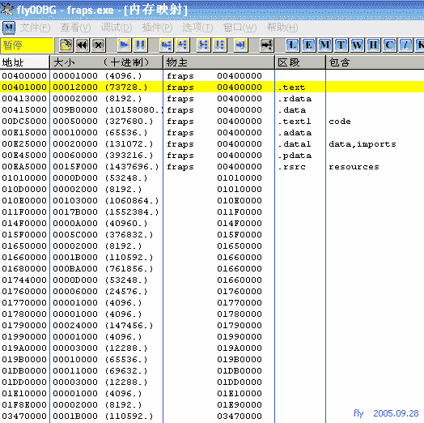  
  
1、Process ID  
OllyDBG 菜单->文件->附加，显示当前的进程列表，找到目标进程的 ID 即可。  
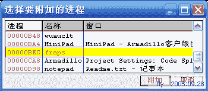  
  
2、Start Of Target Code  
代码段的开始地址，一般为第 2 个区段，这里是 00401000  
  
3、Length Of Target Code  
第 2 区段的 Size，这里为 00012000  
  
4、Start Of Spliced Code  
在程序中查找 Code Splicing 的地方。  
0040C53C    E8 00250000     call 0040EA41  
0040C541    E9 4A9E0603     jmp 03476390  
//处理 Code Splicing  
此区段的开始地址＝03470000  
  
5、Length Of Spliced Code  
直接察看 03470000 段的 Size＝0001B000  
  
下面在 ArmInline 填入各项数据，点击“Remove Splice”，可以看到“Patch Succesful”的提示。  
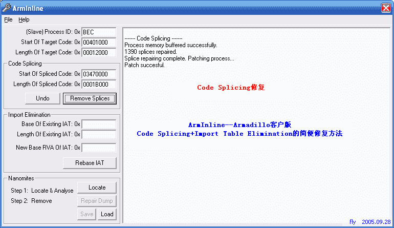   
如果失败，请检查各数据信息。当然，某些时候修复可能会有问题。  
  
  
—————————————————————————————————  
五、Import Table Elimination 修复  
  
  
1、Base Of Existing IAT  
现在输入表函数的开始地址。  
在程序中随便找个 API 调用，在数据窗口中察看 IAT 的开始和结束地址。  
可以在数据窗口中选择方便的察看方式，点右键->长型->地址  
Base Of Existing IAT＝IAT Start＝0174400C  
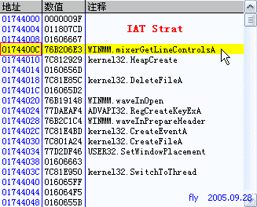   
  
2、Length Of Existing IAT  
IAT 的大小。向下滚动窗口，可以看到结束的地方。  
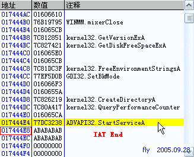   
IAT End＝017444E8  
  
Length Of Existing IAT＝Size＝017444E8-0174400C＝4DC  
  
3、New Base RVA Of IAT  
新输入表的存放地址。ArmInline 会把乱序的输入表重新整理成有序的，方便 ImportREC 修复。  
在程序中找段足够的空白处就行了。  
  
我通常是存放在程序加壳前原来 IAT 的相近地方。如何查找这个地方？  
Armadillo 加壳时保留了原输入表的 DLL 名，利用这个特征就行了。  
Alt+M，在第 2 个区段开始搜索输入表中的某个 DLL 名，去掉“整个段块”的选项，如 kernel32.dll  
找到在 00413E1A 处，向上看到还有许多的 0000，那就放在 00413B10 处吧。  
  
在 ArmInline 填入以上数据，点击“Rebase IAT”，可以看到提示修复成功了。  
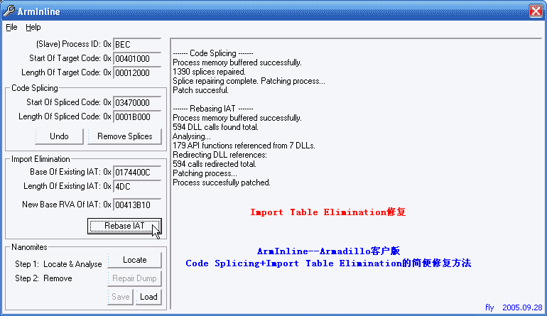  
ArmInline V0.6 支持 Nanomites 修复了，有兴趣的兄弟测试看看。  
  
  
—————————————————————————————————  
六、Armadillo 保护程序脱壳后 PE 的修复和优化  
  
  
现在去代码窗口中可以看到 Code Splicing 的地方还原了，输入表也放在了程序内部。  
运行 LordPE 修正 ImageSize 后完全 Dump 这个进程。得到 dumped.exe  
  
运行 ImportREC，把 OEP 改为 0000C434，点 IAT AutoSearch、Get Import，可以得到整齐的输入表。  
但是此时修复的话，ImportREC 会提示“没有足够的空间!不能对抓取文件添加任何区块!”。  
  
为何这样？当然是 Armadillo 惹的祸。用 WinHex 打开 dumped.exe，检查其 PE 信息。  
0X3C 处是 e\_lfanew，所指向的偏移是 PE Header。dumped.exe 的 e\_lfanew＝00A65CEF  
Armadillo 把 PE Header 复制到了壳区段里，PE Header 后面是壳代码，导致了 ImportREC 无法增加区段。  
我们把 00A65CEF-00A65F26 处的 PE Header 复制写入到 0XF0 的原 PE Header 处，修正 e\_lfanew＝000000F0  
  
现在就可以用 ImportREC“新增区段”来修复输入表了。  
不过修复 Import Table Elimination 后 00413B10 后面还有不少空地，算算 Size 够了，所以我没有“新增区段”，而是放在 0X00013E00 处，这样稍微美观点，也减小了文件的长度。得到 UnPacKed.exe  
注意：输入表中的 ntdll.dll 要替换成 kernel32.dll 的相应函数，否则无法跨平台运行。  
  
再来谈谈 Armadillo 保护程序脱壳后的优化问题。  
用 LordPE 打开 UnPacKed.exe 的区段，记下.text1 区段的 ROffset=009C5000。Wipe Section Header 末尾的几个壳区段：.text1、.adata、.data1、.pdata、.rsrc，用 WinHex 删除自 009C5000 至末尾的数据，用 00 清掉 Section Table 里面的这 5 个区段信息。  
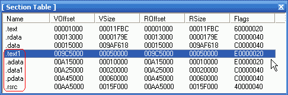  
壳区段清理完了，脱壳文件由 12M 变为 9.76M，但是第 3 个.data 段 RawSize=009AF618，明显太大，用 WinHex 察看 0X17000 后全是 00,所以删除自 00017000 至末尾的 00,修正.data 段 RawSize=00002000，VirtualSize=009AF618 保持不变，否则程序会出错。  
  
别忘了资源段。刚才我们删除区段是把资源段也删了，当然不能没有资源段啦。  
用 ResFixer 或者 DT\_FixRes 来修复资源吧。  
  
运行 ResFixer 打开未优化的 dumped.exe，看到各资源项都是完好的，如果有问题 ResFixer 会以红色来显示，我们所要做的是把 Resource 的 RVA 调整一下，在 Section RVA 填入 009C5000(00015000+009AF618＝009C4618，取整＝009C5000)，File Alignment 一般是 00001000，Rebuild Method 选择 Method 1(Cut And Paste），点击“Rebuild”，得到.rsrc 文件。  
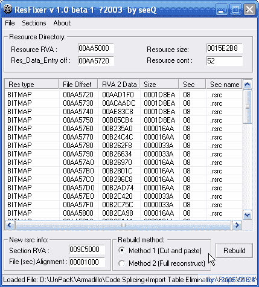  
ResFixer 的两种修复方法要注意一下。如果壳挪动了资源项，则需要选择 Method 2(Full Reconstruct）来 Rebuild。如果只是调整 Resource RVA，选择 Method 1(Cut And Paste）即可。另外 ResFixer 有 bug，修复某些程序资源时会异常出错。  
  
使用 DT\_FixRes 最终版修复的设置如下：  
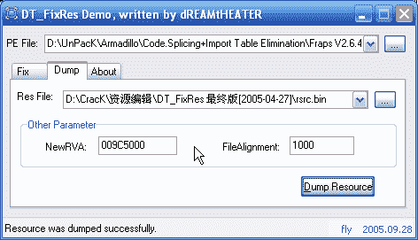  
  
运行 LordPE 把.rsrc 文件 load 入 UnPacKed.exe，修正 Resource RVA＝009C5000  
OK，UnPacKed.exe 大小为 1.46M，脱壳完成。  
  
此时用 PEiD 侦壳脱壳文件会显示“Armadillo 1.xx-2.xx”，用 WinHex 把 PE Header+0X1A、0X1B 处 MajorLinkerVersion、MinorLinkerVersion 的 5352 清 0 就行了。  
  
终于整理好了，希望能对朋友们有点用处。  
Game Over  
  
               
—————————————————————————————————                                   
         ,     \_/   
        /| \_.-~/            \\\_     ,        青春都一晌  
       ( /~   /              \\~-.\_ |\\  
       \`\\\\  \_/                \\   ~\\ )          忍把浮名   
   \_-~~~-.)  )\_\_/;;,.          \\\_  //'  
  /'\_,\\   --~   \\ ~~~-  ,;;\\\_\_\_(  (.-~~~-.        换了脱壳轻狂  
 \`~ \_( ,\_..--\\ (     ,;'' /    ~--   /.\_\`\\   
  /~~//'   /' \`~\\         ) /--..\_, )\_  \`~  
  "  \`~"  "      \`"      /~'\`\\    \`\\\\~~\\     
                         "     "   "~'  ""  
      
              UnPacKed By :  fly  
               2005-09-28 20:00 

转自：RCE Messageboard's Regroupment   
作者：Admiral  
  
ArmInline is an Armadillo unpacking tool designed specifically to deal with the many antidump features available with private builds of Armadillo 4.x. Features:  
  
\* Code Splicing:  
ArmInline 'revirgin's code protected by 'Strategic Code Splicing' by recursively identifying and removing the redundant opcodes, rather than dumping and patching in a VirtualAlloc, and so it adds nothing to the size of your dump.   
  
\* Import Elimination:  
ArmInline is capable of consolidating DLL imports that have been shuffled by Armadillo's 'Import Elimination' and can generate a new IAT, which can then be used by ImpRec (or any other import table reconstructor). Any references to the old IAT are automatically redirected to the newly created, streamlined IAT. Note that ArmInline cannot retrieve Armadillo's stolen imports, so you will have to fix this prior to rebasing the IAT if you want a working dump.  
  
\* Nanomites:  
Locates all of the nanomites in a dump and uses the packed exe to analyse them, generating a Nanomite table containing all the necessary information to produce a working dump. ArmInline can patch a small piece of vector exception handling code into your dump which will deal with the Nanomites on the fly.  
  
It's not the fastest tool you're ever going to see - it can take a few seconds to work a large 'Dillo (due to the recursive nature of its Code Splicing redundancy algorithm, the brute-force Nanomite debugging and the fact that I took the liberty of using Visual Basic to write much of it) and although it hasn't failed me yet (much), it has certainly not been thoroughly tested, and is provided without any guarantees whatsoever. So use this software at your own risk.  
  
附件:ArmInline V0.6.zip 

 4dd466d0e1e0cc123afbe504da2462ca