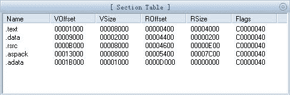
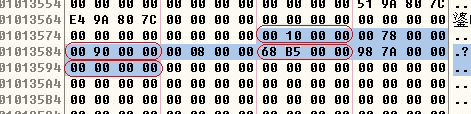

# ASPack 2.12 外壳流程分析

> 原文：[`www.pediy.com/kssd/pediy08/pediy8-616.htm`](https://www.pediy.com/kssd/pediy08/pediy8-616.htm)

整理了一篇，马上发上来，我算是怕了。发上估计是最安全了。   
  
写的时候是 HTML 形式，拷贝到这里后，格式和色彩标记都会去掉。  
着色的还是看附件好了。  
\=========================================================================  
【文章标题】: ASPack 2.12 外壳流程分析  
【作者声明】: 初学脱壳，没什么好东西。个人的一些经验，希望与大家分享，错误之处，欢迎指正！   
【测试软件】：Notepad + ASPack   
  
  
\--------------------------------------------------------------------------------  
  
【详细过程】  
  
  
从脱壳的角度来说 ASPack 1.08.03， 2.11 和 2.12 这 3 个版本都非常相似。  
在流程分析中，我只对 2.12 作了详细的分析，其他两个也就没必要了。  
  
————————————————————脱壳流程（ASPack 2.12）————————————————————  
01013000    90              nop  
01013001 >  60              pushad  
01013002    E8 03000000     call    0101300A                      ; 进  
01013007  - E9 EB045D45     jmp     465E34F7  
0101300C    55              push    ebp  
0101300D    C3              retn  
0101300E    E8 01000000     call    01013014                      ; 进  
01013013    90              nop                                   ; 花指令  
01013014    5D              pop     ebp                           ; Notepad\_.01013013  
01013015    BB EDFFFFFF     mov     ebx, -13  
0101301A    03DD            add     ebx, ebp  
0101301C    81EB 00300100   sub     ebx, 13000  
01013022    83BD 22040000 0>cmp     dword ptr \[ebp+422\], 0  
01013029    899D 22040000   mov     \[ebp+422\], ebx  
0101302F    0F85 65030000   jnz     0101339A                      ; 长跳转跟随  
01013035    8D85 2E040000   lea     eax, \[ebp+42E\]  
0101303B    50              push    eax  
0101303C    FF95 4D0F0000   call    \[ebp+F4D\]  
01013042    8985 26040000   mov     \[ebp+426\], eax  
01013048    8BF8            mov     edi, eax  
0101304A    8D5D 5E         lea     ebx, \[ebp+5E\]  
  
跟随后来到：  
  
0101339A    B8 9D730000     mov     eax, 739D                     ; 鼠标点击这一行，F4  
0101339F    50              push    eax  
010133A0    0385 22040000   add     eax, \[ebp+422\]  
010133A6    59              pop     ecx  
010133A7    0BC9            or      ecx, ecx  
010133A9    8985 A8030000   mov     \[ebp+3A8\], eax                ；执行这一行之后，OEP 值出现  
010133AF    61              popad  
010133B0    75 08           jnz     short 010133BA                  
010133B2    B8 01000000     mov     eax, 1  
010133B7    C2 0C00         retn    0C  
010133BA    68 00000000     push    0                             ; OEP  
010133BF    C3              retn  
  
用 LordPE 来 DUMP，直接 ImportRec 修复即可  
（1）与 1.08.03 相比较没有多大变化，只是在壳入口处增加了花指令及近跳转变形 CALL。  
（2）长跳转依然存在，脱起来还是这么方便。  
  
步骤总结：直接在壳入口处找到 jnz 的一个长跳转，跟随，OEP 就在下面几行了。  
  
脱这个壳没有多大意义，  
  
\---------------------------------ASPack 2.12 完全分析 --------------------------  
  
首先观察区块表：  
  
   
  
3 个经过压缩的原始区块，".text",".data",".rsrc".  
".aspck"块为壳的代码块  
".adata"块为壳的数据块  
  
OD 载入：  
01013001 >  60             pushad  
01013002    E8 03000000    call    0101300A              ; 进  
01013007  - E9 EB045D45    jmp     465E34F7  
0101300C    55             push    ebp  
0101300D    C3             retn  
0101300E    E8 01000000    call    01013014              ; 进  
01013013    EB 5D          jmp     short 01013072        ; 花指令  
01013015    BB EDFFFFFF    mov     ebx, -13  
0101301A    03DD           add     ebx, ebp  
0101301C    81EB 00300100  sub     ebx, 13000  
01013022    83BD 22040000 >cmp     dword ptr \[ebp+422\], >  
01013029    899D 22040000  mov     \[ebp+422\], ebx  
0101302F    0F85 65030000  jnz     0101339A              ; 跟随  
01013035    8D85 2E040000  lea     eax, \[ebp+42E\]  
0101303B    50             push    eax                   ; 字符串"kernel32.dll"  
0101303C    FF95 4D0F0000  call    \[ebp+F4D\]             ; CALL kernel32.GetModuleHandleA  
01013042    8985 26040000  mov     \[ebp+426\], eax  
01013048    8BF8           mov     edi, eax  
0101304A    8D5D 5E        lea     ebx, \[ebp+5E\]  
0101304D    53             push    ebx                   ; 字符串“VirtualAlloc”  
0101304E    50             push    eax  
0101304F    FF95 490F0000  call    \[ebp+F49\]             ; CALL kernel32.GetProcAddress  
01013055    8985 4D050000  mov     \[ebp+54D\], eax  
0101305B    8D5D 6B        lea     ebx, \[ebp+6B\]  
0101305E    53             push    ebx                   ; 字符串“VirtualFree”  
0101305F    57             push    edi  
01013060    FF95 490F0000  call    \[ebp+F49\]             ; CALL kernel32.GetProcAddress  
01013066    8985 51050000  mov     \[ebp+551\], eax  
0101306C    8D45 77        lea     eax, \[ebp+77\]  
0101306F    FFE0           jmp     eax                   ; Notepad\_.0101308A  
  
取得 VirtualAlloc 和 VirtualFree 地址，分别保存在\[ebp+426\]和\[ebp+54D\]位置  
  
0101308A    8B9D 31050000  mov     ebx, \[ebp+531\]        ; 跳转到这里（有花指令）  
01013090    0BDB           or      ebx, ebx  
01013092    74 0A          je      short 0101309E        ; 跳  
01013094    8B03           mov     eax, \[ebx\]  
01013096    8785 35050000  xchg    \[ebp+535\], eax  
0101309C    8903           mov     \[ebx\], eax  
0101309E    8DB5 69050000  lea     esi, \[ebp+569\]        ; esi = 0X101357C,指向原始区块信息（数据窗口跟随 esi，如下图所示）  
010130A4    833E 00        cmp     dword ptr \[esi\], 0    ;   
010130A7    0F84 21010000  je      010131CE              ;   
010130AD    6A 04          push    4  
010130AF    68 00100000    push    1000  
010130B4    68 00180000    push    1800                  ; size = 0x1800，（\*".data"段长度？\*）  
010130B9    6A 00          push    0  
010130BB    FF95 4D050000  call    \[ebp+54D\]             ; CALL kernel32.VirtualAlloc  
010130C1    8985 56010000  mov     \[ebp+156\], eax        ; EBP\[156\] = 0x930000：缓冲区起始地址（块一）  
  
  
   
  
图中蓝色部分数据，显然为 3 个区块的起始地址和长度（看到这些数据，比较敏感）。经过进一步分析，如 0x0000B568，虽然不是".rsrc"块的起始地址，但在".rsrc"内。且 0XB568 + 0X7A98 = 0X8000，刚好与".rsrc"块的长度相同，这也就说明 ASPack 在对资源段进行压缩时并不是从起始位置开始的，而是压缩距离资源段偏移位置（0X568--0X8000）部分。  
  
   
  
下面就进入了区块解压部分（在本例中下面这段代码会执行 3 次，每一次执行意味着解压一个区块）：  
  
010130C7    8B46 04        mov     eax, \[esi+4\]          ; 取得当前要解压块长度，保存在 eax  
010130CA    05 0E010000    add     eax, 10E              ; eax += 0x10E  
010130CF    6A 04          push    4  
010130D1    68 00100000    push    1000  
010130D6    50             push    eax                   ; 缓冲区长度  
010130D7    6A 00          push    0  
010130D9    FF95 4D050000  call    \[ebp+54D\]             ; CALL kernel32.VirtualAlloc，分配解压缓冲区  
010130DF    8985 52010000  mov     \[ebp+152\], eax        ; EBP\[152\] = 0x940000（解压缓冲区起始地址）  
010130E5    56             push    esi  
010130E6    8B1E           mov     ebx, \[esi\]  
010130E8    039D 22040000  add     ebx, \[ebp+422\]  
010130EE    FFB5 56010000  push    dword ptr \[ebp+156\]   ; 参数 4：缓冲区一起始地址  
010130F4    FF76 04        push    dword ptr \[esi+4\]     ; 参数 3：解压区块数据长度  
010130F7    50             push    eax                   ; 参数 2：解压缓冲区起始地址  
010130F8    53             push    ebx                   ; 参数 1：解压区块起始地址  
010130F9    E8 6E050000    call    0101366C              ; 取得解压数据保存在解压缓冲区中  
010130FE    B3 01          mov     bl, 0                 ; 这条指令的第二操作数会变化（如果是代码段为 1，其他为 0）  
01013100    80FB 00        cmp     bl, 0  
01013103    75 5E          jnz     short 01013163        ; 事实上，当前不是代码段时，会跳过下面这段蓝色代码  
01013105    FE85 EC000000  inc     byte ptr \[ebp+EC\]  
0101310B    8B3E           mov     edi, \[esi\]  
0101310D    03BD 22040000  add     edi, \[ebp+422\]  
01013113    FF37           push    dword ptr \[edi\]       ；干扰指令（这里开始的 4 个指令）  
01013115    C607 C3        mov     byte ptr \[edi\], 0C3   ; 把 0x1001000 处的第一字节改为 0XC3，即 ret 指令  
01013118    FFD7           call    edi                   ; 变形 CALL，相当于无效指令（edx = 0X1001000）  
0101311A    8F07           pop     dword ptr \[edi\]  
0101311C    50             push    eax  
0101311D    51             push    ecx  
0101311E    56             push    esi  
0101311F    53             push    ebx  
01013120    8BC8           mov     ecx, eax  
01013122    83E9 06        sub     ecx, 6  
01013125    8BB5 52010000  mov     esi, \[ebp+152\]  
0101312B    33DB           xor     ebx, ebx  
0101312D    0BC9           or      ecx, ecx  
0101312F    74 2E          je      short 0101315F  
01013131    78 2C          js      short 0101315F  
01013133    AC             lods    byte ptr \[esi\]  
01013134    3C E8          cmp     al, 0E8  
01013136    74 0A          je      short 01013142  
01013138    EB 00          jmp     short 0101313A  
0101313A    3C E9          cmp     al, 0E9  
0101313C    74 04          je      short 01013142  
0101313E    43             inc     ebx  
0101313F    49             dec     ecx  
01013140  ^ EB EB          jmp     short 0101312D  
01013142    8B06           mov     eax, \[esi\]  
01013144    EB 00          jmp     short 01013146        ; 无效指令，相当于 NOP  
01013146    803E 06        cmp     byte ptr \[esi\], 6  
01013149  ^ 75 F3          jnz     short 0101313E  
0101314B    24 00          and     al, 0  
0101314D    C1C0 18        rol     eax, 18  
01013150    2BC3           sub     eax, ebx  
01013152    8906           mov     \[esi\], eax  
01013154    83C3 05        add     ebx, 5  
01013157    83C6 04        add     esi, 4  
0101315A    83E9 05        sub     ecx, 5  
0101315D  ^ EB CE          jmp     short 0101312D  
0101315F    5B             pop     ebx  
01013160    5E             pop     esi  
01013161    59             pop     ecx  
01013162    58             pop     eax  
01013163    EB 08       jmp    short 0101316D      ；不是代码段时跳到这里  
  
01013165    0000           add     \[eax\], al  
01013167    94             xchg    eax, esp  
01013168    0000           add     \[eax\], al  
0101316A    90             nop  
0101316B    90             nop  
0101316C    90             nop  
0101316D    8BC8           mov     ecx, eax  
0101316F    8B3E           mov     edi, \[esi\]  
01013171    03BD 22040000  add     edi, \[ebp+422\]        ; edi 指向区块起始地址  
01013177    8BB5 52010000  mov     esi, \[ebp+152\]        ; esi 指向解压缓冲区  
0101317D    C1F9 02        sar     ecx, 2                ; ecx 保存该区块解压数据的长度  
01013180    F3:A5          rep     movs dword ptr es:\[edi\], dword ptr \[esi\]     ; 区段数据覆盖（对 0x1001000 设置内存写入断点，第 3 次中断来到这里，因为前面的一个干扰指令会在这个地址写入 ret 和擦除。中断后要立即撤消该断点）  
01013182    8BC8           mov     ecx, eax  
01013184    83E1 03        and     ecx, 3                ; 为了保证 4 字节对齐  
01013187    F3:A4          rep     movs byte ptr es:\[edi\], byte ptr \[esi\]  
01013189    5E             pop     esi  
0101318A    68 00800000    push    8000  
0101318F    6A 00          push    0  
01013191    FFB5 52010000  push    dword ptr \[ebp+152\]   ; push 0x940000，释放解压缓冲区  
01013197    FF95 51050000  call    \[ebp+551\]             ; CALL kernel32.VirtualFree  
0101319D    83C6 08        add     esi, 8                ；取下一个区块信息  
010131A0    833E 00        cmp     dword ptr \[esi\], 0    ; 检测下一区块信息是否为空  
010131A3  ^ 0F85 1EFFFFFF  jnz     010130C7              ; 不为空则跳转（在本例中跳转 3 次）  
010131A9    68 00800000    push    8000                  ; 一旦到了这里，就表示解压完成  
010131AE    6A 00          push    0  
010131B0    FFB5 56010000  push    dword ptr \[ebp+156\]   ; push 0x930000，释放第一个缓冲区  
010131B6    FF95 51050000  call    \[ebp+551\]             ; CALL kernel32.VirtualFree  
010131BC    8B9D 31050000  mov     ebx, \[ebp+531\]  
010131C2    0BDB           or      ebx, ebx  
010131C4    74 08          je      short 010131CE        ; 跳  
010131C6    8B03           mov     eax, \[ebx\]  
010131C8    8785 35050000  xchg    \[ebp+535\], eax  
010131CE    8B95 22040000  mov     edx, \[ebp+422\]        ; edx = 0x1000000，基地址  
010131D4    8B85 2D050000  mov     eax, \[ebp+52D\]        ; eax = 0x1000000，基地址  
010131DA    2BD0           sub     edx, eax  
010131DC    74 79          je      short 01013257        ; 跳  
  
  
到这里外壳部分已经对软件的 3 个区块进行了解压  
  
下面开始进入的 IAT 的还原部分  
  
01013257    8B95 22040000  mov     edx, \[ebp+422\]           ; edx = 0x1000000  
0101325D    8BB5 41050000  mov     esi, \[ebp+541\]           ; esi = 0  
01013263    0BF6           or      esi, esi  
01013265    74 11          je      short 01013278           ; 跳  
  
01013278    BE 04760000    mov     esi, 7604                ; 7604 为输入表的偏移地址（壳备份）  
0101327D    8B95 22040000  mov     edx, \[ebp+422\]           ; edx = 0x1000000  
01013283    03F2           add     esi, edx                 ; esi = 0x1007604 指向备份输入表  
01013285  8B46 0C       mov    eax,\[esi+C\]          ; ImportTable->dwDllNameOffset（外循环起始）  
01013288    85C0           test    eax, eax                 ; 测试 esi 所指向的输入表项是否为空（即 DLL 是否处理完了）  
0101328A   0F84 0A010000 je    0101339A              ; 若为空，就跳出（跳出外循环）  
01013290    03C2           add     eax, edx                 ; DLL 名字的偏移地址+基地址=虚拟内存地址  
01013292    8BD8           mov     ebx, eax  
01013294    50             push    eax                      ; eax 指向 DLL 名字的字符串  
01013295    FF95 4D0F0000  call    \[ebp+F4D\]                ; CALL kernel32.GetModuleHandleA  
0101329B    85C0           test    eax, eax  
0101329D    75 07          jnz     short 010132A6           ; 取得 DLL 模块句柄成功，则跳转  
0101329F    53             push    ebx  
010132A0    FF95 510F0000  call    \[ebp+F51\]  
010132A6    8985 45050000  mov     \[ebp+545\], eax           ; 把 dll 模块地址保存在\[ebp+545\]  
010132AC    C785 49050000 >mov     dword ptr \[ebp+549\], 0   ; \[ebp+549\]保存着地址表的偏移地址  
010132B6  8B95 22040000 mov    edx, \[ebp+422\]        ; edx 为基地址（内循环起始）  
010132BC    8B06           mov     eax, \[esi\]               ; eax 为 IT->OriginalFirstThunk 表的偏移地址  
010132BE    85C0           test    eax, eax                 ; 测试 DLL 的 IT->OriginalFirstThunk 项是否为空  
010132C0    75 03          jnz     short 010132C5           ; 若不为空则跳转  
010132C2    8B46 10        mov     eax, \[esi+10\]            ; IT->OriginalThunk 项为空，eax 为 IT->FirstThunk  
010132C5    03C2           add     eax, edx                 ; eax = eax + 基地址  
010132C7    0385 49050000  add     eax, \[ebp+549\]           ; eax = eax + 地址表偏移地址  
010132CD    8B18           mov     ebx, \[eax\]               ; ebx 为 OriginalFirstThunk 表中的一个值（表示当前 dll 中的某个函数的地址）  
010132CF    8B7E 10        mov     edi, \[esi+10\]            ; edi 为 IT->FirstThunk 表的偏移地址，即 IAT 表  
010132D2    03FA           add     edi, edx                 ; edi = edi + 基地址  
010132D4    03BD 49050000  add     edi, \[ebp+549\]           ; eax = eax + 地址表偏移地址  
010132DA    85DB           test    ebx, ebx                 ; 如果 ebx=0，意味当前 dll 的所有函数入口地址都已经处理完了  
010132DC    0F84 A2000000  je      01013384  
010132E2    F7C3 00000080  test    ebx, 80000000  
010132E8    75 04          jnz     short 010132EE  
010132EA    03DA           add     ebx, edx                 ; ebx = ebx + 基地址  
010132EC    43             inc     ebx  
010132ED    43             inc     ebx  
010132EE    53             push    ebx  
010132EF    81E3 FFFFFF7F  and     ebx, 7FFFFFFF  
010132F5    53             push    ebx                      ; ebx 指向函数名  
010132F6    FFB5 45050000  push    dword ptr \[ebp+545\]      ; \[ebp+545\]为 dll 模块句柄  
010132FC    FF95 490F0000  call    \[ebp+F49\]                ; CALL kernel32.GetProcAddress  
01013302    85C0           test    eax, eax  
01013304    5B             pop     ebx  
01013305    75 6F          jnz     short 01013376           ; 取函数地址成功，就跳转  
……（忽略一段除错处理）  
01013376    8907           mov     \[edi\], eax               ; 跳到这里，把所取得的函数地址存在 IAT 中  
01013378    8385 49050000 >add     dword ptr \[ebp+549\], 4   ; 下一个函数，增加偏移量  
0101337F  ^ E9 32FFFFFF jmp     010132B6             ; 继续找函数地址（内循环尾部）  
01013384    8906           mov     \[esi\], eax  
01013386    8946 0C        mov     \[esi+C\], eax  
01013389    8946 10        mov     \[esi+10\], eax  
0101338C    83C6 14        add     esi, 14                  ; esi 指向输入表的下一个表项  
0101338F    8B95 22040000  mov     edx, \[ebp+422\]  
01013395   E9 EBFEFFFF jmp     01013285          ; 继续枚举 dll 输入表项（外循环尾部）  
  
上面的双重循环是用来恢复 IAT 的，工作流程如下所示：  
  
for ( 每一个输入表项 ）  
{  
 for ( 每一个函数　）  
 ｛  
  取函数地址  
  写入 IAT  
 ｝  
}  
  
跳出上面的双重循环后，来到这里：  
  
0101339A    B8 9D730000    mov     eax, 739D                ; 0x739D 为 OEP 偏移  
0101339F    50             push    eax  
010133A0    0385 22040000  add     eax, \[ebp+422\]           ; eax = eax + 基地址  
010133A6    59             pop     ecx                       
010133A7    0BC9           or      ecx, ecx  
010133A9    8985 A8030000  mov     \[ebp+3A8\], eax           ；改写 OEP 存储地址  
010133AF    61             popad  
010133B0    75 08          jnz     short 010133BA  
010133B2    B8 01000000    mov     eax, 1  
010133B7    C2 0C00        retn    0C  
010133BA   68 9D730001  push   0100739D          ; OEP = 0X0100739D,动态生成  
010133BF    C3             retn  
  
——————————————————————————————————————  
  
总结 ASPack2.12 外壳执行流程：  
  
1、取得 VirtualAlloc 和 VirtualFree 函数地址  
  
2、分配缓冲区，解压区块（此例中为 3 个区块），释放缓冲区  
  
3、双重循环，填充 IAT 表  
  
4、转到 OEP  
  
\=========================================================================================  
（说明：DLB 是为了便于我自己的理解而起的名字，作为心得写在这里。如果哪位觉得无聊，就别看了。想找我拍砖的，就免了。）  
DLB（Double Loop Body）原理:  
对于一般的压缩壳，外壳需要先解压缩，然后再填充 IAT。|  
而在填充 IAT 的时候,通常都会调用 GetModuleHandleA,就利用这一点，返回到用户空间之后，  
要做的第一件事就找内层循环体，然后再找外层循环体。而当找到“双重循环体（DLB）”之后，OEP 就不远了。  
  
在这里提出 DLB 原理，因为当我把 ASPack 2.12 分析完之后，我把 ASPack 的 DLB 当作标准 DLB，  
因为在后面的实践中，我发现 DLB 的形式并不都是这样，有一定的变形，但本质都是一样。  
  
再来回顾一下 DLB 的特征：  
for ( 每一个输入表项 ）  
{  
 取得模块地址（GetModuleHandleA),当若干次中断，然后返回到用户空间的时候，在这里的下一行  
 for ( 每一个函数　）  
 ｛  
  取函数地址  
  写入 IAT  
 ｝  
}  
  
当使用外壳是调用系统的 GetModuleHandleA，可以直接设断，中段若干次后返回到用户空间，  
返回的地址必定在 DLB 中，然后找 DLB 的两个边界。  
如果壳中自己实现了这个函数，那就不能直接对这个函数设置断点，需要通过分析来找 DLB 了。  
  
要熟练利用 DLB 原理的前提：非常熟悉 PE 结构，对一些数据很敏感，例如 IAT 项大小为 0X14 等。  
需要对 IAT 的填充形式非常清楚，最好能写个程序测试下，仔细观察 DLB 实现中的每个细节。  
  
关于 DLB 原理的实践应用，将整理到下一篇。  
  
  
\--------------------------------------------------------------------------------  
  
【版权声明】: 本文原创于看雪技术论坛, 转载请注明作者并保持文章的完整, 谢谢!  
  
   

我觉得完全没有必要起这么个高深的原理。  
循环完全是作者的喜好，有可能延迟输入的这种方法也不适用。  
如果找 OEP，对于压缩壳来说 Alt+M hit Code 段就到了  
如果是保护壳即使找到所谓双循环还是什么也找不到，  
因为如果是我找 IAT 的话，肯定会 BP LoadLibraryA，何必要找什么 DLB 呢？