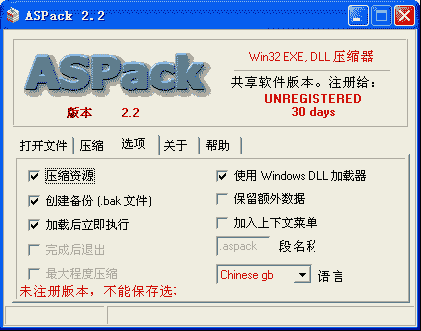
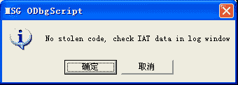

# ASPACK 2.2 破解手记

> 原文：[`www.pediy.com/kssd/pediy10/89887.html`](https://www.pediy.com/kssd/pediy10/89887.html)

【文章标题】: ASPACK 2.2 破解手记  
【文章作者】: 啊 cr/FTSTT  
【软件名称】: www.aspack.com  
【软件大小】: 675 KB (691,771 字节)  
【下载地址】: www.aspack.com  
【加壳方式】: Aspr  
【保护方式】: Aspr+key 解码  
【编写语言】: Delphi 5  
【使用工具】: OD  
【操作平台】: Win xp Sp3  
【软件介绍】: A Win32 executable file compressor.   
【作者声明】: 只是感兴趣，没有其他目的。失误之处敬请诸位大侠赐教!  
\--------------------------------------------------------------------------------  

引用:    
今天看到 RegKiller 放了一个 2.2 的破解，说明中提到他这个破解 右键菜单调用压缩的时候有一个自动退出的 bug，想起自己 4 月份放的那个忘记测试这里了，测试之下发现比他这个 bug 还严重 都弹出出错对话框了 呵呵，fix it。重新弄一下 记录一下完整的破解过程。 

准备工作：OD 一个，VolX 脚本一个，ASPACK 22 安装文件一只，ASPACK 212r 注册版一套（用来抄代码）。  
  
  
  
开始 XX：  
第一步，观察  
根据经验这个版本共有三个限制 配置保存 配置应用 时间限制。  
  
  
第二步，脱壳  
  
感谢 VolX，轻松秒掉，时间限制同时也秒掉了。  
  
  
版本区别不大，尝试抄袭 212r 中的代码。  
  
第三步，调戏 212r，把需要抄袭的代码都找到。  
注册 212r，OD 载入。  
回忆一下限制，不能保存选项，有可能是是退出不保存或者启动的时候不读取，假设是启动不读取配置，看看初始化代码吧。  
用资源工具查看主窗体叫 TfrmMain，F9 运行程序，G 401000 二进制搜索“TfrmMain”，找到这里：  
  
代码:

```
0043F120   .  54 66 72 6D 4>ASCII "TfrmMain"

```

向下翻看到这里  
代码:

```
0043F5DC . FF15 08494400 CALL DWORD PTR DS:\[444908\]
0043F5E2 . E9 83000000 JMP ASPack.0043F66A

```

典型的 Aspr 解码，记下 CALL DWORD PTR DS:\[444908\]，搜索此命令代码:

```
0043F5DC . FF15 08494400 CALL DWORD PTR DS:\[444908\]
0044152C . FF15 08494400 CALL DWORD PTR DS:\[444908\]
00441CEA . FF15 08494400 CALL DWORD PTR DS:\[444908\]
00442257 |> \\FF15 08494400 CALL DWORD PTR DS:\[444908\]

```

共四处解码。  
在 22 里同样方法  
找到代码:

```
004651A2 . FF15 F0AC4600 CALL DWORD PTR DS:\[46ACF0\]
004651A8 . E9 83000000 JMP Doit\_ASP.00465230

```

记下 CALL DWORD PTR DS:\[46ACF0\]，并搜此命令代码:

```
004651A2 . FF15 F0AC4600 CALL DWORD PTR DS:\[46ACF0\]
0046716C . FF15 F0AC4600 CALL DWORD PTR DS:\[46ACF0\]
00467951 . FF15 F0AC4600 CALL DWORD PTR DS:\[46ACF0\]
00467EEB > \\FF15 F0AC4600 CALL DWORD PTR DS:\[46ACF0\]

```

巧啊，也是四处，假设他们对应的功能是完全相同的，事实证明正是如此。  
分析 212r 中相关代码的功能，方便移植后的修复。  
  
  
第一处：0043F5DC  
重新启动 212r，在 0043F5DC 出下内存访问断点，  
第 N 次后断在代码:

```
0043F5DC   .  FF15 08494400 CALL DWORD PTR DS:\[444908\]

```

F8 走过这句，可以看到下面解码了，Ctrl+A 分析一下 代码:

```
0043F5DC . FF15 08494400 CALL DWORD PTR DS:\[444908\] ; 解码
0043F5E2 . E9 01000000 JMP ASPack.0043F5E8
0043F5E7 29 DB 29 ; 小花
0043F5E8 > 8B45 FC MOV EAX,DWORD PTR SS:\[EBP-4\]
0043F5EB . 8B80 E0010000 MOV EAX,DWORD PTR DS:\[EAX+1E0\] ; @控件 1: LabelTrial
0043F5F1 . 8B40 44 MOV EAX,DWORD PTR DS:\[EAX+44\]
0043F5F4 . 33D2 XOR EDX,EDX
0043F5F6 . E8 2993FDFF CALL ASPack.00418924 ; @CALL\_1:
0043F5FB . 8D55 D4 LEA EDX,DWORD PTR SS:\[EBP-2C\]
0043F5FE . A1 BC564400 MOV EAX,DWORD PTR DS:\[4456BC\] ;@指针 1:
0043F603 . E8 586DFCFF CALL ASPack.00406360 ; @CALL\_2:
0043F608 . 8B55 D4 MOV EDX,DWORD PTR SS:\[EBP-2C\]
0043F60B . 8B45 FC MOV EAX,DWORD PTR SS:\[EBP-4\]
0043F60E . 8B80 E0010000 MOV EAX,DWORD PTR DS:\[EAX+1E0\] ; @控件 1: LabelTrial
0043F614 . E8 073BFDFF CALL ASPack.00413120 ; @CALL\_3:
0043F619 . 8B45 FC MOV EAX,DWORD PTR SS:\[EBP-4\]
0043F61C . 8B80 6C020000 MOV EAX,DWORD PTR DS:\[EAX+26C\] ; @控件 2: LabelUnregistered
0043F622 . E8 E53EFDFF CALL ASPack.0041350C ; @CALL\_4:
0043F627 . B2 01 MOV DL,1
0043F629 . 8B45 FC MOV EAX,DWORD PTR SS:\[EBP-4\]
0043F62C . 8B80 7C020000 MOV EAX,DWORD PTR DS:\[EAX+27C\] ; @控件 3: EditSection
0043F632 . E8 513AFDFF CALL ASPack.00413088 ; @CALL\_5:
0043F637 . B2 01 MOV DL,1
0043F639 . 8B45 FC MOV EAX,DWORD PTR SS:\[EBP-4\]
0043F63C . 8B80 78020000 MOV EAX,DWORD PTR DS:\[EAX+278\] ; @控件 4: CBExit
0043F642 . E8 413AFDFF CALL ASPack.00413088 ; @CALL\_5:
0043F647 . B2 01 MOV DL,1
0043F649 . 8B45 FC MOV EAX,DWORD PTR SS:\[EBP-4\]
0043F64C . 8B80 EC020000 MOV EAX,DWORD PTR DS:\[EAX+2EC\] ; @控件 5: CBMaxCompression
0043F652 . E8 313AFDFF CALL ASPack.00413088 ; @CALL\_5:
0043F657 . 8B45 FC MOV EAX,DWORD PTR SS:\[EBP-4\]
0043F65A . 8B80 E4020000 MOV EAX,DWORD PTR DS:\[EAX+2E4\] ; @控件 6: FS
0043F660 . C640 20 01 MOV BYTE PTR DS:\[EAX+20\],1 ; @标志位 1:
0043F664 . EB 04 JMP SHORT ASPack.0043F66A
0043F666 . 46 DB 46 ; 小花
0043F667 . 8C DB 8C ; 小花
0043F668 . DD DB DD ; 小花
0043F669 . 94 DB 94 ; 小花
0043F66A > FF15 0C494400 CALL DWORD PTR DS:\[44490C\] ; 编码

```

这段代码从解码开始到编码结束，其中小花若干,nop 小花后 0043F5E20043F669 二进制数据如下代码:

```
E9 01 00 00 00 90 8B 45 FC 8B 80 E0 01 00 00 8B 40 44 33 D2 E8 29 93 FD FF 8D 55 D4 A1 BC 56 44
00 E8 58 6D FC FF 8B 55 D4 8B 45 FC 8B 80 E0 01 00 00 E8 07 3B FD FF 8B 45 FC 8B 80 6C 02 00 00
E8 E5 3E FD FF B2 01 8B 45 FC 8B 80 7C 02 00 00 E8 51 3A FD FF B2 01 8B 45 FC 8B 80 78 02 00 00
E8 41 3A FD FF B2 01 8B 45 FC 8B 80 EC 02 00 00 E8 31 3A FD FF 8B 45 FC 8B 80 E4 02 00 00 C6 40
20 01 EB 04 90 90 90 90

```

新开一个 OD 载入脱壳后的 22，定位到对应的位置 004651A8，二进制粘贴上面的代码，看一下结尾 长度刚好一致。  
代码:

```
 
004651A2   .  FF15 F0AC4600 CALL DWORD PTR DS:\[46ACF0\]
00465230   > \\FF15 F4AC4600 CALL DWORD PTR DS:\[46ACF4\]

```

这两个已经被强大的脚本自动修复了，指向 ret 等于 nop 了，如果空间不足可以 nop 掉这两句腾出空间补代码。  
  
这段代码一共涉及 6 个控件，5 个 CALL 一个指针，一个标志，若干局部变量。  
这些值复制到新版中可能需要修正，下面记录他们的特征。  
  
在 212r 中  
控件名称可以算是空间的特征，查找控件名：  
例如：  
  
代码:

```
0043F5EB   .  8B80 E0010000 MOV EAX,DWORD PTR DS:\[EAX+1E0\]

```

控件标号是 1E0，在 code 段二进制搜索（区分大小写） E001，第一次找到的是代码，第二次找到  
代码:

```
 
0043EA70      E0            DB E0
0043EA71      01            DB 01
0043EA72      00            DB 00
0043EA73      00            DB 00
0043EA74      03            DB 03
0043EA75      00            DB 00
0043EA76   .  0A            DB 0A
0043EA77   .  4C 61 62 65 6>ASCII "LabelTrial"

```

这里"LabelTrial"就是控件的名字了，同样方法查找其他控件,在新程序里搜索控件名就可以找到编号了。  
在 22 中  
在 code 段二进制搜索（区分大小写） LabelTrial，找到  
代码:

```
 
00464620      04            DB 04
00464621      03            DB 03
00464622      00            DB 00
00464623      00            DB 00
00464624      03            DB 03
00464625      00            DB 00
00464626   .  0A            DB 0A
00464627   .  4C 61 62 65 6>ASCII "LabelTrial"

```

标号为 304  
修正代码  
代码:

```
 
004651B1      8B80 04030000 MOV EAX,DWORD PTR DS:\[EAX+304\]

```

其他几个用同样的方法找到。  
  
指针的特征，  
在 212r 中  
例如：  
  
代码:

```
0043F5FE   .  A1 BC564400   MOV EAX,DWORD PTR DS:\[4456BC\]

```

搜索常数 4456BC  
找到  
代码:

```
 
00442BC4  /.  55            PUSH EBP
00442BC5  |.  8BEC          MOV EBP,ESP
00442BC7  |.  8B45 08       MOV EAX,DWORD PTR SS:\[EBP+8\]
00442BCA  |.  A3 BC564400   MOV DWORD PTR DS:\[4456BC\],EAX
00442BCF  |.  5D            POP EBP                                  ;  0012FE50
00442BD0  \\.  C2 0400       RETN 4

```

，看看前后代码，熟悉 aspr 的都知道怎么找这个地址了，DWORD PTR DS:\[4456BC\]=注册名的指针，属于 pre-dip 可以轻松找到，他的下一段代码是时间限制，然后是过期提示等，  
其中  
代码:

```
 
00442C0D  |.  68 402C4400   PUSH ASPack.00442C40                     ;  ASCII "Expired"

```

这句有字符串很明显。  
在 22 中  
查找字符串 Expired，找到  
代码:

```
 
00468255  |.  68 88824600   PUSH Doit\_ASP.00468288                   ; |Title = "Expired"

```

向上  
代码:

```
 
004681E0  /.  55            PUSH EBP
004681E1  |.  8BEC          MOV EBP,ESP
004681E3  |.  8B45 08       MOV EAX,DWORD PTR SS:\[EBP+8\]
004681E6  |.  A3 E8AC4600   MOV DWORD PTR DS:\[46ACE8\],EAX
004681EB  |.  8B45 0C       MOV EAX,DWORD PTR SS:\[EBP+C\]             ;  Doit\_ASP.00441F8D
004681EE  |.  A3 ECAC4600   MOV DWORD PTR DS:\[46ACEC\],EAX
004681F3  |.  5D            POP EBP                                  ;  0012FE1C
004681F4  \\.  C2 0800       RETN 8

```

时间限制，继续向上，找到了  
代码:

```
 
004681D6  |.  A3 24C94600   MOV DWORD PTR DS:\[46C924\],EAX

```

感谢强大的脚本，这里面已经写好"VolX"的指针了，悄悄地改成自己的字串。  
  
  
标志位：  
在 212r 中  
例如：  
代码:

```
 
0043F65A   .  8B80 E4020000 MOV EAX,DWORD PTR DS:\[EAX+2E4\]
0043F660   .  C640 20 01    MOV BYTE PTR DS:\[EAX+20\],1

```

这个标志位和 2E4 控件有直接关系，细想一下应该是控件禁用，搜索常数 2E4，成功找到另一处类似代码：  
代码:

```
 
0043F5C2   .  8B80 E4020000 MOV EAX,DWORD PTR DS:\[EAX+2E4\]
0043F5C8   .  C640 20 00    MOV BYTE PTR DS:\[EAX+20\],0

```

很巧这段代码就在解码 call 的前面。  
在 22 中  
之前修复了   
代码:

```
0043F5C2   .  8B80 E4020000 MOV EAX,DWORD PTR DS:\[EAX+2E4\]

```

对应的  
代码:

```
00465220      8B80 08040000 MOV EAX,DWORD PTR DS:\[EAX+408\]

```

好，搜索常数 408，找到  
代码:

```
 
00465188   .  8B80 08040000 MOV EAX,DWORD PTR DS:\[EAX+408\]
0046518E   .  C640 24 00    MOV BYTE PTR DS:\[EAX+24\],0

```

修正代码  
代码:

```
 
00465226      C640 24 01    MOV BYTE PTR DS:\[EAX+24\],1

```

保存修改代码，重新运行 22，并在第一个需要修复的 CALL  
代码:

```
 
004651BC   .  E8 172FFBFF   CALL Doit\_ASP.004180D8

```

下断点，运行停到这里 004651BC。  
  
CALL 的修复，这些 call 都是 delphi 的内部接口，虽然 212r 和 22 的 delphi 的版本不同但是想来区别不会太大。提取代码进行查找试试。  
212r 中的 CALL  
代码:

```
 
0043F5F6   .  E8 2993FDFF   CALL ASPack.00418924

00418924  /$  53            PUSH EBX
00418925  |.  3B50 10       CMP EDX,DWORD PTR DS:\[EAX+10\]
00418928  |.  74 0C         JE SHORT ASPack.00418936
0041892A  |.  8950 10       MOV DWORD PTR DS:\[EAX+10\],EDX
0041892D  |.  66:BB FFFF    MOV BX,0FFFF
00418931  |.  E8 4EA3FEFF   CALL ASPack.00402C84
00418936  |>  5B            POP EBX                                  ;  0012FE50
00418937  \\.  C3            RETN

```

复制一段二进制，注意把把常数,绝对跳转等换成??  
代码:

```
 
53 3B 50 10 74 0C 89 50 10 66 BB 
53 3B 50 ?? 74 0C 89 50 ?? 66 BB 

```

在 212r 中搜索特征码，检查是否有特殊性，只找到一处，在 22 中搜索  
找到 CALL  
代码:

```
 
004180D8  /$  53            PUSH EBX
004180D9  |.  3B50 18       CMP EDX,DWORD PTR DS:\[EAX+18\]
004180DC  |.  74 0C         JE SHORT Doit\_ASP.004180EA
004180DE  |.  8950 18       MOV DWORD PTR DS:\[EAX+18\],EDX
004180E1  |.  66:BB FDFF    MOV BX,0FFFD
004180E5  |.  E8 C2AFFEFF   CALL Doit\_ASP.004030AC
004180EA  |>  5B            POP EBX                                  ;  0012FE1C
004180EB  \\.  C3            RETN

```

212r 中的 00418924 对应 22 中的 004180D8  
修复代码  
代码:

```
004651BC   .  E8 172FFBFF   CALL Doit\_ASP.004180D8

```

F8 走过这个检查是否正确，OK  
  
第二个 CALL  
IN 212r  
代码:

```
 
00406360  /$  53            PUSH EBX
00406361  |.  56            PUSH ESI                                 ;  ASPack.0043E920
00406362  |.  8BF2          MOV ESI,EDX
00406364  |.  8BD8          MOV EBX,EAX
00406366  |.  8BC6          MOV EAX,ESI                              ;  ASPack.0043E920
00406368  |.  8BD3          MOV EDX,EBX
0040636A  |.  E8 C5D2FFFF   CALL ASPack.00403634
0040636F  |.  5E            POP ESI                                  ;  0012FE50
00406370  |.  5B            POP EBX                                  ;  0012FE50
00406371  \\.  C3            RETN

```

提取特征  
代码:

```
 
53 56 8B F2 8B D8 8B C6 8B D3

```

IN 22  
代码:

```
 
00408CC0  /$  53            PUSH EBX
00408CC1  |.  56            PUSH ESI
00408CC2  |.  8BF2          MOV ESI,EDX
00408CC4  |.  8BD8          MOV EBX,EAX
00408CC6  |.  8BC6          MOV EAX,ESI
00408CC8  |.  8BD3          MOV EDX,EBX
00408CCA  |.  E8 41B0FFFF   CALL Doit\_ASP.00403D10
00408CCF  |.  5E            POP ESI                                  ;  0012FE1C
00408CD0  |.  5B            POP EBX                                  ;  0012FE1C
00408CD1  \\.  C3            RETN

```

修复代码  
代码:

```
 
004651C9   .  E8 F23AFAFF   CALL Doit\_ASP.00408CC0

```

F8 走过这个检查是否正确，OK  
  
第三个 CALL  
IN 212r  
代码:

```
 
00413120  /$  55            PUSH EBP
00413121  |.  8BEC          MOV EBP,ESP
00413123  |.  6A 00         PUSH 0
00413125  |.  53            PUSH EBX
00413126  |.  56            PUSH ESI                                 ;  ASPack.0043E920
00413127  |.  57            PUSH EDI
00413128  |.  8BF2          MOV ESI,EDX
0041312A  |.  8BD8          MOV EBX,EAX
0041312C  |.  33C0          XOR EAX,EAX
0041312E  |.  55            PUSH EBP

```

提取特征码  
代码:

```
 
55 8B EC 6A 00 53 56 57 8B F2 8B D8 33 C0 55

```

IN 22  
代码:

```
 
0042CB94  /$  55            PUSH EBP
0042CB95  |.  8BEC          MOV EBP,ESP
0042CB97  |.  6A 00         PUSH 0
0042CB99  |.  53            PUSH EBX
0042CB9A  |.  56            PUSH ESI
0042CB9B  |.  57            PUSH EDI                                 ;  Doit\_ASP.0046446C
0042CB9C  |.  8BF2          MOV ESI,EDX
0042CB9E  |.  8BD8          MOV EBX,EAX
0042CBA0  |.  33C0          XOR EAX,EAX
0042CBA2  |.  55            PUSH EBP

```

修复代码  
代码:

```
004651DA      E8 B579FCFF   CALL Doit\_ASP.0042CB94

```

F8 走过这个检查是否正确，蹦！程序出错了。 重新运行程序，执行到 004651DA，重新修复这个 CALL。  
  
换个方法定位 CALL，在 212r 中搜索 CALL 00413120 ，观察附近代码辅助定位。  
找到这里  
代码:

```
 
004404D1  |.  8BC6          MOV EAX,ESI                              ;  ASPack.0043E920
004404D3  |.  BA 14054400   MOV EDX,ASPack.00440514                  ;  ASCII ".data"
004404D8  |.  E8 432CFDFF   CALL ASPack.00413120
004404DD  |>  33C0          XOR EAX,EAX
004404DF  |.  5A            POP EDX                                  ;  0012FE50
004404E0  |.  59            POP ECX                                  ;  0012FE50
004404E1  |.  59            POP ECX                                  ;  0012FE50
004404E2  |.  64:8910       MOV DWORD PTR FS:\[EAX\],EDX

```

可爱的字串啊  
在 22 中搜索字串.data  
找到  
代码:

```
 
00466100  |.  BA 40614600   MOV EDX,Doit\_ASP.00466140                ;  ASCII ".data"
00466105  |.  E8 7A4DFCFF   CALL Doit\_ASP.0042AE84

```

修复代码  
代码:

```
004651DA   .  E8 A55CFCFF   CALL Doit\_ASP.0042AE84

```

F8 走过这个检查是否正确，OK。  
第四个 CALL  
IN 212r  
代码:

```
 
0041350C  /$  33D2          XOR EDX,EDX
0041350E  |.  E8 39FBFFFF   CALL ASPack.0041304C
00413513  \\.  C3            RETN

```

好像没啥特点，观察前后代码，  
前面面的代码  
代码:

```
 
004134F9      8D40 00       LEA EAX,DWORD PTR DS:\[EAX\]
004134FC   .  F640 34 40    TEST BYTE PTR DS:\[EAX+34\],40
00413500   .  0F95C1        SETNE CL
00413503   .  8A50 37       MOV DL,BYTE PTR DS:\[EAX+37\]
00413506   .  E8 65FFFFFF   CALL ASPack.00413470
0041350B   .  C3            RETN

```

  
看上去不错  
提取特征码  
代码:

```
F6 40 34 40 0F 95 C1 8A 50 37

```

替换常数  
代码:

```
F6 40 ?? 40 0F 95 C1 8A 50 ??

```

IN 22  
找到  
代码:

```
 
0042B30C   .  F640 40 40    TEST BYTE PTR DS:\[EAX+40\],40
0042B310   .  0F95C1        SETNE CL
0042B313   .  8A50 47       MOV DL,BYTE PTR DS:\[EAX+47\]
0042B316   .  E8 65FFFFFF   CALL Doit\_ASP.0042B280
0042B31B   .  C3            RETN
0042B31C  /$  33D2          XOR EDX,EDX
0042B31E  |.  E8 49FAFFFF   CALL Doit\_ASP.0042AD6C
0042B323  \\.  C3            RETN

```

修复代码  
代码:

```
004651E8   .  E8 2F61FCFF   CALL Doit\_ASP.0042B31C

```

F8 走过这个检查是否正确，OK。  
  
其他 CALL 的寻找参考前面的方法，全部搞定。  
  
没发现因局部变量错误产生的异常，暂且不修改，运行不出错就可以了。  
  
修复好的代码如下  
代码:

```
 
004651A8   . /E9 01000000   JMP Doit\_ASP.004651AE
004651AD     |90            NOP
004651AE   > \\8B45 FC       MOV EAX,DWORD PTR SS:\[EBP-4\]
004651B1   .  8B80 04030000 MOV EAX,DWORD PTR DS:\[EAX+304\]
004651B7   .  8B40 58       MOV EAX,DWORD PTR DS:\[EAX+58\]
004651BA   .  33D2          XOR EDX,EDX                              ;  Doit\_ASP.00420CA0
004651BC   .  E8 172FFBFF   CALL Doit\_ASP.004180D8
004651C1   .  8D55 B0       LEA EDX,DWORD PTR SS:\[EBP-50\]
004651C4   .  A1 24C94600   MOV EAX,DWORD PTR DS:\[46C924\]
004651C9   .  E8 F23AFAFF   CALL Doit\_ASP.00408CC0
004651CE   .  8B55 B0       MOV EDX,DWORD PTR SS:\[EBP-50\]
004651D1   .  8B45 FC       MOV EAX,DWORD PTR SS:\[EBP-4\]
004651D4   .  8B80 04030000 MOV EAX,DWORD PTR DS:\[EAX+304\]
004651DA   .  E8 A55CFCFF   CALL Doit\_ASP.0042AE84
004651DF   .  8B45 FC       MOV EAX,DWORD PTR SS:\[EBP-4\]
004651E2   .  8B80 90030000 MOV EAX,DWORD PTR DS:\[EAX+390\]
004651E8   .  E8 2F61FCFF   CALL Doit\_ASP.0042B31C
004651ED   .  B2 01         MOV DL,1
004651EF   .  8B45 FC       MOV EAX,DWORD PTR SS:\[EBP-4\]
004651F2   .  8B80 A0030000 MOV EAX,DWORD PTR DS:\[EAX+3A0\]
004651F8   .  E8 B35BFCFF   CALL Doit\_ASP.0042ADB0
004651FD   .  B2 01         MOV DL,1
004651FF   .  8B45 FC       MOV EAX,DWORD PTR SS:\[EBP-4\]
00465202   .  8B80 9C030000 MOV EAX,DWORD PTR DS:\[EAX+39C\]
00465208   .  E8 A35BFCFF   CALL Doit\_ASP.0042ADB0
0046520D   .  B2 01         MOV DL,1
0046520F   .  8B45 FC       MOV EAX,DWORD PTR SS:\[EBP-4\]
00465212   .  8B80 10040000 MOV EAX,DWORD PTR DS:\[EAX+410\]
00465218   .  E8 935BFCFF   CALL Doit\_ASP.0042ADB0
0046521D   .  8B45 FC       MOV EAX,DWORD PTR SS:\[EBP-4\]
00465220   .  8B80 08040000 MOV EAX,DWORD PTR DS:\[EAX+408\]
00465226   .  C640 24 01    MOV BYTE PTR DS:\[EAX+24\],1
0046522A   .  EB 04         JMP SHORT Doit\_ASP.00465230

```

代码:

```
 
E9 01 00 00 00 90 8B 45 FC 8B 80 04 03 00 00 8B 40 58 33 D2 E8 17 2F FB FF 8D 55 B0 A1 24 C9 46
00 E8 F2 3A FA FF 8B 55 B0 8B 45 FC 8B 80 04 03 00 00 E8 A5 5C FC FF 8B 45 FC 8B 80 90 03 00 00
E8 2F 61 FC FF B2 01 8B 45 FC 8B 80 A0 03 00 00 E8 B3 5B FC FF B2 01 8B 45 FC 8B 80 9C 03 00 00
E8 A3 5B FC FF B2 01 8B 45 FC 8B 80 10 04 00 00 E8 93 5B FC FF 8B 45 FC 8B 80 08 04 00 00 C6 40
24 01 EB 04

```

  
修复第二处代码。  
0044152C  
  
代码:

```
00441532   . /E9 01000000   JMP ASPack.00441538

```

00441533 是解码的第一个字节  
重启 212r 在 00441533 下内存写入点的，F9，断下几次代码开始解码，再次断下代码开始加密，此时复制出代码。  
代码:

```
 
0044152C   .  FF15 08494400 CALL DWORD PTR DS:\[444908\]
00441532   .  E9 01000000   JMP ASPack.00441538
00441537   .  59            POP ECX
00441538   >  8B45 FC       MOV EAX,DWORD PTR SS:\[EBP-4\]
0044153B   .  80B8 11030000>CMP BYTE PTR DS:\[EAX+311\],0
00441542   .  75 1C         JNZ SHORT ASPack.00441560
00441544   .  8B45 FC       MOV EAX,DWORD PTR SS:\[EBP-4\]
00441547   .  8B80 EC020000 MOV EAX,DWORD PTR DS:\[EAX+2EC\]
0044154D   .  E8 B273FEFF   CALL ASPack.00428904
00441552   .  84C0          TEST AL,AL
00441554   .  74 0A         JE SHORT ASPack.00441560
00441556   .  8B45 FC       MOV EAX,DWORD PTR SS:\[EBP-4\]
00441559   .  C680 11030000>MOV BYTE PTR DS:\[EAX+311\],1
00441560   >  8B45 FC       MOV EAX,DWORD PTR SS:\[EBP-4\]
00441563   .  8B80 08030000 MOV EAX,DWORD PTR DS:\[EAX+308\]
00441569   .  8B55 FC       MOV EDX,DWORD PTR SS:\[EBP-4\]
0044156C   .  8A92 11030000 MOV DL,BYTE PTR DS:\[EDX+311\]
00441572   .  8850 54       MOV BYTE PTR DS:\[EAX+54\],DL
00441575   .  EB 04         JMP SHORT ASPack.0044157B
00441577      05            DB 05
00441578      EA            DB EA
00441579      8D            DB 8D
0044157A      65            DB 65                                    ;  CHAR 'e'
0044157B   >  FF15 0C494400 CALL DWORD PTR DS:\[44490C\]

```

004415320044157A  
代码:

```
 
E9 01 00 00 00 59 8B 45 FC 80 B8 11 03 00 00 00 75 1C 8B 45 FC 8B 80 EC 02 00 00 E8 B2 73 FE FF
84 C0 74 0A 8B 45 FC C6 80 11 03 00 00 01 8B 45 FC 8B 80 08 03 00 00 8B 55 FC 8A 92 11 03 00 00
88 50 54 EB 04 05 EA 8D 65

```

粘贴到新程序 00467172004671BD  
  
修复后  
代码:

```
 
00441538   > \\8B45 FC       MOV EAX,DWORD PTR SS:\[EBP-4\]
0044153B   .  80B8 11030000>CMP BYTE PTR DS:\[EAX+311\],0
00441542   .  75 1C         JNZ SHORT ASPack.00441560
00441544   .  8B45 FC       MOV EAX,DWORD PTR SS:\[EBP-4\]
00441547   .  8B80 EC020000 MOV EAX,DWORD PTR DS:\[EAX+2EC\]           ;  @控件 1:     CBMaxCompression
0044154D   .  E8 B273FEFF   CALL ASPack.00428904
00441552   .  84C0          TEST AL,AL
00441554   .  74 0A         JE SHORT ASPack.00441560
00441556   .  8B45 FC       MOV EAX,DWORD PTR SS:\[EBP-4\]
00441559   .  C680 11030000>MOV BYTE PTR DS:\[EAX+311\],1
00441560   >  8B45 FC       MOV EAX,DWORD PTR SS:\[EBP-4\]
00441563   .  8B80 08030000 MOV EAX,DWORD PTR DS:\[EAX+308\]
00441569   .  8B55 FC       MOV EDX,DWORD PTR SS:\[EBP-4\]
0044156C   .  8A92 11030000 MOV DL,BYTE PTR DS:\[EDX+311\]
00441572   .  8850 54       MOV BYTE PTR DS:\[EAX+54\],DL
00441575   .  EB 04         JMP SHORT ASPack.0044157B

```

标志位、控件和 CALL 的查找参看前面的方法，另两处也类似略过。  
  
收工。  
  
  
【版权声明】: 转载请注明作者并保持文章的完整, 谢谢!  
                                                       2009 年 05 月 26 日 9:30:24